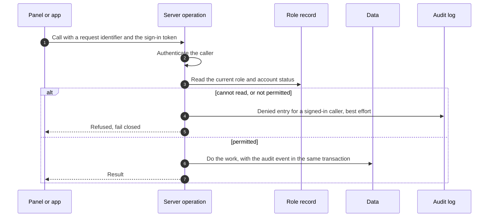
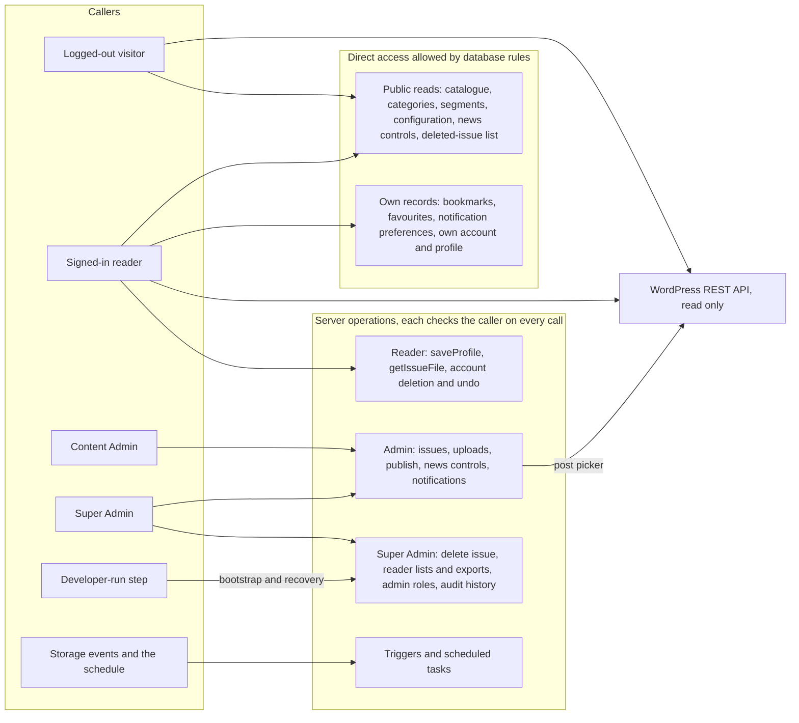

# API and Backend Contract: Metal Forming World (MFW) Mobile Application

## 1. Document Control, Purpose, Scope and Status

| Field | Detail |
|---|---|
| Document title | API and Backend Contract |
| File | `API_AND_BACKEND_CONTRACT.md`, in the same folder as `REQUIREMENTS_SPECIFICATION.md` |
| Project | Metal Forming World (MFW) mobile application |
| Version | 0.1 |
| Status | Draft for Review |
| Last updated | 23 October 2026 |
| Prepared by | MFW development team |
| Approval status | Not approved. No MFW or internal approval of this document has been recorded. The architecture is not approved by the charter (CH §17.4). |
| Related documents | [Requirements Specification](REQUIREMENTS_SPECIFICATION.md) v0.1; [Scope and Exclusions](SCOPE_AND_EXCLUSIONS.md) v0.1; [Assumptions and Constraints Register](ASSUMPTIONS_AND_CONSTRAINTS.md) v0.1; [Glossary](GLOSSARY.md) v0.1; [System Architecture](SYSTEM_ARCHITECTURE.md) v0.2; [Technology Decisions](TECHNOLOGY_DECISIONS.md) v0.2; [Database and Data Model](DATABASE_AND_DATA_MODEL.md) v0.2; [Security and Access Control](SECURITY_AND_ACCESS_CONTROL.md) v0.1; `PROJECT_CHARTER.md` v0.1 |

**Purpose.** This document says what the backend does for the app and the admin panel. For each operation it gives the caller, the inputs and outputs, the checks, the errors, the writes, the audit entry and the requirements behind it. It also fixes the conventions that every operation follows, the contract for reading MFW's WordPress site, the rules for changing a contract without breaking installed apps, and the tests that guard the contract.

**Scope.** The operations between the Flutter app, the admin panel, the backend and the systems the backend uses. It contains no code, no OpenAPI file, no schema code and no cloud configuration, and it creates no cloud resource. S2 does not ask for a public API (GS-D2), so this is the internal contract between the product's own parts.

**Status of the technology.** The core of this document is written without a vendor's terms. Section 11 maps it onto Firebase, which is the PROPOSED baseline (TD-03, CONFLICT C-05, not approved). Only Flutter (TD-01) is an accepted decision. Every vendor-specific detail is in Section 11 and is provisional. If another platform is chosen, only Section 11 changes.

**Change history**

| Version | Date | Change |
|---|---|---|
| 0.1 | 23 October 2026 | Initial draft. Written after the 17-question interview (GS-Q17 to GS-Q33) and a read-only review of MFW's public website (WEB). Decisions recorded here are team-accepted, with the requirement label PROVISIONAL and MFW written approval pending (GS-Q30). No requirement status in the specification changed. |

### 1.1 Sources and authority

| Ref | Source | Evidence status | Authority in this document |
|---|---|---|---|
| S1, S2 | MFW Mobile App Commercial Proposal and Statement of Work, 17 October 2026 | Read. Both copies are unsigned (REG-002). | S2 lists the product's capabilities and acceptance criteria. |
| S3 | Client emails received after S1 and S2 | Not available (REG-001). | Not used as evidence. Anything known only through the charter is PROVISIONAL. |
| CH | `PROJECT_CHARTER.md` v0.1 | Read. Draft for review, unsigned. | Working summary. It does not override S1 or S2. |
| SPEC | [Requirements Specification](REQUIREMENTS_SPECIFICATION.md) | Read. Draft for Review. | The requirement IDs and statuses, used as written. |
| TD, GS | [Technology Decisions](TECHNOLOGY_DECISIONS.md) | Draft for Review. | The decisions, and the interview answers GS-Q1 to GS-Q33 and the defaults GS-D1 to GS-D20. |
| ARCH | [System Architecture](SYSTEM_ARCHITECTURE.md) | Draft for Review. | The flows and the function list this document turns into a contract. |
| DM | [Database and Data Model](DATABASE_AND_DATA_MODEL.md) | Draft for Review. | The entities, invariants (INV-nn) and the access rules per entity. |
| SEC | [Security and Access Control](SECURITY_AND_ACCESS_CONTROL.md) | Draft for Review. | The permission rules, the audit policy and the security tests. This document refers to it and does not repeat it. |
| WEB | MFW's public website, https://metalformingworld.com/, read on 23 October 2026 | Observed. Not an approved source. | A reference for the WordPress contract (Section 7 and Appendix A). It does not change scope (INT-WP-002) and is not MFW's approval. |

S1, S2 and CH are named by file name and not linked, because they are not in this folder. Fees and personal names are left out, as in the specification. All sample values are fictional.

### 1.2 Status labels and identifiers

The status legend is the specification's: CONFIRMED, PROVISIONAL, ASSUMPTION, OPEN and CONFLICT. "Proposed" is a decision status for choices the development team recommends. "Team-accepted" is a decision status for a choice the developer who ran the interview recorded as accepted. The requirement label stays PROVISIONAL, MFW written approval is pending, and the other developer's agreement is not recorded (GS-Q30, REG-052). CONFIRMED is never used for a team-accepted decision.

| Prefix | Meaning | Defined in |
|---|---|---|
| OP-nn | An operation in this contract | Sections 4 to 6 |
| CT-nn | A contract test | Section 10 |
| FR, NFR, INT, BR, AC, DATA | Requirement IDs and S2 acceptance criteria | Specification Sections 5 to 10 |
| OQ, C, ASM | Open questions, conflicts, assumptions | Specification Section 12 |
| TD-nn, AOQ-nn, PRC-nn | Technology decision, architecture open question, proposed requirement change | [Technology Decisions](TECHNOLOGY_DECISIONS.md) |
| AR-nn | Architecture risk | [System Architecture](SYSTEM_ARCHITECTURE.md) §14 |
| INV-nn | Data invariant | [Database and Data Model](DATABASE_AND_DATA_MODEL.md) §10.8 |
| GS-Qnn, GS-Dnn | Interview answers and confirmed defaults | [Technology Decisions](TECHNOLOGY_DECISIONS.md) §10 |
| WEB | An observation on MFW's website | Section 1.1 and Appendix A |

### 1.3 How to read this document

An **operation** is a named thing the backend does for a caller. There are two kinds. A **server operation** is code that runs in the backend, checks the caller and does the work. A **direct operation** is a read or write that the database rules allow the caller to make on their own records or on public data, with no server code in between. Both are listed, so that a different platform can implement every one of them. Section 11 says which kind each operation is on Firebase.

## 2. Conventions

### 2.1 Contract format

Each operation is a short tree: who may call it, what goes in and out, the checks, the refusals, the writes, the audit entry, whether a repeat is harmless, and the requirements. The format is Markdown, not OpenAPI, and there is no public REST API (GS-D2, GS-D13). The operation names are working names, as in System Architecture §10.1. Field lengths and formats are proposals for testing.

```text
OP-nn operationName                              [kind; who may call it]
├── In: the inputs
├── Out: the outputs
├── Checks: what the backend verifies, in order
├── Refuses: the error category and reason code for each refusal
├── Writes: the entities changed
├── Audit: the audit action written, if any
├── Repeat: whether a repeated call is harmless
└── Requirements: the requirement IDs and decisions behind it
```

### 2.2 Callers

```text
Callers
├── Logged-out visitor        no sign-in. May use the public direct reads and the WordPress site
├── Reader                    signed in. May use the public reads, the operations on their own records, and the reader operations
├── Content Admin             a reader with an active Content Admin role record (PRC-01). May use the admin operations
├── Super Admin               a reader with an active Super Admin role record (PRC-01). May use every admin operation and the Super Admin operations
├── Storage event, schedule   the backend's own triggers. No human caller
└── Developer-run step        the controlled bootstrap and recovery step. Not an operation a client can call
```

### 2.3 Identity and authorisation

1. Every server operation authenticates the caller first.
2. An admin operation reads the caller's role record and account status on this call. It does not trust a role claim, a cached role or anything held by the client (GS-Q20, INV-08). The panel hides controls by role as a convenience only.
3. If the backend cannot verify the caller's current authorisation, the operation is refused and nothing changes. This is fail closed.
4. A reader whose account is pending deletion or being deleted is refused by every server operation except `cancelAccountDeletion` and `requestAccountDeletion`, and may still read their own account (OP-06) (GS-Q28). The direct operations on the reader's own records stay open to the owner, because rules do not look up the account status (whether they could is NOT VERIFIED, Section 11). The app shows only the undo screen, and those records are removed at the purge.
5. A privileged operation is an admin or Super Admin operation. A refusal of one for a signed-in caller writes a denied audit entry on a best-effort basis (GS-Q26, SEC §8).



### 2.4 Request identifiers and repeats

Every write operation carries a `request_id` that the client creates once per user action and reuses on every retry. The backend remembers it for a period (the length is OPEN) and returns the earlier result for a repeat, so a retry after a lost reply changes nothing and adds no second audit event (GS-D14, INV-07, M6). Direct writes are made repeat-safe by their keys (DM §10.1). Reads need no request identifier.

### 2.5 Errors

Every refusal carries a category, a stable reason code, and a plain message. The exact names are confirmed at implementation, as System Architecture §10.1 says (GS-D16).

```text
Error categories
├── unauthenticated        no valid sign-in
├── permission_denied      signed in, but not allowed: wrong role, or not the owner
├── failed_precondition    a rule is not met. The reason code says which: account_closed, email_not_verified,
│                          profile_incomplete, issue_not_available, no_current_file, no_accepted_file, not_unpublished,
│                          confirmation_mismatch, last_super_admin, recent_sign_in_required, target_account_closed,
│                          already_has_role, in_use, not_retryable, not_pending, already_deleting, target_not_available
├── invalid_argument       a value is missing or malformed. The reply names the fields
├── not_found              the thing does not exist
├── gone                   the issue was permanently deleted. Returned only for an identifier on the deleted-issue list (GS-Q24, GS-Q25)
├── conflict               a stale screen: the role or record is not what the caller saw (stale_role, stale_record)
├── resource_exhausted     a rate or size limit. The reply may carry a retry-after value
├── unavailable            a dependency cannot be reached, such as the WordPress site or the push service. Retry later
└── internal               an unexpected failure. Nothing was changed, or the change is repeatable (Section 2.4)
```

A rejected upload is not an error to the caller. It is reported on the upload job with the reason not_a_pdf, over_limit, uploader_not_authorised or cover_invalid (OP-40). The app maps each category and reason to the prompts in System Architecture §7.4 and to the states in FR-STATE-001 to FR-STATE-007 (ASSUMPTION).

### 2.6 Pagination

The catalogue is small and is fetched whole and filtered on the device (GS-D3, GS-D15). Admin lists use a cursor: the input is `page_size` and `cursor`, and the output is `items` and `next_cursor`. The largest page size is OPEN. News paging follows the WordPress site: 10 posts by default and 100 at most per request (VS-41, Section 7).

### 2.7 Rate limits and abuse

A limit is stated as a requirement for each class of operation. The mechanism is OPEN, because whether App Check is enabled for the backend is AOQ-10, and no number is invented (GS-D17). A refusal for a limit is `resource_exhausted`.

```text
Operation classes that need a limit             [mechanism OPEN (AOQ-10); no value is set]
├── File-link requests (getIssueFile)           a cap per reader per day, signed_url_requests_per_reader (ASSUMPTION)
├── Profile saves, deletion requests, undo
├── Admin writes and uploads
├── Reader-data lists and exports               Super Admin only
├── Notification sends and retries
├── Searching for a reader by email address     Super Admin only
└── Denied-attempt audit entries                a cap per caller, denied_audit_cap (GS-Q26)
```

### 2.8 Logging

Operation logs record the operation name, the caller's identifier and the outcome category. They never contain a signed link, a token, a password, an exported file or a reader's profile values (System Architecture §12.1). A signed link is a temporary credential and is neither stored nor logged (DM §9).

### 2.9 Identifiers and time

Identifiers are opaque, generated by the server and never reused, except the user identifier, which is the sign-in provider's (M10, INV-14). Timestamps are UTC. A request never carries an email address as a key.

## 3. Operations Overview



```text
Operations                                                   [team-accepted, PROVISIONAL, MFW written approval pending, unless a line says otherwise]
├── Public and reader data, direct access (Section 4)
│   ├── OP-01 listCatalogue                public read of published issues, categories and segments
│   ├── OP-02 getPublicConfig              public read of the public configuration
│   ├── OP-03 listDeletedIssues            public read of the deleted-issue list
│   ├── OP-04 listNewsControls             public read of the news controls
│   ├── OP-05 listNotificationCategories   public read
│   ├── OP-06 getMyAccount                 own account and profile
│   ├── OP-07 manageBookmarks              own bookmarks: add, remove, list
│   ├── OP-08 manageFavourites             own favourites: add, remove, list
│   └── OP-09 managePreferences            own notification preferences
├── Reader server operations (Section 4)
│   ├── OP-10 saveProfile
│   ├── OP-11 getIssueFile
│   ├── OP-12 requestAccountDeletion
│   └── OP-13 cancelAccountDeletion
├── Admin operations, Content Admin and Super Admin (Section 5)
│   ├── OP-14 getMyAdminRole
│   ├── OP-15 listIssuesForAdmin
│   ├── OP-16 saveIssue
│   ├── OP-17 saveCategory and OP-18 deleteCategory
│   ├── OP-19 requestUpload
│   ├── OP-20 listUploadJobs
│   ├── OP-21 publishIssue and OP-22 unpublishIssue
│   ├── OP-23 setNewsControl
│   ├── OP-24 listWordPressPosts
│   ├── OP-25 sendNotification and OP-26 retryNotification
│   ├── OP-27 listNotificationSends
│   └── OP-28 saveSegment and OP-29 saveNotificationCategory   [conditional on AOQ-16 and OQ-18]
├── Super Admin operations (Section 5)
│   ├── OP-30 deleteIssue
│   ├── OP-31 listRegisteredUsers, OP-32 exportRegisteredUsers and OP-33 exportSubscribers [conditional, CONFLICT]
│   ├── OP-34 searchUsersByEmail
│   ├── OP-35 grantAdminRole, OP-36 changeAdminRole and OP-37 revokeAdminRole
│   └── OP-38 listAdmins and OP-39 listAuditEvents
└── Triggered, scheduled and operator steps (Section 6)
    ├── OP-40 onUploadFinalized
    ├── OP-41 scheduledMaintenance
    └── OP-42 bootstrapSuperAdmin
```

## 4. Public and Reader Operations

### 4.1 Direct operations

These are reads and writes that the database rules allow, with no server code in between. The rules that allow them are in the [Security and Access Control](SECURITY_AND_ACCESS_CONTROL.md) document, Section 12.

```text
Direct operations
├── OP-01 listCatalogue                              [direct; anyone]
│   ├── In: none
│   ├── Out: the published issues, the issue categories and the industry segments
│   ├── Checks: none. The rules return only issues whose publication_state is published
│   ├── Writes: none
│   └── Requirements: FR-MAG-001 to FR-MAG-008, FR-SRCH-001 to FR-SRCH-005 (CONFIRMED); FR-MAG-009 (OPEN); OQ-13
├── OP-02 getPublicConfig                            [direct; anyone]
│   ├── Out: profile_required_fields, policy_versions, news_category_ids, min_supported_app_version
│   └── Requirements: FR-PROF-001 (PROVISIONAL); INT-WP-003 (CONFIRMED); PRC-04
├── OP-03 listDeletedIssues                          [direct; anyone, an ASSUMPTION (GS-D20)]
│   ├── Out: issue_id and deleted_at for each deleted issue
│   ├── Use: the app removes a downloaded copy whose identifier is on the list. It never removes one because an issue is missing
│   │   from a fetch (GS-Q24)
│   └── Requirements: DATA-013 (CONFIRMED); FR-DL-010 (OPEN); OQ-11; AOQ-19; GS-Q24, GS-Q25
├── OP-04 listNewsControls                           [direct; anyone]
│   ├── Out: wp_post_id, is_hidden and is_breaking for each controlled post
│   └── Requirements: DATA-009, FR-NEWS-008 (CONFIRMED); FR-NEWS-009 (OPEN)
├── OP-05 listNotificationCategories                 [direct; anyone]
│   ├── Out: the notification categories
│   └── Requirements: FR-NOTIF-002, FR-NOTIF-006 (CONFIRMED); OQ-18
├── OP-06 getMyAccount                               [direct; Reader, own records]
│   ├── Out: the account status and deletion dates, the profile, and the policy versions accepted
│   ├── Checks: the rules allow only the owner
│   └── Requirements: FR-PROF-006 (CONFIRMED); NFR-SEC-006 (ASSUMPTION)
├── OP-07 manageBookmarks                            [direct; Reader, own records]
│   ├── In: add (issue_id, page_number, file_revision), remove (bookmark_id), or list
│   ├── Checks: the rules allow only the owner (INV-11). page_number is at least 1. A bookmark for a missing issue is tolerated and
│   │   cleaned up later (INV-13)
│   ├── Repeat: harmless. The key is (user, issue, page)
│   └── Requirements: FR-BKM-001, FR-BKM-002, FR-BKM-004 to FR-BKM-006, NFR-SEC-005 (CONFIRMED); FR-BKM-007 (ASSUMPTION);
│       FR-BKM-008 (OPEN); OQ-10
├── OP-08 manageFavourites                           [direct; Reader, own records]
│   ├── In: add (issue_id), remove (issue_id), or list
│   ├── Checks: owner only (INV-11). Whether a reader without full access may favourite is OQ-12
│   ├── Repeat: harmless. The key is (user, issue)
│   └── Requirements: FR-BKM-003, FR-BKM-004 to FR-BKM-006, NFR-SEC-005 (CONFIRMED); OQ-12
└── OP-09 managePreferences                          [direct; Reader, own records]
    ├── In: add or remove a notification category, or list. The app also subscribes the device to the matching push topics (TD-13)
    ├── Checks: owner only (INV-11). The category exists and is active
    ├── Repeat: harmless. The key is (user, category)
    └── Requirements: DATA-007, FR-NOTIF-002, FR-NOTIF-003 (CONFIRMED); FR-NOTIF-007 (OPEN); OQ-09
```

### 4.2 Reader server operations

```text
Reader server operations
├── OP-10 saveProfile                                [server; Reader]
│   ├── In: request_id; the profile fields in the configured set; on the first call, the privacy-policy and terms-of-use versions accepted
│   ├── Out: the profile status, complete or the names of the missing fields
│   ├── Checks: authenticated; the account is active; every value is valid (trimmed, within length, in format); the accepted
│   │   versions equal the current versions in configuration
│   ├── Refuses: invalid_argument (field names); failed_precondition account_closed; unauthenticated
│   ├── Writes: APP_USER (created on the first call, with the caller's identifier), READER_PROFILE, CONSENT_RECORD (first call). The
│   │   email address is not copied
│   ├── Repeat: harmless. The profile is replaced, and a consent record is unique per user, document and version
│   ├── Offline: not queued. The app asks the reader to retry (System Architecture §7.2)
│   └── Requirements: FR-PROF-001 to FR-PROF-005, DATA-004 (PROVISIONAL); FR-PROF-006, FR-PRIV-001 (CONFIRMED); FR-PROF-007,
│       DATA-012 (ASSUMPTION); GS-Q23
├── OP-11 getIssueFile                               [server; Reader]
│   ├── In: issue_id
│   ├── Out: url, expires_at, revision, size_bytes, checksum_sha256
│   ├── Checks, in this order
│   │   ├── 0. If the identifier is on the deleted-issue list, the answer is gone
│   │   ├── 1. The caller is signed in
│   │   ├── 2. The account is active, not pending deletion or being deleted
│   │   ├── 3. The email is verified. Required for password accounts. For Google accounts it depends on AOQ-09
│   │   ├── 4. The profile is complete, checked only when the gate is on (BR-003)
│   │   ├── 5. The issue exists and is published
│   │   └── 6. A current file revision exists
│   ├── Refuses: unauthenticated; failed_precondition with account_closed, email_not_verified, profile_incomplete, issue_not_available
│   │   or no_current_file; gone; resource_exhausted
│   ├── Writes: none. The link is neither stored nor logged
│   ├── Repeat: each call issues a new link. A resumed or expired download calls again
│   ├── Also used when: a notification or a shared link leads to a full issue (BR-005)
│   └── Requirements: BR-002, FR-READ-001, FR-DL-002, FR-AUTH-010, NFR-SEC-002, INT-FILE-001 (CONFIRMED); BR-003, FR-PROF-004 (PROVISIONAL);
│       BR-005 (ASSUMPTION); AC-3; Section 8
├── OP-12 requestAccountDeletion                     [server; Reader, the account owner]
│   ├── In: request_id; mode, either grace (the default) or immediate; a confirmation flag (FR-PRIV-004)
│   ├── Out: the new state with the purge date for grace, or a confirmation that deletion has started for immediate
│   ├── Checks: authenticated; the account is the caller's own; not already deleting. If the caller is an active Super Admin, the
│   │   last-Super-Admin rule applies (INV-03)
│   ├── Effects, in one transaction: set APP_USER.status to pending_deletion (grace) or deleting (immediate); take the account out of
│   │   the active Super Admin count if it was one; remove any edition-update entry if that feature exists. Then end the caller's sessions
│   ├── Refuses: failed_precondition last_super_admin or already_deleting; unauthenticated
│   ├── Repeat: harmless. A repeat returns the same state, and immediate is allowed from pending_deletion
│   ├── After: the app removes its notification subscriptions and clears local data
│   └── Requirements: FR-AUTH-009, FR-PRIV-003 (CONFIRMED); FR-PRIV-004 (ASSUMPTION); NFR-PRIV-005 (OPEN); PRC-02; AOQ-02; GS-Q28
└── OP-13 cancelAccountDeletion                      [server; Reader, account pending deletion]
    ├── In: request_id
    ├── Out: the account is active again
    ├── Checks: authenticated; the status is pending_deletion
    ├── Refuses: failed_precondition not_pending or already_deleting
    ├── Writes: APP_USER (active, deletion fields cleared); the Super Admin count if the account was one
    ├── Repeat: harmless
    └── Requirements: FR-AUTH-009, FR-PRIV-003 (CONFIRMED); PRC-02; GS-Q28
```

**Sign-in during the grace window.** The reader must be able to sign in during the window to undo, so the backend does not disable the sign-in account then. The app's own status closes access instead: every server operation except `cancelAccountDeletion` and `requestAccountDeletion` is refused with `account_closed`, and the reader can still read their own account (OP-06). System Architecture §7.10 and TD-19 said that sign-in is disabled at the request. Version 0.2 of each corrects that wording (GS-Q28). The immediate option disables or deletes the sign-in account as the deletion proceeds.

## 5. Admin Operations

Every operation in this section follows Section 2.3: it authenticates the caller, reads the current role record and the account status on this call, and fails closed. "Admin" means a Content Admin or a Super Admin. A refusal for a signed-in caller writes a denied audit entry (GS-Q26). The panel never reads admin data directly. Every read is an operation here (GS-Q20).

### 5.1 Operations for both admin roles

```text
Admin operations                                      [Content Admin and Super Admin]
├── OP-14 getMyAdminRole                              [server; any signed-in reader]
│   ├── Out: role (none, content_admin or super_admin) and is_active
│   ├── Use: the panel shows or hides controls. It is never an authorisation. Every privileged operation checks again (GS-D20)
│   └── Requirements: FR-ADMIN-003 (CONFIRMED); GS-Q20
├── OP-15 listIssuesForAdmin
│   ├── In: an optional publication_state filter, page_size, cursor
│   ├── Out: a page of issues, including unpublished ones, with the current revision's facts
│   └── Requirements: FR-ADMIN-009, FR-MAG-008, NFR-SEC-007 (CONFIRMED); GS-Q20
├── OP-16 saveIssue
│   ├── In: request_id; issue_id (absent to create); title, description, category_id, segment_ids, publication_date, year, edition;
│   │   expected_updated_at when editing
│   ├── Checks: title and description are present; the category and segments exist; year defaults to the year of publication_date.
│   │   It cannot change publication_state, current_revision or the file facts
│   ├── Refuses: invalid_argument; not_found; conflict stale_record
│   ├── Writes: ISSUE, ISSUE_SEGMENT. Audit: none, because routine edits are not audited (GS-Q26)
│   ├── Repeat: harmless
│   └── Requirements: FR-ADMIN-009, FR-MAG-002 to FR-MAG-005, NFR-SEC-007 (CONFIRMED); OQ-13
├── OP-17 saveCategory and OP-18 deleteCategory
│   ├── In: request_id; category_id (absent to create), name, display_order. For delete, category_id
│   ├── Checks: the name is not empty and is unique ignoring case. A category in use cannot be deleted
│   ├── Refuses: invalid_argument; conflict; failed_precondition in_use
│   ├── Writes: ISSUE_CATEGORY. Audit: none
│   └── Requirements: FR-ADMIN-010, DATA-002 (CONFIRMED)
├── OP-19 requestUpload
│   ├── In: request_id; kind (pdf or cover); issue_id; declared_size_bytes; content_type
│   ├── Out: job_id, upload_url (signed, resumable, short-lived) and expires_at. The URL points to a holding area
│   ├── Checks: the issue exists; the size is within max_upload_bytes (150 MB by default); the content type is allowed. It serves a
│   │   first upload and a replacement (GS-Q21)
│   ├── Refuses: invalid_argument (size or type); not_found; resource_exhausted
│   ├── Writes: UPLOAD_JOB (pending). Audit: none here. A replacement is audited when it is accepted (OP-40)
│   ├── Repeat: harmless. The same request_id returns the same job
│   └── Requirements: FR-ADMIN-005, FR-ADMIN-007, NFR-SEC-008 (CONFIRMED); FR-ADMIN-008, FR-ADMIN-012 (OPEN); OQ-21, OQ-22, OQ-30
├── OP-20 listUploadJobs
│   ├── In: issue_id or job_id
│   ├── Out: the status and the reason for a rejection
│   └── Requirements: FR-ADMIN-006 (CONFIRMED); FR-STATE-007 (ASSUMPTION); GS-Q20
├── OP-21 publishIssue and OP-22 unpublishIssue
│   ├── In: request_id; issue_id
│   ├── Out: the issue with its new state
│   ├── Checks: for publish, in one transaction, the issue has an accepted current revision and has its title, description and
│   │   category (INV-02). A repeat of the same state succeeds and changes nothing
│   ├── Refuses: not_found; failed_precondition no_accepted_file
│   ├── Writes: ISSUE. Audit: issue_publish or issue_unpublish (INV-16)
│   └── Requirements: FR-ADMIN-011, FR-MAG-007, FR-MAG-008, NFR-SEC-007 (CONFIRMED); INV-02
├── OP-23 setNewsControl
│   ├── In: request_id; wp_post_id; is_hidden; is_breaking
│   ├── Checks: wp_post_id is a positive integer. A record with neither flag set may be removed
│   ├── Writes: NEWS_CONTROL. Audit: none. Repeat: harmless
│   └── Requirements: FR-ADMIN-013, FR-ADMIN-014, DATA-009 (CONFIRMED); FR-NEWS-009 (OPEN)
├── OP-24 listWordPressPosts
│   ├── In: page, per_page, an optional category filter
│   ├── Out: a page of posts (id, title, date, link, category identifiers) and the number of pages
│   ├── Refuses: unavailable when the site cannot be reached
│   ├── Note: the panel does not call the site itself, because cross-origin access from a browser was not researched (TD-12)
│   └── Requirements: FR-ADMIN-013 to FR-ADMIN-015, INT-WP-001 (CONFIRMED)
├── OP-25 sendNotification and OP-26 retryNotification
│   ├── In: request_id; for send, category_id, title, body, target_type (issue, news_post or none) and target_ref; for retry, send_id
│   ├── Out: send_id and the outcome (accepted, failed or unknown)
│   ├── Order for send: check the category and the link target (an issue must be published, a post must exist on the site); write
│   │   the record as pending; send to the category; mark the record accepted or failed
│   ├── Order for retry: the record must be failed or unknown. In one transaction set it to pending and add 1 to attempt_count;
│   │   then send and mark it. Nothing retries automatically (INV-17)
│   ├── Refuses: invalid_argument; not_found; failed_precondition target_not_available or not_retryable; conflict (another retry has
│   │   started); resource_exhausted; unavailable (the push service failed and the record is marked failed)
│   ├── Writes: NOTIFICATION_SEND. Audit: none, because the send record shows who sent it
│   ├── Repeat: harmless. The same request_id returns the same send_id
│   └── Requirements: FR-ADMIN-015 to FR-ADMIN-018, DATA-008 (CONFIRMED); INV-17; GS-Q27
├── OP-27 listNotificationSends
│   ├── In: an optional outcome filter, page_size, cursor
│   ├── Out: a page of send records, newest first
│   └── Requirements: FR-ADMIN-018 (CONFIRMED); OQ-19; GS-Q20
└── OP-28 saveSegment and OP-29 saveNotificationCategory      [conditional on AOQ-16 and OQ-18]
    ├── In: request_id; id (absent to create); name; display_order; is_active
    ├── Checks: the name is unique ignoring case. A value in use cannot be deleted, only made inactive
    ├── Writes: INDUSTRY_SEGMENT or NOTIFICATION_CATEGORY. Audit: none
    └── Requirements: FR-SRCH-003, FR-NOTIF-006 (CONFIRMED); AOQ-16; OQ-18
```

### 5.2 Operations for Super Admins only

A Content Admin who calls one of these is refused with `permission_denied` and a denied audit entry is written.

```text
Super Admin operations
├── OP-30 deleteIssue
│   ├── In: request_id; issue_id; confirmation, the value the Super Admin typed. The rule is that it equals the issue's title (a proposal)
│   ├── Out: confirmation of the deletion
│   ├── Checks: the caller is a Super Admin; the issue exists; it is unpublished (INV-15); the confirmation matches
│   ├── One transaction: delete the issue and its segment links, write the deleted-issue record, write the audit event
│   ├── Afterwards: remove the file revisions, the cover and the upload jobs. Orphan cleanup removes the readers' bookmarks and
│   │   favourites (DM §10.3)
│   ├── Refuses: permission_denied; not_found; gone (already deleted); failed_precondition not_unpublished or confirmation_mismatch
│   ├── Audit: issue_delete. Repeat: the same request_id returns the first result
│   └── Requirements: FR-ADMIN-012 (OPEN); OQ-21; OQ-11; INV-15, INV-16; GS-Q21, GS-Q22
├── OP-31 listRegisteredUsers
│   ├── In: page_size, cursor
│   ├── Out: a page of readers: user_id, email (from the sign-in provider), the profile fields and created_at. Accounts pending deletion are hidden
│   ├── Audit: reader_list_view, once per call, with result_count and no reader data
│   └── Requirements: FR-USER-002 (PROVISIONAL); NFR-PRIV-004 (ASSUMPTION); AOQ-05; GS-D6
├── OP-32 exportRegisteredUsers
│   ├── Out: a CSV built in memory and not stored. Cells that start with a formula character are neutralised
│   ├── Audit: reader_export, with result_count and no reader data
│   └── Requirements: FR-USER-003 (PROVISIONAL); NFR-PRIV-004 (ASSUMPTION); AOQ-05
├── OP-33 exportSubscribers                           [conditional; the list does not exist if OQ-31 drops it]
│   ├── Out: a CSV built in memory
│   ├── Audit: reader_export
│   └── Requirements: FR-USER-001 (CONFLICT); FR-EMAIL-001 (CONFLICT); DATA-010 (CONFLICT); OQ-31
├── OP-34 searchUsersByEmail
│   ├── In: an email address
│   ├── Out: the matching user_id, and the person's current role
│   ├── Audit: none (GS-D19). Rate limited (Section 2.7)
│   └── Requirements: PRC-01; FR-USER-005 (OPEN)
├── OP-35 grantAdminRole, OP-36 changeAdminRole and OP-37 revokeAdminRole
│   ├── In: request_id; target_user_id; the new role for grant and change; expected_previous_role for change and revoke
│   ├── Out: the role record
│   ├── Checks: the caller is a Super Admin by the record; the token is not revoked; the sign-in is recent (AOQ-14); for grant and
│   │   change the target is a registered reader whose account is active
│   ├── One transaction: read the guard record; check the last-Super-Admin rule (INV-03); check expected_previous_role (INV-07); write the
│   │   role record, the audit event and the guard record (INV-04)
│   ├── After the commit: end the target's sessions, with retry (INV-09). A failure there does not undo the change
│   ├── Refuses: permission_denied; not_found; failed_precondition recent_sign_in_required, target_account_closed or last_super_admin;
│   │   conflict stale_role
│   ├── Audit: role_grant, role_change or role_revoke. Repeat: the same request_id returns the first result
│   └── Requirements: FR-ADMIN-003 (CONFIRMED); FR-ADMIN-004 (CONFIRMED, in conflict with PRC-01); FR-USER-005, NFR-SEC-011 (OPEN);
│       EXC-07; PRC-01; INV-03 to INV-09; GS-Q19, GS-Q33
├── OP-38 listAdmins
│   ├── Out: every admin role record
│   └── Requirements: PRC-01; GS-Q19
└── OP-39 listAuditEvents
    ├── In: optional filters (action, actor, dates), page_size, cursor
    ├── Out: a page of audit events, newest first
    ├── Audit: none
    └── Requirements: PRC-01; NFR-SEC-011 (OPEN); AOQ-04; GS-Q26
```

## 6. Triggered, Scheduled and Operator Operations

```text
Triggered, scheduled and operator operations
├── OP-40 onUploadFinalized                           [trigger; a file arrives in the holding area]
│   ├── In: the uploaded object and its upload job
│   ├── Steps
│   │   ├── 1. Re-check the uploader's current role (INV-08)
│   │   ├── 2. Check that the file is a genuine PDF, not only by its name, and within the size limit. A cover goes through its own checks (OQ-22)
│   │   ├── 3. Move the file to the private path and remove it from the holding area
│   │   └── 4. In one transaction mark the old current revision superseded, write the new revision as current, set current_revision, the
│   │       size and the page count on the issue, and set the job to accepted (INV-01). For a replacement, write the audit event
│   │       file_replace in the same transaction (INV-16)
│   ├── Rejects (job rejected, object removed): upload_rejected, with the reason not_a_pdf, over_limit, uploader_not_authorised or cover_invalid
│   ├── Failure: if the database write fails after the move, an orphan file remains and cleanup removes it
│   └── Requirements: FR-ADMIN-006, FR-ADMIN-007, NFR-SEC-007, NFR-SEC-008 (CONFIRMED); FR-ADMIN-008, FR-ADMIN-012 (OPEN); INV-01, INV-08, INV-16
├── OP-41 scheduledMaintenance                        [schedule; runs under the backend's own credentials]
│   ├── Every task is repeatable. A run that stops part-way continues on the next run
│   ├── Daily: account purge, including deletions left in the deleting state (TD-19, GS-Q28); the holding area and finished upload
│   │   jobs; superseded revisions after their retention period
│   ├── Hourly (ASSUMPTION): the Super Admin count repair (INV-03); marking stale pending sends as unknown (INV-17)
│   ├── Weekly: orphaned reader records; orphaned user records
│   ├── Monthly: orphaned news controls; deleted-issue records past their retention period, if MFW sets one (AOQ-19)
│   └── Requirements: FR-PRIV-003 (CONFIRMED); PRC-02; DM §10.3
└── OP-42 bootstrapSuperAdmin                         [developer-run step; not an operation a client can call]
    ├── Who: MFW's authorised approver names the person in writing (the approver is not yet named, OQ-28). One developer runs the
    │   documented step under role-based access (NFR-SEC-012). The other developer verifies it (GS-Q33)
    ├── Precondition: the person has registered an ordinary reader account
    ├── Effects: create the Super Admin role record with a fixed marker as granted_by; create the guard record with a count of 1; write
    │   an audit event bootstrap_super_admin that holds the written reference
    ├── Guard: the step refuses to run while an active Super Admin exists, unless it is declared a recovery and carries the written
    │   reference. A recovery follows the same two-person procedure (GS-Q33)
    └── Requirements: FR-USER-005, NFR-SEC-011 (OPEN); NFR-SEC-012 (CONFIRMED); PRC-01; INV-03; GS-D4, GS-Q33; the procedure is in
        [Security and Access Control](SECURITY_AND_ACCESS_CONTROL.md) Section 7
```

## 7. WordPress Integration Contract

WordPress is the master source of news (DATA-015) and the project makes no change to the site (INT-WP-002). The app and the panel only read from it. The proposed access is option A of TD-12: the app calls the site directly and the backend reads it only for the panel's post picker. TD-12 is proposed and not approved. The observations on the site are in Appendix A.

```text
WordPress read contract                         [read only; TD-12 proposed; INT-WP-001 to INT-WP-005 (CONFIRMED)]
├── Direction and credentials
│   ├── The app sends HTTPS GET requests to the site's API and sends no credentials and no personal data (NFR-SEC-001)
│   ├── The admin panel does not call the site. It uses OP-24, because cross-origin access from a browser was not researched
│   └── The routes are the standard WordPress routes for posts and categories, observed under /wp-json/wp/v2/ (WEB)
├── List posts
│   ├── Request: a page number; a small page size (INT-WP-004); the category identifiers MFW selected (INT-WP-003); only the fields
│   │   the app needs; embedded media
│   ├── Documented limits: 10 posts by default and 100 at most per request, headers that give the total count and the page count, and a
│   │   modified-after filter (VS-41)
│   ├── Fields used: id, date, modified, slug, link, title, content, featured image and categories (INT-WP-005)
│   └── Result: the list is merged with the news controls (OP-04). Hidden posts are removed and breaking posts are flagged (FR-NEWS-008)
├── Get one post
│   └── The article page uses the cached post, or one request for the post by id
├── Categories
│   ├── The app filters the list by category (FR-NEWS-003) and shows only the categories MFW selects (INT-WP-003)
│   ├── The selected identifiers are configuration (news_category_ids). Which ones MFW selects is not yet known (REG-043)
│   └── Observed: only Industry News has posts (Appendix A)
├── Rendering
│   ├── Post content is HTML from MFW's site, shown by a sanitising renderer (TD-12). Scripts, styles, forms and embedded frames are not run
│   ├── Observed: the content of a sample post was page-builder markup of about 32 KB. How it looks in the app has to be tested with real
│   │   posts (recommendation, unverified). How embedded media is shown is OPEN (OQ-16)
│   └── Observed: the excerpt of the sample post began with the word "Home". The app should not show the site's excerpt as written until
│       that is settled (recommendation; the choice is unresolved)
├── Cache and offline
│   ├── Recent articles are cached on the device and stay readable offline with a notice (FR-NEWS-005)
│   └── Whether articles are saved by an explicit action or automatically, and how many are kept, is OPEN (OQ-16)
├── Failure
│   ├── If the site cannot be reached, the app shows the cached articles and a message (FR-STATE-005)
│   └── If the host throttles or blocks the app (CH R5), the design moves to a backend cache, which is option B of TD-12
├── Not used
│   └── Comments, the author, tags (none are in use) and the site's pages. The app does not write to the site
└── Unresolved, for MFW
    ├── The host's capacity and whether the API stays reachable (REG-042)
    ├── Which categories the app shows (INT-WP-003, REG-043)
    └── How a breaking post is shown (OQ-17)
```

## 8. File Delivery Contract

```text
File delivery
├── Download of an issue (OP-11)
│   ├── The link: one object, the current revision; read-only; short-lived. The lifetime is signed_url_lifetime, and 60 minutes is an
│   │   ASSUMPTION (AOQ-07)
│   ├── Needed from the file store: byte-range reads on the issued link, so that a broken download can resume (FR-DL-006). This is
│   │   unproven (AR-01) and is the subject of the TD-09 proof plan
│   ├── The app: checks the size and checksum (FR-READ-010); moves the file to private app storage; adds a registry row; asks for a
│   │   new link after expiry
│   └── The link is a temporary credential. It is never stored in the database and never logged (DM §9)
├── Upload of an issue file or a cover (OP-19, OP-40)
│   ├── The panel uploads to a holding area through a signed, resumable, short-lived URL. Nothing in the holding area is readable by readers
│   ├── Validation is done by the backend and not only by the panel (NFR-SEC-008): a genuine PDF, the size limit (150 MB by default,
│   │   OQ-30), and the cover rules (OQ-22, OPEN)
│   ├── An accepted PDF moves to the private area at a path that includes its revision, so a revision's path is never overwritten
│   └── A replacement adds the next revision. Readers keep what they downloaded and see an updated badge (DM §6.2)
├── Covers
│   ├── A cover is in the public-read area and anyone can fetch it by its address (GS-D7)
│   └── Before publication a cover is reachable by anyone who knows its address. Addresses are opaque (AOQ-20)
└── The website's copy of an issue
    ├── The same issue may be public on MFW's website as a separate object that WordPress owns (WEB)
    ├── This contract never serves, links to or depends on that copy. The app's file store is the only source the app uses (GS-Q32)
    └── The check in OP-11 controls the app's copy only (AOQ-18). The [Security and Access Control](SECURITY_AND_ACCESS_CONTROL.md)
        document says what the gate is for
```

## 9. Compatibility, Versioning and the Update Gate

Installed apps stay on old versions for months, and the two developers change the backend independently. This policy keeps a change to a contract from breaking an installed app. It is team-accepted (GS-Q29), with the requirement label PROVISIONAL. Only the update gate (Section 9.6) is a proposed addition to S2 scope that needs MFW's agreement. Nothing in this section exists yet (Section 9.8).

### 9.1 Backward compatibility by default

```text
Compatibility rules
├── Additive changes, allowed without ceremony
│   ├── A new optional input field, with a default that keeps the old behaviour
│   ├── A new field in a response or a document
│   ├── A new operation
│   ├── A new reason code, and a new value in an enumeration that a response returns
│   └── Condition: clients ignore unknown fields and treat an unknown reason code or enumeration value as the generic case for its
│       category. The app must implement this, and CT-04 tests it
└── Breaking changes, which need Section 9.2
    ├── Removing or renaming an operation, a field or a reason code
    ├── Changing a field's type, meaning or unit
    ├── Making an optional input required, or tightening validation so a request that was valid now fails
    ├── Changing the error category for an existing situation
    ├── Changing who may call an operation, or the order or guarantee a client relies on
    └── Changing a stored document so that an installed app can no longer read it
```

### 9.2 Breaking changes need a record and an approval

No breaking change is made until a compatibility record exists. The record is the pull request that makes the change plus an entry in the change history of this document.

```text
Compatibility record for a breaking change
├── What changes: the operation or field, and the old and new behaviour
├── Why: the rationale, and what was considered instead
├── Impact: the assessment in Section 9.3
├── Migration plan: the steps and the order (Section 9.5)
├── Rollout and rollback: what is deployed first, how it is undone (Section 9.5)
├── Minimum supported app version: needed or not, and the value when it is set (Section 9.6)
└── Approval: both developers (CH §17.4). MFW's authorised approver as well, if scope, cost or an S2 acceptance criterion changes
    (the change process in the scope document). No other approver is created here
```

### 9.3 Compatibility assessment

```text
Assessment checklist                                   [answer each line in the record]
├── Android app versions in the field, and iOS app versions in the field
├── Cached data: the database cache, the cached catalogue, the article cache and the deleted-issue list
├── Authentication: sign-in methods, token contents, and the account states the backend checks
├── Offline reading: a downloaded issue and its registry row must stay readable after the change (FR-DL-007)
├── Admin operations: a panel left open in a browser may be older than the backend
└── Integrations: the WordPress site, push topics and the sign-in provider
```

### 9.4 Versioning

```text
Versioning
├── Operations are addressed by name. No version number is placed in an address, and no URL scheme is invented for callable functions
├── A breaking change gets a new operation name, and the old operation stays until its removal criteria are met (Section 9.7)
├── Stored data has schema_version in configuration (DM §10.5)
├── The WordPress API has the site's own version, which this project does not control
└── Where a platform offers versioning of its own, it is adopted in the mapping (Section 11). None is assumed
```

### 9.5 Migration and rollout

```text
Rollout of a breaking change
├── 1. Deploy the new operation next to the old one, so both work
├── 2. Release an app version that uses the new operation
├── 3. Keep both for a compatibility period. Its length is OPEN, and no period is set here
├── 4. When MFW agrees, raise the minimum supported app version (Section 9.6)
├── 5. Remove the old operation when its removal criteria are met (Section 9.7)
├── Rollback before step 5: stop using the new operation. The old one is still there
├── Rollback of a backend release: redeploy the previous release from source control. The previous release must still read the data
└── Data changes: additive steps first, a backup and a tested restore before any destructive step (DM §10.5)
```

### 9.6 The update gate (PRC-04)

```text
Update gate                                            [team-accepted (GS-Q29), PROVISIONAL, MFW agreement pending; a proposed addition to S2 scope]
├── Setting: min_supported_app_version in the public configuration (OP-02). No value is set
├── Behaviour: an app whose version is lower shows an update-required screen with a link to its store listing (which link is OQ-15)
├── Offline: the app uses the last value it read. What the gate does to reading downloaded issues offline is OPEN and is decided before
│   the gate is built
├── Limit: the gate stops only app versions that contain it, so it has to be in the first release if it is wanted
├── Not verified: whether the app stores restrict or review forced updates (Technology Decisions §9.4, item 23)
└── Effort: not estimated here
```

### 9.7 Deprecation

```text
Deprecation record
├── Affected: the operation or field
├── Replacement: the operation or field that takes its place
├── Migration guidance: what each client changes, and from which app version
├── Removal criteria: no supported app version still calls it. A version is supported when it is at or above the minimum supported
│   app version once PRC-04 exists. Until then the developers and MFW agree a date in writing
└── Steps: mark it deprecated in the change history, add the replacement, keep the old one, remove it only when the criteria are met,
    and record the removal with the same approval as a breaking change
```

### 9.8 Approval and implementation status

```text
Status of this policy
├── Decision: team-accepted (GS-Q29). Requirement label PROVISIONAL. MFW written approval pending for the update gate (PRC-04)
├── Not CONFIRMED: no source document or MFW approval establishes it
├── Built: nothing. The repository holds no code, because the project is in the documentation stage
├── Does not exist yet: a versioning scheme, contract tests, deprecation records, the update gate and any enforcement of a minimum version
└── Effort: the PRC-01 estimate and any other estimate do not include this policy
```

## 10. Contract Tests

These tests are proposed. None is written, and none has been run. They run against the emulators in continuous integration where that is possible (TD-17). The permission and security tests are in [Security and Access Control](SECURITY_AND_ACCESS_CONTROL.md) §14.

```text
Contract tests                                         [proposed; none exists]
├── CT-01 Contract snapshot         each operation's inputs, outputs, error categories and reason codes are kept as a reference file.
│                                   A change that removes or renames anything fails the build
├── CT-02 Old-client replay         recorded requests from each released app version are replayed against the current backend, and each
│                                   still gets a valid answer
├── CT-03 Additive check            adding an optional field or a new operation passes. Making an optional input required fails
├── CT-04 Tolerant reader           the app ignores unknown response fields and treats an unknown reason code or enumeration value as the
│                                   generic case for its category
├── CT-05 Error stability           each refusal returns its documented category and reason code
├── CT-06 Repeats                   replaying a write with the same request_id returns the first result, adds no record and adds no
│                                   second audit event
├── CT-07 Authorisation             for every operation, a signed-out caller, a reader, a Content Admin, a Super Admin and a revoked admin
│                                   each get the documented answer
├── CT-08 Update gate               an app below the minimum version shows the update-required screen. An app at or above it does not. With
│                                   no value set, nothing is gated
├── CT-09 WordPress shape           the app handles a missing field, an extra field, an empty list and an unreachable site
├── CT-10 Cached data               an app updated from the previous release still reads its cached catalogue, bookmarks and downloads
└── CT-11 Deprecation               a deprecated operation still works until its removal criteria are met
```

## 11. Firebase Mapping (PROVISIONAL)

Everything in this section is PROVISIONAL. Firebase is the proposed baseline (TD-03, CONFLICT C-05), and each service is proposed and not approved. The sections above do not change if another platform is chosen. Only services named in the project's documents are mapped.

```text
Firebase mapping                                       [PROVISIONAL; TD-03 proposed, CONFLICT C-05]
├── Cloud Firestore (TD-07)
│   ├── Direct operations OP-01 to OP-09 under security rules. The collections are in DM §12
│   └── Rules deny by default (SEC §12)
├── Firebase Authentication (TD-06)
│   ├── Email and password (FR-AUTH-001 to FR-AUTH-004), and Google Sign-In (FR-AUTH-005, PROVISIONAL; OQ-06)
│   ├── The provider's user identifier is user_id. The email address is read from the provider and not copied (GS-Q5)
│   └── No role is carried in a sign-in claim (GS-Q20)
├── Cloud Functions, TypeScript (TD-04)
│   ├── Server operations OP-10 to OP-39 as callable functions, the upload trigger OP-40, and one scheduled function OP-41
│   │   (the scheduler's free allowance is three jobs per account, VS-14)
│   ├── A callable function receives the caller's sign-in identity. It still reads the role record on every call (INV-08)
│   ├── The Admin SDK bypasses security rules (TD-03), so each function checks the caller itself
│   └── Errors map to the callable error codes: unauthenticated, permission-denied, failed-precondition, not-found, invalid-argument,
│       resource-exhausted, unavailable and internal. The exact names are confirmed at implementation. The reason code travels in
│       the error details. gone is carried as not-found with the reason gone (an assumption)
├── Cloud Storage (TD-08, TD-09)
│   ├── A private area, a public cover area and a holding area. Rules deny every direct client read of the private area
│   ├── V4 signed URLs for downloads and for resumable uploads. A storage-finalised event starts OP-40
│   └── Resume on a signed URL is unproven (AR-01)
├── Firebase Cloud Messaging (TD-13)
│   └── One topic per notification category. OP-25 sends to a topic. No device token is stored by the backend
├── Firebase Hosting (TD-14, TD-18)
│   └── Serves the React admin panel. It is not an API
├── Crashlytics (TD-16)
│   └── Crash reports only. It is not an operation. Analytics collection is off (GS-Q10)
└── App Check (AOQ-10)
    └── Open. Not assumed
```

```text
Firebase constraints and verification gaps
├── Transactions and uniqueness
│   ├── Firestore is not assumed to enforce references or uniqueness. The mechanisms are in DM §10.8
│   └── How transactions behave when two changes touch one record is NOT VERIFIED (Technology Decisions §9.4, item 20)
├── Security rules
│   ├── Rules do not join across collections, and the admin reads that needed a role lookup are functions instead (GS-Q20)
│   └── How many documents a rule may read, and whether a rule can see a revoked token, are NOT VERIFIED (item 21). Nothing relies on them now
├── Server-side authorisation
│   └── Every function checks the caller on every call, because the Admin SDK ignores rules (TD-03)
├── Signed URLs
│   ├── Whether a V4 signed URL honours the Range header is NOT VERIFIED (item 6, AR-01)
│   └── A link cannot be withdrawn before it expires (AR-06)
├── Queries and indexes
│   └── Composite indexes are validated against the platform before they are relied on (DM §18)
├── Callable function limits
│   └── Request size, response size and run time limits were not researched. An export built in memory (OP-32) may need another route if the user list grows
├── Push
│   ├── An accepted send is not a delivery (NFR-REL-003)
│   └── Whether a repeated send reaches devices twice is NOT VERIFIED (item 22)
└── Stores
    └── Whether the stores restrict or review a forced update is NOT VERIFIED (item 23)
```

## 12. Traceability

```text
Decisions to operations
├── GS-Q18 Neutral core with a Firebase mapping        Sections 2 to 10 are neutral. Section 11 is the mapping
├── GS-Q19 Two admin roles                             OP-14, OP-35 to OP-39, OP-42
├── GS-Q20 Admin reads through functions               OP-14, OP-15, OP-20, OP-24, OP-27, OP-31, OP-38, OP-39
├── GS-Q21 Replace a PDF, delete an issue              OP-19, OP-30, OP-40
├── GS-Q22 Only a Super Admin deletes                  OP-30
├── GS-Q23 Working profile list                        OP-10
├── GS-Q24 Downloaded copies                           OP-03, OP-11
├── GS-Q25 Deleted-issue list, opaque identifiers      OP-03, OP-11, OP-30
├── GS-Q26 Audit set                                   OP-21, OP-22, OP-30 to OP-33, OP-35 to OP-37, OP-40, OP-42, and a denied entry on every privileged operation
├── GS-Q27 Notification send                           OP-25, OP-26, OP-27, OP-41
├── GS-Q28 Account deletion with a window              OP-12, OP-13, OP-41
├── GS-Q29 Compatibility and the update gate           Sections 9 and 10, and OP-02
├── GS-Q30 Labels                                      Section 1.2
├── GS-Q31 Taxonomy                                    OP-01, OP-17, OP-28, Section 7 and Appendix A
├── GS-Q32 Channel policy                              OP-11, Section 8 and Appendix A
└── GS-Q33 Bootstrap and recovery                      OP-42
```

```text
S2 acceptance criteria and the operations behind them
├── AC-1 Publish and find an issue                     OP-01, OP-16, OP-19, OP-21
├── AC-3 Sign-in gate and account deletion             OP-10, OP-11, OP-12, OP-13
├── AC-4 Download, resume, read offline                OP-11 and Section 8
├── AC-5 Bookmarks and favourites                      OP-07, OP-08
├── AC-7 News                                          Section 7, OP-04
├── AC-8 Admin panel                                   OP-14 to OP-27, OP-31 to OP-33
├── AC-9 Notifications                                 OP-05, OP-09, OP-25 to OP-27
└── AC-12 Handover                                     This document and the other documents in the set
```

## 13. Open Questions and Verification Gaps

```text
Open items
├── For MFW
│   ├── OQ-09, OQ-11, OQ-13, OQ-16, OQ-17, OQ-18, OQ-19, OQ-21, OQ-22, OQ-24, OQ-27, OQ-30, OQ-31
│   ├── FR-USER-005 and NFR-SEC-011 (OQ-20), AOQ-04, AOQ-05, AOQ-16, AOQ-18, AOQ-19
│   ├── PRC-01, PRC-02, PRC-03 and PRC-04, which need MFW's written approval
│   └── Which news categories the app shows (INT-WP-003, REG-043), and the host's capacity (REG-042)
├── For the development team
│   ├── AOQ-07 (link lifetime), AOQ-09 and AOQ-08 (linking), AOQ-10 (App Check), AOQ-13, AOQ-14 (recent sign-in), AOQ-20 (covers)
│   ├── How long a request identifier is remembered, the largest page size, and every rate-limit value
│   ├── The rule for the typed confirmation in OP-30
│   └── What the update gate does to offline reading of downloaded issues
└── Not verified
    ├── Technology Decisions §9.4 items 6, 7, 12, 16, 20 and 21, and the new items 22 and 23
    └── The limits of callable functions
```

## Appendix A. Website Observations

The observations come from a read-only review of MFW's public website on 23 October 2026 (WEB). They describe the existing product. They are a reference only. They do not change the approved scope, they are not MFW's approval, and they create no requirement. Facts, recommendations and unresolved items are kept apart. Nothing was downloaded, and the only request for a file was a header-only request for one PDF.

```text
Website observations (WEB)                             [observed 23 October 2026; read only]
├── Pages read
│   ├── https://metalformingworld.com/ (home), /about/, /industry-news/, /contact/ and /april-may-2026-issue/
│   ├── The section pages /industry-watch/, /hall-of-fame/, /world-gateway/, /case-studies/, /innovators/, /project-updates/,
│   │   /product-view/ and /event-coverage/, and /news/
│   └── The public WordPress API under /wp-json/wp/v2/ (posts, categories, tags, pages, media, types, taxonomies), and /robots.txt
├── Facts observed
│   ├── Platform: WordPress with the Elementor page builder. A footer credit names Globbuzz Media Private Limited. The names of the
│   │   plugins listed by the API suggest Hostinger hosting with LiteSpeed caching. That is an inference (REG-042)
│   ├── Menu: Home, About, News, one issue link, Contact, and a Subscribe link that goes to the Contact page. The News menu lists
│   │   nine section pages. The footer link "News" goes to /news/, which returns "Page not found". The social icons have no link targets
│   ├── Issues: three issue pages are published: April-May 2026 (21 April), June-July 2026 (30 June) and August-September 2026
│   │   (15 August). The menu links only April-May. The April-May page shows a flipbook of a PDF and holds no category, description,
│   │   cover, segment or edition number. The other two pages were not opened
│   ├── PDFs: they are media uploads. April-May is 7.7 MB and 28 pages. August-September is 15.3 MB, with smaller variants of 9.2 and
│   │   9.6 MB. The largest is 15.3 MB, against the 150 MB limit. The media list returned 5 PDFs while its header said 7, and none was
│   │   for June-July
│   ├── Public access: a header-only request for the April-May PDF returned 200 with no sign-in. The file supports byte ranges and
│   │   may be cached publicly for about 31 days. Only that file was tested
│   ├── Cadence: the editorial calendar on /about/ lists 8 issues for 2026-27. April-May, June-July, August-September and
│   │   October-November 2026, then December 2026, January, February and March 2027 as single months. The published issues are
│   │   two-monthly, and the later ones are not
│   ├── News: the API holds 11 posts, all in Industry News and dated 16 to 21 March 2026. None is newer. The three posts checked
│   │   each have a title, date, modified date, slug, link, one author, a featured image and a category. No tags are in use. The sample
│   │   post allows comments
│   ├── Categories: 10 flat categories. Only Industry News has posts
│   ├── Content: the sample post's body was about 32 KB of page-builder markup, and its excerpt began with the word "Home"
│   ├── Industries and editorial themes: see the Database and Data Model, Appendix B
│   └── Sign-up: the home page has a Name and Email form with a Sign Up button. What it does with the data is unknown
├── Differences from the app requirements
│   ├── The site holds no per-issue metadata, so the admin panel enters it
│   ├── The brief describes about one issue every two months, and the site's calendar is not uniformly two-monthly
│   ├── The site labels issues by period and shows no edition number (OQ-13)
│   ├── The site has no marker for breaking news (OQ-17)
│   ├── The issue PDFs are public on the site, and the app requires sign-in (AOQ-18)
│   ├── The news is thin and the newest post is from March 2026
│   └── The footer link "News" is broken
├── Recommended
│   ├── Treat the site as a reference. Do not change the app's scope because of it
│   ├── Taxonomy: as in the Database and Data Model, Appendix B (PROVISIONAL)
│   └── WordPress contract: as in Section 7
└── Unresolved, for MFW
    ├── Whether the public PDFs on the website are meant to stay public (AOQ-18). Only one was tested
    ├── Which news categories the app shows (INT-WP-003, REG-043)
    ├── The host's capacity (REG-042), and what the sign-up form does (OQ-31)
    └── Cover images: none were seen on the issue page that was opened (OQ-22)
```
