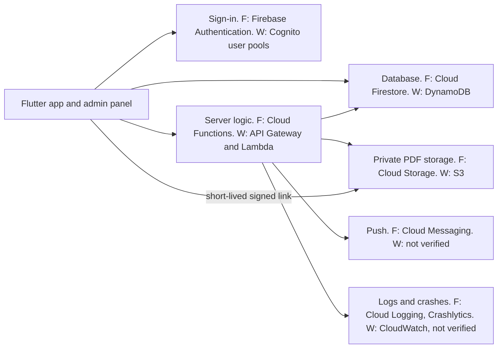

# Cloud Infrastructure and Costs: Metal Forming World (MFW) Mobile Application

## 1. Document Control

| Field | Detail |
|---|---|
| Document | Cloud Infrastructure and Costs |
| File | `Documentation/CLOUD_INFRASTRUCTURE_AND_COSTS.md` |
| Version | 0.2 |
| Status | Draft for review. Not approved. A comparison of candidates and a parameterised cost model. No provider is chosen, because DEC-003 is OPEN. Every price is a vendor figure read on the date shown. Every amount is planning arithmetic, not a quotation. |
| Date | 27 October 2026 |
| Audience | The two developers. MFW's authorised approver only for the decisions in section 22. |
| Proposed owner | Yuvraj, as drafter and primary editor. PROPOSED and not agreed. Reviewer: Sanika Attarde, whose workstream (WS-A) holds MFW's cloud project and accounts (`TASK_OWNERSHIP_MATRIX.md` section 5). |
| Approval required | Both developers (CH §17.4). MFW's written approval for any cost, scope or contract effect: the provider, the region, the cost ceiling and any content delivery network. This document asks MFW for nothing. |
| Sources | `TECHNOLOGY_DECISIONS.md` TD-03 to TD-09, TD-13, TD-14, TD-16, TD-18, TD-19, TD-22 and section 9; `SYSTEM_ARCHITECTURE.md` sections 9, 13 and 14; `DECISION_LOG.md` DEC-003, DEC-004, DEC-023, DEC-031; `OPEN_QUESTIONS.md`; `RISK_REGISTER.md` R14; `BACKUP_AND_RECOVERY.md`; `DEPLOYMENT_PLAN.md` section 4; `DEPENDENCY_REGISTER.md`; S1 "Costs outside the fee"; S2 "Proposed technical architecture"; the vendor pages in Appendix A |

**Change history**

| Version | Date | Change |
|---|---|---|
| 0.1 | 25 October 2026 | Initial draft. This is the document that `TASK_OWNERSHIP_MATRIX.md` section 13.3 lists as planned and blocked by DEC-003. It is written while DEC-003 is still OPEN, as a comparison of candidates and a parameterised model. It does not decide DEC-003, and it does not lift the block on a single-provider cost model. It is written on top of commit 4769de3, so the identifiers it cites are those of that commit. |
| 0.2 | 27 October 2026 | Three stale mentions updated: the stored data no longer lists an audit log, the scheduled job covers maintenance and not only the withdrawn purge window (PRC-02), and the effort note names the withdrawn two-role figure (PRC-01) and the unestimated in-panel add and remove (GS-Q44). No price, scenario or provider choice changed. |

### 1.1 Related documents

| Document | Status on 25 October 2026 |
|---|---|
| `MFW_Statement_of_Work.pdf` (S2) "Proposed technical architecture", "Why this design", AC-12 | Exists, issued, unsigned (OQ-28). Names Firebase. |
| `MFW_Commercial_Proposal-2.pdf` (S1) "Costs outside the fee" | Exists, issued, unsigned. Cloud usage is billed to MFW directly. |
| `REQUIREMENTS_SPECIFICATION.md` (RS) | Exists, draft. Requirements are quoted by ID and not restated. |
| `TECHNOLOGY_DECISIONS.md`, `SYSTEM_ARCHITECTURE.md` | Exist (draft). Own the options (TD-03, TD-22), the vendor evidence of 23 October (section 9) and the first cost scenarios (section 13). |
| `DECISION_LOG.md`, `OPEN_QUESTIONS.md`, `RISK_REGISTER.md` | Exist (draft). Own DEC-003, DEC-031, OQ-41, OQ-53 and R14. |
| `DEPLOYMENT_PLAN.md`, `BACKUP_AND_RECOVERY.md`, `DEPENDENCY_REGISTER.md` | Exist (draft). Own the environments, the backup proposals and the service candidates. |
| `SECURITY_AND_ACCESS_CONTROL.md`, `DATABASE_AND_DATA_MODEL.md`, `API_AND_BACKEND_CONTRACT.md` | Exist (draft). Own access rules, data and operations. |
| `TASK_OWNERSHIP_MATRIX.md` | Exists (draft). Section 13.3 names this document. |

Status labels follow RS §1.2 and `DECISION_LOG.md` section 3.1. **PROPOSED** marks a development-team proposal. **NOT VERIFIED** means that no check was run, or that the page read did not give the figure. A figure is "read" only when section 3 and Appendix A name the page and the date.

## 2. Purpose, Scope and Status

**Purpose.** The repository holds cost drivers and four download scenarios (`TECHNOLOGY_DECISIONS.md` section 9, `SYSTEM_ARCHITECTURE.md` section 13). It holds no cost model, and its figures for a database, server functions, backups and sign-in were NOT VERIFIED. This document gathers the infrastructure the requirements call for, compares the candidates on record, adds vendor prices read from official pages on 25 October 2026, and sets out a model that turns workload inputs into a monthly amount. It answers R14 as far as the evidence allows without a provider decision.

**Scope.** Cloud infrastructure and the money MFW pays for it. Not in scope: development fees, MFW's commercial terms, application code, and any step that creates a cloud resource.

```text
Who owns what
├── Options and the decision        TECHNOLOGY_DECISIONS TD-03, TD-22; DECISION_LOG DEC-003, DEC-031
├── Vendor evidence of 23 October   TECHNOLOGY_DECISIONS section 9 (not edited here)
├── First download scenarios        SYSTEM_ARCHITECTURE section 13.3 (reused here, same volumes)
├── Backup proposals, RPO, RTO      BACKUP_AND_RECOVERY (this document adds unit rates only)
├── Environments                    DEPLOYMENT_PLAN section 4, TD-18, DEC-023
└── This document adds
    ├── The cost model: inputs, formulas, scenarios, sensitivity
    ├── A comparison of two candidates with prices read on 25 October 2026
    └── Open items that the cost question raises (CL-01 to CL-07)
```

### 2.1 Status statements

```text
What this document is and is not
├── Provider            Unresolved. DEC-003 stays OPEN until the evidence in DECISION_LOG section 3.1 is recorded:
│                       both developers agree, and MFW approves in writing if the choice differs from S2,
│                       changes the S2 M3 or AC-12 wording, or adds third-party cost (CH §17.4)
├── Amounts             Planning estimates on stated inputs. Not a quotation, not a budget, not a contractual commitment.
│                       No amount here has been seen or approved by MFW
├── Region, location,   Subject to TD-22 (DEC-031, OQ-41), the security documents and CH §17.4.
│   security, approval  Nothing here settles them
└── Provisioning        Creating this document creates no cloud project, bucket, database, account or billing plan
```

No decision in this document is marked AGREED, APPROVED or ANSWERED. Where an existing register records a status, it is quoted as recorded.

## 3. Sources, Evidence and Method

### 3.1 Sources

```text
Evidence, strongest first
├── S1 and S2 (issued, unsigned)         Firebase named as the proposed backend; cloud usage billed to MFW; Apple and Google fees
├── Requirements and registers           RS, DECISION_LOG, OPEN_QUESTIONS, ASSUMPTIONS_AND_CONSTRAINTS (REG-037, REG-038)
├── Design documents (drafts)            TECHNOLOGY_DECISIONS, SYSTEM_ARCHITECTURE, DEPLOYMENT_PLAN, BACKUP_AND_RECOVERY
├── Vendor pages read on 25 October      Appendix A, CV-01 to CV-15
└── Vendor pages read on 23 October      TECHNOLOGY_DECISIONS section 9.2, VS-01 to VS-43. Used where this document says so.
                                         Not re-read on 25 October: VS-05 to VS-09, VS-11, VS-19 to VS-24, VS-32 to VS-39
```

### 3.2 Reading codes

| Code | Meaning |
|---|---|
| B | Read in the built-in browser from the rendered page. Where the page has a region selector, it was set to the region named (Mumbai, asia-south1 or Asia Pacific (Mumbai)) and the table was read after the change. |
| T | Page text read without a region selector. |
| F | Free-tier text only. The rates were not read. |

### 3.3 Method

- Cost of an item is a vendor unit price times the usage in the model. Usage inputs are in section 4, and the formulas are in sections 8 to 14 and 17.
- Amounts are in USD, as the vendor pages state them, rounded to the cent. INR is a parameter (section 17.4). No exchange rate is assumed.
- The scenario volumes are those of `SYSTEM_ARCHITECTURE.md` section 13.3, so the two documents agree. One 150 MB issue is taken as 0.14 GiB.
- Every amount in sections 10, 17 and 19 was recomputed by a script from the inputs above and the Appendix A figures. The script is not part of the repository.

### 3.4 Limits of this evidence

1. Vendor prices and plan rules change. The Cloud Storage plan requirement changed in 2026 (VS-03). Every figure here has a read date, and none is a promise.
2. The pages were read once, on one day, through a page-reading tool with a region selector. A selector can fail to update a table. The Mumbai rows were checked against the selector's displayed value.
3. Taxes are not included in any figure. The AWS pages say their prices exclude applicable taxes. Whether GST applies to MFW's bills, and in which currency MFW is billed, is NOT VERIFIED (CL-01).
4. Free allowances differ between pages of the same vendor (Appendix B, item 6). The model uses the lower figure where it matters.
5. S2 says an AWS-based design was considered and judged to need more parts and more time (DEC-003). It does not list the services. The AWS mapping in section 6 is this document's illustration, built from serverless services so that prices can be compared. It is not an S2 design and has not been reviewed.
6. The AWS Price List host was refused by the browser pane and was not used. AWS figures come from the pricing pages only.
7. Prices for a PostgreSQL-based managed backend (TD-03 option B) and for self-hosting were not researched. They stay NOT VERIFIED.

## 4. Workload and Usage Assumptions

| ID | Input | Value used | Source and status |
|---|---|---|---|
| WI-01 | Monthly active users | Fewer than 1,000 | ASSUMPTION from the development team's brief. CH §6 says no volume target was agreed (`SYSTEM_ARCHITECTURE.md` G4, `TECHNOLOGY_DECISIONS.md` P1). MFW's ceiling and volume: OQ-53. |
| WI-02 | Size of one issue | Up to 150 MB, about 120 pages. Taken as 0.14 GiB. | NFR-STOR-001, ASSUMPTION (S2 ASM-01). The upper bound, so the scenarios overstate cost if issues are smaller. |
| WI-03 | Issues live | Five to twelve. At launch the latest issue and four to six archive issues. | NFR-STOR-002, ASSUMPTION. FR-MAG-004, CONFIRMED. |
| WI-04 | Stored volume | About 2 GiB live. 4 GiB as an upper bracket for replaced and soft-deleted revisions. | `SYSTEM_ARCHITECTURE.md` section 13.2 (ranks 2 and 3). ASSUMPTION. |
| WI-05 | Downloads per reader per month | In no source. Scenarios A to D carry the values 1, 1, 3 and 7. | `SYSTEM_ARCHITECTURE.md` section 13.3. ASSUMPTION. No scenario is called expected. |
| WI-06 | Delivery model | Whole-file download, no content delivery network | NFR-STOR-003, ASSUMPTION (S2 ASM-15). A CDN needs MFW's written approval (CHG-05). |
| WI-07 | Database operations per reader | In no source | Unit rates only (section 8). The design aims to stay inside the free allowance and measures reads in test builds (TD-07). |
| WI-08 | Function invocations | About one per download, plus sign-in, admin and scheduled actions. Roughly ten functions. | TD-04, TD-09. The count is in no source. |
| WI-09 | Push sends | In no source | Unit rates only (section 12). |
| WI-10 | Log volume | In no source | Unit rates only (section 13). |
| WI-11 | Environments | ENV-LOCAL, ENV-TEST (the development project), ENV-PROD and a throwaway project for AC-12 | TD-18, DEC-023, `DEPLOYMENT_PLAN.md` section 4. PROPOSED. |
| WI-12 | Admin panel traffic | Editors only | TD-14. |
| WI-13 | Billing currency and tax | USD in the pages read. MFW's billing currency and tax treatment are NOT VERIFIED. | CL-01 |

## 5. Infrastructure Requirements

```text
What the requirements call for, whatever the provider
├── Identity
│   ├── Email and password sign-in, Google Sign-In, verified email, account deletion from the app (FR-AUTH-001 to FR-AUTH-004, FR-AUTH-009)
│   └── One trusted source for reader and admin identities (TD-06)
├── Data
│   ├── Catalogue, profiles, bookmarks, favourites, preferences, send records, admin roles, the narrow change record (DATA-001 to DATA-012)
│   └── Access enforced on the backend (NFR-SEC-002, NFR-SEC-005, NFR-SEC-007)
├── Files
│   ├── Private issue PDFs of up to 150 MB, with five to twelve issues live (NFR-SEC-003, NFR-STOR-001, NFR-STOR-002)
│   ├── Public cover images (FR-MAG-002)
│   └── Resumable, authorised download of a whole file (FR-DL-006, NFR-SEC-002)
├── Server logic
│   └── Upload checks, access issuing, notification sending, account deletion, admin role changes, one scheduled purge (TD-04, TD-09, TD-15, TD-19)
├── Push                  Category topics to Android and iPhone (INT-PUSH-001, TD-13)
├── Admin web hosting     The only web interface (FR-ADMIN-001, TD-14)
├── Observability         Crash reports and basic usage events inside NFR-PRIV-003 (NFR-OBS-001, NFR-OBS-002)
├── Backup                Proposed, not required by S1 or S2 (OQ-46)
├── Environments          Development, production and a throwaway project (TD-18)
└── Ownership             MFW's project, MFW's billing, role-based access for developers (REG-037, REG-038, NFR-SEC-012)
```

## 6. Candidate Cloud Architectures

### 6.1 Candidates on record

```text
Candidates
├── Evidence in DEC-003
│   ├── Firebase, as proposed in S2
│   └── An AWS-based design, which S2 "Why this design" says needs more parts and more time, with no benefit at launch volumes
├── Options in TD-03
│   ├── A  Firebase (the proposed baseline)
│   ├── B  A PostgreSQL-based managed backend such as Supabase       method only here, prices not researched
│   ├── C  A custom API on a major cloud with managed PostgreSQL    method only here, prices not researched
│   └── D  Self-hosting on MFW's WordPress host                     rejected in TD-03
└── Modelled in this document
    ├── Candidate F  Firebase on Google Cloud, a proposed mapping (TD-03 option A)
    └── Candidate W  An AWS-based design, an illustrative mapping (this document's own, see section 3.4, item 5)
```

### 6.2 One logical architecture, two mappings



### 6.3 Mapping

| Capability | Basis | Candidate F | Candidate W (illustration) | Required or optional |
|---|---|---|---|---|
| Sign-in | TD-06, FR-AUTH-001 | Firebase Authentication | Cognito user pools, Essentials tier | Required |
| Database | TD-07, DATA-001 to DATA-012 | Cloud Firestore, Standard edition | DynamoDB on-demand | Required |
| Private files | TD-08, NFR-SEC-003 | Cloud Storage for Firebase | S3 Standard | Required |
| File access | TD-09 | Function-issued V4 signed URL | Pre-signed URL from a function (not researched) | Required |
| Server logic | TD-04 | Cloud Functions, billed as Cloud Run functions | API Gateway HTTP API and Lambda | Required |
| Push | TD-13, INT-PUSH-001 | Firebase Cloud Messaging | SNS mobile push, rate NOT VERIFIED. A Firebase project may still be needed for Cloud Messaging (CL-02). | Required |
| Admin hosting | TD-14, FR-ADMIN-001 | Firebase Hosting | A static site on S3, with or without CloudFront. Rates NOT VERIFIED. | Required |
| Crash reports | NFR-OBS-001, TD-16 | Crashlytics | Crashlytics needs a Firebase project (CL-02) | Required |
| Usage events | NFR-OBS-002, OQ-23 | Analytics, off until OQ-23 | Not mapped | Required by S2, held back by OQ-23 |
| Logs | TD-16 | Cloud Logging | CloudWatch Logs, rate NOT VERIFIED | Required in practice |
| Scheduled maintenance | TD-19 | Cloud Scheduler, one job | A scheduler service, not researched | Required for orphan clean-up and for finishing a deletion that stopped part-way (OP-41, GS-Q50) |
| Secrets | TD-18 | Secret Manager | Not researched | Required in practice |
| Backups | OQ-46 | Firestore scheduled backups, point-in-time recovery | DynamoDB point-in-time recovery, on-demand backup | PROPOSED |
| Admin multi-factor | AOQ-03 | Identity Platform upgrade | Cognito, SMS rate not read | OPEN |
| Content delivery network | CHG-05, NFR-STOR-003 | Not researched | CloudFront flat-rate plans read (CV-15) | Not in S2. Needs MFW's written approval. |

### 6.4 Candidate F: Firebase on Google Cloud (proposed mapping, not an approved architecture)

```text
Candidate F
├── Required services          Authentication, Firestore, Cloud Storage, Cloud Functions, Cloud Messaging, Hosting, Crashlytics
├── Optional or conditional    Analytics (after OQ-23), Identity Platform upgrade for admin multi-factor (AOQ-03),
│                              Firestore backups and point-in-time recovery (OQ-46), App Check (AOQ-10),
│                              Secret Manager, Cloud Scheduler (one purge job), a CDN (not researched)
├── Known costs (read 25 October 2026)
│   ├── Internet egress from Cloud Storage to Asia, first 10 TiB     USD 0.12 per GiB (CV-03)
│   ├── Standard storage, Mumbai                                      USD 0.000027397 per GiB-hour, about USD 0.02 per GiB-month (CV-03)
│   ├── Firestore, Mumbai, Standard edition                           reads 0.035, writes 0.104, deletes 0.012 per 100,000; storage 0.104 per GiB-month (CV-02)
│   ├── Functions                                                     2 million invocations free, then USD 0.40 per million (CV-01); compute in section 11
│   └── Backups and recovery                                          section 14
├── Estimated costs            Egress and storage only (section 17). Everything else is inside the free allowances at the volumes in the repository, or not estimated.
├── Free-tier assumptions
│   ├── Cloud Storage no-cost quotas apply only to buckets in us-central1, us-west1 and us-east1 (CV-01). A Mumbai bucket pays from the first byte.
│   ├── Firestore: 50,000 reads, 20,000 writes and 20,000 deletes a day, 1 GiB stored, 10 GiB a month of outbound transfer (CV-01, CV-02)
│   └── Authentication: no cost up to 50,000 monthly active users (CV-01, CV-05)
├── Unverified prices          Cloud Storage and Firestore rates for US regions, App Check beyond its quotas, Google Cloud CDN, TOTP multi-factor, Artifact Registry above 500 MB
├── Regional constraints       Locations of the database and the bucket cannot be changed after creation (VS-21, VS-23). Mumbai is listed for Firestore (CV-02) and Cloud Storage (CV-03). Whether the Firebase console offers it is NOT VERIFIED (TD-22).
├── Vendor limitations         Cloud Storage and Cloud Functions need the pay-as-you-go plan (VS-02, VS-03). The Admin SDK bypasses rules, so each function checks the caller.
├── Migration and lock-in      High for the database model and sign-in accounts. Low for PDFs (TD-03). A migration route for password accounts was not researched.
└── Decisions needed           DEC-003, TD-22 (AOQ-01), AOQ-11 (OQ-53), AOQ-15, DEC-023 (OQ-40), OQ-23, AOQ-03
```

### 6.5 Candidate W: an AWS-based design (illustrative mapping, not an S2 design)

```text
Candidate W
├── Required services          Cognito, DynamoDB, S3, API Gateway with Lambda, a push service, static admin hosting, crash reporting
├── Optional or conditional    CloudFront (CHG-05), DynamoDB point-in-time recovery, multi-factor, a scheduler, a secret store
├── Known costs (read 25 October 2026)
│   ├── S3 Standard storage, Mumbai                                   USD 0.025 per GB-month, first 50 TB (CV-09)
│   ├── S3 requests                                                   PUT, COPY, POST, LIST USD 0.005 per 1,000; GET and others USD 0.0004 per 1,000 (CV-09)
│   ├── Internet egress from S3, first 10 TB                          USD 0.1093 per GB after the first 100 GB a month (CV-09)
│   ├── Lambda, x86                                                   USD 0.20 per million requests and USD 0.0000166667 per GB-second (CV-10)
│   ├── API Gateway HTTP API                                          USD 1.05 per million requests (CV-13)
│   ├── DynamoDB on-demand, Mumbai                                    USD 0.71 per million write units, 0.1425 per million read units, 0.285 per GB-month (CV-12)
│   └── Cognito                                                       free to 10,000 monthly active users, then USD 0.015 per user (CV-11)
├── Estimated costs            Egress and storage only (section 17)
├── Free-tier assumptions
│   ├── The first 100 GB a month of internet egress is free, aggregated across all AWS services and regions (CV-09). It is shared with any other AWS use on the account.
│   ├── Lambda: 1 million requests and 400,000 GB-seconds a month (CV-10)
│   └── API Gateway: no standing monthly allowance on the page read. New customers get credits for six months (CV-13).
├── Unverified prices          SNS mobile push, CloudWatch Logs, S3 pre-signed URL behaviour with Range, a scheduler, a secret store, static hosting, the CloudFront pay-as-you-go rate for India,
│                              whether Cognito prices differ by region
├── Regional constraints       Mumbai (ap-south-1) was the region read. The 100 GB egress allowance does not depend on the region of the bucket.
├── Vendor limitations         More services to configure and test than candidate F (S2 "Why this design"). A Firebase project may still be needed for Crashlytics and Cloud Messaging (CL-02).
├── Migration and lock-in      Not researched. The thin data layer (NFR-MAINT-005) would limit it. DynamoDB's model is vendor-specific.
└── Decisions needed           DEC-003, CHG-04 (a design that differs from S2 needs MFW's written approval), TD-22, AOQ-11, AOQ-15, CL-02
```

### 6.6 Other options

TD-03 option B (a PostgreSQL-based managed backend) and option C (a custom API on a major cloud with managed PostgreSQL) are not priced. To price either, these inputs are needed: the plan tiers and included allowances, the price of a managed database by size, object storage and egress rates, the price of the compute that runs the API, and any rate for authentication. Option D is rejected in TD-03 (the host's capacity is unknown, REG-042). Nothing here ranks B or C.

## 7. Authentication and Authorization Dependencies

```text
Cost of sign-in and access checks
├── Candidate F
│   ├── Email and Google sign-in: no cost up to 50,000 monthly active users (CV-01, CV-05)
│   ├── Above 50,000: USD 0.0055 per user from 50,000 to 100,000, then USD 0.0046 (CV-05)
│   ├── Admin multi-factor (AOQ-03): needs the Identity Platform upgrade (VS-32, VS-33)
│   │   ├── SMS and multi-factor messages are charged per SMS. India: USD 0.07 per SMS. The first ten SMS a day are not billed (CV-05)
│   │   └── The page read does not mention a time-based code option. Its rate is NOT VERIFIED.
│   └── App Check (AOQ-10): no cost, subject to quotas that vary by attestation provider (CV-01). Setup cost NOT VERIFIED.
├── Candidate W
│   ├── Cognito Lite and Essentials: free to 10,000 monthly active users. Above that USD 0.015 per user, as the page's own example prices it (CV-11)
│   ├── Multi-factor with authenticator apps and SMS is listed in every tier (CV-11). The SMS price was not read.
│   └── No free tier for the Plus tier (CV-11)
└── Either candidate
    ├── Storage rules that read database documents bill those reads (VS-11)
    ├── Each admin function reads the role record on every call (AOQ-17, answered by proposal), so admin use adds database reads
    └── At fewer than 1,000 monthly active users both free tiers are far from used. The sign-in decisions are not cost decisions.
```

Dependencies. The provider decision (DEC-003) sets the sign-in product (TD-06). OQ-04, OQ-05 and OQ-06 (account linking, App Store sign-in rule) are not cost questions and are not answered here. The earlier two-role admin model (PRC-01, withdrawn) was estimated at about 7 to 11 person-days of development-team effort (AR-05). In-panel add and remove of admins (GS-Q44) has not been estimated. Neither is a cloud cost, and neither is counted here.

## 8. Database and Metadata Storage

| Item | Candidate F: Firestore, Mumbai, Standard edition (CV-02) | Candidate W: DynamoDB on-demand, Mumbai (CV-12) |
|---|---|---|
| Reads | USD 0.035 per 100,000 documents, USD 0.35 per million. Free: 50,000 a day. | USD 0.1425 per million read request units. The free tier lists provisioned capacity, not on-demand units. |
| Writes | USD 0.104 per 100,000, USD 1.04 per million. Free: 20,000 a day. | USD 0.71 per million write request units |
| Deletes | USD 0.012 per 100,000. Free: 20,000 a day. | Counted as writes (NOT VERIFIED) |
| Stored data | USD 0.104 per GiB-month. Free: 1 GiB. | USD 0.285 per GB-month. Free: 25 GB. |
| Unit of work | A document read | A request unit (read: up to 4 KB, NOT VERIFIED on the page read) |

The two columns are not like for like. A Firestore read and a DynamoDB read unit measure different things, so the rates cannot be compared line by line.

```text
Formula, candidate F (the free allowance is daily, so pooling it over 30 days understates the cost of a busy day)
database cost = max(0, reads - 50,000 x days) / 100,000 x 0.035
              + max(0, writes - 20,000 x days) / 100,000 x 0.104
              + max(0, deletes - 20,000 x days) / 100,000 x 0.012
              + max(0, stored GiB - 1) x 0.104

Scale checks (illustrative arithmetic, not forecasts)
├── 50,000 free reads a day is about 50 reads for each of 1,000 users, every day
├── 20,000 free writes a day is about 20 writes for each of 1,000 users, every day
├── 3 million reads in a 30-day month: USD 0.53 beyond the 1.5 million free
└── 10 million reads in a 30-day month: USD 2.98 beyond the 1.5 million free
```

The database is not a cost driver at the volumes the repository assumes. Reads per session, writes per session and database size are in no source (WI-07). Test builds measure them (TD-07, CL-04). The Mumbai Firestore rates close item 1 of `TECHNOLOGY_DECISIONS.md` section 9.4. Backup and recovery rates are in section 14.

## 9. Magazine PDF Storage and Delivery

| Item | Candidate F: Cloud Storage, Mumbai | Candidate W: S3, Mumbai |
|---|---|---|
| Storage, Standard | USD 0.000027397 per GiB-hour, about USD 0.02 per GiB-month (CV-03) | USD 0.025 per GB-month, first 50 TB (CV-09) |
| Write operations | Class A USD 0.005 per 1,000 (CV-03) | PUT, COPY, POST, LIST USD 0.005 per 1,000 (CV-09) |
| Read operations | Class B USD 0.0004 per 1,000 (CV-03) | GET and others USD 0.0004 per 1,000 (CV-09) |
| Free allowance | None in Mumbai. No-cost quotas only in us-central1, us-west1, us-east1 (CV-01). | Storage: none stated on the page read. Egress: section 10. |
| Delete and replace | Soft delete on by default, seven days, still billed (VS-05, not re-read) | Not researched |
| Access to a private file | V4 signed URL, longest life seven days (VS-07, not re-read) | Pre-signed URL, not researched |
| Resume with a signed link | NOT VERIFIED (AR-01). The TD-09 proof plan has not been run. | NOT VERIFIED, not researched |

```text
Formulas
├── storage cost per month   = stored GiB x 0.0200 (candidate F, Mumbai)   or   stored GB x 0.025 (candidate W)
├── at 2 GiB and at 4 GiB    F: USD 0.04 and USD 0.08          W: USD 0.05 and USD 0.10
└── operations cost          = downloads x reads per download / 1,000 x 0.0004, plus uploads / 1,000 x 0.005
                             negligible at these volumes (one or a few reads per download, TD-08)
```

The 4 GiB bracket and the 2 GiB base are WI-04. Cover images are small and public (FR-MAG-002). Whether a cover for an unpublished issue is held privately until publication is open (AOQ-20). Neither changes the cost at this scale.

## 10. Download Traffic and Egress Costs

Egress is the only item with real spend in every scenario. Each download is a whole file of up to 150 MB with no CDN (NFR-STOR-003).

```text
Formula
monthly egress cost = max(0, N x k x s - F) x P
where
  N  readers who download in the month
  k  issues each reader downloads in the month
  s  size of one issue in GiB (0.14 for 150 MB)
  F  free egress allowance in GiB for the month (0 if none applies)
  P  price per GiB for internet egress
Candidate F, Mumbai bucket       F = 0     P = 0.12       first 10 TiB a month, to Asia destinations (CV-03)
Candidate F, US bucket           F = 100   P = 0.12       the 100 GB no-cost quota applies only in us-central1, us-west1, us-east1 (CV-01)
Candidate W, Mumbai bucket       F = 100   P = 0.1093     first 10 TB a month; the 100 GB is shared across the AWS account (CV-09)
Candidate W, allowance used up   F = 0     P = 0.1093
```

### 10.1 Scenarios A to D

Volumes are those of `SYSTEM_ARCHITECTURE.md` section 13.3. USD per month, egress only.

| Scenario | Readers who download | Issues each | Downloads | Volume (GiB) | F, Mumbai bucket | F, US bucket with the allowance | W, Mumbai, shared allowance | W, Mumbai, allowance used up |
|---|---|---|---|---|---|---|---|---|
| A | 300 | 1 | 300 | 42 | 5.04 | 0.00 | 0.00 | 4.59 |
| B | 1,000 | 1 | 1,000 | 140 | 16.80 | 4.80 | 4.37 | 15.30 |
| C | 1,000 | 3 | 3,000 | 420 | 50.40 | 38.40 | 34.98 | 45.91 |
| D | 1,000 | 7 | 7,000 | 980 | 117.60 | 105.60 | 96.18 | 107.11 |

The F columns agree with `SYSTEM_ARCHITECTURE.md` section 13.3. The W columns are new. Scenario D is an upper bound for a launch month: every reader takes the latest issue and six archive issues. Scenario A is a low case. No scenario is called expected, because no source gives downloads per reader (WI-05). An expected case needs MFW's answer to OQ-53 or measured use.

### 10.2 What one download costs

```text
Per download of one 150 MB issue (0.14 GiB)
├── Candidate F, Mumbai bucket              USD 0.0168
├── Candidate W, beyond the allowance       USD 0.0153
└── A resumed transfer that restarts from zero (AR-01) costs up to the same again for each restart
```

### 10.3 Levers

| Lever | Effect | Status |
|---|---|---|
| Smaller PDFs | Cost falls in proportion (section 19.1) | A suggestion to MFW. The size is MFW's choice. |
| Bucket location, candidate F | A US bucket gains the 100 GB quota. That is worth at most USD 12 a month, but is farther from readers and cannot be changed (TD-22). | OPEN (TD-22) |
| The 100 GB egress allowance, candidate W | Applies in Mumbai. Shared with any other AWS use. | As the page states it |
| CloudFront flat-rate plan | The Pro plan is USD 15 a month and lists 50 TB of data transfer (CV-15). Against S3 direct egress with the shared allowance it would save about USD 19.98 a month in scenario C and about USD 81.18 in D, and S3 direct egress passes USD 15 at about 237 GiB a month. Whether a flat-rate plan may serve private signed-link PDFs is NOT VERIFIED (CL-03). | A CDN needs MFW's written approval (CHG-05). Not researched for candidate F. |
| Limit on signed-link requests per reader | Caps abuse and repeat downloads | ASSUMPTION (`SYSTEM_ARCHITECTURE.md` section 13.5) |
| Re-verify prices before MFW sees them | Prices and plan rules change | CL-05 |

## 11. Backend Functions and API Costs

| Item | Candidate F (CV-01, CV-04) | Candidate W (CV-10, CV-13) |
|---|---|---|
| Requests | USD 0.40 per million. First 2 million a month free. | Lambda USD 0.20 per million, first 1 million free. API Gateway HTTP API USD 1.05 per million, no standing allowance. |
| Compute | USD 0.000024 per vCPU-second and USD 0.0000025 per GiB-second (Cloud Run request-based billing, Tier 1, Mumbai) | USD 0.0000166667 per GB-second on x86, first 400,000 GB-seconds free |
| Compute allowance | Differs between two pages (section 3.4, item 4) | One page |
| Deployment | Cloud Build 120 minutes a day free, then USD 0.003 a minute. Container storage 500 MB free, then "Google Cloud pricing" (CV-01). | Not researched |
| Outbound network from functions | 5 GB a month free, then USD 0.12 per GB (CV-01) | Not researched |
| Per million API calls beyond all allowances, requests only | USD 0.40 | USD 1.25 (0.20 plus 1.05) |

```text
Formula, candidate F
function cost = max(0, invocations - 2,000,000) / 1,000,000 x 0.40
              + max(0, vCPU-seconds - allowance) x 0.000024
              + max(0, GiB-seconds  - allowance) x 0.0000025
Candidate W, per million calls = 0.20 + 1.05 = 1.25, plus Lambda compute; 100,000 API calls cost USD 0.105 at the API Gateway rate
```

The invocation count (WI-08) is in no source. The design keeps functions to privileged actions, about one call per download (TD-09), and the bytes do not pass through a function. Scheduled sends are excluded (EXC-04). The compute allowance question is CL-07.

## 12. Push Notifications

```text
Cost of push
├── Candidate F
│   ├── Cloud Messaging: no cost, no quota stated (CV-01)
│   ├── One topic per category (TD-13). Limits: 2,000 topics per app instance, 3,000 subscription changes a second (VS-34, not re-read)
│   └── iPhone delivery needs an APNs key from MFW's Apple Developer account (VS-36, INT-PUSH-002). The account fee is in section 17.3.
├── Candidate W
│   ├── SNS mobile push rate and any free allowance: NOT VERIFIED (not read)
│   └── Cloud Messaging may still be the sender for Android, which needs a Firebase project (CL-02)
└── Delivery time depends on Apple and Google and is not guaranteed (NFR-REL-003)
```

## 13. Logging, Monitoring and Crash Reporting

| Item | Candidate F | Candidate W |
|---|---|---|
| Crash reports | Crashlytics, no cost (CV-01) | Crashlytics needs a Firebase project (CL-02) |
| Usage events | Analytics, no cost. Collection stays off until OQ-23 (TD-16). | Not mapped |
| Function and platform logs | Cloud Logging: first 50 GiB per project a month free, then USD 0.50 per GiB, which includes 30 days of storage (CV-07) | CloudWatch Logs: the free tier lists 5 GB a month. The rate is NOT VERIFIED (CV-14). |
| Retention beyond the default | USD 0.01 per GiB-month beyond 30 days (CV-07) | Not read |
| Billing alerts | Google Cloud lets an owner set monthly budgets and alerts (the Firestore pricing page, CV-02, says so) | Not read |

Logs are proposed to record security events without personal data and without signed URLs (TD-16, and step E of the TD-09 proof plan). Log volume (WI-10) is in no source, so no log cost is estimated. MFW sets billing alerts in its account (R14, mitigation). The alert recipient is OQ-47.

## 14. Backup and Recovery Costs

Every backup frequency, retention period, RPO and RTO is PROPOSED in `BACKUP_AND_RECOVERY.md` and needs MFW's approval (OQ-46). This section adds unit rates only.

| Item | Candidate F: Firestore, Mumbai (CV-02) | Candidate W: DynamoDB, Mumbai (CV-12) |
|---|---|---|
| Scheduled or on-demand backup | USD 0.035 per GiB-month | USD 0.114 per GB-month warm, USD 0.0342 cold |
| Point-in-time recovery | USD 0.1731 per GiB-month. No allowance. Seven days (VS-20). | USD 0.228 per GB-month |
| Restore | USD 0.23 per GiB | USD 0.171 per GB (warm backup) |
| Clone | USD 0.208 per GiB | Not applicable |
| Retention limits | One daily and one weekly schedule, up to 14 weeks (VS-19, not re-read) | Not researched |
| Storage objects | Soft delete seven days, billed. Versioning is off by default and would add cost (VS-05, VS-06, not re-read). | Not researched |

```text
Formula, candidate F
backup cost per month = database GiB x (0.035 + 0.1731)          when scheduled backups and point-in-time recovery are both on
                      = database GiB x 0.2081
```

Database size is in no source (WI-07), so no amount is given. At 1 GiB the formula gives USD 0.21 a month. The rates for Firestore backups and recovery close item 4 of `TECHNOLOGY_DECISIONS.md` section 9.4. A deleted reader's data stays in backups until retention ends, and a restore must re-apply deletions (TD-19, AOQ-02). Whether MFW keeps master copies of the PDFs is OQ-46. Storage and operations for backups are cloud usage billed to MFW (`BACKUP_AND_RECOVERY.md` section 11).

## 15. Development, Staging and Production Environments

```text
Environments (PROPOSED, TD-18, DEC-023; needs MFW's approval because a second project may add cost)
├── ENV-LOCAL   Emulators on the developers' machines. No cloud cost.
├── ENV-TEST    The development project, in MFW's name. Fictional data only (DEC-024). Owner and payer OPEN (AOQ-15, OQ-40).
├── ENV-PROD    The live project. Owned and paid by MFW (REG-037, REG-038, CONFIRMED).
├── Throwaway   One project, used once to prove a clean-copy deployment (AC-12). Owner and payer OPEN (AOQ-15).
└── Staging     Not proposed. TD-18 option B adds upkeep for a small team and would add a project to pay for.
```

Cost effects:

1. Each project that uses Cloud Storage or Cloud Functions needs billing switched on (VS-02, VS-03). Each such project needs a billing account to pay it.
2. Cloud Scheduler gives 3 jobs a month free per billing account, counted across all projects on the account (CV-06). One purge job in each of three projects is three jobs. Projects on separate billing accounts get separate free jobs. Which billing accounts are used is CL-06.
3. Test traffic is real traffic. Ten test downloads of a 150 MB file are 1.4 GiB, about USD 0.17 on candidate F with a Mumbai bucket. The TD-09 proof plan repeats and breaks downloads, so its cost grows with the number of runs, at about USD 0.0168 for each full 150 MB download.
4. Real reader data is never held in the development project (TD-18).
5. The continuous-integration service is a separate cost, not a cloud cost. It is not read (DEP-61, `TECHNOLOGY_DECISIONS.md` section 9.4 item 15).

## 16. Security and Data-Location Considerations

```text
Where the cost and the security questions meet
├── Location is set once
│   ├── Database and bucket locations cannot be changed after creation (VS-21, VS-23)
│   ├── Mumbai is listed as a Firestore location (CV-02) and a Cloud Storage location (CV-03)
│   ├── The legal position on where personal data is held was not assessed, and no source requires a location (TD-22)
│   └── Candidate F, bucket in Mumbai, pays egress from the first byte. Candidate W's allowance does not depend on the bucket region.
├── Private files
│   ├── PDFs are stored privately (NFR-SEC-003, CONFIRMED). The proposed release is a short-lived link (TD-09, PROPOSED).
│   ├── That link is a bearer link for its lifetime, proposed at 60 minutes (ASSUMPTION). A leaked link could drive egress until it expires.
│   └── Mitigations that carry a cost question: a limit on link requests, billing alerts (R14), App Check (AOQ-10)
├── Public copies
│   └── The same issues may be public on MFW's website (OQ-57). The app's gate controls the app's copy only, so it does not change what MFW pays for the app's egress.
├── Credentials
│   └── MFW holds every credential. Developers use role-based access (NFR-SEC-012). Billing owners are MFW's.
└── Privacy
    ├── Backups can hold deleted data until they expire (TD-19, AOQ-02)
    └── Analytics collection stays off until OQ-23 (TD-16)
```

Security and data-location decisions are not made here. `SECURITY_AND_ACCESS_CONTROL.md` and TD-22 own them.

## 17. Monthly Cost Scenarios

### 17.1 The model

```text
monthly service cost = E + S + O + D + B
E  egress                       section 10
S  storage at rest              stored size x storage price (section 9)
O  operations and functions     sections 9 and 11
D  database                     section 8
B  backups and recovery         section 14
Not in the sum: sign-in above the free tier (section 7), push on candidate W, logs, hosting, CI, taxes
```

### 17.2 Scenarios

USD per month. Egress from section 10 plus storage at 2 GiB and at 4 GiB (WI-04). Other items are inside the vendors' free allowances at the volumes in the repository, or are not estimated (section 17.5).

| Scenario | F, Mumbai bucket | W, Mumbai, shared allowance | W, Mumbai, allowance used up |
|---|---|---|---|
| A | 5.08 to 5.12 | 0.05 to 0.10 | 4.64 to 4.69 |
| B | 16.84 to 16.88 | 4.42 to 4.47 | 15.35 to 15.40 |
| C | 50.44 to 50.48 | 35.03 to 35.08 | 45.96 to 46.01 |
| D | 117.64 to 117.68 | 96.23 to 96.28 | 107.16 to 107.21 |

A US bucket on candidate F is not totalled, because the US storage rate was not read. Its egress alone is in section 10.1. The totals are planning estimates, not a budget. No MFW cost ceiling exists (OQ-53).

### 17.3 One-time and annual costs

| Item | Amount | Source and status |
|---|---|---|
| Apple Developer Program | USD 99 a year | S1 "Costs outside the fee" (unsigned). To be re-checked on Apple's page. |
| Google Play Console | USD 25 once | S1 "Costs outside the fee" (unsigned). To be re-checked. |
| Custom domain for the admin panel | Optional. At the registrar's price. | CHG-14. The price is NOT VERIFIED. |
| Commercial reader or flipbook licence | None assumed | NFR-MAINT-006. Bought only after MFW approves a quotation in writing. |
| Cloud set-up work | Part of the development work in S1. No figure is repeated here. | DEC-003 context (S1 Annex A lines 21 to 25) |

### 17.4 Currency and tax

```text
INR per month = USD per month x FX
FX is an input. No rate is assumed or read. Taxes are not included. MFW's billing currency and tax treatment are NOT VERIFIED (CL-01).
```

### 17.5 What is not estimated

```text
Not estimated
├── Database operations beyond the allowance, database size
├── Function compute beyond the allowance, and the invocation count
├── Backups and point-in-time recovery (needs database size)
├── Logs (needs log volume), CloudWatch rates
├── Push on candidate W
├── Admin multi-factor (SMS count)
├── Hosting beyond the allowance, a custom domain, a CDN on candidate F
├── CI minutes
└── Any PostgreSQL-based option and any other platform
```

## 18. Expected Cost Drivers

| Rank | Driver | Why it matters | Where the rate is |
|---|---|---|---|
| 1 | Issue downloads, as internet egress | Whole files of up to 150 MB, no CDN | Section 10 |
| 2 | Storage at rest | About 2 GiB live, up to 4 GiB with revisions. A few cents a month. | Section 9 |
| 3 | Backups and point-in-time recovery | Billed by size with no allowance, but the database is small | Section 14 |
| 4 | Database operations | Free allowance expected to hold. USD 0.35 per extra million reads on candidate F. | Section 8 |
| 5 | Function requests and compute | Privileged actions only. API Gateway has no allowance on candidate W. | Section 11 |
| 6 | Logs | Large free allowance on candidate F | Section 13 |
| 7 | Scheduler, secrets, builds | Inside the free allowances if the billing account has few jobs | Sections 11 and 15 |
| 8 | Sign-in | Free below 50,000 (F) or 10,000 (W) monthly active users | Section 7 |
| 9 | Push, crash reports, analytics | No cost on candidate F | Sections 12 and 13 |

At the volumes in section 10, rank 1 is at least 97 percent of the total in every cell of section 17.2, except scenario A on candidate W with the shared allowance, where egress is zero.

## 19. Cost Risks and Sensitivity Analysis

### 19.1 File size

Egress in USD per month, candidate F with a Mumbai bucket, and candidate W with the shared allowance. Volumes in GiB.

| Scenario | File size | Volume (GiB) | F, Mumbai bucket | W, shared allowance |
|---|---|---|---|---|
| C | 150 MB | 420 | 50.40 | 34.98 |
| C | 100 MB | 280 | 33.60 | 19.67 |
| C | 50 MB | 140 | 16.80 | 4.37 |
| D | 150 MB | 980 | 117.60 | 96.18 |
| D | 100 MB | 653 | 78.40 | 60.48 |
| D | 50 MB | 327 | 39.20 | 24.77 |

### 19.2 Price, units and volume

```text
Sensitivities
├── Egress price on candidate F, scenario D     minus 25 percent: USD 88.20     base: USD 117.60     plus 25 percent: USD 147.00
├── Units                                       vendors bill in GiB or GB. Treating GB as GiB understates the price by about 7.4 percent
├── Downloads per reader                        each extra issue per reader in scenario C adds 1,000 x 0.14 x 0.12 = USD 16.80 on candidate F
└── Readers                                     egress is linear in readers and downloads. There is no volume discount until 10 TiB a month.
```

### 19.3 Risks

| Risk | Effect | Mitigation | Linked |
|---|---|---|---|
| Vendor prices or plan rules change | Every figure is out of date | Re-read the pages before MFW sees any amount, and on any change (CL-05) | AR-07, TD-03 review triggers |
| No MFW cost ceiling | The design has no limit to meet | Ask for OQ-53. Set billing alerts in MFW's account. | OQ-53, R14 |
| A resumed download restarts from zero | Each restart can cost up to one more download | The TD-09 proof plan before M3 | AR-01, AR-09 |
| A leaked signed link | Egress until the link expires | A short lifetime, a request limit, billing alerts | TD-09, AOQ-10 |
| The free allowance is shared (W) or limited to three US regions (F) | The assumed saving is not there | State the assumption in every table, and re-check | CV-01, CV-09 |
| A second or third project | More billing and more scheduler jobs | Decide the billing accounts first | CL-06, AOQ-15 |
| Candidate W needs a Firebase project after all | More parts than the comparison shows | Test it in a throwaway project | CL-02 |
| A CDN is added later | The cost model changes | Needs MFW's written approval | CHG-05 |
| Taxes and currency | Amounts differ from this document's USD figures | Ask MFW for its billing setup | CL-01 |
| Daily quotas on candidate F | A busy day can cost more than a pooled month suggests | Measure reads in test builds | TD-07, CL-04 |

## 20. Operational Responsibilities

```text
Who does what about cloud cost
├── MFW
│   ├── Owns and pays for the cloud project, billing, accounts and any domain (REG-037, REG-038, S1)
│   ├── Holds every credential (NFR-SEC-012)
│   ├── Sets billing alerts in its account (R14, mitigation)
│   └── Decides the cost ceiling (OQ-53), the region (OQ-41) and any CDN (CHG-05)
├── Developers
│   ├── Work under role-based access and deploy to production (TD-17, TD-18)
│   ├── Keep functions to privileged actions and measure database reads in test builds (TD-05, TD-07)
│   └── Re-read vendor prices before MFW approves any amount (CL-05, PROPOSED)
├── After handover
│   ├── Running and paying for the cloud is MFW's. A support plan or a day rate may cover monitoring (S1 "Costs outside the fee", `MAINTENANCE_AND_HANDOVER.md`).
│   └── Who receives billing and alert messages is OQ-47
└── The vendor
    └── Runs the managed services. Availability and prices are the vendor's and can change.
```

## 21. Decision Criteria and Trade-offs

The criteria are those of `TECHNOLOGY_DECISIONS.md` section 3. They are not scored.

| Criterion | Candidate F | Candidate W |
|---|---|---|
| EC-1 Fit | Matches the S2 architecture. The TD-09 resume proof is not run. | Not designed in S2. The mapping here is an illustration. |
| EC-2 Proportion | One console and official Flutter plugins (TD-03) | More services to set up (S2 "Why this design") |
| EC-3 Cost to MFW | Egress from the first byte in Mumbai. Many other items inside free allowances. | A 100 GB egress allowance in any region. API Gateway has no standing allowance. A flat-rate CDN plan may lower egress (CL-03). |
| EC-4 Security and privacy | Rules and function checks, to be tested (TD-05) | Not assessed |
| EC-5 Operability | One console | More consoles. Not assessed. |
| EC-6 Handover | S2 promises a Flutter and Firebase developer can maintain it | Not assessed |
| EC-7 Lock-in | High for the database model and sign-in accounts | Not researched |
| EC-8 Contract alignment | Matches S1 and S2 wording | Differs from S2. Needs MFW's written approval (CHG-04). |
| EC-9 Maturity and currency | Plugins published new major versions recently (AR-10) | Not assessed |
| EC-10 Team skill | Not recorded in any source | Not recorded in any source |

```text
Trade-offs the numbers show
├── At the volumes in section 10, the choice between F and W moves the monthly amount by at most about USD 21 in scenarios A to D (scenario D, shared allowance)
├── The largest single cost choice is egress: file size, the CDN question, and for F the bucket location
├── Region on F trades cost against closeness to readers and personal data, and cannot be undone (TD-22)
└── Contract and approval effects (CHG-04, CHG-05) weigh more than the cost difference between the candidates
```

## 22. Open Questions and Approval Dependencies

| Item | Status or question | Needed from | What it blocks |
|---|---|---|---|
| DEC-003 backend platform | OPEN. Evidence class PROVISIONAL, CONFLICT C-05. | Both developers. MFW in writing if the choice differs from S2 or adds third-party cost. | Any cloud project, a single-provider cost model |
| DEC-031, TD-22, OQ-41 data location | OPEN | MFW's authorised approver, with its legal adviser for personal data | Any bucket or database |
| OQ-53 (AOQ-11) cost ceiling and expected volume | OPEN | MFW | An expected scenario and a design limit |
| DEC-023, OQ-40 and AOQ-15 environments, owner and payer | PROPOSED, OPEN | MFW | A development project and the throwaway project |
| OQ-46 backup expectations | OPEN | MFW | Backup rates in the cost model |
| OQ-47 who receives alerts | OPEN | MFW | Billing alert recipients |
| OQ-23 usage events | OPEN | MFW | Analytics, and a log of events |
| AOQ-03 admin multi-factor | OPEN | MFW, with the development team | The Identity Platform upgrade and SMS cost |
| CHG-05 content delivery network | ASSUMPTION | MFW, in writing | A CDN, if one is wanted |
| CL-01 | Which billing currency and tax setup will MFW's cloud bills use? Do the amounts need GST or other tax added? | MFW and its adviser | INR figures and every total |
| CL-02 | Under candidate W, does the app still need a Firebase project for Crashlytics and Cloud Messaging, and what does it cost to run both? | Development team | The comparison in sections 6 and 12 |
| CL-03 | May a CloudFront flat-rate plan deliver private signed-link PDFs, does it need approval as a CDN, and what are its terms? Is there an equivalent for candidate F? | Development team, then MFW | The CDN lever in section 10.3 |
| CL-04 | Which measurements from the M3 spikes (reads and writes per session, invocations per download, log volume, database size) replace the open inputs WI-07 to WI-10? | Development team | Estimates for database, functions and logs |
| CL-05 | Who re-reads the vendor pages, when, and where is the date recorded, before MFW sees any amount? | Development team | Every figure here |
| CL-06 | Which billing accounts will the production, development and throwaway projects use? | MFW, with the development team | The scheduler free-job count and the number of bills |
| CL-07 | Which compute allowance applies to functions deployed through Firebase: the Firebase page's or the Cloud Run page's? | Development team, by test in a throwaway project | The function cost in section 11 |

CL-01 to CL-07 are local identifiers. They are not in `OPEN_QUESTIONS.md`. Registering them follows the same step as the other local identifiers in the 24 October documents.

## 23. Recommendation Status

```text
Recommendation status
├── This document recommends no provider
├── TD-03 records Firebase (option A) as the proposed baseline, because it matches S1 and S2 and needs no contract change.
│   That position is PROPOSED, not approved. This document neither supports nor withdraws it.
├── What the numbers add
│   ├── Egress is the only item with real spend. It decides the monthly amount in every scenario.
│   ├── On candidate F a Mumbai bucket has no free egress, while on candidate W the 100 GB allowance applies in Mumbai.
│   ├── A flat-rate CDN plan could change the egress picture. Its terms and its approval are open (CL-03).
│   └── The two candidates differ by at most about USD 21 a month in scenarios A to D. The contract effect of leaving S2 (CHG-04) is the larger difference.
└── What would let DEC-003 move
    ├── Both developers agree (DECISION_LOG section 3.1)
    ├── MFW's written approval, with the approver's name, if the choice differs from S2, changes M3 or AC-12, or adds third-party cost
    ├── MFW has seen the scenarios and answered OQ-53 and OQ-41
    └── The TD-09 resume proof passes, and the account-linking spike is done (AR-01, AR-04)
```

## 24. References

```text
References
├── Requirements       NFR-STOR-001 to NFR-STOR-003, NFR-SEC-003, NFR-SEC-012, NFR-OBS-001, NFR-OBS-002, NFR-PRIV-003,
│                      NFR-MAINT-005, NFR-MAINT-006, FR-MAG-004, FR-DL-006, FR-ADMIN-001, INT-PUSH-001, INT-PUSH-002, AC-12
├── Decisions          DEC-003, DEC-004, DEC-023, DEC-024, DEC-031
├── Technology         TD-03, TD-04, TD-05, TD-06, TD-07, TD-08, TD-09, TD-13, TD-14, TD-16, TD-17, TD-18, TD-19, TD-22; criteria EC-1 to EC-10
├── Questions          OQ-23, OQ-28, OQ-40, OQ-41, OQ-46, OQ-47, OQ-53, OQ-57; AOQ-01, AOQ-02, AOQ-03, AOQ-10, AOQ-11, AOQ-15, AOQ-17, AOQ-20
├── Risks              R14, AR-01, AR-04, AR-05, AR-07, AR-09, AR-10
├── Registers          REG-037, REG-038, REG-042, CHG-04, CHG-05, CHG-14, C-05, EXC-04
├── Vendor evidence    VS-01 to VS-43 in `TECHNOLOGY_DECISIONS.md` section 9.2; CV-01 to CV-15 in Appendix A
└── Documents          `TECHNOLOGY_DECISIONS.md`, `SYSTEM_ARCHITECTURE.md`, `DECISION_LOG.md`, `OPEN_QUESTIONS.md`, `RISK_REGISTER.md`,
                       `DEPLOYMENT_PLAN.md`, `BACKUP_AND_RECOVERY.md`, `DEPENDENCY_REGISTER.md`, `SECURITY_AND_ACCESS_CONTROL.md`,
                       `DATABASE_AND_DATA_MODEL.md`, `API_AND_BACKEND_CONTRACT.md`, `TASK_OWNERSHIP_MATRIX.md`, `README.md`, `CHANGELOG.md`
```

## Appendix A. Vendor Sources Read on 25 October 2026

Date checked for every row: 25 October 2026. Currency USD. Codes are in section 3.2.

| ID | URL | Region or selector | Read as | What was taken |
|---|---|---|---|---|
| CV-01 | https://firebase.google.com/pricing | Not applicable | B | Plans (no-cost and pay as you go). Allowances for Cloud Storage (US regions only), Cloud Functions, Firestore, Authentication, Hosting. Cloud Messaging, Crashlytics, Analytics, App Check. Cloud Build and Artifact Registry allowances. |
| CV-02 | https://cloud.google.com/firestore/pricing | Mumbai (asia-south1), monthly view, Standard edition | B | Reads, writes, deletes, stored data, point-in-time recovery, backup, restore and clone rates. Free quota per day. A note that monthly budgets and alerts can be set. |
| CV-03 | https://cloud.google.com/storage/pricing | Mumbai (asia-south1); egress table for Asia destinations | B | Standard storage per GiB-hour, Class A and B operation rates, internet egress tiers |
| CV-04 | https://cloud.google.com/functions/pricing, which redirects to https://cloud.google.com/run/pricing | Mumbai (asia-south1). The page lists asia-south1 under Tier 1 pricing. | B | Requests-based billing: CPU and memory rates, request rate, free tier |
| CV-05 | https://cloud.google.com/identity-platform/pricing | Not applicable. SMS table by country. | B | Monthly active user tiers, SAML and OIDC rate, SMS price for India, free SMS per day |
| CV-06 | https://cloud.google.com/scheduler/pricing | Not applicable | B | Price per job, free jobs per billing account |
| CV-07 | https://cloud.google.com/products/observability/pricing, redirected from /stackdriver/pricing | Not applicable | B | Logging price, free allotment, retention price |
| CV-08 | https://cloud.google.com/secret-manager/pricing | Not applicable | B | Active secret versions and access operations, free limits |
| CV-09 | https://aws.amazon.com/s3/pricing/ | Asia Pacific (Mumbai), storage and requests tab and data transfer tab | B | Standard storage, request prices, internet egress tiers, the 100 GB free egress statement, S3 to CloudFront at no charge |
| CV-10 | https://aws.amazon.com/lambda/pricing/ | Asia Pacific (Mumbai) | B | Request and duration rates for x86 and Arm, free tier |
| CV-11 | https://aws.amazon.com/cognito/pricing/ | Not applicable | T | Tiers, free tier of 10,000 monthly active users, the example price per user above it, multi-factor row in the feature table |
| CV-12 | https://aws.amazon.com/dynamodb/pricing/on-demand/ | Asia Pacific (Mumbai) | B | Request unit and storage rates, backup and recovery rates, free tier |
| CV-13 | https://aws.amazon.com/api-gateway/pricing/ | Asia Pacific (Mumbai) | B | HTTP API and REST API request rates, new-customer credits |
| CV-14 | https://aws.amazon.com/cloudwatch/pricing/ | Not set | F | Free tier text for logs. Rates not read. |
| CV-15 | https://aws.amazon.com/cloudfront/pricing/ | Not applicable | T | Flat-rate plan names, monthly prices, listed allowances. Pay-as-you-go rates not read. |

A request to the AWS Price List host was refused by the browser pane and is not a source. Statements in `TECHNOLOGY_DECISIONS.md` section 9.2 from 23 October (VS-01 to VS-43) remain the source for everything this appendix does not list.

## Appendix B. Observations for the Owners of `TECHNOLOGY_DECISIONS.md` Section 9

These are not edits. Section 9 is not changed by this document. Each item is for its owners to take up or decline.

| Item | Section 9 says | The pages read on 25 October 2026 say |
|---|---|---|
| 1 | Section 9.4 item 1: the Mumbai price per 100,000 Firestore reads and writes was NOT VERIFIED | CV-02: reads USD 0.035, writes USD 0.104, deletes USD 0.012 per 100,000 in Mumbai, Standard edition. Stored data USD 0.104 per GiB-month. |
| 2 | Section 9.4 item 2: function compute unit prices NOT VERIFIED | CV-04: CPU USD 0.000024 per vCPU-second and memory USD 0.0000025 per GiB-second, request-based billing, Tier 1 (Mumbai listed) |
| 3 | Section 9.4 item 3: Identity Platform and multi-factor rates NOT VERIFIED | CV-05: monthly active user tiers, and USD 0.07 per SMS for India. A time-based code option is not mentioned and stays NOT VERIFIED. |
| 4 | Section 9.4 item 4: backup and point-in-time recovery rates NOT VERIFIED | CV-02: backup USD 0.035 and point-in-time recovery USD 0.1731 per GiB-month in Mumbai |
| 5 | Section 9.4 item 5 and VS-14: the scheduler's free jobs per billing account NOT VERIFIED | CV-06: 3 jobs a month free per billing account, counted at the account level |
| 6 | Section 9.3 gives 400,000 GB-seconds and 200,000 CPU-seconds free for functions (VS-01) | CV-01 repeats those figures. CV-04 says 360,000 GiB-seconds and 180,000 vCPU-seconds, aggregated per billing account. The two pages differ (CL-07). |
| 7 | Section 9.3 lists no Cloud Build, Artifact Registry, Cloud Logging or Secret Manager figures | CV-01: Cloud Build 120 minutes a day free, then USD 0.003 a minute; Artifact Registry 500 MB free. CV-07: logging first 50 GiB per project a month free, then USD 0.50 per GiB. CV-08: six secret versions and 10,000 accesses a month free. |
| 8 | Section 9.3: Cloud Storage egress and Mumbai storage rates | CV-03 agrees: USD 0.12 per GiB for the first 10 TiB to Asia destinations, USD 0.000027397 per GiB-hour in Mumbai. No change. |
| 9 | Section 9.3: no-cost Storage quotas only in us-central1, us-west1, us-east1 | CV-01 agrees. No change. |
| 10 | The Firebase page now distinguishes Firestore Standard and Enterprise editions | The rates read are for the Standard edition page. Whether the Firebase console offers the Standard edition in Mumbai is NOT VERIFIED. |
