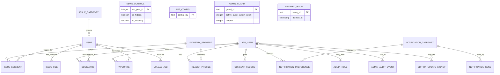
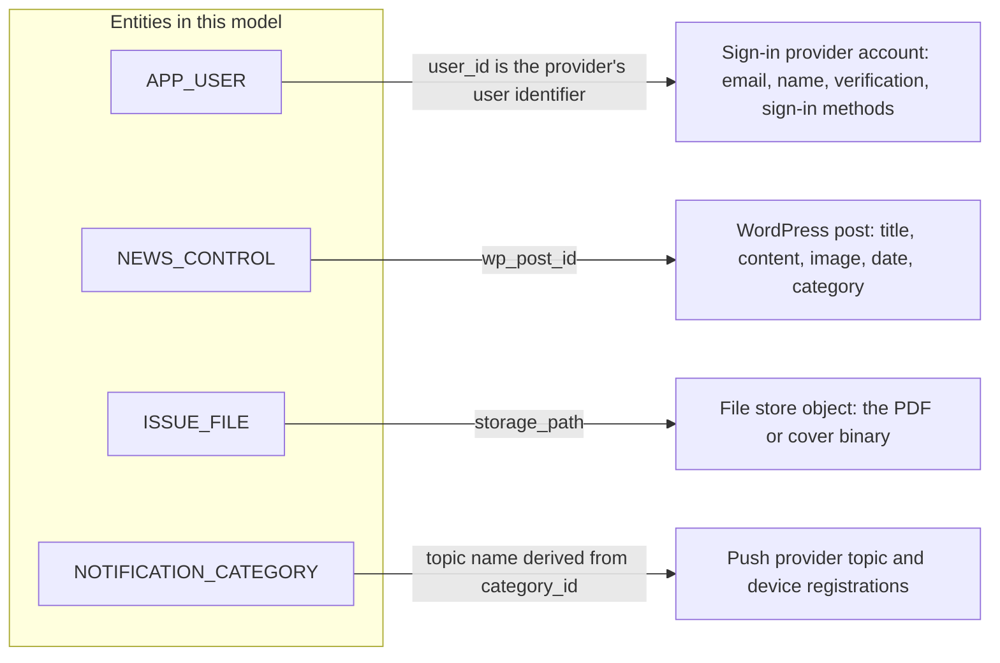
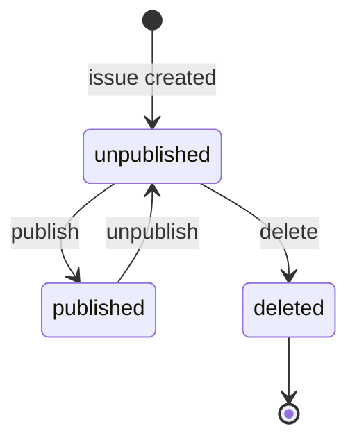

# Database and Data Model: Metal Forming World (MFW) Mobile Application

## 1. Document Control, Purpose, Scope and Status

| Field | Detail |
|---|---|
| Document title | Database and Data Model |
| File | `DATABASE_AND_DATA_MODEL.md`, in the same folder as `REQUIREMENTS_SPECIFICATION.md` |
| Project | Metal Forming World (MFW) mobile application |
| Version | 0.2 |
| Status | Draft for Review |
| Last updated | 23 October 2026 |
| Prepared by | MFW development team |
| Approval status | Not approved. No MFW or internal approval of this document has been recorded. The data model is not approved by the charter (CH §17.4). |
| Related documents | [Requirements Specification](REQUIREMENTS_SPECIFICATION.md) v0.1; [Scope and Exclusions](SCOPE_AND_EXCLUSIONS.md) v0.1; [Assumptions and Constraints Register](ASSUMPTIONS_AND_CONSTRAINTS.md) v0.1; [Glossary](GLOSSARY.md) v0.1; [System Architecture](SYSTEM_ARCHITECTURE.md) v0.2; [Technology Decisions](TECHNOLOGY_DECISIONS.md) v0.2; [API and Backend Contract](API_AND_BACKEND_CONTRACT.md) v0.1; [Security and Access Control](SECURITY_AND_ACCESS_CONTROL.md) v0.1; `PROJECT_CHARTER.md` v0.1 |

**Purpose.** This document defines what data the MFW product keeps, how the pieces relate, who may read and change each piece, and when each piece is deleted. S2 lists the data model as a handover deliverable [S2 Handover], and the charter leaves it to a recorded decision (CH §17.4). The access rules for each entity are summarised in Section 19 and defined in the [Security and Access Control](SECURITY_AND_ACCESS_CONTROL.md) document. The operations that read and write the entities are defined in the [API and Backend Contract](API_AND_BACKEND_CONTRACT.md).

**Scope.** The server-side data, the data kept on the reader's device, and the references to data that other systems own: the sign-in provider, the WordPress site, the file store and the push provider. It contains no schema code, no migration scripts and no cloud configuration, and it creates no database.

**Status of the technology.** A logical relational model is given first, and it does not depend on a database vendor. Cloud Firestore is the PROPOSED database (TD-07, not approved), so Section 12 maps the model onto Firestore and marks every vendor-specific detail provisional. If another database is chosen, only Section 12 changes.

**Change history**

| Version | Date | Change |
|---|---|---|
| 0.1 | 23 October 2026 | Initial draft for internal review. Revised the same day: trees replace tables in Sections 7.1, 8 and 12. An invariant enforcement register (Section 10.8) and a guard record (ADMIN_GUARD) are added for the proposed admin roles (PRC-01). No decision, status or requirement changed. |
| 0.2 | 23 October 2026 | Revised after the 17-question interview (GS-Q17 to GS-Q33) and a read-only review of MFW's public website (WEB). Admin reads go through functions only and no role is copied into the sign-in claim (GS-Q20): INV-08 is rewritten and INV-09 is narrowed to sessions. The audit event covers the audit set (GS-Q26). New: the DELETED_ISSUE entity (Section 4.22), the account deletion states, the notification send states, invariants INV-14 to INV-18, website-based seed values for segments and categories (GS-Q31), Sections 17 to 19 (issue lifecycle, query patterns, access by entity and actor) and Appendix B. Decisions in this version are team-accepted, with the requirement label PROVISIONAL and MFW written approval pending (GS-Q30). No requirement status in the specification changed. |

### 1.1 Sources and authority

| Ref | Source | Evidence status | Authority in this document |
|---|---|---|---|
| S1, S2 | MFW Mobile App Commercial Proposal and Statement of Work, 17 October 2026 | Read. Both copies are unsigned (REG-002). | S2 lists the data the product stores and the access rules. |
| S3 | Client emails received after S1 and S2 | Not available (REG-001). | Not used as evidence. Anything known only through the charter is PROVISIONAL. |
| CH | `PROJECT_CHARTER.md` v0.1 | Read. Draft for review, unsigned. | Working summary. It does not override S1 or S2. |
| SPEC | [Requirements Specification](REQUIREMENTS_SPECIFICATION.md) | Read. Draft for Review. | The data requirements (Section 7 of the specification) and every requirement ID. Used as written. |
| TD, GS | [Technology Decisions](TECHNOLOGY_DECISIONS.md) | Draft for Review. | The decisions and the questioning answers (GS-Q4 to GS-Q6, GS-Q11, GS-Q13, GS-Q14, GS-Q16 and, for version 0.2, GS-Q17 to GS-Q33 and GS-D13 to GS-D20) behind this model. |
| WEB | MFW's public website, https://metalformingworld.com/ (home, About, April-May 2026 issue, Industry News and Contact pages, and the public WordPress REST API), read on 23 October 2026 | Observed. Not an approved source. | A reference for seed values and the WordPress contract. It does not change scope (INT-WP-002) and is not MFW's approval. |

S1, S2 and CH are named by file name and not linked, because they are not in this folder. Fees, payment amounts and personal names are left out, as in the specification. All sample values are fictional.

### 1.2 Status labels and identifiers

The status legend is the specification's (spec §1.2): CONFIRMED, PROVISIONAL, ASSUMPTION, OPEN and CONFLICT. "Proposed" is a decision status for choices the development team recommends and that are not approved. "Team-accepted" is a decision status for a choice the developer who ran the interview recorded as accepted. The requirement label stays PROVISIONAL, MFW written approval is pending, and the other developer's agreement is not recorded (GS-Q30, REG-052). CONFIRMED is never used for it.

| Prefix | Meaning | Defined in |
|---|---|---|
| DATA-nnn | A data requirement | Specification Section 7 |
| FR, NFR, INT, BR, AC | Requirement IDs and S2 acceptance criteria | Specification Sections 5 to 10 |
| OQ, C, ASM | Open questions, conflicts, assumptions | Specification Section 12 |
| TD-nn | Technology decision | [Technology Decisions](TECHNOLOGY_DECISIONS.md) §5 |
| AOQ-nn, PRC-nn | New architecture open question, proposed requirement change | [Technology Decisions](TECHNOLOGY_DECISIONS.md) §8 |
| AR-nn | Architecture risk | [System Architecture](SYSTEM_ARCHITECTURE.md) §14 |
| INV-nn | Data invariant in the enforcement register | Section 10.8 of this document |
| GS-Qnn, GS-Dnn | Interview answers and confirmed defaults | [Technology Decisions](TECHNOLOGY_DECISIONS.md) §10 |
| WEB | An observation on MFW's public website | Section 1.1 and Appendix B |
| SCP, EXC, CHG, REG | Scope items, exclusions, change items, register entries | The scope document and the register |

### 1.3 Terminology

| Term | Meaning in this document |
|---|---|
| Entity | A kind of record the product keeps, such as an issue or a bookmark. In a relational database it is a table. |
| Field | One piece of information in an entity. |
| Primary key (PK) | The field or fields that identify one record. |
| Foreign key (FK) | A field that refers to the primary key of another entity. |
| Reference | A pointer to something another system owns, such as the sign-in provider's user identifier or a WordPress post number. The product does not copy what it points to. |
| Required | The model requires a value for the record to be valid. Where a requirement is PROVISIONAL, "required" means required in the working position and not required by MFW. |
| Personal data | Information about an identifiable person. This document makes no legal classification (spec §7.2). |
| Guard record | A single record that every admin role change reads and writes, so that two concurrent changes cannot both succeed when only one should. It is a design device and is proposed (PRC-01). |
| Team-accepted | Accepted by the development team as a decision. The requirement label is PROVISIONAL, MFW written approval is pending, and the other developer's agreement is not recorded (GS-Q30, REG-052). |
| Deleted-issue record | A record of an issue that was permanently deleted. It holds the issue's identifier and the time, and no content (Section 4.22). |

## 2. Modelling Principles and Assumptions

### 2.1 Principles

| Ref | Principle | Basis |
|---|---|---|
| M1 | Keep the minimum data the product needs. A field must have a stated purpose and a requirement or an open decision behind it. | NFR-PRIV-001 (PROVISIONAL) |
| M2 | Do not assume that every suggested profile field is required. Required-ness is configuration, not schema. | GS-Q4 |
| M3 | Reference what other systems own. Do not copy it. The product does not store the email address, the sign-in method, device tokens or WordPress news. | GS-Q5; DATA-015 (CONFIRMED) |
| M4 | Separate file metadata from file binaries. Binaries live in the file store and the database holds only a path and facts about the file. | NFR-SEC-003 (CONFIRMED) |
| M5 | Key everything a reader owns by the provider's user identifier, so deletion and access rules are simple. | NFR-SEC-005 (CONFIRMED) |
| M6 | Make repeated or replayed writes harmless, because offline writes can be sent more than once. | TD-20 |
| M7 | Keep the logical model independent of the vendor. Vendor-specific detail is marked provisional. | NFR-MAINT-005 (ASSUMPTION) |
| M8 | Do not record which reader opened which issue or page. | NFR-PRIV-003 (PROVISIONAL); EXC-06 |
| M9 | Do not expose an admin's identity to the public through public-read data. | Design |
| M10 | Identifiers are opaque, generated by the server and never reused, so a reader's old copy or bookmark can never point at a different issue. | GS-Q25 |
| M11 | The record of a deleted issue holds an identifier and a time and no content. | GS-Q25 |

### 2.2 Assumptions

| Ref | Assumption | Status |
|---|---|---|
| MA-1 | The product serves fewer than 1,000 monthly active users. No source gives a volume target. | ASSUMPTION (GS-D10) |
| MA-2 | Each issue is one PDF of up to 150 MB and about 120 pages, with five to twelve issues live at launch. | ASSUMPTION (ASM-01, ASM-02) |
| MA-3 | One sign-in account is one reader, with one set of app records. | Proposed (TD-06) |
| MA-4 | Opening a full issue downloads it and keeps it until the reader deletes it. | ASSUMPTION (GS-Q6, OQ-08) |
| MA-5 | The working profile field list is the development team's, and MFW has not confirmed it. | ASSUMPTION (PRC-03, OQ-01) |
| MA-6 | Type names are logical. Length limits and formats are proposals for testing and are not requirements. | ASSUMPTION |
| MA-7 | The same issue PDFs may be public on MFW's website. The app's sign-in gate controls the app's copy and is not a claim that the content is secret. | Observed (WEB); team-accepted position (GS-Q32); MFW confirmation pending (AOQ-18) |
| MA-8 | The administrator model is the two-role model, Super Admin and Content Admin. | Team-accepted (GS-Q19), PROVISIONAL, MFW written approval pending (PRC-01) |

## 3. Conceptual Model

### 3.1 Entities and relationships

The diagram shows the entities the product keeps on the server. The device-side data and the external references are in Sections 5 and 7. Entities marked conditional exist only if the open question behind them is settled that way.



`NEWS_CONTROL` refers to a WordPress post by number and has no relationship inside the model. `APP_CONFIG` holds settings and has none either. `ADMIN_GUARD` is one record that serialises admin role changes. It is derived from `ADMIN_ROLE` and has no relationship of its own (Section 10.8). `DELETED_ISSUE` holds the identifier of an issue that no longer exists, so it has no relationship inside the model (Section 4.22).

### 3.2 What the model points to but does not own



| Owned by another system | Referenced by | Copied into the model? |
|---|---|---|
| Email address, verification state, sign-in methods | `APP_USER.user_id` | No (GS-Q5) |
| News post title, content, image, date, category | `NEWS_CONTROL.wp_post_id` | No (DATA-015) |
| PDF and cover binaries | `ISSUE_FILE.storage_path` and `ISSUE.cover_path` | No. Only paths and facts about the file are stored. |
| Device registration tokens and topic subscriptions | The topic name, derived from `NOTIFICATION_CATEGORY.category_id` | No. Held by the push provider (TD-13). |
| The website's public copy of an issue (its page and PDF) | Nothing | No. The model never refers to it (GS-Q32, AOQ-18). |

## 4. Logical Relational Model

### 4.1 Conventions

| Convention | Rule |
|---|---|
| Types | `text`, `integer`, `boolean`, `timestamp` (UTC), `date`, `enum(...)`, and `text list`. They are logical types, not a vendor's types. |
| Identifiers | Opaque, generated by the server and never reused, except `user_id`, which is the sign-in provider's user identifier (M10, INV-14). |
| Required | The record is invalid without the value. For PROVISIONAL requirements, required means required in the working position (MA-5). |
| Lengths and formats | Proposals for testing and not requirements (MA-6). |
| Client access | Whether the reader's app or the admin panel can read or write the entity directly under rules. Writes that the table says go "through a function" are made by a server function only (System Architecture §10). |
| Privacy class | None, Pseudonymous (an identifier that points to a person only through another system), or Personal. No legal classification is made. |

### 4.2 APP_USER

| Field | Entry |
|---|---|
| Purpose | The app's own record for one account. It holds the lifecycle of the account and nothing that the sign-in provider already holds. |
| Status | CONFIRMED in part (DATA-003). The deletion fields and states are team-accepted (GS-Q28) and PROVISIONAL. PRC-02 stays OPEN for MFW and its legal adviser. |
| Primary key | `user_id` |
| Foreign keys | `user_id` refers to the sign-in provider's account (external). |
| Uniqueness | `user_id` is unique. |
| Indexing | `(status, purge_after)` for the purge job. |
| Validation | `user_id` must equal the caller's identifier when the record is created. `purge_after` is set only when `status` is `pending_deletion`. The status moves from `active` to `pending_deletion`, from `pending_deletion` back to `active` (undo) or on to `deleting`, and from `active` straight to `deleting` for an immediate deletion. From `deleting` the record can only be removed (INV-18). |
| Retention and deletion | Created at registration. Deleted at the purge, after the window, or at once if the reader chooses immediate deletion (TD-19, GS-Q28). The window length is configuration and OPEN (AOQ-02). |
| Privacy class | Pseudonymous |
| Client access | Read by the owner. Written by functions only. |
| Related requirement IDs | DATA-003 (CONFIRMED); FR-AUTH-009 (CONFIRMED); FR-PRIV-003 (CONFIRMED); NFR-PRIV-005, DATA-017 (OPEN); PRC-02 |

| Field | Type | Required | Notes |
|---|---|---|---|
| `user_id` | text | Yes | The provider's user identifier. Never the email address. |
| `status` | enum(active, pending_deletion, deleting) | Yes | Default `active`. `pending_deletion` is the grace window, in which the reader can undo. `deleting` means the deletion is running and is retried until it finishes. |
| `created_at` | timestamp | Yes | |
| `deletion_requested_at` | timestamp | No | Set when the reader confirms deletion. |
| `purge_after` | timestamp | No | `deletion_requested_at` plus the purge window, from configuration (AOQ-02). |

Whether the profile is complete is not stored. It is worked out from the profile and the configured required fields each time, so a change to the required set needs no data migration.

### 4.3 READER_PROFILE

| Field | Entry |
|---|---|
| Purpose | The reader's profile information, kept apart from the account record. It gives MFW visibility of who registers (objective O6). |
| Status | PROVISIONAL (DATA-004). The field list is the development team's working list and is not MFW-confirmed (PRC-03, ASSUMPTION). The development team keeps it as the mandatory set (GS-Q23), and the status stays ASSUMPTION until MFW answers OQ-01 and OQ-02. |
| Primary key | `user_id` |
| Foreign keys | `user_id` refers to APP_USER. `industry_segment_id` refers to INDUSTRY_SEGMENT. |
| Uniqueness | One profile per user. |
| Indexing | None needed for access. The admin list and export read all profiles, which is a small set. |
| Validation | Each field named in the configured required set must be present. Text fields are trimmed and limited in length. `mobile_number` follows an international format. `country` is a two-letter country code. Age is a whole number within a sanity range of 1 to 120, or a date in the past. There is no minimum age (FR-PROF-005). |
| Retention and deletion | Created and changed through `saveProfile`. Deleted at the purge. The retention period is MFW's (OQ-24). |
| Privacy class | Personal |
| Client access | Read by the owner. Written through a function only. Read by Super Admins through the registered-user functions. |
| Related requirement IDs | DATA-004, FR-PROF-001 to FR-PROF-005, NFR-PRIV-001 (PROVISIONAL); FR-PROF-006 (CONFIRMED); FR-PROF-007, NFR-SEC-006 (ASSUMPTION); NFR-PRIV-006 (OPEN); OQ-01, OQ-02, OQ-03, OQ-07 |

| Field | Type | Required in the working position | Notes |
|---|---|---|---|
| `user_id` | text | Yes | |
| `full_name` | text | Yes | Prefilled from the sign-in account and then owned by the profile (GS-Q4). |
| `mobile_number` | text | Yes | Not in any source. Collected only if MFW confirms it (Section 11). |
| `company_name` | text | Yes | Not in any source. |
| `job_title` | text | Yes | Close to "occupation" in the S3-reported list. |
| `industry_segment_id` | text | Yes | Refers to INDUSTRY_SEGMENT. Close to "domain of work" in the S3-reported list. The seed list is the website's circulation industries (Section 4.5). |
| `country` | text | Yes | Two-letter country code. Not in any source. |
| `city` | text | No | Optional in the working list. |
| `age_value` | integer | Working position: one of these two | UNRESOLVED (OQ-02). Exactly one of `age_value` and `date_of_birth` will remain. The other is dropped. |
| `date_of_birth` | date | Working position: one of these two | UNRESOLVED (OQ-02). More sensitive than an age. It stays current without edits. |
| `areas_of_interest` | text list | No | Optional free text (GS-Q4). |
| `updated_at` | timestamp | Yes | |

Gender is not in the model. The S3-reported list includes it (FR-PROF-002), and the working list leaves it out on purpose. That difference is flagged and not decided (PRC-03, OQ-01). The development team confirmed this position (GS-Q23). It is recorded as a known divergence from FR-PROF-002 and is not resolved here.

### 4.4 CONSENT_RECORD

| Field | Entry |
|---|---|
| Purpose | Evidence that a reader accepted MFW's privacy policy and terms of use, with the versions. |
| Status | ASSUMPTION (DATA-012). How consent is recorded is OPEN (OQ-27). |
| Primary key | `consent_id` |
| Foreign keys | `user_id` refers to APP_USER. |
| Uniqueness | `(user_id, document_type, document_version)` |
| Indexing | `(user_id)` through the owner's path. |
| Validation | The document versions must be the current versions from configuration at the time of consent. |
| Retention and deletion | Kept with the user. Whether a consent record must outlive the person is a question for MFW's adviser (OQ-24). Until then it is deleted at the purge. |
| Privacy class | Pseudonymous |
| Client access | Read by the owner. Written by a function only. |
| Related requirement IDs | DATA-012 (ASSUMPTION); FR-PRIV-001 (CONFIRMED); FR-PRIV-002 (ASSUMPTION); NFR-PRIV-002 (CONFIRMED); OQ-27 |

| Field | Type | Required | Notes |
|---|---|---|---|
| `consent_id` | text | Yes | |
| `user_id` | text | Yes | |
| `document_type` | enum(privacy_policy, terms_of_use) | Yes | Terms of use is an inference from S2 and is listed with the policy (Appendix A, item 2). |
| `document_version` | text | Yes | The version MFW publishes. |
| `accepted_at` | timestamp | Yes | |
| `method` | enum(registration_action) | Yes | The recorded action. The final form is OQ-27. |

### 4.5 INDUSTRY_SEGMENT

| Field | Entry |
|---|---|
| Purpose | One shared list of industry segments. It tags issues (many per issue) and describes a reader (one per reader), so filters and exports use consistent values (GS-Q4). |
| Status | ASSUMPTION for the entity. The seed values are PROVISIONAL (GS-Q31, WEB). The meaning of "industry segment" is OPEN (OQ-13). |
| Primary key | `segment_id` |
| Foreign keys | None |
| Uniqueness | `name` is unique, ignoring case. |
| Indexing | `display_order` |
| Validation | `name` is not empty. A segment in use cannot be deleted. It can be made inactive. |
| Retention and deletion | Kept. Not personal data. |
| Privacy class | None |
| Client access | Read by anyone. Written through functions only. |
| Related requirement IDs | FR-SRCH-003 (CONFIRMED); FR-ADMIN-009 (CONFIRMED); FR-MAG-009 (OPEN); OQ-13; AOQ-16 |

| Field | Type | Required | Notes |
|---|---|---|---|
| `segment_id` | text | Yes | |
| `name` | text | Yes | The seed values are the website's circulation industries (below). S2 names the filter and no values. |
| `display_order` | integer | Yes | |
| `is_active` | boolean | Yes | Default true. |

Whether the developers set the list up once or admins maintain it in the panel is AOQ-16. The panel's category tools in S2 cover issue categories only (FR-ADMIN-010).

```text
Seed values for INDUSTRY_SEGMENT   [PROVISIONAL; the "Circulation by Industries" list on https://metalformingworld.com/about/, read on 23 October 2026]
├── Automobile
├── Auto Component
├── Dies & Molds
├── Ancillaries
├── Defence
├── Aerospace
├── Medical Equipment
├── OEMs
├── Heavy Engineering
├── Plastics
├── Railways
├── Pharma
├── WoodWorking
├── Glass
├── Metal
└── Packaging
```

The values are MFW's own wording and are reused as the site gives them. This model adds none and merges none, and it does not change the website's taxonomy. The development team's brief says "Automotive", and the site has two terms, Automobile and Auto Component. The site writes "Dies & Molds" here and "Die & Mould" elsewhere, so MFW chooses one spelling (OQ-13). Stamping and Tooling are not segments. They are search topics only and have no entity (GS-Q31). The values are not a requirement, and which ones the app offers is MFW's decision (AOQ-16).

### 4.6 ISSUE_CATEGORY

| Field | Entry |
|---|---|
| Purpose | The category of an issue, maintained by admins. |
| Status | CONFIRMED (DATA-002) for the entity. The seed values are PROVISIONAL (GS-Q31, WEB). |
| Primary key | `category_id` |
| Foreign keys | None |
| Uniqueness | `name` is unique, ignoring case. |
| Indexing | `display_order` |
| Validation | A category in use cannot be deleted. |
| Retention and deletion | Kept. Not personal data. |
| Privacy class | None |
| Client access | Read by anyone. Written through functions by admins. |
| Related requirement IDs | DATA-002, FR-ADMIN-010, FR-MAG-003, FR-SRCH-002 (CONFIRMED) |

| Field | Type | Required | Notes |
|---|---|---|---|
| `category_id` | text | Yes | |
| `name` | text | Yes | |
| `display_order` | integer | Yes | |

```text
Seed values for ISSUE_CATEGORY   [PROVISIONAL; the "Editorial Calendar 2026-27" on https://metalformingworld.com/about/, read on 23 October 2026]
├── Die & Mould                                April-May 2026
├── Precision & Medical                        June-July 2026
├── Semiconductor, EV & Aerospace Machining    August-September 2026
├── Forging, Casting & Foundry                 October-November 2026
├── Pre IMTEX - Global Machining               December 2026
├── IMTEX Special Issue                        January 2027
├── Machine Automation                         February 2027
└── Women Entrepreneurs                        March 2027
```

A category is the theme of one issue, and an issue has exactly one (FR-MAG-003). An industry segment is the audience a reader or an issue belongs to, and an issue can have many. A word can appear in both lists, such as Die & Mould and Aerospace, because the two lists answer different questions. The website calls these entries topics and does not define a taxonomy for them. Admins can add, rename and retire categories in the panel (FR-ADMIN-010), and the list is not synchronised with the website.

### 4.7 ISSUE

| Field | Entry |
|---|---|
| Purpose | One magazine edition's public details and publication state. It holds no file. |
| Status | CONFIRMED (DATA-001). The meaning of "edition" and which fields are public before sign-in are OPEN (OQ-13). |
| Primary key | `issue_id` |
| Foreign keys | `category_id` refers to ISSUE_CATEGORY. `(issue_id, current_revision)` refers to ISSUE_FILE. |
| Uniqueness | `issue_id` only. No uniqueness is placed on title, year or edition, because "edition" is not defined (OQ-13). The admin panel warns about a likely duplicate. |
| Indexing | `(publication_state, publication_date)` for the catalogue. `category_id`. `year`. |
| Validation | An issue can be published only when `current_revision` refers to an accepted file. `title` and `description` are required (FR-MAG-002). `year` is entered with the issue and defaults to the year of `publication_date` (FR-ADMIN-009). An issue can be deleted only while it is unpublished (INV-15). |
| Retention and deletion | Kept while MFW keeps the issue. Unpublish hides it. Permanent deletion is in the working design (GS-Q21): only a Super Admin, only after the issue is unpublished, with a typed confirmation and an audit event (GS-Q22). Its file revisions go with it, its bookmarks and favourites are removed by orphan cleanup (Section 10), and a deleted-issue record is kept (Section 4.22). OQ-21 and FR-ADMIN-012 stay OPEN for MFW. |
| Privacy class | None |
| Client access | Published issues are readable by anyone. Unpublished issues are readable by admins through functions only (GS-Q20). Written through functions only. |
| Related requirement IDs | DATA-001, FR-MAG-002 to FR-MAG-008, FR-SRCH-001 to FR-SRCH-005, FR-ADMIN-009, FR-ADMIN-011 (CONFIRMED); FR-MAG-009, FR-ADMIN-012 (OPEN); OQ-13, OQ-21; GS-Q21, GS-Q22 |

| Field | Type | Required | Notes |
|---|---|---|---|
| `issue_id` | text | Yes | Opaque and never reused (INV-14). |
| `title` | text | Yes | |
| `description` | text | Yes | |
| `publication_date` | date | Yes | |
| `year` | integer | Yes | For the year filter. |
| `edition` | text | No | A label. The meaning is OQ-13. The website labels its issues by period, such as "April-May 2026", and shows no edition number or volume (WEB). |
| `category_id` | text | Yes | FR-MAG-003. |
| `publication_state` | enum(unpublished, published) | Yes | Default `unpublished`. S2 excludes a draft and review workflow, so there is no third state. |
| `cover_path` | text | No | A path in the public cover area. A cover is public metadata. Format checks are OQ-22. |
| `current_revision` | integer | No | The revision that readers receive. Required before publishing. |
| `file_size_bytes` | integer | No | Copied from the current revision so the size shows before the download (FR-DL-003). Public only if OQ-13 allows it. |
| `page_count` | integer | No | Copied from the current revision. Public only if OQ-13 allows it. |
| `published_at` | timestamp | No | |
| `created_at`, `updated_at` | timestamp | Yes | |

If OQ-13 decides that size and page count are not shown to logged-out visitors, those two fields move to a record that only signed-in readers can read. The model does not change otherwise.

### 4.8 ISSUE_SEGMENT

| Field | Entry |
|---|---|
| Purpose | Links an issue to the industry segments it covers, many to many. |
| Status | CONFIRMED in need (FR-SRCH-003, FR-ADMIN-009). The segment values are OPEN (OQ-13). |
| Primary key | `(issue_id, segment_id)` |
| Foreign keys | `issue_id` refers to ISSUE. `segment_id` refers to INDUSTRY_SEGMENT. |
| Uniqueness | The primary key |
| Indexing | `segment_id` |
| Validation | Both ends must exist. |
| Retention and deletion | Removed when the issue is removed. |
| Privacy class | None |
| Client access | Same as ISSUE. |
| Related requirement IDs | FR-SRCH-003 (CONFIRMED); FR-ADMIN-009 (CONFIRMED); OQ-13 |

### 4.9 ISSUE_FILE

| Field | Entry |
|---|---|
| Purpose | One numbered revision of an issue's PDF: the facts about the file and the path to it. The binary is in the file store (Section 8). |
| Status | CONFIRMED in need (DATA-001, NFR-SEC-003). Replacement and deletion are OPEN (OQ-21). The working design lets either admin role replace a PDF as a new revision, and removes the revisions with a deleted issue (GS-Q21). |
| Primary key | `(issue_id, revision)` |
| Foreign keys | `issue_id` refers to ISSUE. |
| Uniqueness | The primary key. Exactly one revision per issue has `status = current`, enforced in a single transaction. |
| Indexing | `(issue_id, status)` |
| Validation | Created only after the upload passes the genuine-PDF and size checks (FR-ADMIN-006, FR-ADMIN-007, NFR-SEC-008). `size_bytes` is within the configured limit. |
| Retention and deletion | A superseded revision is kept for a short period for rollback and then removed with its file. The period is configuration and is open. Removed with the issue. |
| Privacy class | Pseudonymous (`uploaded_by` is an admin identifier) |
| Client access | None. Never readable by clients, because `storage_path` is private (Section 9). |
| Related requirement IDs | DATA-001, FR-ADMIN-005 to FR-ADMIN-007, NFR-SEC-002, NFR-SEC-003, NFR-SEC-008, INT-FILE-001 (CONFIRMED); NFR-STOR-001 (ASSUMPTION); FR-ADMIN-012 (OPEN); OQ-21, OQ-30 |

| Field | Type | Required | Notes |
|---|---|---|---|
| `issue_id` | text | Yes | |
| `revision` | integer | Yes | Starts at 1. A replacement adds 1. |
| `storage_path` | text | Yes | A path in the private area. Never sent to clients. |
| `size_bytes` | integer | Yes | |
| `page_count` | integer | Yes | |
| `checksum_sha256` | text | Yes | Lets the app check a download. |
| `status` | enum(current, superseded, removed) | Yes | |
| `uploaded_by` | text | Yes | The admin's user identifier. |
| `uploaded_at`, `accepted_at` | timestamp | Yes | |

### 4.10 BOOKMARK

| Field | Entry |
|---|---|
| Purpose | A reader's saved page in an issue. |
| Status | CONFIRMED (DATA-005) |
| Primary key | `bookmark_id` |
| Foreign keys | `user_id` refers to APP_USER. `issue_id` refers to ISSUE. |
| Uniqueness | `(user_id, issue_id, page_number)`. Bookmarking a page that is already bookmarked changes nothing, so a repeated tap or a replayed offline write creates no duplicate. |
| Indexing | `(user_id, issue_id)` and `(user_id, created_at)` |
| Validation | `page_number` is at least 1. The app checks it against the page count it knows, and the stored value is clamped on opening if the file changed (Section 6). |
| Retention and deletion | Kept with the reader. Removed by the reader (FR-BKM-007). Removed at the purge. Removed by orphan cleanup if the issue is permanently deleted. |
| Privacy class | Pseudonymous. It reveals a reader's interest, so it is treated as personal data. |
| Client access | Read and written by the owner only (NFR-SEC-005). |
| Related requirement IDs | DATA-005, FR-BKM-001, FR-BKM-002, FR-BKM-004 to FR-BKM-006, NFR-SEC-005 (CONFIRMED); FR-BKM-007 (ASSUMPTION); FR-BKM-008 (OPEN); OQ-10 |

| Field | Type | Required | Notes |
|---|---|---|---|
| `bookmark_id` | text | Yes | |
| `user_id` | text | Yes | |
| `issue_id` | text | Yes | |
| `page_number` | integer | Yes | The position of the page in the PDF, counted from 1. It is not a printed page label. |
| `file_revision` | integer | Yes | The revision the reader was reading when the bookmark was made. |
| `created_at` | timestamp | Yes | |

### 4.11 FAVOURITE

| Field | Entry |
|---|---|
| Purpose | An issue a reader has marked as a favourite. |
| Status | CONFIRMED (DATA-006). Whether a reader without full access can favourite is OPEN (OQ-12). |
| Primary key | `(user_id, issue_id)` |
| Foreign keys | `user_id` refers to APP_USER. `issue_id` refers to ISSUE. |
| Uniqueness | The primary key |
| Indexing | `(user_id, created_at)` |
| Validation | The issue must exist and be published when the favourite is made. |
| Retention and deletion | As for BOOKMARK. |
| Privacy class | Pseudonymous, treated as personal data |
| Client access | Read and written by the owner only (NFR-SEC-005). |
| Related requirement IDs | DATA-006, FR-BKM-003 to FR-BKM-006, NFR-SEC-005 (CONFIRMED); OQ-12 |

| Field | Type | Required | Notes |
|---|---|---|---|
| `user_id` | text | Yes | |
| `issue_id` | text | Yes | |
| `created_at` | timestamp | Yes | |

### 4.12 NOTIFICATION_CATEGORY

| Field | Entry |
|---|---|
| Purpose | A topic a reader can opt into, and the target of a send. |
| Status | CONFIRMED in need (FR-NOTIF-006). The final list and whether admins can change it are OPEN (OQ-18). |
| Primary key | `category_id` |
| Foreign keys | None |
| Uniqueness | `name` is unique, ignoring case. |
| Indexing | `display_order` |
| Validation | A category used by a preference or a send cannot be deleted. It can be made inactive. |
| Retention and deletion | Kept. Not personal data. |
| Privacy class | None |
| Client access | Read by anyone. Written through functions. |
| Related requirement IDs | FR-NOTIF-002, FR-NOTIF-006 (CONFIRMED); OQ-18 |

| Field | Type | Required | Notes |
|---|---|---|---|
| `category_id` | text | Yes | The push topic name is derived from it. |
| `name` | text | Yes | The starting values are new issues, expo specials and major news (S1, FR-NOTIF-006). |
| `display_order` | integer | Yes | |
| `is_active` | boolean | Yes | Default true. |

### 4.13 NOTIFICATION_PREFERENCE

| Field | Entry |
|---|---|
| Purpose | The categories a signed-in reader has chosen, so the choice follows the reader to a new device. The device is subscribed to the matching topics. |
| Status | CONFIRMED (DATA-007). The device registration part of DATA-007 is held by the push provider, not here (TD-13). Logged-out preferences are OPEN (OQ-09). |
| Primary key | `(user_id, category_id)` |
| Foreign keys | `user_id` refers to APP_USER. `category_id` refers to NOTIFICATION_CATEGORY. |
| Uniqueness | The primary key. A row means the reader opted in to the category. |
| Indexing | `(user_id)` through the owner's path |
| Validation | The category must exist and be active. |
| Retention and deletion | Kept with the reader. Removed at the purge. |
| Privacy class | Pseudonymous |
| Client access | Read and written by the owner only. |
| Related requirement IDs | DATA-007, FR-NOTIF-002, FR-NOTIF-003 (CONFIRMED); FR-NOTIF-007 (OPEN); OQ-09 |

| Field | Type | Required | Notes |
|---|---|---|---|
| `user_id` | text | Yes | |
| `category_id` | text | Yes | |
| `created_at` | timestamp | Yes | |

### 4.14 NOTIFICATION_SEND

| Field | Entry |
|---|---|
| Purpose | One entry per notification an admin sends. It is the send log. |
| Status | CONFIRMED (DATA-008). The fields recorded are OPEN (OQ-19). The list here is a proposal. The record-first order and the states are team-accepted (GS-Q27). |
| Primary key | `send_id` |
| Foreign keys | `category_id` refers to NOTIFICATION_CATEGORY. |
| Uniqueness | `send_id` only. |
| Indexing | `sent_at`, newest first |
| Validation | The link target must exist and, for an issue, be published. The record is written as `pending` before the send, then moves to `accepted` or `failed`. A `pending` record that is still unresolved after the configured time is marked `unknown`. Only an admin retries a `failed` or `unknown` record. The retry sets it back to `pending` in one transaction and adds 1 to `attempt_count`. Nothing retries automatically (INV-17). |
| Retention and deletion | Kept for a period that MFW sets (OQ-24). It holds no reader data. |
| Privacy class | Pseudonymous (`sent_by` is an admin identifier) |
| Client access | Read by admins through functions only (GS-Q20). Written by the send function only. |
| Related requirement IDs | DATA-008, FR-ADMIN-016 to FR-ADMIN-018 (CONFIRMED); OQ-19, OQ-24; GS-Q27 |

| Field | Type | Required | Notes |
|---|---|---|---|
| `send_id` | text | Yes | |
| `category_id` | text | Yes | |
| `title` | text | Yes | |
| `target_type` | enum(issue, news_post, none) | Yes | |
| `target_ref` | text | No | An issue identifier or a WordPress post number. |
| `sent_by` | text | Yes | The admin's user identifier. |
| `sent_at` | timestamp | Yes | When the first attempt began. |
| `outcome` | enum(pending, accepted, failed, unknown) | Yes | `accepted` means the push service accepted the send. It is not a delivery receipt. `unknown` means an attempt never reported back. |
| `attempt_count` | integer | Yes | Starts at 1. A retry adds 1. |
| `last_attempt_at` | timestamp | Yes | |

### 4.15 NEWS_CONTROL

| Field | Entry |
|---|---|
| Purpose | App-level controls for a WordPress post: hide it in the app, or mark it as breaking. The post itself stays in WordPress. |
| Status | CONFIRMED (DATA-009, DATA-015). How a breaking post is shown is OPEN (OQ-17). |
| Primary key | `wp_post_id` |
| Foreign keys | `wp_post_id` refers to a WordPress post (external). |
| Uniqueness | One record per post. |
| Indexing | None needed. The app reads the whole small set. |
| Validation | `wp_post_id` is a positive integer. A record where neither flag is set may be removed. |
| Retention and deletion | Kept. A record for a post that no longer exists is cleaned up occasionally. |
| Privacy class | None. The acting admin is not stored here, so a public read exposes no admin identity (M9). |
| Client access | Read by anyone, because the app needs it. Written through a function by admins. |
| Related requirement IDs | DATA-009, DATA-015, FR-NEWS-008, FR-ADMIN-013, FR-ADMIN-014 (CONFIRMED); FR-NEWS-009 (OPEN); OQ-17 |

| Field | Type | Required | Notes |
|---|---|---|---|
| `wp_post_id` | integer | Yes | |
| `is_hidden` | boolean | Yes | |
| `is_breaking` | boolean | Yes | |
| `updated_at` | timestamp | Yes | |

### 4.16 EDITION_UPDATE_SIGNUP (conditional)

| Field | Entry |
|---|---|
| Purpose | The email address of someone who opted in to edition-update emails. MFW sends the emails itself from an export (FR-EMAIL-003). |
| Status | CONFLICT (DATA-010, C-02). The entity exists only if OQ-31 keeps the feature. |
| Primary key | `signup_id` |
| Foreign keys | `user_id` refers to APP_USER, and may be empty. |
| Uniqueness | The email address, ignoring case. |
| Indexing | The normalised email address |
| Validation | A well-formed email address. |
| Retention and deletion | Removed when the person withdraws (FR-EMAIL-002, ASSUMPTION). Removed when a linked account's deletion is requested, if the feature exists. A sign-up with no account has no deletion route in the app, which is part of OQ-09 and OQ-31. |
| Privacy class | Personal |
| Client access | None directly. Written and exported through functions. |
| Related requirement IDs | DATA-010, FR-EMAIL-001, FR-USER-001 (CONFLICT); FR-EMAIL-002, FR-EMAIL-003 (ASSUMPTION); FR-PRIV-003 (CONFIRMED, conditional); OQ-09, OQ-31 |

| Field | Type | Required | Notes |
|---|---|---|---|
| `signup_id` | text | Yes | |
| `email` | text | Yes | |
| `user_id` | text | No | Set when the sign-up came from a registered reader. |
| `created_at` | timestamp | Yes | |
| `withdrawn_at` | timestamp | No | |

### 4.17 ADMIN_ROLE (proposed change)

| Field | Entry |
|---|---|
| Purpose | The server-side record of who is an admin and in which role. It is the authority for every privileged operation. |
| Status | CONFIRMED in need (DATA-011) with one role. The two-role model is team-accepted (GS-Q19), PROVISIONAL, with MFW written approval pending (PRC-01). EXC-07 and CHG-01 are preserved: S2 excludes editorial roles and an audit log. |
| Primary key | `user_id` |
| Foreign keys | `user_id` refers to APP_USER. `granted_by` refers to APP_USER. These are logical references and not constraints the database enforces. Functions check them when they write (INV-13). |
| Uniqueness | One active role per user, because the record's key is the user identifier (INV-06). At least one active `super_admin` must always exist, enforced through the guard record in the transaction that changes a role (ADMIN_GUARD, INV-03). |
| Indexing | `role` |
| Validation | A change is rejected if it would remove or demote the last Super Admin. The database engine does not enforce this itself, so the function and the guard record do (Section 10.8). |
| Retention and deletion | A revoked record is kept so the audit log stays readable. It is removed at the purge of the account, unless AOQ-04 decides otherwise. |
| Privacy class | Pseudonymous |
| Client access | None. Functions only. |
| Related requirement IDs | DATA-011, FR-ADMIN-002, FR-ADMIN-003 (CONFIRMED); FR-ADMIN-004 (CONFIRMED, in conflict); FR-USER-005, NFR-SEC-011 (OPEN); EXC-07; PRC-01; OQ-20; AOQ-04; GS-Q19, GS-Q33 |

| Field | Type | Required | Notes |
|---|---|---|---|
| `user_id` | text | Yes | |
| `role` | enum(content_admin, super_admin) | Yes | Under S2's single role, `content_admin` stands for "admin" and `super_admin` is not used. |
| `is_active` | boolean | Yes | |
| `granted_by` | text | Yes | The first Super Admin is created by the controlled bootstrap step (GS-Q33) and has `granted_by` set to a fixed marker. The same step is the recovery route after a lockout. |
| `granted_at` | timestamp | Yes | |
| `revoked_at` | timestamp | No | |

### 4.18 ADMIN_AUDIT_EVENT (proposed change)

| Field | Entry |
|---|---|
| Purpose | An append-only record of the audited admin actions (GS-Q26): role changes and the bootstrap step, issue deletion, PDF replacement, publish and unpublish, views of the full reader list, exports of reader data, and denied privileged attempts by signed-in callers. Routine edits are not recorded. |
| Status | A proposed change. S2 excludes an audit log (EXC-07, PRC-01). The audit set goes beyond the log of role changes that PRC-01 describes, so the PRC-01 effort estimate does not cover it. The set is team-accepted (GS-Q26), PROVISIONAL, with MFW written approval pending. Retention is OPEN (AOQ-04). |
| Primary key | `event_id` |
| Foreign keys | `actor_user_id` and `target_user_id` refer to APP_USER. `subject_ref` refers to an issue or names an operation. These are logical references (INV-13). |
| Uniqueness | `event_id` only. |
| Indexing | `occurred_at`, newest first. `(action, occurred_at)` and `(actor_user_id, occurred_at)` if the panel filters by them, to be validated against the chosen platform. |
| Validation | For a successful action, written in the same transaction as the action itself (INV-04, INV-16). A denied-attempt entry is written on a best-effort basis, and a failure to write it never changes the denial. Denied entries are written only for signed-in callers, with a per-caller cap so that a loop of denied calls cannot flood the log. The cap is configuration and its value is OPEN. An entry never holds exported data or reader data. No update and no delete from any client or function path except the retention clean-up. |
| Retention and deletion | The period is AOQ-04. What happens when an admin's account is deleted is AOQ-04. Until MFW decides, an entry keeps only the identifiers. |
| Privacy class | Pseudonymous |
| Client access | Read by Super Admins through a function. Written by functions only. |
| Related requirement IDs | PRC-01; EXC-07; FR-ADMIN-012 (OPEN); FR-USER-002, FR-USER-003 (PROVISIONAL); NFR-SEC-011 (OPEN); OQ-21; OQ-24; AOQ-04; GS-Q22, GS-Q26, GS-Q33 |

| Field | Type | Required | Notes |
|---|---|---|---|
| `event_id` | text | Yes | Derived from the caller's request identifier, so a repeated request does not add a second event (INV-07). Generated for a denied attempt. |
| `action` | enum(role_grant, role_change, role_revoke, bootstrap_super_admin, issue_delete, file_replace, issue_publish, issue_unpublish, reader_list_view, reader_export, denied) | Yes | |
| `actor_user_id` | text | Yes | A fixed marker for the bootstrap step. |
| `target_user_id` | text | No | Set for role actions. |
| `subject_type` | enum(user, issue, reader_list, operation) | Yes | |
| `subject_ref` | text | No | An issue identifier, or the name of the operation that was denied. |
| `previous_role`, `new_role` | text | No | Role actions only. |
| `reference` | text | No | The written reference for a bootstrap or recovery step (GS-Q33). Never a document's content. |
| `result_count` | integer | No | For a list view or an export, how many records were returned. Never the records. |
| `recent_sign_in_checked` | boolean | Yes | True when the recent-sign-in rule was applied (AOQ-14). False for a denied attempt. |
| `occurred_at` | timestamp | Yes | No network address or device detail is stored. |

Searching for a reader by email address is not in the audit set (GS-D19).

### 4.19 UPLOAD_JOB

| Field | Entry |
|---|---|
| Purpose | A short-lived record of one upload, so the admin panel can show whether the file was accepted or rejected and why. |
| Status | ASSUMPTION. It supports FR-STATE-007 and FR-ADMIN-006. |
| Primary key | `job_id` |
| Foreign keys | `issue_id` refers to ISSUE. `requested_by` refers to APP_USER. |
| Uniqueness | `job_id` only. |
| Indexing | `(issue_id, created_at)` |
| Validation | Status moves from `pending` to `accepted`, `rejected` or `expired`, and not back. |
| Retention and deletion | Removed after a short period, from configuration. A job that is still pending is marked expired, and its holding-area object is removed. |
| Privacy class | Pseudonymous |
| Client access | Read by admins through functions only (GS-Q20). Written by functions only. |
| Related requirement IDs | FR-ADMIN-005 to FR-ADMIN-007 (CONFIRMED); FR-STATE-007 (ASSUMPTION); OQ-22, OQ-30 |

| Field | Type | Required | Notes |
|---|---|---|---|
| `job_id` | text | Yes | |
| `kind` | enum(pdf, cover) | Yes | |
| `issue_id` | text | Yes | |
| `requested_by` | text | Yes | |
| `declared_size_bytes` | integer | Yes | |
| `status` | enum(pending, accepted, rejected, expired) | Yes | |
| `reason` | text | No | A plain message for a rejection, such as "not a genuine PDF" or "over the size limit". |
| `created_at`, `finished_at` | timestamp | Yes, and No | |

### 4.20 APP_CONFIG

| Field | Entry |
|---|---|
| Purpose | Settings that the app and the functions read. They keep values that MFW may change out of the code. No value is set in this document. |
| Status | ASSUMPTION |
| Primary key | `config_key` |
| Foreign keys | None |
| Uniqueness | `config_key` |
| Indexing | None |
| Validation | Types are checked when the setting is written. |
| Retention and deletion | Kept. Not personal data. |
| Privacy class | None |
| Client access | A public part is readable by anyone. A private part is readable by functions only. Both are written by developers at deployment. |
| Related requirement IDs | FR-PROF-001 (PROVISIONAL); BR-003 (PROVISIONAL); FR-ADMIN-007 (CONFIRMED); INT-WP-003 (CONFIRMED); OQ-24, OQ-27, OQ-30; PRC-04; GS-Q26, GS-Q27, GS-Q29 |

| Setting | Part | Used for |
|---|---|---|
| `profile_required_fields` | Public | The profile fields that make a profile complete (PRC-03, OQ-01). |
| `profile_gate_enabled` | Private | Whether a complete profile is needed before a full issue (BR-003). |
| `policy_versions` | Public | The current privacy policy and terms of use versions (OQ-27). |
| `news_category_ids` | Public | The WordPress categories shown in the app (INT-WP-003). |
| `max_upload_bytes` | Private | The upload limit, 150 MB by default (FR-ADMIN-007, OQ-30). |
| `signed_url_lifetime` | Private | How long a download link works (TD-09, AOQ-07). |
| `signed_url_requests_per_reader` | Private | A cap on download-link requests per reader per day (an ASSUMPTION). |
| `purge_window` | Private | The deletion grace window (PRC-02, AOQ-02). |
| `retention_periods` | Private | Retention for send records, audit events, superseded revisions, upload jobs and the deleted-issue list (OQ-24, AOQ-04, AOQ-19). |
| `denied_audit_cap` | Private | The cap on denied-attempt audit entries per caller (GS-Q26). No value is set. |
| `notification_unknown_after` | Private | How long a send stays pending before it is marked unknown (GS-Q27). No value is set. |
| `min_supported_app_version` | Public | The update gate: an app older than this shows an update-required screen (PRC-04). It is a team-accepted addition to S2 scope that needs MFW's agreement. No value is set. |
| `schema_version` | Private | The version of the data model, for migrations (Section 10). |

### 4.21 ADMIN_GUARD (proposed change)

| Field | Entry |
|---|---|
| Purpose | One record that every admin role change reads and writes, so that two concurrent role changes cannot both succeed when only one should. It holds the count of active Super Admins. |
| Status | A design device that depends on PRC-01. It is not a requirement. |
| Primary key | `guard_id`, always the same value |
| Foreign keys | None |
| Uniqueness | Exactly one record |
| Indexing | None |
| Validation | `active_super_admin_count` is never below 1 after a change. It equals the number of `ADMIN_ROLE` records with `role` super_admin and `is_active` true whose account is neither disabled nor pending deletion. A repair task recomputes it and reports any difference (INV-03). |
| Retention and deletion | Kept while admin roles exist. Not personal data. |
| Privacy class | None |
| Client access | None. Functions only (INV-05). |
| Related requirement IDs | PRC-01; EXC-07; NFR-SEC-011 (OPEN) |

| Field | Type | Required | Notes |
|---|---|---|---|
| `guard_id` | text | Yes | A fixed value. |
| `active_super_admin_count` | integer | Yes | Maintained in the same transaction as every role change. |
| `version` | integer | Yes | Increased by one on every role change. |
| `updated_at` | timestamp | Yes | |

### 4.22 DELETED_ISSUE (team-accepted design)

| Field | Entry |
|---|---|
| Purpose | A minimal record of an issue that was permanently deleted, so that the app can find downloaded copies of it and remove them (GS-Q24, GS-Q25). |
| Status | Team-accepted (GS-Q25), PROVISIONAL, MFW written approval pending. It exists only if permanent deletion is allowed (OQ-21, OPEN). That anyone may read it is an ASSUMPTION (GS-D20). Its retention is OPEN (AOQ-19). |
| Primary key | `issue_id`, the identifier the deleted issue had. It is never reused (INV-14). |
| Foreign keys | None. It names an issue that no longer exists. |
| Uniqueness | `issue_id` |
| Indexing | `deleted_at` |
| Validation | Created in the same transaction that deletes the issue (INV-15). Never changed. Not deleted by any client. It holds no title, no content and no admin identity (M9, M11). |
| Retention and deletion | OPEN (AOQ-19). It has to outlast a device that stays offline for a long time, which is MFW's question. |
| Privacy class | None |
| Client access | Read by anyone (ASSUMPTION). Written by the delete function only. |
| Related requirement IDs | DATA-013 (CONFIRMED); FR-ADMIN-012 (OPEN); OQ-11; OQ-21; AOQ-19; GS-Q24, GS-Q25 |

| Field | Type | Required | Notes |
|---|---|---|---|
| `issue_id` | text | Yes | |
| `deleted_at` | timestamp | Yes | Who deleted the issue is in the audit event, not here. |

When the app is online it reads this list and removes any downloaded copy, and its registry row, whose issue identifier is on it. It never removes a copy because an issue is missing from a fetch. It does not send the server a list of what the reader holds (M8). An issue that is only unpublished is not on the list, and its downloaded copies stay (GS-Q24). OQ-11 stays OPEN for MFW.

## 5. The Provider's User Identifier and the App's Records

### 5.1 How the two relate

The sign-in provider's user identifier is the primary key of `APP_USER` and the foreign key on everything a reader owns. It is never the email address. The app creates its own records through the `saveProfile` function after the provider has created the account, and the function sets `APP_USER.user_id` to the caller's own identifier.

### 5.2 What is stored locally and what is referenced externally

| Information | Stored in the app's database? | Where it lives | Note |
|---|---|---|---|
| User identifier | Yes, as `user_id` | The provider, and referenced here | The join key for everything |
| Email address | No | The provider | Read from the signed-in account to prefill forms. Admin lists and exports join it in from the provider at request time (GS-Q5). |
| Email verification state | No | The provider | Read by `getIssueFile` at the time of the request (DATA-003 is met jointly by the provider and `APP_USER`). |
| Sign-in methods | No | The provider | |
| Password and its hash | No | The provider | |
| Display name | No, but its value starts the profile's `full_name` | The provider | The reader confirms the name, and then it is the profile's own value. The two are not kept in sync. |
| Account creation time | Yes, as `created_at` | Also the provider | The app's own record of when it created its data |
| Account status | Yes, as `APP_USER.status` | The app's database, and the provider's disabled flag | Pending deletion and deleting are the app's states. The provider can also disable an account. The access check reads both, and INV-03 counts a disabled account as not active. |
| Role | Yes, in `ADMIN_ROLE` | The app's database only. No role is copied into the sign-in claims (GS-Q20). | The record is the authority, and every privileged function reads it on each call (TD-15, INV-08) |
| Cached copy on the device | Yes, on the device only | The database SDK's cache and the sign-in SDK's session | The reader's own profile and records may be cached for offline use. They are removed at sign-out and on account deletion (Section 7.1). No role is cached for authorisation. |

### 5.3 Linking, duplicates and reconciliation

1. Linking Google to a password account adds a method to the same account, so the identifier and all app records stay valid. This is the proposed rule (TD-06, OQ-05) and is to be confirmed in the spike (AOQ-08).
2. If linking fails and a person ends up with two accounts, they have two identifiers and two separate sets of records. The model does not merge them automatically. A manual procedure is outside this document (AR-04).
3. A provider account without an `APP_USER` record, for example after an interrupted registration, gets one on its first `saveProfile` call. Until the profile is complete the access check treats the reader as having incomplete access.
4. An `APP_USER` record without a provider account is found by a periodic reconciliation and removed with its subtree (Section 10).
5. The registered-user list is built from the provider's accounts joined with profiles. A registrant who has not completed the profile appears with blank profile fields.
6. Changing the email address is not a feature in scope. Because no copy is kept, nothing would need to be kept in sync if it were added later.
7. At the purge, the app's records are deleted first and the provider account last. `APP_USER` stays until the final step, so a failed run is retried from where it stopped.

## 6. Bookmarks and Replaced PDFs

### 6.1 How a bookmark names a page

A bookmark names the issue, the page number and the file revision. The page number is the page's position in the PDF, counted from 1. It is not a printed page label, because labels are not reliable in an arbitrary PDF. The revision records which version of the file the reader was looking at (GS-Q16). A replacement PDF is a new revision of the same issue, so the issue identifier never changes.

### 6.2 What happens when a PDF is replaced

| Situation | Behaviour |
|---|---|
| The new revision has the same number of pages | The bookmark opens the same page. The app may show a short notice that the issue was updated. |
| The new revision has fewer pages and the bookmarked page no longer exists | The app opens the last page and shows a notice. |
| The new revision has more pages or inserted pages | The bookmark opens the same page number, which may now show different content. The notice says the issue was updated and the bookmark may have moved. |
| A reader has an older revision downloaded | The older copy still opens, so a reader keeps what they downloaded. The app shows an updated badge and offers a new download. It never replaces a file silently. |
| The issue is unpublished | The bookmark is kept but the issue is not available. The bookmarks list shows it as unavailable. |
| The issue is permanently deleted, if MFW allows it | The bookmarks and favourites for it are removed by orphan cleanup. The app removes the downloaded copy once it sees the issue on the deleted-issue list (GS-Q24, Section 4.22). |
| MFW does not allow replacement (OQ-21) | Only revision 1 exists. The same model works unchanged. |

### 6.3 Opening a bookmark

1. Find the local copy in the device's file registry for the issue.
2. If there is none, download the current revision (the normal flow, System Architecture §7.5).
3. Open the page number, clamped to the page count of the file that opens.
4. If the file's revision differs from the bookmark's revision, show the notice above.

## 7. Device-Side Data and Offline Reading

### 7.1 What the device holds

```text
On the reader's device
├── Downloaded issue files
│   ├── Kept in: app-private storage
│   ├── Content: complete PDFs (NFR-SEC-004)
│   ├── Synced to the server: no
│   └── Removed when: the reader deletes them (FR-DL-009); account deletion deletes them; a permanent
│       deletion of the issue removes them once the app sees it on the deleted-issue list (GS-Q24).
│       Sign-out hides them until the same reader signs in again, and unpublishing leaves them
│       (ASSUMPTION, GS-Q24). All three are OPEN for MFW (OQ-11)
├── File registry
│   ├── Kept in: a small local table in app-private storage
│   ├── Content: owner_user_id, issue_id, file_revision, local_path, size_bytes, checksum,
│   │   state (partial or complete), retention_mode (default kept)
│   ├── Synced to the server: no
│   └── Removed when: with the file
├── Article cache
│   ├── Kept in: app-private storage
│   ├── Content: recent WordPress posts with their images (FR-NEWS-005)
│   ├── Synced to the server: no
│   └── Removed when: the cache size limit is reached, or on sign-out if MFW decides (OQ-16)
├── Database cache
│   ├── Kept in: managed by the database's mobile SDK
│   ├── Content: the cached catalogue, the deleted-issue list and the reader's own records
│   ├── Synced to the server: it is a copy of server data
│   └── Removed when: on sign-out and on account deletion
└── Session tokens, notification permission and topic subscriptions
    ├── Kept in: the sign-in SDK, the operating system and the push SDK
    ├── Synced to the server: held by the providers
    └── Removed when: sign-out; the app removes subscriptions on sign-out and on deletion
```

`owner_user_id` records which reader downloaded a file. A different reader who signs in on the same device does not see it, because the first reader's access does not carry over to the second, and the app cannot check access while offline.

### 7.2 Where offline reading progress and downloaded-file metadata live

| Item | On the device | On the server | Reason |
|---|---|---|---|
| Downloaded-file metadata (which issues, which revision, how big) | Yes, in the file registry | No | The file exists only on the device. A server record of which reader downloaded which issue would amount to per-reader reading activity, which the project avoids (NFR-PRIV-003, EXC-06). |
| Offline reading progress, such as the last page read | Not stored | Not stored | No requirement in S1, S2, the charter or the specification asks for it. A device-only "last page" would be a small convenience that adds behaviour S2 does not list, so it is not proposed. Progress that follows a reader across devices would need server storage, which conflicts with NFR-PRIV-003 unless MFW decides otherwise. |
| Bookmarks and favourites | A cached copy | Yes, the authoritative copy | They must appear on a second device (FR-BKM-004). Offline changes queue on the device and are sent later (TD-20). |
| The queue of offline changes | Yes, until sent | No | The database SDK holds it. |

### 7.3 Sign-out, deletion and unpublishing (OQ-11, OPEN)

Until MFW answers OQ-11, the behaviour below is the working design. It is team-accepted (GS-Q24), PROVISIONAL, with MFW written approval pending. Account deletion deletes the reader's files, registry rows and caches on the device. Sign-out keeps the files but hides them until the same reader signs in again, which avoids repeating a 150 MB download. Unpublishing stops new downloads and leaves a copy that a reader already has. Permanent deletion of an issue makes the app remove its copy and registry row once it sees the issue on the deleted-issue list (Section 4.22). MFW cannot recall a copy from a device that is offline or that has not opened the app since the deletion, and MFW has to accept that limit in writing. The registry's `retention_mode` field, with a default of "kept", lets a temporary-copy model be added if MFW chooses one under OQ-08.

## 8. File Metadata and File Binaries

PDFs and covers are never stored in database rows. A document is limited to 1 MiB (VS-17), a PDF is up to about 150 MB, and a database row gives no benefit for a file that is only downloaded whole. No compelling reason to store a binary in the database was found.

```text
File store
├── Issue PDF
│   ├── Lives in: the private area of the file store
│   ├── Path pattern (provisional): issues/{issue_id}/{revision}.pdf
│   ├── The database holds: ISSUE_FILE (path, size, page count, checksum, revision, status)
│   ├── Access: no client read; a signed URL from getIssueFile only
│   └── Not the website's copy: the same issue may be public on MFW's website as a separate object that
│       WordPress owns. The model never refers to it (GS-Q32, AOQ-18)
├── Cover image
│   ├── Lives in: the public-read area
│   ├── Path pattern (provisional): covers/{issue_id}/{version}
│   ├── The database holds: ISSUE.cover_path
│   ├── Access: public (FR-MAG-002); format and size checks are OQ-22
│   └── Before publication: a cover is reachable by anyone who knows its path. The paths are opaque, so
│       they cannot be guessed. Holding covers privately until publication is OPEN (AOQ-20)
└── Upload waiting for validation
    ├── Lives in: a holding area
    ├── Path pattern (provisional): holding/{job_id}
    ├── The database holds: UPLOAD_JOB
    └── Access: the uploader's signed upload URL only; removed after validation or when it expires
```

The path patterns are PROVISIONAL and depend on the file-store choice (TD-08, TD-22).

## 9. Private Access and Download Protection

1. A client cannot read `ISSUE_FILE`. The `storage_path` is never sent to a client.
2. A client obtains a file only through `getIssueFile`. It checks identity, account status, verified email, the profile gate and publication state, and then returns a short-lived signed URL (System Architecture §7.4).
3. The signed URL is not stored in the database or in logs. Its lifetime is configuration (TD-09, AOQ-07). A resumed download asks for a fresh URL.
4. The file store denies every direct client read of the private area, so a request without a signed URL is refused (NFR-SEC-002, AC-3).
5. The checksum and size returned with the URL let the app confirm that the downloaded file is complete and undamaged (FR-READ-010).
6. Download tokens that never expire are not used for private files (VS-10).
7. Cover images are public on purpose. They carry no private content.
8. The sign-in gate and the signed URL protect the app's copy of an issue, including an issue that is not yet released. They do not make the content secret, because the same issue may be public on MFW's website (GS-Q32, AOQ-18). The [Security and Access Control](SECURITY_AND_ACCESS_CONTROL.md) document says what the gate is for.

| Entity | Anyone | The owning reader | Admins | Functions only |
|---|---|---|---|---|
| ISSUE (published), ISSUE_CATEGORY, INDUSTRY_SEGMENT, ISSUE_SEGMENT, NOTIFICATION_CATEGORY, NEWS_CONTROL, DELETED_ISSUE, public APP_CONFIG | Read | Read | Read | Write |
| ISSUE (unpublished), UPLOAD_JOB, NOTIFICATION_SEND | No | No | Through functions only (GS-Q20) | Read and write |
| APP_USER, READER_PROFILE, CONSENT_RECORD | No | Read | Through functions (Super Admin lists) | Write |
| BOOKMARK, FAVOURITE, NOTIFICATION_PREFERENCE | No | Read and write | No | No |
| ISSUE_FILE, ADMIN_ROLE, ADMIN_GUARD, EDITION_UPDATE_SIGNUP, private APP_CONFIG | No | No | No | Read and write |
| ADMIN_AUDIT_EVENT | No | No | Super Admin through a function | Read and write |

Section 19 gives the same rules by actor and by operation, and the [Security and Access Control](SECURITY_AND_ACCESS_CONTROL.md) document defines them. Admins hold no direct read on any admin data. Every admin read is a function that checks the current role and account status on each call (GS-Q20).

## 10. Integrity, Deletion, Cleanup, Migrations, Backups and Recovery

### 10.1 Duplicates

| Entity | Prevented by | On a repeated or replayed write |
|---|---|---|
| BOOKMARK | `(user_id, issue_id, page_number)` | No new record |
| FAVOURITE | `(user_id, issue_id)` | No new record |
| NOTIFICATION_PREFERENCE | `(user_id, category_id)` | No new record |
| CONSENT_RECORD | `(user_id, document_type, document_version)` | No new record |
| EDITION_UPDATE_SIGNUP | The normalised email address | No new record |
| NEWS_CONTROL | `wp_post_id` | The existing record is updated |
| ISSUE_FILE | `(issue_id, revision)` and one `current` per issue | The second writer is rejected |
| NOTIFICATION_SEND | `send_id`. A retry reuses the record. | The existing record is updated and `attempt_count` goes up by 1 |
| DELETED_ISSUE | `issue_id` | No new record |
| ISSUE | A warning in the panel, with no constraint, because "edition" is not defined (OQ-13) | |

### 10.2 What deletion removes

| Deleting | Also removes or blocks |
|---|---|
| An issue, if MFW allows it (OQ-21). Super Admin only, after unpublish (GS-Q22) | Its issue-segment links, file revisions and their binaries, its cover, upload jobs, and every reader's bookmarks and favourites for it. A deleted-issue record is left behind (Section 4.22). The website's copy is not touched (GS-Q32). |
| An issue category or an industry segment in use | Blocked. It can be made inactive instead. |
| A notification category in use | Blocked. It can be made inactive instead. |
| A reader's account | See the lifecycle table in Section 13 |
| A reader's account, by immediate deletion | The same subtree as the purge, started at once without the grace window (GS-Q28) |
| A WordPress post | Nothing at once. A control record for a missing post is removed by cleanup. |

### 10.3 Orphan cleanup

One scheduled function can run these tasks, so it needs one scheduled job. The job count matters because the scheduler's free allowance is three jobs per Google account (VS-14). The frequencies are proposals.

| Task | Removes | Proposed frequency |
|---|---|---|
| Account purge | Accounts whose purge date has passed, and deletions left in the `deleting` state (TD-19, GS-Q28) | Daily |
| Holding area and upload jobs | Unfinished uploads and finished jobs older than the retention period | Daily |
| Superseded revisions | Old file revisions and their binaries after the retention period | Daily |
| Orphaned reader records | Bookmarks and favourites that point to a removed issue | Weekly |
| Orphaned user records | `APP_USER` records with no provider account | Weekly |
| Orphaned news controls | Controls for WordPress posts that no longer exist | Monthly |
| Admin role repair (PRC-01) | A guard count that differs from the role records. It reports the difference and corrects the count (INV-03). No claim exists to repair (GS-Q20). | Hourly while admin roles exist (ASSUMPTION), run by the same scheduled job |
| Stale notification sends | Marks sends still pending after the configured time as unknown (GS-Q27, INV-17) | Hourly (ASSUMPTION), run by the same scheduled job |
| Deleted-issue list | Records older than the retention period, if MFW sets one (AOQ-19) | Monthly (ASSUMPTION), run by the same scheduled job |

### 10.4 Integrity rules

The database engine is not assumed to enforce references or uniqueness (TD-07). Functions, transactions and rules enforce these rules instead, and automated tests cover them (TD-17). Section 10.8 says how each one is enforced and tested.

1. Exactly one current revision per issue.
2. An issue is published only when it has an accepted current revision.
3. At least one active Super Admin always exists, if PRC-01 is approved.
4. A role change and its audit event are written together or not at all.
5. A profile is complete when the configured required fields are present. It is worked out and not stored.
6. User-owned records are written only under the owner's identifier.
7. Public-read records carry no admin identity (M9).
8. An identifier is never reused (INV-14).
9. An issue is deleted only by a Super Admin and only while unpublished, with its deleted-issue record written in the same transaction (INV-15).
10. An audited admin action and its audit event are written together (INV-16).
11. A notification send is recorded before it is sent, and a retry reuses the record (INV-17).
12. A reader's deletion state moves only forward, except for the undo from the grace window (INV-18).

### 10.5 Migrations

The model is versioned through `schema_version` in the configuration. Changes are made in additive steps first: add a field, deploy code that reads both forms, backfill with a one-off function, then remove the old field in a later release. The app ignores fields it does not know, so old apps keep working while a change rolls out (System Architecture §10.4). Contract and field changes follow the compatibility policy in the [API and Backend Contract](API_AND_BACKEND_CONTRACT.md): additive changes first, and a breaking change only with a documented impact, migration plan and approval (GS-Q29). No destructive change is made without a backup and a tested restore. The one known migration is resolving OQ-02, which drops either `age_value` or `date_of_birth`. Migration scripts are future work and none is written here.

### 10.6 Backups and recovery

Backups are the managed scheduled backups of the database and optional point-in-time recovery (TD-19). They keep deleted data until they expire. A restore must be followed by a purge of every account deleted since the backup, using a short-lived list of purged identifiers that outlives the backup retention (AOQ-02). Security rules are not part of the backups and live in the repository (VS-19). A restore into the throwaway project before launch is a proposed check (ASSUMPTION). PDFs are re-uploaded from MFW's originals.

### 10.7 Concurrency

For a reader's own records, the last write wins (VS-18). Where a rule must hold across records, such as one current revision or the last Super Admin, a single transaction makes the change. The transaction also reads and writes a record that all competing changes share, which is the issue record for revisions and the guard record for admin roles, so that two changes conflict and do not both succeed. How Firestore resolves such a conflict was not verified (Technology Decisions §9.4) and is tested (Section 10.8). The same applies to a notification retry: the move from failed or unknown back to pending is made in one transaction on the send record, so only one of two simultaneous retries proceeds (INV-17).

### 10.8 Invariant enforcement register

Writing a rule in this document does not make the database enforce it. Cloud Firestore, the proposed database (TD-07), is not assumed to enforce references, uniqueness or rules that span records. The "foreign keys" in Section 4 are logical references. The register below says, for each rule, what enforces it in the database and the backend, what happens when it is broken, and how it is tested. Every mechanism is proposed. Nothing is implemented, and no test is written.

```text
Invariant enforcement register           [all mechanisms proposed; nothing implemented; no test written]
├── INV-01 Exactly one current revision per issue                         [Section 10.4, rule 1]
│   ├── Enforced by: the upload function. One transaction reads the issue record, marks the old revision
│   │   superseded, writes the new revision as current and sets current_revision on the issue
│   ├── When broken: the later of two simultaneous uploads fails its transaction and is retried or refused
│   └── Test: two uploads for one issue at once leave exactly one current revision
├── INV-02 An issue is published only with an accepted current revision   [Section 10.4, rule 2]
│   ├── Enforced by: publishIssue reads the issue and its current revision in one transaction and refuses
│   │   otherwise. Rules deny every client write to publication_state
│   ├── When broken: the panel shows an error and the issue stays unpublished
│   └── Test: publish with no file, with a rejected file, and while a replacement upload is pending
├── INV-03 At least one active Super Admin always exists                  [Section 10.4, rule 3; PRC-01]
│   ├── Enforced by: the guard record (ADMIN_GUARD). Every grant, change, revoke and account removal reads and
│   │   writes it in the same transaction, and a change that would leave the count below 1 is refused
│   ├── What counts: a Super Admin whose account is neither disabled nor pending deletion
│   ├── Paths covered: role changes, a Super Admin deleting their own account, and the account purge
│   ├── Detected, not prevented: an outside change, such as disabling or deleting the account in the sign-in
│   │   console. The repair task reports it
│   ├── First Super Admin: created by the controlled bootstrap step (GS-Q33). MFW's authorised approver names the
│   │   person in writing, one developer runs the step, the other verifies it, and an audit event records the
│   │   written reference. The step also creates the guard record and is the way back if an outside change
│   │   ever leaves none
│   ├── When broken: the change is refused with a last-Super-Admin error
│   └── Test: the TD-15 enforcement tests, concurrency and deletion cases
├── INV-04 A role change, its audit event and the guard update are written together or not at all
│   │                                                                     [Section 10.4, rule 4; PRC-01]
│   ├── Enforced by: one transaction, or one batched write, holding all three writes, issued from one module
│   │   that no other code path bypasses
│   ├── When broken: the whole change is refused and the previous role stands
│   ├── Not covered: the ending of the target's sessions, which follows the commit (INV-09)
│   └── Test: force the audit write to fail. The role record, the audit log and the count are unchanged
├── INV-05 Clients cannot read or write role, audit or guard records      [PRC-01]
│   ├── Enforced by: rules that deny every read and write on those collections and any collection not listed,
│   │   and an allow-list of fields on the documents a client may write (bookmarks, favourites, notification
│   │   preferences), so that none can carry a role
│   ├── Server code: the admin SDK bypasses rules, so one module is the only writer of the three collections
│   │   and it applies its own checks
│   ├── When broken: rules refuse the request
│   └── Test: rules tests as a signed-out user, a reader, a Content Admin and a Super Admin, on each
│       collection and on an unlisted one
├── INV-06 One active role per user                                       [PRC-01]
│   ├── Enforced by: the role record's key is the user identifier, so a second record cannot exist. A change
│   │   updates that record
│   ├── When broken: not possible by design. A repeated grant is refused as unchanged
│   └── Test: grant twice. Grant after a revoke
├── INV-07 A role change is applied once, and only against the role the caller saw   [PRC-01]
│   ├── Enforced by: the call carries a request identifier, from which the audit event identifier is derived,
│   │   and the expected previous role. The transaction refuses if the previous role differs and returns the
│   │   earlier result for a repeated identifier
│   ├── When broken: a stale screen gets a conflict message. A retry adds no second audit event
│   └── Test: send one request twice. Change a role from a stale screen
├── INV-08 A revoked or demoted admin loses privileged access             [PRC-01; AOQ-17; GS-Q20]
│   ├── Intended guarantee: once the change is committed and visible to the authorisation check, every
│   │   privileged request from that person is denied
│   ├── Enforced by: every privileged function, including every privileged read, reads the current role record
│   │   and the account status on each call and fails closed if it cannot. No role claim is trusted. The step
│   │   that finalises an upload re-checks the uploader's role. Rules deny every direct client read of admin data
│   ├── Known limit: a signed upload URL issued earlier works until it expires
│   ├── Unverified: whether a read made right after the commit always sees the change, and how long an old
│   │   sign-in token or session stays usable, are NOT VERIFIED (Technology Decisions §9.4, items 20 and 21)
│   ├── When broken: the function refuses and writes a denied audit entry (INV-16)
│   └── Test: revoke an admin, then call every privileged function with a token from before. Try the direct
│       reads. Finish an upload after revoking the uploader. Make the role read fail and check the call is refused
├── INV-09 Existing sessions after a role change                          [PRC-01; GS-Q20]
│   ├── Enforced by: no role is carried in the sign-in claim, so there is no claim to correct. After the commit
│   │   the function ends the target's sessions, with retry, as defence in depth
│   ├── When broken: the session step fails after the commit. The record already decides, so every privileged
│   │   function refuses the person, and the step is retried
│   └── Test: stop the process between the commit and the session step. Privileged calls are still refused
├── INV-10 A profile is complete when the configured required fields are present   [Section 10.4, rule 5]
│   ├── Enforced by: computed from the configured field list by saveProfile and getIssueFile. No completeness
│   │   flag is stored
│   └── Test: change the required set in configuration and check both functions
├── INV-11 User-owned records are written only under the owner's identifier        [Section 10.4, rule 6]
│   ├── Enforced by: rules that require the user identifier in the path to equal the signed-in identifier
│   └── Test: rules tests that write to another user's path for bookmarks, favourites and notification
│       preferences
├── INV-12 Public-read records carry no admin identity                    [Section 10.4, rule 7; M9]
│   ├── Enforced by: functions write public documents from a fixed list of fields. Fields such as uploaded_by
│   │   and granted_by live only in records that clients cannot read
│   └── Test: check the shape of a published issue, a category and a segment
├── INV-13 References point to records that exist when written
│   ├── Enforced by: functions check the target inside the transaction for server writes (category, issue,
│   │   user). Rules do not join, so a bookmark or favourite for a missing issue is tolerated and removed by
│   │   orphan cleanup (Section 10.3)
│   ├── Open: whether rules should check that the issue exists, which adds a billed read to every such write
│   └── Test: write a bookmark for a removed issue and check the cleanup
├── INV-14 Identifiers are opaque, unique and never reused                [Section 10.4, rule 8; M10]
│   ├── Enforced by: the server generates every identifier except user_id. A create that finds the identifier
│   │   already used, or already on the deleted-issue list, is refused and retried with a new one
│   ├── When broken: not possible by design for server-created records. A reused identifier would let an old
│   │   copy or bookmark point at a different issue
│   └── Test: create many records and check there is no collision. Try to create an issue with the identifier
│       of a deleted one
├── INV-15 An issue is deleted only by a Super Admin, only while unpublished   [Section 10.4, rule 9; GS-Q21, GS-Q22]
│   ├── Enforced by: deleteIssue checks the Super Admin role and the unpublished state in one transaction that
│   │   also writes the deleted-issue record and the audit event. The call must carry the typed confirmation
│   ├── After the commit: the file revisions are removed from the file store, and orphan cleanup removes the
│   │   bookmarks and favourites. A failure here leaves orphans and never a half-deleted issue record
│   ├── When broken: the call is refused with a failed-precondition error and a denied audit entry
│   └── Test: delete a published issue, delete as a Content Admin, delete with a wrong confirmation, delete twice
├── INV-16 An audited admin action and its audit event are written together    [Section 10.4, rule 10; GS-Q26]
│   ├── Enforced by: one transaction or batched write holds the action and the event, issued from the one
│   │   module that writes audit events. A denied attempt is written on a best-effort basis and never changes
│   │   the denial
│   ├── When broken: the action is refused and nothing changes
│   └── Test: force the audit write to fail for each audited action. The action does not happen
├── INV-17 A notification send is recorded before it is sent, and a retry reuses the record   [Section 10.4, rule 11; GS-Q27]
│   ├── Enforced by: sendNotification writes the record as pending, sends, then marks it accepted or failed. A
│   │   stale pending record is marked unknown. A retry is an admin call that moves failed or unknown to
│   │   pending in one transaction and adds 1 to the attempt count. Nothing retries automatically
│   ├── When broken: a crash leaves a pending or unknown record, and never a sent notification with no record
│   ├── Not covered: whether the push service delivers a repeated send twice is NOT VERIFIED
│   └── Test: stop the process after the record and before the send, and after the send and before the mark.
│       Retry twice at once
└── INV-18 A reader's deletion state moves forward, except for the undo   [Section 10.4, rule 12; GS-Q28]
    ├── Enforced by: only the deletion functions change APP_USER.status, and each move is checked against the
    │   allowed moves in one transaction
    ├── When broken: the call is refused
    └── Test: undo after deleting has begun, delete twice, undo twice
```

The database transaction covers only the database. These operations also touch other systems, so their order and their failure behaviour are fixed here.

```text
Operations that cross systems               [proposed order]
├── Role change (PRC-01)
│   ├── Order: database transaction, then ending the target's sessions, then the reply
│   ├── If the second step fails: the role record already decides, so every privileged function refuses the
│   │   person, and the step is retried (INV-09)
│   └── Never: end the sessions before the commit
├── Upload accepted (System Architecture §7.8)
│   ├── Order: validate in the holding area, move to the private path, then write the revision and the job
│   ├── If the database write fails: an orphan file remains and orphan cleanup removes it (Section 10.3)
│   └── Never: write a revision that points to a file that does not exist
├── Account deletion (System Architecture §7.10)
│   ├── Order: mark pending (or deleting, for an immediate deletion) in the database, then delete the subtree,
│   │   then the sign-in account. Undo is possible only from pending (INV-18)
│   ├── If it stops part-way: the account stays marked and the next run continues
│   └── A Super Admin's account follows INV-03 on the same path
├── Notification send (System Architecture §7.9)
│   ├── Order: write the record as pending, send to the topic, then mark it accepted or failed (GS-Q27)
│   ├── If it stops in between: the record stays pending, is marked unknown, and only an admin retries (INV-17)
│   └── Never: send without a record, or retry automatically
└── Issue deletion (GS-Q21, GS-Q22)
    ├── Order: database transaction (delete the issue, write the deleted-issue record and the audit event), then
    │   remove the file revisions, then orphan cleanup removes the readers' bookmarks and favourites
    ├── If the file removal fails: an orphan file remains and cleanup removes it
    └── Never: remove the file before the commit
```

If MFW declines PRC-01, INV-03, INV-04, INV-06, INV-07 and INV-16 fall away, and the guard record and the audit event are not built. INV-15 keeps its unpublished-only rule for the single admin role. INV-05, INV-08 and INV-09 remain.

## 11. Minimum Data and Unresolved Profile Fields

### 11.1 Personal data and its justification

Every personal-data field has a stated purpose. Fields that no source supports are marked, so that an unconfirmed field is never mistaken for a requirement.

| Field | Entity | Purpose | Source support | Status |
|---|---|---|---|---|
| Email address | Provider | Sign-in, verification, admin export | S2 AC-3 | CONFIRMED (DATA-003). Not copied here. |
| Full name | READER_PROFILE | MFW's view of who registers (O6) | S3 via CH §8 as "name" | PROVISIONAL |
| Job title | READER_PROFILE | The same | S3 via CH §8 as "occupation", if "occupation" means this | PROVISIONAL, interpretation not confirmed |
| Industry segment | READER_PROFILE | The same, and consistent filters and exports | S3 via CH §8 as "domain of work", if it means this | PROVISIONAL, interpretation not confirmed. Seed values from the website (GS-Q31, WEB). |
| Age or date of birth | READER_PROFILE | The same | S3 via CH §8, §9 as "exact age" | PROVISIONAL. Format OQ-02. Legal review OQ-07. |
| Mobile number | READER_PROFILE | The same | None. The development team's working list. | ASSUMPTION |
| Company or organisation name | READER_PROFILE | The same | None | ASSUMPTION |
| Country | READER_PROFILE | The same | None | ASSUMPTION |
| City | READER_PROFILE | The same. Optional. | None | ASSUMPTION |
| Areas of interest | READER_PROFILE | The same. Optional. | None | ASSUMPTION |
| Gender | Not stored | | S3 via CH §8 reports it | Left out on purpose and flagged (PRC-03, OQ-01, GS-Q23) |
| Consent record | CONSENT_RECORD | Evidence of consent | S2 Not included, as an inference | ASSUMPTION (DATA-012) |
| Bookmarks, favourites, notification choices | Reader-owned entities | Features | S2 AC-5, AC-9 | CONFIRMED |
| Edition-update email | EDITION_UPDATE_SIGNUP | MFW's edition emails | S2 Scope: Accounts | CONFLICT |
| Admin identifiers | ADMIN_ROLE, ADMIN_AUDIT_EVENT, UPLOAD_JOB, NOTIFICATION_SEND, ISSUE_FILE | Authorisation and accountability | S2 Architecture: Accounts, and PRC-01 | Pseudonymous identifiers only |
| Identifier of a deleted issue | DELETED_ISSUE | The app removes downloaded copies of it | None. The development team's design (GS-Q25). | ASSUMPTION for public read, retention OPEN (AOQ-19). Not personal data. |

### 11.2 Unresolved until MFW confirms

The following stay unresolved until MFW confirms them in writing. None is a confirmed requirement. They are modelled as columns that can be empty, and the required set is configuration (M2).

1. Which profile fields exist at all, and which are mandatory (OQ-01, PRC-03). The working list is wider than the S3-reported list and leaves out gender. The development team keeps the working list as the mandatory set (GS-Q23).
2. Whether age is stored as a number or a date of birth, and how it stays current (OQ-02). The model carries both candidates and keeps one.
3. Whether to collect age without an age gate or parental-consent flow (FR-PROF-005, OQ-07). MFW's legal adviser reviews it (NFR-PRIV-006). An age gate, if later required, is a change request (CHG-07).
4. Whether mobile number, company, job title, country, city, industry segment and areas of interest are collected, and their formats and allowed values (OQ-01).
5. When a Google Sign-In reader completes the profile (OQ-03).

MFW's privacy policy must name each collected field and its purpose (CH §9 rule 8), and the store privacy details must match it (NFR-PRIV-002, AC-11). Each field added or dropped changes both.

### 11.3 Deliberately not collected

The product does not store a copy of the email address, device registration tokens, network addresses, precise location, which reader opened which issue or page, which issues a reader has downloaded, payment details, or advertising identifiers. Analytics collection is off until OQ-23 is decided (TD-16).

## 12. Provisional Firestore Mapping

Everything in this section is PROVISIONAL. It applies only if Cloud Firestore is chosen (TD-07, not approved), and it is to be confirmed in the implementation spike. The logical model above does not change if another database is chosen.

```text
Cloud Firestore                                   [PROVISIONAL; applies only if Cloud Firestore is chosen, TD-07]
├── users/{user_id}                               APP_USER
│   ├── profile/current                           READER_PROFILE
│   │                                             one document under the user, so deletion removes it
│   │                                             with the user's subtree
│   ├── consents/{consent_id}                     CONSENT_RECORD
│   ├── bookmarks/{bookmark_id}                   BOOKMARK
│   │                                             the identifier can be derived from the issue and page,
│   │                                             which makes a repeated write idempotent
│   ├── favourites/{issue_id}                     FAVOURITE (the key is the issue identifier)
│   └── notification_preferences/{category_id}    NOTIFICATION_PREFERENCE
├── segments/{segment_id}                         INDUSTRY_SEGMENT
├── categories/{category_id}                      ISSUE_CATEGORY
├── issues/{issue_id}                             ISSUE
│   │                                             ISSUE_SEGMENT is the array segment_ids on the issue: a join
│   │                                             table in the logical model, denormalised here
│   └── files/{revision}                          ISSUE_FILE (rules deny every client read)
├── deleted_issues/{issue_id}                     DELETED_ISSUE (rules: anyone reads, no client writes)
├── notification_categories/{category_id}         NOTIFICATION_CATEGORY
├── notification_sends/{send_id}                  NOTIFICATION_SEND
├── news_controls/{wp_post_id}                    NEWS_CONTROL
├── edition_updates/{signup_id}                   EDITION_UPDATE_SIGNUP (conditional)
├── admin_roles/{user_id}                         ADMIN_ROLE (proposed change, PRC-01)
├── admin_audit/{event_id}                        ADMIN_AUDIT_EVENT (proposed change, PRC-01)
├── admin_guard/current                           ADMIN_GUARD (proposed change, PRC-01)
├── upload_jobs/{job_id}                          UPLOAD_JOB
└── config/public and config/private              APP_CONFIG
```

| Topic | Provisional position |
|---|---|
| References and uniqueness | Enforced by rules, functions and transactions, as in Section 10.4. The database engine is not assumed to do it. |
| Deletion of a reader | The purge function removes `users/{user_id}` and everything under it, then the provider account. How recursive deletion is done is to be confirmed. |
| Document size | Every document is far below the 1 MiB limit (VS-17). |
| Indexes | With on-device filtering (TD-21), the catalogue needs one query for published issues. The purge needs a query on status and purge date. Any composite index is added only when a query needs it. |
| Offline | The mobile SDK caches documents and queues writes (VS-18). Cache size is set explicitly. |
| Cost | Reads and writes are counted per document. The design keeps catalogue reads to one query per refresh. The Mumbai price beyond the daily allowance was NOT VERIFIED. |
| Roles and claims | No custom claim carries a role (GS-Q20). Functions read `admin_roles/{user_id}` on each privileged call. Rules deny every client read and write on `admin_roles`, `admin_audit` and `admin_guard`. |
| Admin reads | Rules allow no direct admin read of unpublished issues, upload jobs or the send log. Functions read them with the Admin SDK after checking the caller. The Admin SDK bypasses rules, so each function must check the caller itself (TD-03). |
| Transactions | The guard record, the issue deletion and the notification retry rely on database transactions. Their behaviour under concurrency is NOT VERIFIED (Technology Decisions §9.4, item 20). |
| Deleted-issue list | One small collection that the app reads in full when it is online. Its retention is OPEN (AOQ-19). |
| Opaque identifiers | The function generates the identifier. The generator and the collision check are confirmed at implementation (INV-14). |

## 13. Entity Dictionary, Relationships and Data Lifecycle

### 13.1 Entity dictionary

| Entity | Purpose | Personal data | Client access | Requirement IDs | Status |
|---|---|---|---|---|---|
| APP_USER | The app's account record | Pseudonymous | Owner reads | DATA-003 | CONFIRMED in part, PRC-02 for the deletion states (OPEN, GS-Q28) |
| READER_PROFILE | Profile information | Personal | Owner reads | DATA-004 | PROVISIONAL (PRC-03) |
| CONSENT_RECORD | Evidence of consent | Pseudonymous | Owner reads | DATA-012 | ASSUMPTION |
| INDUSTRY_SEGMENT | Shared segment list | None | Anyone reads | FR-SRCH-003 | ASSUMPTION, seed values PROVISIONAL (GS-Q31), OQ-13 |
| ISSUE_CATEGORY | Issue categories | None | Anyone reads | DATA-002 | CONFIRMED, seed values PROVISIONAL (GS-Q31) |
| ISSUE | An edition's public details | None | Anyone reads published | DATA-001 | CONFIRMED, OQ-13 |
| ISSUE_SEGMENT | Issue to segment links | None | Anyone reads | FR-SRCH-003 | CONFIRMED in need |
| ISSUE_FILE | A PDF revision's facts and path | Pseudonymous | None | DATA-001 | CONFIRMED in need, OQ-21 |
| BOOKMARK | A saved page | Treated as personal | Owner | DATA-005 | CONFIRMED |
| FAVOURITE | A favourite issue | Treated as personal | Owner | DATA-006 | CONFIRMED |
| NOTIFICATION_CATEGORY | A notification topic | None | Anyone reads | FR-NOTIF-006 | CONFIRMED in need, OQ-18 |
| NOTIFICATION_PREFERENCE | A reader's chosen categories | Pseudonymous | Owner | DATA-007 | CONFIRMED |
| NOTIFICATION_SEND | The send log | Pseudonymous | Admins through functions | DATA-008 | CONFIRMED, OQ-19, states team-accepted (GS-Q27) |
| NEWS_CONTROL | Hide and breaking flags for a post | None | Anyone reads | DATA-009 | CONFIRMED |
| EDITION_UPDATE_SIGNUP | Edition-update email list | Personal | None | DATA-010 | CONFLICT, conditional |
| ADMIN_ROLE | Who is an admin and which role | Pseudonymous | None | DATA-011 | CONFIRMED in need, PRC-01 for roles (team-accepted, GS-Q19) |
| ADMIN_AUDIT_EVENT | Log of the audited admin actions | Pseudonymous | Super Admin through a function | None in the specification | Proposed change (PRC-01), set widened (GS-Q26) |
| ADMIN_GUARD | Serialises role changes and holds the active Super Admin count | None | None | None in the specification | Proposed change (PRC-01) |
| DELETED_ISSUE | Identifier and time of a deleted issue | None | Anyone reads (ASSUMPTION) | FR-ADMIN-012 | Team-accepted (GS-Q25), PROVISIONAL, OQ-21 OPEN |
| UPLOAD_JOB | Upload status for the panel | Pseudonymous | Admins through functions | FR-STATE-007 | ASSUMPTION |
| APP_CONFIG | Settings | None | Public part reads | FR-ADMIN-007 | ASSUMPTION |
| Device file registry and caches | Offline reading | Pseudonymous (`owner_user_id`) | Not applicable, local | DATA-013 | CONFIRMED |

### 13.2 Relationships and cardinality

| Relationship | Cardinality | Mandatory | On delete |
|---|---|---|---|
| APP_USER to READER_PROFILE | One to zero or one | The profile may not exist yet | Deleted with the user |
| APP_USER to CONSENT_RECORD | One to zero or many | At registration, when consent is required | Deleted with the user |
| APP_USER to BOOKMARK | One to zero or many | No | Deleted with the user |
| ISSUE to BOOKMARK | One to zero or many | A bookmark needs an issue | Removed by orphan cleanup if the issue is deleted |
| APP_USER to FAVOURITE | One to zero or many | No | Deleted with the user |
| ISSUE to FAVOURITE | One to zero or many | A favourite needs an issue | Removed by orphan cleanup if the issue is deleted |
| APP_USER to NOTIFICATION_PREFERENCE | One to zero or many | No | Deleted with the user |
| NOTIFICATION_CATEGORY to NOTIFICATION_PREFERENCE | One to zero or many | A preference needs a category | A category in use cannot be deleted |
| NOTIFICATION_CATEGORY to NOTIFICATION_SEND | One to zero or many | A send needs a category | A category in use cannot be deleted |
| ISSUE_CATEGORY to ISSUE | One to zero or many | An issue has exactly one category (FR-MAG-003) | A category in use cannot be deleted |
| ISSUE to INDUSTRY_SEGMENT through ISSUE_SEGMENT | Many to many | An issue may have none until MFW decides | Links removed with the issue. A segment in use cannot be deleted. |
| INDUSTRY_SEGMENT to READER_PROFILE | One to zero or many | A profile has one segment when the field is required | A segment in use cannot be deleted |
| ISSUE to ISSUE_FILE | One to zero or many. One of them is current once the issue is published. | A published issue needs a current revision | Removed with the issue |
| ISSUE to UPLOAD_JOB | One to zero or many | No | Removed by retention clean-up |
| ISSUE to DELETED_ISSUE | One to zero or one, and never both at once | No | The issue record is removed and the deleted-issue record stays |
| APP_USER to ADMIN_ROLE | One to zero or one | No | Kept as revoked, or removed at the purge (AOQ-04) |
| APP_USER to ADMIN_AUDIT_EVENT | One to zero or many, as actor or as target | No | Open (AOQ-04) |
| APP_USER to EDITION_UPDATE_SIGNUP | Zero or one to zero or many | The link is optional | Removed with a linked account's deletion, if the feature exists |
| NEWS_CONTROL to a WordPress post | One to one, outside the model | The post is external | Removed by cleanup if the post is gone |

### 13.3 Data lifecycle and deletion

Retention periods are MFW's decision (OQ-24, NFR-PRIV-005, DATA-017) and are OPEN unless the cell says otherwise. "Purge" means the scheduled removal after the deletion window (TD-19, PRC-02).

| Entity | Created | Changed | Removed | Retention period | On a reader's account deletion |
|---|---|---|---|---|---|
| APP_USER | At registration | On a deletion request, on undo, and while a deletion runs | When the deletion finishes | The account's life, plus the window (OPEN, AOQ-02) | Marked pending at the request, or deleting for an immediate deletion. Undo returns it to active during the window. |
| READER_PROFILE | At registration or first profile save | By the reader, through `saveProfile` | At the purge | OPEN | Hidden from admin lists at the request. Removed at the purge. |
| CONSENT_RECORD | At consent | Never | At the purge | OPEN (OQ-24) | Removed at the purge, unless MFW's adviser requires it to be kept, and then only pseudonymously |
| INDUSTRY_SEGMENT, ISSUE_CATEGORY, NOTIFICATION_CATEGORY | By developers or admins | By developers or admins | When unused and no longer wanted | Not personal data | Not affected |
| ISSUE | By an admin | By an admin | By a Super Admin after unpublish, if deletion is allowed (OQ-21) | Not personal data | Not affected |
| ISSUE_FILE | By the upload function | When a new revision supersedes it | After the superseded-revision period | OPEN | Not affected |
| BOOKMARK, FAVOURITE | By the reader | By the reader | By the reader, or at the purge | The account's life | Removed at the purge |
| NOTIFICATION_PREFERENCE | By the reader | By the reader | At the purge | The account's life | Removed at the purge. The app removes its topic subscriptions at once. |
| NOTIFICATION_SEND | By the send function, as pending | By the send function and by an admin retry (state and attempt count) | By retention clean-up | OPEN (OQ-24) | Not affected. It holds no reader data. |
| NEWS_CONTROL | By an admin | By an admin | By clean-up | Not personal data | Not affected |
| EDITION_UPDATE_SIGNUP | By the reader or visitor, if the feature exists | On withdrawal | On withdrawal, or with a linked account's deletion | OPEN (OQ-24, OQ-31) | Removed at once if linked, if the feature exists |
| ADMIN_ROLE | By a Super Admin | By a Super Admin | At the purge of the account | OPEN (AOQ-04) | Removed at the purge |
| ADMIN_AUDIT_EVENT | By the function that performs the audited action | Never | By retention clean-up | OPEN (AOQ-04) | Open (AOQ-04) |
| ADMIN_GUARD | At deployment, with the first Super Admin | In the transaction of every role change | Never | Not personal data | Updated in the same step if a Super Admin's account is removed (INV-03) |
| DELETED_ISSUE | By the delete function, with the deletion | Never | By retention clean-up, if MFW sets a period | OPEN (AOQ-19) | Not affected. It holds no reader data. |
| UPLOAD_JOB | By `requestUpload` | By the upload function | By retention clean-up | A short period | Not affected |
| Device files, registry and caches | On download or read | By the app | By the reader, on account deletion, or when the issue is permanently deleted | Until the reader deletes them | Deleted on the device (OQ-11 is OPEN for sign-out, unpublish and deletion) |
| Crash reports | By the crash service | Never | By the service's own retention | OPEN (OQ-24) | Carry no reader identity |

## 14. Sample Records

All values are fictional. No sample uses a real person, company, number or address.

**Sign-in provider account (external, shown for context only).**

| Field | Value |
|---|---|
| user identifier | `demo-user-0001` |
| email | `asha.example@example.com` |
| email verified | true |
| sign-in methods | password |

**APP_USER**

| user_id | status | created_at | deletion_requested_at | purge_after |
|---|---|---|---|---|
| `demo-user-0001` | active | 2026-10-23T09:00:00Z | | |

**READER_PROFILE**

| Field | Value |
|---|---|
| user_id | `demo-user-0001` |
| full_name | Asha Example |
| mobile_number | +91 00000 00000 |
| company_name | Example Forming Works |
| job_title | Production Manager |
| industry_segment_id | `seg-8d27e0` |
| country | IN |
| city | Exampleville |
| age_value | 34 |
| date_of_birth | (not used while `age_value` is kept) |
| areas_of_interest | Metal forming; Factory automation |
| updated_at | 2026-10-23T09:05:00Z |

**CONSENT_RECORD**

| consent_id | user_id | document_type | document_version | accepted_at | method |
|---|---|---|---|---|---|
| `consent-0001` | `demo-user-0001` | privacy_policy | v1 | 2026-10-23T09:00:30Z | registration_action |
| `consent-0002` | `demo-user-0001` | terms_of_use | v1 | 2026-10-23T09:00:30Z | registration_action |

**INDUSTRY_SEGMENT and ISSUE_CATEGORY**

| segment_id | name | display_order | is_active |
|---|---|---|---|
| `seg-3f9a1c` | Automobile | 1 | true |
| `seg-8d27e0` | Dies & Molds | 3 | true |

| category_id | name | display_order |
|---|---|---|
| `cat-5c1e7a` | Die & Mould | 1 |

**ISSUE**

| Field | Value |
|---|---|
| issue_id | `issue-k7m2q9` |
| title | Example Issue, Autumn |
| description | A fictional sample issue used only for documentation. |
| publication_date | 2026-10-01 |
| year | 2026 |
| edition | Autumn |
| category_id | `cat-5c1e7a` |
| segment_ids (link records) | `seg-3f9a1c`, `seg-8d27e0` |
| publication_state | published |
| cover_path | `covers/issue-k7m2q9/v1` |
| current_revision | 2 |
| file_size_bytes | 120586240 |
| page_count | 118 |

**ISSUE_FILE**

| issue_id | revision | storage_path | size_bytes | page_count | checksum_sha256 | status | uploaded_by | accepted_at |
|---|---|---|---|---|---|---|---|---|
| `issue-k7m2q9` | 1 | `issues/issue-k7m2q9/1.pdf` | 119537664 | 118 | `sha256-fictional-0001` | superseded | `demo-admin-0001` | 2026-09-28T10:00:00Z |
| `issue-k7m2q9` | 2 | `issues/issue-k7m2q9/2.pdf` | 120586240 | 118 | `sha256-fictional-0002` | current | `demo-admin-0001` | 2026-09-30T08:30:00Z |

**BOOKMARK, FAVOURITE and NOTIFICATION_PREFERENCE**

| bookmark_id | user_id | issue_id | page_number | file_revision | created_at |
|---|---|---|---|---|---|
| `bm-0001` | `demo-user-0001` | `issue-k7m2q9` | 42 | 1 | 2026-10-05T18:20:00Z |

| user_id | issue_id | created_at |
|---|---|---|
| `demo-user-0001` | `issue-k7m2q9` | 2026-10-05T18:21:00Z |

| user_id | category_id | created_at |
|---|---|---|
| `demo-user-0001` | `notif-new-issues` | 2026-10-23T09:06:00Z |

The bookmark was made on revision 1 and the issue is now at revision 2, so opening it shows the updated-issue notice (Section 6).

**NOTIFICATION_SEND and NEWS_CONTROL**

| send_id | category_id | title | target_type | target_ref | sent_by | sent_at | outcome | attempt_count | last_attempt_at |
|---|---|---|---|---|---|---|---|---|---|
| `send-0001` | `notif-new-issues` | A new example issue is out | issue | `issue-k7m2q9` | `demo-admin-0001` | 2026-10-01T06:00:00Z | accepted | 1 | 2026-10-01T06:00:04Z |
| `send-0002` | `notif-expo` | An example expo special | none | | `demo-admin-0001` | 2026-10-10T08:00:00Z | unknown | 1 | 2026-10-10T08:00:03Z |

| wp_post_id | is_hidden | is_breaking | updated_at |
|---|---|---|---|
| 9001 | false | true | 2026-10-02T07:00:00Z |

**ADMIN_ROLE, ADMIN_AUDIT_EVENT and ADMIN_GUARD (proposed change)**

| user_id | role | is_active | granted_by | granted_at |
|---|---|---|---|---|
| `demo-superadmin-0001` | super_admin | true | `deploy-step` | 2026-09-01T08:00:00Z |
| `demo-admin-0001` | content_admin | true | `demo-superadmin-0001` | 2026-09-15T09:00:00Z |

| event_id | actor_user_id | action | subject_type | subject_ref | target_user_id | new_role | reference | recent_sign_in_checked | occurred_at |
|---|---|---|---|---|---|---|---|---|---|
| `audit-0000` | `deploy-step` | bootstrap_super_admin | user | | `demo-superadmin-0001` | super_admin | `written-request-0001` | false | 2026-09-01T08:00:00Z |
| `audit-0001` | `demo-superadmin-0001` | role_grant | user | | `demo-admin-0001` | content_admin | | true | 2026-09-15T09:00:00Z |
| `audit-0002` | `demo-admin-0001` | denied | operation | `deleteIssue` | | | | false | 2026-10-12T11:00:00Z |

| guard_id | active_super_admin_count | version | updated_at |
|---|---|---|---|
| `admin` | 1 | 2 | 2026-09-15T09:00:00Z |

**DELETED_ISSUE**

| issue_id | deleted_at |
|---|---|
| `issue-p4w8d1` | 2026-10-20T10:00:00Z |

The sample identifiers are fictional and have no meaning in their form, as M10 requires.

**Device file registry row (on the reader's phone)**

| owner_user_id | issue_id | file_revision | local_path | size_bytes | state | retention_mode |
|---|---|---|---|---|---|---|
| `demo-user-0001` | `issue-k7m2q9` | 1 | (app-private path) | 119537664 | complete | kept |

## 15. Traceability

### 15.1 Data requirements to entities

| Requirement | Status | Where it is modelled |
|---|---|---|
| DATA-001 Issue | CONFIRMED | ISSUE, ISSUE_SEGMENT, ISSUE_FILE |
| DATA-002 Issue category | CONFIRMED | ISSUE_CATEGORY |
| DATA-003 Reader account | CONFIRMED | The sign-in provider, and APP_USER |
| DATA-004 Reader profile | PROVISIONAL | READER_PROFILE |
| DATA-005 Bookmark | CONFIRMED | BOOKMARK |
| DATA-006 Favourite | CONFIRMED | FAVOURITE |
| DATA-007 Notification preferences | CONFIRMED | NOTIFICATION_PREFERENCE, and the push provider for device registration |
| DATA-008 Notification send record | CONFIRMED | NOTIFICATION_SEND |
| DATA-009 News control | CONFIRMED | NEWS_CONTROL |
| DATA-010 Edition-update list | CONFLICT | EDITION_UPDATE_SIGNUP, conditional |
| DATA-011 Admin account | CONFIRMED | The sign-in provider, and ADMIN_ROLE (with ADMIN_GUARD and ADMIN_AUDIT_EVENT if PRC-01 is approved) |
| DATA-012 Consent record | ASSUMPTION | CONSENT_RECORD |
| DATA-013 Data on the device | CONFIRMED | Section 7 |
| DATA-014 Crash reports and usage events | CONFIRMED | The crash-reporting service. No entity here. |
| DATA-015 WordPress as master source | CONFIRMED | NEWS_CONTROL and the device article cache. No copy of news. |
| DATA-016 Ownership | CONFIRMED | Not modelled. MFW owns its brand, content and reader data. |
| DATA-017 Retention | OPEN | The lifecycle table in 13.3 and APP_CONFIG |

### 15.2 Privacy-sensitive fields

| Field | Entity | Requirement IDs | Open decisions |
|---|---|---|---|
| Full name | READER_PROFILE | FR-PROF-002 (PROVISIONAL); NFR-PRIV-001 (PROVISIONAL) | OQ-01 |
| Age or date of birth | READER_PROFILE | FR-PROF-002, FR-PROF-005 (PROVISIONAL); NFR-PRIV-006 (OPEN) | OQ-02, OQ-07; CH R10 |
| Job title, industry segment | READER_PROFILE | FR-PROF-002 (PROVISIONAL) | OQ-01, OQ-13 |
| Mobile number, company, country, city, areas of interest | READER_PROFILE | NFR-PRIV-001 (PROVISIONAL) | OQ-01; PRC-03; no source supports them |
| Gender | Not stored | FR-PROF-002 (PROVISIONAL) | OQ-01; PRC-03 |
| Consent record | CONSENT_RECORD | FR-PRIV-001 (CONFIRMED); DATA-012 (ASSUMPTION) | OQ-27; OQ-24 |
| Bookmarks and favourites | BOOKMARK, FAVOURITE | NFR-SEC-005 (CONFIRMED) | OQ-10; OQ-12 |
| Edition-update email | EDITION_UPDATE_SIGNUP | FR-EMAIL-001 (CONFLICT); FR-PRIV-003 (CONFIRMED) | OQ-31; OQ-09 |
| Admin identifiers and the audit log | ADMIN_ROLE, ADMIN_AUDIT_EVENT | NFR-SEC-011 (OPEN) | PRC-01; AOQ-04 |
| Exports of personal data | Not stored | FR-USER-002, FR-USER-003 (PROVISIONAL); NFR-PRIV-004 (ASSUMPTION) | AOQ-05 |
| Views and exports of the reader list | ADMIN_AUDIT_EVENT (a count only, never the data) | FR-USER-002, FR-USER-003 (PROVISIONAL) | GS-Q26; AOQ-04 |

Charter risks R10 and R11 map to READER_PROFILE and CONSENT_RECORD together with REG-022, REG-023 and REG-024. That mapping covers the profile-field decisions and the legal review, and not only the privacy policy and terms.

### 15.3 Decisions of version 0.2 and where they are modelled

```text
Decisions of version 0.2      [team-accepted, PROVISIONAL, MFW written approval pending, unless a line says otherwise]
├── GS-Q17 Baseline kept and revised in place            this document, version 0.2
├── GS-Q18 Neutral core with a Firebase mapping          Sections 4 (logical model) and 12 (Firestore mapping, PROVISIONAL)
├── GS-Q19 Two admin roles                               Sections 4.17, 4.21 and 10.8 (INV-03 to INV-07)
├── GS-Q20 Admin reads through functions, no role claim  Sections 4.7, 4.14, 4.19, 5.2, 9 and 10.8 (INV-08, INV-09)
├── GS-Q21 Replace a PDF, delete an issue                Sections 4.7, 4.9, 4.22, 10.2, 10.8 (INV-15) and 17; OQ-21 OPEN for MFW
├── GS-Q22 Super Admin only, after unpublish             Sections 4.7, 4.18 and 10.8 (INV-15)
├── GS-Q23 Working profile list kept, gender left out    Sections 4.3 and 11.2 (ASSUMPTION)
├── GS-Q24 Downloaded copies on unpublish and delete     Sections 6.2, 7.1, 7.3 and 4.22; OQ-11 OPEN for MFW
├── GS-Q25 Deleted-issue list, opaque never-reused ids   Sections 4.1, 4.22 and 10.8 (INV-14); M10, M11
├── GS-Q26 Audit set                                     Sections 4.18 and 10.8 (INV-16); retention OPEN (AOQ-04)
├── GS-Q27 Notification send: record first               Sections 4.14, 10.3 and 10.8 (INV-17)
├── GS-Q28 Account deletion: window, undo, immediate     Sections 4.2, 10.2, 10.3 and 10.8 (INV-18); PRC-02 OPEN
├── GS-Q29 Compatibility policy and update gate          Sections 4.20 and 10.5, and the API and Backend Contract (PRC-04)
├── GS-Q30 Labels for team-accepted decisions            Section 1.2
├── GS-Q31 Website-based taxonomy                        Sections 4.5, 4.6 and Appendix B
├── GS-Q32 Channel policy: public website, signed-in app Sections 3.2, 8 and 9, and the Security and Access Control document
└── GS-Q33 Bootstrap and lockout recovery                Sections 4.17 and 10.8 (INV-03)
```

## 16. Schema Decisions That Depend on Open Decisions

| Schema decision | Depends on | If it goes the other way |
|---|---|---|
| Keep `age_value` or `date_of_birth` | OQ-02, OQ-07 | Drop the other field, by the one known migration (Section 10.5). An age gate, if later required, is CHG-07. |
| Which profile fields exist and which are required | OQ-01, PRC-03 | Add or drop nullable columns. The required set is configuration, so no data migration is needed for a change of required-ness. |
| Gender | OQ-01 | Add a nullable field with its allowed values. |
| When a Google reader completes the profile | OQ-03 | No schema effect. It changes the flow only. |
| The sign-in provider and the linking rule | TD-06, OQ-04, OQ-05, AOQ-08 | A different provider has a different identifier format. `user_id` would need an identifier migration. A different linking rule changes how many accounts a person has, not the schema. |
| Verified email for Google accounts | OQ-04, AOQ-09 | No schema effect. The access check reads the provider. |
| Temporary versus retained copies | OQ-08 | Use the `retention_mode` field on the device registry. No server schema effect. |
| Sign-out, deletion and unpublish on the device | OQ-11 | Device registry behaviour only. |
| Offline bookmarks and favourites | OQ-10 | No schema effect. The write queue is the SDK's. |
| Replacing or deleting a PDF | OQ-21 | If replacement is not allowed, only revision 1 exists. If deletion is allowed, orphan cleanup is needed. |
| The edition-update list | OQ-31, OQ-09, C-02 | The entity exists or it does not. Logged-out sign-ups need a deletion route that does not use an account. |
| Public issue metadata | OQ-13 | Move `file_size_bytes` and `page_count` to a restricted record. |
| The meaning of "edition" and "industry segment" | OQ-13, AOQ-16 | Changes the issue's edition field, uniqueness rules and the segment list's maintenance. |
| How WordPress news is served | TD-12, OQ-16, OQ-17 | A backend cache would add a news cache entity. Today there is none, because WordPress stays the master source (DATA-015). |
| How push targeting works | TD-13, OQ-09, OQ-18 | Stored device tokens would add a device-registration entity holding personal data. Today there is none. |
| Admin roles and the audit log | PRC-01, OQ-20, AOQ-04 | Without approval there is one role, and no audit entity or guard record. Deletion becomes an admin power, and INV-03, INV-04, INV-06, INV-07 and INV-16 fall away. |
| Admin reads | AOQ-17, GS-Q20 | The working design has no direct admin reads. If it is rejected, rules that read the role record add a billed read to each evaluation, or an accepted window changes nothing in the schema. |
| Retention periods | OQ-24, AOQ-02, AOQ-04 | Set the retention values in configuration and the cleanup tasks. |
| Consent recording | OQ-27 | Change the `CONSENT_RECORD` fields. |
| Fields in the send log | OQ-19 | Add or drop fields in `NOTIFICATION_SEND`. |
| Cover image formats | OQ-22 | Add checks. No schema effect. |
| The database product and the data location | TD-07, TD-22 | Only Section 12 changes. Moving data between locations or products is a migration. |
| Issue replacement and deletion | OQ-21, GS-Q21, GS-Q22 | If MFW disallows deletion, DELETED_ISSUE is not built and INV-15 falls away. If replacement is disallowed, only revision 1 exists. |
| The deleted-issue list | AOQ-19, OQ-11 | A different retention period changes configuration only. If MFW wants copies kept after deletion, the app does not use the list. |
| Cover image before publication | AOQ-20 | A private holding path for covers adds a move at publication. |
| The update gate | PRC-04 | If MFW declines it, `min_supported_app_version` is removed and no screen is built. |
| The account deletion window | PRC-02, AOQ-02, OQ-24 | If MFW wants immediate deletion only, the `pending_deletion` state, `purge_after` and the undo are dropped. |
| The website's public PDFs | AOQ-18 | No schema effect. It changes how the sign-in gate is described in the Security and Access Control document. |
| Taxonomy seed values | GS-Q31, OQ-13, AOQ-16 | Seed values only. Nothing in the schema changes. |

## 17. Issue Lifecycle and Publication States

The lifecycle follows S2: there is no draft and review workflow and no scheduled publishing (EXC-07, GS-D18). Everything here is team-accepted, PROVISIONAL, with MFW written approval pending.



`deleted` is not a stored state. The issue record is gone, and a DELETED_ISSUE record remains (Section 4.22).

```text
Issue lifecycle                                     [team-accepted, PROVISIONAL; OQ-21 and OQ-11 OPEN for MFW]
├── States
│   ├── unpublished   the default for a new issue. It also stands in for "draft", because S2 has no separate draft state
│   ├── published     visible to every reader in the catalogue after a refresh (FR-MAG-007)
│   └── deleted       not stored: the issue record is gone and a DELETED_ISSUE record remains
├── Transitions and who may make them
│   ├── create to unpublished                     Content Admin or Super Admin (FR-ADMIN-009)
│   ├── unpublished to published                  Content Admin or Super Admin. Refused without an accepted current revision (INV-02)
│   ├── published to unpublished (withdrawal)     Content Admin or Super Admin. Audited (FR-ADMIN-011, GS-Q26)
│   ├── unpublished to deleted                    Super Admin only, with a typed confirmation, audited (INV-15, GS-Q22)
│   └── Not allowed                               published to deleted, anything from deleted, and any client change to publication_state
├── The file of an issue, separate from the issue's state
│   ├── An upload is pending, then accepted as the current revision or rejected. A replacement adds the next revision and
│   │   supersedes the old one (INV-01)
│   ├── Either admin role may replace a PDF. The replacement is audited. Readers keep what they downloaded and see an
│   │   updated badge (Section 6.2)
│   └── An issue with a pending replacement stays published with its old current revision
├── Publication and withdrawal as readers see them
│   ├── Publish: the issue appears after the next refresh
│   ├── Unpublish: it leaves the catalogue after the next refresh (FR-MAG-008). No new download link is issued, bookmarks
│   │   stay and show the issue as unavailable, and downloaded copies stay (GS-Q24)
│   └── Delete: as for unpublish, and the app removes downloaded copies once it sees the issue on the deleted-issue list
├── Ordering and archive browsing
│   ├── The catalogue is ordered by publication_date, newest first. The newest published issue is the latest issue and the
│   │   rest are the archive (FR-MAG-004)
│   ├── Ties are broken by created_at (ASSUMPTION)
│   └── At launch the catalogue holds the latest issue and four to six past issues (FR-MAG-004)
├── Categories and filtering
│   ├── One category and any number of segments per issue, plus year and edition (FR-SRCH-001 to FR-SRCH-005)
│   └── Filters and search run on the device over the cached catalogue (GS-D3). Stamping and Tooling are found by search only (GS-Q31)
└── Keeping unpublished and withdrawn content from the wrong people
    ├── Rules: a client can read only published issues, and no client can write publication_state
    ├── Metadata of unpublished issues: admins read it through functions only (GS-Q20)
    ├── Files: no client reads a private PDF. The link comes from getIssueFile after its checks (System Architecture §7.4)
    ├── Covers: public-read. Before publication a cover is reachable by anyone who knows its path (AOQ-20)
    └── Known limits: the website may already show the issue (GS-Q32, AOQ-18), and a link issued before an unpublish works
        until it expires (AR-06)
```

## 18. Query Patterns and Indexes

Every index here is PROVISIONAL. A composite index must be validated against the chosen platform before it is relied on, and none is created by this document.

```text
Query patterns and indexes
├── Reader app
│   ├── Home and catalogue                  all published issues, newest publication_date first, one query per refresh. The whole
│   │                                       catalogue is small (MA-2). Index (publication_state, publication_date): to be validated
│   ├── Archive, category, segment, year, edition and search
│   │                                       on the device over the cached catalogue (GS-D3, TD-21). No server query and no index
│   ├── Issue details                       one ISSUE by identifier. No index
│   ├── The deleted-issue list              read in full when online and compared on the device. No index. Reading only newer
│   │                                       records by deleted_at is possible later: to be validated
│   ├── Bookmarks and favourites            own records, newest first (user_id, created_at), and bookmarks for one issue
│   │                                       (user_id, issue_id), both from the owner's path: to be validated
│   ├── Notification preferences and profile   own records by user_id. No index
│   ├── News list                           not our database. The WordPress REST API, a page at a time, filtered by category
│   │                                       (TD-12, VS-41), merged with NEWS_CONTROL, which is read in full. No index of ours
│   └── App configuration                   the public configuration document. No index
├── Admin panel (every read is a function, GS-Q20)
│   ├── Issues including unpublished        by publication_date and by publication_state: to be validated
│   ├── Upload jobs                         (issue_id, created_at)
│   ├── Send log                            newest first by sent_at, and by outcome for pending and unknown sends: to be validated
│   ├── Registered users (Super Admin)      a page at a time with a cursor, joined with the provider's accounts at request time (GS-Q5)
│   ├── Admin list (Super Admin)            all ADMIN_ROLE records, a small set, by role
│   └── Audit history (Super Admin)         newest first by occurred_at, and by action or actor: (action, occurred_at) and
│                                           (actor_user_id, occurred_at): to be validated
└── Scheduled tasks
    ├── Account purge                       (status, purge_after)
    ├── Stale notification sends            (outcome, last_attempt_at)
    ├── Orphan cleanup                      bookmarks and favourites by issue_id, news controls by wp_post_id
    └── Retention clean-up                  by occurred_at, deleted_at and created_at: to be validated
```

## 19. Access by Entity and Actor

This is the data model's view of who may do what. The policies, the enforcement rules and the tests are in the [Security and Access Control](SECURITY_AND_ACCESS_CONTROL.md) document, and the operations are in the [API and Backend Contract](API_AND_BACKEND_CONTRACT.md).

Legend: C create, R read, U update, D delete. A plain letter is a direct access that the database rules allow. A letter followed by "f" goes through a function that checks the caller on every call. A dash means no access. "Own" means the record whose owner is the caller.

| Entity | Logged out | Reader | Content Admin | Super Admin | Functions and triggers |
|---|---|---|---|---|---|
| APP_USER | - | R own | - | Rf (user list) | C U D |
| READER_PROFILE | - | R own, Uf own | - | Rf (list, export) | C U D |
| CONSENT_RECORD | - | R own, Cf own | - | - | C D |
| INDUSTRY_SEGMENT | R | R | R, Cf Uf (AOQ-16) | R, Cf Uf (AOQ-16) | C U |
| ISSUE_CATEGORY | R | R | R, Cf Uf | R, Cf Uf | C U |
| ISSUE (published) | R | R | R | R | C U D |
| ISSUE (unpublished) | - | - | Rf, Cf Uf | Rf, Cf Uf Df | C U D |
| ISSUE_SEGMENT | R (published issues) | R | Cf Uf with the issue | Cf Uf with the issue | C U D |
| ISSUE_FILE | - | - | Cf (upload) | Cf (upload) | C U D |
| BOOKMARK, FAVOURITE | - | C R U D own | - | - | D |
| NOTIFICATION_CATEGORY | R | R | R, Cf Uf (OQ-18) | R, Cf Uf (OQ-18) | C U |
| NOTIFICATION_PREFERENCE | - | C R U D own | - | - | D |
| NOTIFICATION_SEND | - | - | Rf, Cf (send, retry) | Rf, Cf (send, retry) | C U D |
| NEWS_CONTROL | R | R | R, Cf Uf | R, Cf Uf | D |
| DELETED_ISSUE | R | R | R | R | C D |
| UPLOAD_JOB | - | - | Rf, Cf | Rf, Cf | C U D |
| EDITION_UPDATE_SIGNUP (conditional) | Cf (OQ-31) | Cf (OQ-31) | - | Rf (export) | C U D |
| ADMIN_ROLE | - | - | - | Rf, Cf Uf | C U D |
| ADMIN_AUDIT_EVENT | - | - | - | Rf | C D |
| ADMIN_GUARD | - | - | - | - | C U |
| APP_CONFIG (public) | R | R | R | R | C U |
| APP_CONFIG (private) | - | - | - | - | R C U |

Every function check is the same: the caller is authenticated, the current role record and the account status are read on this call, and the call is refused if they cannot be read (INV-08). A logged-out visitor and a signed-in reader without full access read the same public data.

## Appendix A. Review-Gate Items and the Data Model

Five issues in the earlier documents were checked before drafting. None was resolved there, so their status is preserved. The earlier documents were not edited.

| # | Issue | Finding | Effect on the data model |
|---|---|---|---|
| 1 | Reading model | The download-before-read rule has S2 support. Temporary versus retained copies is OPEN (OQ-08, REG-029, FR-DL-010). | The device registry carries a `retention_mode` field. No server entity depends on the answer. |
| 2 | Registration consent | S2 says only that MFW supplies the policy and terms and the developers implement consent and deletion. Mandatory consent at registration and the reference to terms of use are inferences (OQ-27). | CONSENT_RECORD is an ASSUMPTION (DATA-012), with document types for both documents. |
| 3 | Public news | S2 is silent on news for logged-out visitors. The charter says it is public, citing S3. FR-NEWS-007 is CONFIRMED on weaker evidence. | NEWS_CONTROL is public-read and holds no admin identity. |
| 4 | Deletion and edition-update sign-up | FR-PRIV-003 mentions any edition-update sign-up while FR-EMAIL-001 is CONFLICT (OQ-31). | EDITION_UPDATE_SIGNUP and its deletion are conditional. |
| 5 | Privacy-risk mapping | Charter risk R11 covers the policy, consent and deletion only. The profile-field decisions and the legal review sit with R10 and REG-022, REG-023 and REG-024. | Section 15.2 maps R10 and R11 to the profile entities and the open decisions. |

## Appendix B. Website Observations Used for the Taxonomy

The observations come from a read-only review of MFW's public website on 23 October 2026 (WEB). They are a reference and do not change scope (INT-WP-002). The other observations, on issues, PDFs, news structure and cadence, are in the [API and Backend Contract](API_AND_BACKEND_CONTRACT.md), Appendix A.

```text
Website observations used for the taxonomy        [WEB; observed 23 October 2026; not MFW's approval]
├── Observed
│   ├── https://metalformingworld.com/about/ lists "Circulation by Industries": 16 terms (Section 4.5)
│   ├── https://metalformingworld.com/about/ lists an "Editorial Calendar 2026-27" of 8 entries, each with a topic (Section 4.6)
│   ├── https://metalformingworld.com/wp-json/wp/v2/categories lists 10 flat categories: Industry News (11 posts), Blog, Case Studies,
│   │   Event Coverage, Hall of Fame, Industry Watch, Innovators, Product View, Project Updates and World Gateway (no posts).
│   │   https://metalformingworld.com/wp-json/wp/v2/tags lists no tags
│   ├── The site writes "Dies & Molds" in the industries list, and "Die & Mould" in the calendar and in a news headline
│   └── Stamping and Tooling are not in the industries list or the calendar. A search of the public posts for "stamping"
│       returned none
├── Recommended (PROVISIONAL, GS-Q31)
│   ├── Industry segments: the 16 circulation industries, as written
│   ├── Issue categories: the 8 calendar topics, one per issue
│   ├── Stamping and Tooling: search topics only, with no entity
│   └── News categories: reused from WordPress and not copied (DATA-015)
└── Unresolved, for MFW
    ├── Which spelling to use for Dies & Molds and Die & Mould (OQ-13)
    ├── Whether the app offers all 16 industries and all 8 topics, and who maintains them (AOQ-16)
    └── Which WordPress categories the app shows (INT-WP-003)
```
