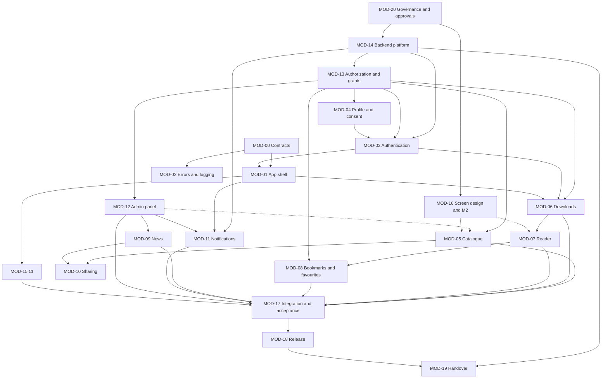

# Implementation Module Inventory: Metal Forming World (MFW) Mobile Application

## 1. Document Control

| Field | Detail |
|---|---|
| Document | Implementation Module Inventory |
| File | `Documentation/IMPLEMENTATION_MODULE_INVENTORY.md` |
| Version | 0.2 |
| Status | Draft for review. Not approved. A planning document. It approves no decision, requirement or scope item. |
| Date | 7 November 2026 |
| Prepared in | Sanika Attarde's session, branch `SA`, on top of commit `bd2db98` |
| Approval required | Both developers. MFW approves nothing in this document. Items that need MFW are listed in section 8. |
| Companion documents | `YUVRAJ_IMPLEMENTATION_ROADMAP.md` and `SANIKA_IMPLEMENTATION_ROADMAP.md`. Both are generated from this inventory. Where they differ from it, this inventory wins and the roadmap is corrected. |

**Change history**

| Version | Date | Change |
|---|---|---|
| 0.1 | 27 October 2026 | Initial draft. 21 modules (MOD-00 to MOD-20), 125 tasks, 12 integration checkpoints. |
| 0.2 | 7 November 2026 | Committed to the repository, unchanged apart from a status note after this table, the version, the date, and two wording fixes (a tool name in the "Prepared in" row, and a dash). The plan, its task IDs and its order of work are not changed. |

**Status note of 7 November 2026.** This document was written on 30 October 2026 on top of commit `bd2db98`, and it is committed here as a record of the plan. Apart from this note, the version, the date and a few wording fixes, it is unchanged. The sections below describe the repository, the open pull requests and the open decisions as they were on 30 October 2026, and are not updated. Since then the Flutter app scaffold (pull request 30) and the shared contracts and fakes (pull request 34) are on `main`; the backend and admin panel spikes are done, and their evidence reports are in `Documentation/test-evidence/` (emulator only, not merged); both developers' written notes are filed, and DEC-010 to DEC-015, DEC-022 and DEC-024 to DEC-030 are AGREED (`DECISION_LOG.md` sections 5.6 and 5.8); and the second-person reviews of issues 28, 29, 31 and 32 are recorded in pull requests 33 to 46. `README.md`, `CHANGELOG.md` and `DEVELOPMENT_ROADMAP.md` give the current state. The task IDs and the order of work stay as the plan.

### 1.1 What this document is and is not

- It is the single list of implementation modules for the two developer roadmaps, with each module's owner, dependencies, interfaces, scope status and the decisions that block it.
- It extends the module list in `API_AND_MODULE_CONTRACTS.md` section 3. MOD-00 to MOD-13 keep their IDs and meaning, because module IDs are never reused (`API_AND_MODULE_CONTRACTS.md` section 12, rule 4). MOD-14 to MOD-20 are new and cover work that has no module there.
- It refines `DEVELOPMENT_ROADMAP.md`. Every work-package task T-xx.y is either split into module tasks or mapped to one (section 9). The roadmap's estimates, weeks and milestone gates are not changed.
- It does not change `TASK_OWNERSHIP_MATRIX.md`. Owners follow that document's PROPOSED workstreams (DEC-011). Where this inventory names an owner that document does not, the difference is listed in section 11.
- Status labels follow RS §1.2 and `DECISION_LOG.md` §3. **PROPOSED** marks a development-team proposal. **Spike** means work that may be done before the decision it depends on is AGREED, on a spike branch and not merged as final (`DECISION_LOG.md` §3.3 rule 4; `DEVELOPMENT_WORKFLOW.md` §13).

## 2. Baseline

Evidence gathered on 27 October 2026.

### 2.1 Repository

| Item | State | Evidence |
|---|---|---|
| Repository | `sanikaattarde/Metal-Forming-World-MFW-` on GitHub, public | `README.md`; `git remote` |
| Branch | `SA` | `git branch` |
| Commit | `bd2db98` ("docs: apply the positions of 26 and 27 October 2026 to the registers and design documents") | `git rev-parse HEAD` |
| How it got there | Local `SA` was at `0b54088`, nine commits behind `origin/main`. On Sanika Attarde's instruction of 27 October 2026 it was fast-forwarded to `origin/main`. Nothing was pushed, so `SA` is nine commits ahead of `origin/SA`. | `git merge --ff-only` output |
| Working tree before this task | One untracked file, `.DS_Store`, not part of the project. No uncommitted changes to tracked files. | `git status` |
| Files tracked | `README.md` and 37 files in `Documentation/` (35 Markdown documents and the two source PDFs) | `git ls-files` |

### 2.2 Existing application structure and implementation status

| Item | State |
|---|---|
| Application code | None. There is no `app/`, `backend/` or `admin/` directory. |
| Build files | None. No `pubspec.yaml`, no `package.json`, no platform projects. |
| Database migrations, rules or schemas | None |
| Tests | None |
| CI configuration | None. No `.github/` directory. |
| Configuration and secrets files | None. No `.gitignore`. |
| Partially completed features | None |

Every implementation module is therefore **Not started** or **Blocked**. Planned spikes (`DEVELOPMENT_ROADMAP.md` section 4.1) are not evidence of progress until they exist in the repository.

### 2.3 Technology stack

| Layer | Position | Status |
|---|---|---|
| Mobile app | Flutter and Dart, one codebase for Android and iOS | BASELINE (DEC-002, S2) |
| App state and navigation | Riverpod and go_router | PROPOSED (DEC-013, DEC-014). Accepted by YG. Sanika Attarde's written agreement not filed. |
| Backend platform | Firebase, as S2 proposes (Authentication, Firestore, Cloud Storage, Cloud Functions, Cloud Messaging, Crashlytics) | PROPOSED in TD-03. DEC-003 is OPEN (C-05). |
| Server language | TypeScript on Node.js | PROPOSED (DEC-025) |
| Admin panel | React web app on Firebase Hosting | PROPOSED in TD-14. DEC-004 is OPEN. |
| News | Direct read of MFW's WordPress REST API from the app | OPEN (DEC-021). S2 position is the working position. |
| PDF reader library | Not chosen. Decided after the M2 reader test. | OPEN (DEC-005) |
| CI | GitHub Actions | PROPOSED (DEC-022). Runner cost not verified. |

No task in the roadmaps treats a PROPOSED or OPEN item above as decided. Firebase names appear only as PROVISIONAL examples.

### 2.4 Authoritative documents used

| Topic | Document |
|---|---|
| Scope baseline | `MFW_Statement_of_Work.pdf` (S2) and `MFW_Commercial_Proposal-2.pdf` (S1). Both copies are unsigned (OQ-28), so they are the issued baseline, not a verified approved one. |
| Requirements | `REQUIREMENTS_SPECIFICATION.md` (RS) v0.1 |
| Scope, exclusions, change candidates | `SCOPE_AND_EXCLUSIONS.md` v0.1 (dated 23 October 2026; it does not yet show the positions of 26 and 27 October 2026) |
| Decisions and questions | `DECISION_LOG.md` v0.3; `OPEN_QUESTIONS.md` v0.3 |
| Architecture and design | `SYSTEM_ARCHITECTURE.md`, `TECHNOLOGY_DECISIONS.md`, `DATABASE_AND_DATA_MODEL.md`, `API_AND_BACKEND_CONTRACT.md` (operations OP-01 to OP-42), `API_AND_MODULE_CONTRACTS.md` (modules, IC-01 to IC-08), `SECURITY_AND_ACCESS_CONTROL.md` (SC-nn), `PDF_READER_AND_OFFLINE_DESIGN.md`, `SCREEN_INVENTORY_AND_NAVIGATION.md` (SCR-A-nn, SCR-W-nn), `CLOUD_INFRASTRUCTURE_AND_COSTS.md` |
| Planning and ownership | `DEVELOPMENT_ROADMAP.md` (WP-00 to WP-12), `TASK_OWNERSHIP_MATRIX.md`, `DEVELOPMENT_WORKFLOW.md`, `CODING_STANDARDS.md`, `DEFINITION_OF_DONE.md` |
| Testing and release | `ACCEPTANCE_CRITERIA.md` (AC-1 to AC-12, PAC-01 to PAC-20), `TESTING_STRATEGY.md` (SEC-CHK-01 to SEC-CHK-19), `TEST_DATA_AND_FIXTURES.md`, `CI_CD_AND_QUALITY_GATES.md` (QG-01 to QG-13), `DEPLOYMENT_PLAN.md` (CFG-01 to CFG-15), `APP_STORE_RELEASE_CHECKLIST.md`, `BACKUP_AND_RECOVERY.md`, `MAINTENANCE_AND_HANDOVER.md` (HO-01 to HO-16), `RISK_REGISTER.md`, `DEPENDENCY_REGISTER.md` |

### 2.5 Decisions

| Group | Entries |
|---|---|
| BASELINE (stated in S1 or S2) | DEC-002 Flutter; DEC-009 content protection |
| AGREED or APPROVED | None |
| PROPOSED (18) | DEC-001, DEC-010 to DEC-015, DEC-022 to DEC-030, DEC-032, DEC-033 |
| OPEN (13) | DEC-003, DEC-004, DEC-005, DEC-006, DEC-007, DEC-008, DEC-016, DEC-017, DEC-018, DEC-019, DEC-020, DEC-021, DEC-031 |
| Open questions | 59, all OPEN (OQ-01 to OQ-59). 40 are P1. |

Most PROPOSED engineering entries (DEC-010 to DEC-015, DEC-025 to DEC-030) carry the note that Sanika Attarde's written agreement is not filed. Until it is, `DECISION_LOG.md` §3.3 rule 4 limits code that depends on them to spikes. Filing it is task MOD20-P1-T01, the first task in the plan.

### 2.6 Known exclusions

S2 "Scope not included" and `SCOPE_AND_EXCLUSIONS.md` section 12 list EXC-01 to EXC-23. Those that most affect implementation: Sign in with Apple (EXC-01); guest reading and a public sample (EXC-02, PROVISIONAL); reading before the full download finishes (EXC-03); scheduled notifications, segments and statistics (EXC-04); a readership dashboard (EXC-05); per-user reading tracking (EXC-06); editorial roles, drafts, scheduled publishing and an audit log (EXC-07); links that open the app (EXC-08); payments (EXC-10); a web reader (EXC-11); WordPress changes and news authoring (EXC-12); the product sending emails (EXC-15); DRM (EXC-19); search inside PDF text (EXC-23). No task in either roadmap builds an excluded item.

### 2.7 Missing information

- Signed or accepted S1 and S2, the S3 emails, and MFW's named approver and deputy (OQ-28, OQ-29). All reported by YG, none filed.
- MFW inputs due on the Charter dates and reported not received: brand assets, sample PDFs, WordPress details, a cloud project in MFW's name, store accounts (GS-Q35).
- A test device set that meets S2 AC-10. The team reports a mid-range Android phone and a current iPhone only (OQ-26, R25).
- Effort estimates for T-09.7 and for the tasks this inventory adds (MOD-02, MOD-14 production set-up, MOD-19 backup). None is estimated here.
- Each developer's availability in a filed record (OQ-38). YG reports both are full time.

### 2.8 Existing ownership

`TASK_OWNERSHIP_MATRIX.md` §5 proposes WS-A Platform and Publishing for Sanika Attarde and WS-B Reader Experience for Yuvraj (DEC-011, PROPOSED). YG accepted it on 27 October 2026. On 27 October 2026, in this session, Sanika Attarde chose DEC-011 as recorded as the basis for these roadmaps. That choice is not filed evidence: DEC-011 stays PROPOSED until Sanika Attarde's written note or approving pull-request review is filed.

## 3. A. Project Implementation Overview

```text
MFW product (S2 Product)
├── Flutter app, Android and iOS (MOD-00 to MOD-11)
│   ├── Foundation: shared contracts (MOD-00), shell and routes (MOD-01), errors and logging (MOD-02)
│   ├── Accounts: authentication (MOD-03), profile, settings and consent (MOD-04)
│   ├── Reading: catalogue and search (MOD-05), issue access and downloads (MOD-06), reader (MOD-07), bookmarks and favourites (MOD-08)
│   ├── News and sharing: WordPress news (MOD-09), sharing (MOD-10)
│   └── Notifications, app side (MOD-11)
├── Backend on MFW's accounts (MOD-11 dispatch, MOD-12 content operations, MOD-13, MOD-14)
│   ├── Platform, environments and configuration (MOD-14)
│   ├── Authorization rules, issue-file grants, account deletion (MOD-13)
│   └── Content operations, uploads, admin roles (MOD-12 server side)
├── Web admin panel (MOD-12)
├── External: MFW's WordPress site, Apple and Google push and stores (not built here)
└── Delivery work that ships no product code
    ├── CI and quality gates (MOD-15)
    ├── Screen design and the M2 prototype (MOD-16)
    ├── Integration, testing and acceptance (MOD-17)
    ├── Release and store submission (MOD-18)
    ├── Handover, backup and operations (MOD-19)
    └── Governance, client approvals and inputs (MOD-20)
```

**Relationships.** The app reads the public catalogue and news without sign-in. Every protected action goes through MOD-03's `AccessState` on the device and is enforced again by MOD-13 on the server (`API_AND_MODULE_CONTRACTS.md` §4.4). An issue file reaches the device only through a short-lived grant from MOD-13 (DEC-009), is stored by MOD-06 and is rendered by MOD-07. Admins change the catalogue, news controls and notifications through MOD-12, and the app sees the changes after a refresh (IC-06, IC-07). MOD-14 holds every environment the others deploy to.

## 4. B. Module Register

Owner names follow DEC-011 (PROPOSED). "Approved" in the scope column means **in the issued S2 baseline (CONFIRMED)**, whose formal acceptance is unverified (OQ-28). It never means MFW approved this plan.

| Module ID | Module Name | Purpose | Included Requirements | Dependencies | Current Status | Scope Status | Primary Owner | Supporting Owner | Source Documents |
|---|---|---|---|---|---|---|---|---|---|
| MOD-00 | Shared domain models and interfaces | One set of Dart models and interfaces so the two developers build against agreed contracts | RS §7.1; DATA-001 to DATA-009, DATA-011 to DATA-013 (shapes only); NFR-MAINT-005 | None | Not started | Approved | Yuvraj (folder and initial drafts). Each file thereafter: the workstream of the module that writes the model. | Sanika Attarde (owns the WS-A files and must approve them) | `API_AND_MODULE_CONTRACTS.md` §5; `TASK_OWNERSHIP_MATRIX.md` §6, §8.1; `DEVELOPMENT_ROADMAP.md` §4.1 |
| MOD-01 | App shell, navigation and platform services | Entry point, theme, route table and guards, connectivity, app configuration, notification tap routing | FR-MAG-006 (shell part), FR-AUTH-010 (routing), FR-PROF-004 (routing), FR-NOTIF-005 (routing), BR-001, BR-002, BR-003, BR-005, NFR-UX-001, NFR-UX-003, NFR-SEC-001, NFR-COMP-001 | MOD-00, MOD-03 (`AccessState` contract) | Not started | Approved. No guest reading (BR-001) is Pending client approval (C-01). | Yuvraj (WS-B) | Sanika Attarde | `API_AND_MODULE_CONTRACTS.md` §6.1; DEC-007, DEC-014; `SCREEN_INVENTORY_AND_NAVIGATION.md` |
| MOD-02 | Errors, logging and monitoring | Failure-to-message mapping, redacting logger, crash reporting, usage events from an approved list, server security logs | FR-STATE-001 to FR-STATE-007 (message mapping), NFR-OBS-001, NFR-OBS-002, NFR-PRIV-003, DATA-014 | MOD-00; MOD-14 for the provider | Not started | Crash reporting Approved. Usage events Requires clarification (C-07, OQ-23). | Sanika Attarde (WS-A) | Yuvraj | `API_AND_MODULE_CONTRACTS.md` §6.2; DEC-028; TD-16 |
| MOD-03 | Authentication and account lifecycle | Email registration, verification, sign-in, reset, sign-out, Google Sign-In, `AccessState`, in-app account deletion | FR-AUTH-001 to FR-AUTH-010, INT-AUTH-001, INT-AUTH-002, DATA-003, BR-002 | MOD-00, MOD-02, MOD-04, MOD-13, MOD-14 | Blocked: DEC-003 (identity provider). Contracts and fakes can start. | Email accounts Approved. Google Sign-In Pending client approval (C-04, OQ-29). FR-AUTH-006 and FR-AUTH-007 Requires clarification (OQ-04, OQ-05). | Sanika Attarde (WS-A) | Yuvraj (route guards) | `API_AND_MODULE_CONTRACTS.md` §6.3; DEC-006; TD-06; `SECURITY_AND_ACCESS_CONTROL.md` SC-21 |
| MOD-04 | Profile, settings and consent | Mandatory reader profile, profile screen and editing, consent and policy links, settings screen | FR-PROF-001 to FR-PROF-007, FR-PRIV-001, FR-PRIV-002, FR-PRIV-004, DATA-004, DATA-012, BR-003, NFR-PRIV-001, NFR-PRIV-006, NFR-SEC-006 | MOD-00, MOD-13, MOD-14, MOD-11 (preferences widget) | Not started | Mandatory profile Pending client approval (S3, OQ-01, OQ-02, OQ-03, OQ-07). Profile screen and consent Approved. | Sanika Attarde (WS-A) | Yuvraj | `API_AND_MODULE_CONTRACTS.md` §6.4; OQ-01, OQ-27 |
| MOD-05 | Catalogue, search and home | Public catalogue, issue details, home, refresh, metadata search and filters on the device | FR-MAG-001 to FR-MAG-009, FR-SRCH-001 to FR-SRCH-007, DATA-001, DATA-002, NFR-OFF-002 (catalogue part), NFR-STOR-002 | MOD-00, MOD-01, MOD-13 (public read), MOD-12 or seeded data | Not started | Approved. Public field list and filter meanings Requires clarification (OQ-13). | Yuvraj (WS-B) | Sanika Attarde | `API_AND_MODULE_CONTRACTS.md` §6.5; DEC-030; TD-21 |
| MOD-06 | Issue access and downloads | Authorized, complete, verified local copy; size, mobile-data and storage checks; resume; Downloads screen; deletion; Read and Download copy kinds | FR-DL-001 to FR-DL-010, FR-READ-002, FR-STATE-004, FR-STATE-006, NFR-SEC-004, NFR-OFF-001, NFR-STOR-001, DATA-013 | MOD-01, MOD-03, MOD-13 (OP-11 grant) | Blocked: DEC-020 for the transport. Contracts, fakes and the spike can start. | Download Approved. Temporary versus kept copy Requires clarification (C-03, OQ-08). FR-DL-010 Requires clarification (OQ-11). | Yuvraj (WS-B) | Sanika Attarde (OP-11) | `API_AND_MODULE_CONTRACTS.md` §6.6; `PDF_READER_AND_OFFLINE_DESIGN.md`; DEC-008, DEC-020, DEC-033 |
| MOD-07 | Reader | Page-turn and swipe modes, zoom to 300%, two-page spread, damaged-file handling, performance | FR-READ-001, FR-READ-003 to FR-READ-010, NFR-PERF-001, NFR-PERF-002, NFR-REL-001, NFR-COMP-002 | MOD-06 (`openLocal`), MOD-08, DEC-005 | Blocked: DEC-005 (library, at M2). The spike can start. | Approved. Mode switching Requires clarification (OQ-14). Library approved by MFW at M2. | Yuvraj (WS-B) | Sanika Attarde | `API_AND_MODULE_CONTRACTS.md` §6.7; `PDF_READER_AND_OFFLINE_DESIGN.md` §7, §9 |
| MOD-08 | Bookmarks and favourites | Page bookmarks and favourite issues stored with the account, private, on a second device | FR-BKM-001 to FR-BKM-008, DATA-005, DATA-006, NFR-SEC-005 | MOD-07, MOD-13 (owner rules) | Not started | Approved. Offline behaviour Requires clarification (OQ-10). Favourites for incomplete access Requires clarification (OQ-12). | Yuvraj (WS-B) | Sanika Attarde (rules) | `API_AND_MODULE_CONTRACTS.md` §6.8 |
| MOD-09 | News from WordPress | News list, article, category filter, offline cache, hidden and breaking controls applied | FR-NEWS-001 to FR-NEWS-009, INT-WP-001 to INT-WP-005, DATA-015, FR-STATE-005 | WordPress site (OQ-39), MOD-12 news controls, MOD-13 public read | Not started. Live read blocked by OQ-39. | Approved. Offline save model and breaking presentation Requires clarification (OQ-16, OQ-17). | Yuvraj (WS-B) | Sanika Attarde (news controls) | `API_AND_MODULE_CONTRACTS.md` §6.9, §9.1; DEC-021; TD-12 |
| MOD-10 | Sharing | Share an issue or article through the share sheet, never the PDF | FR-SHR-001 to FR-SHR-006 | MOD-05, MOD-09 | Not started | Approved. Link targets Pending client approval (S3). Which store link Requires clarification (OQ-15). | Yuvraj (WS-B) | Sanika Attarde | `API_AND_MODULE_CONTRACTS.md` §6.10 |
| MOD-11 | Notifications | Permission explanation, categories, device registration, dispatch by category, send log, tap target payload | FR-NOTIF-001 to FR-NOTIF-007, FR-ADMIN-016 to FR-ADMIN-018 (dispatch), INT-PUSH-001, INT-PUSH-002, DATA-007, DATA-008, NFR-REL-003 | MOD-01 (`AppNavigator`), MOD-12 (send screens), MOD-14 (push provider); Apple Developer account | Blocked: DEC-003 and MFW's Apple account for delivery. App-side contract can start. | Approved. Logged-out visitors Requires clarification (OQ-09). Categories Requires clarification (OQ-18). | Sanika Attarde (WS-A) | Yuvraj (tap routing) | `API_AND_MODULE_CONTRACTS.md` §6.11; TD-13 |
| MOD-12 | Admin and content management | Admin panel: sign-in and role, upload and validation, issue details, categories, publish, news controls, send screens, registered users, delete or replace, admin management | FR-ADMIN-001 to FR-ADMIN-015, FR-ADMIN-019, FR-USER-001 to FR-USER-005, FR-STATE-007, DATA-009, DATA-011, NFR-SEC-007, NFR-SEC-008, NFR-SEC-011, NFR-PRIV-004, NFR-COMP-005 | MOD-13, MOD-14, DEC-004 | Blocked: DEC-003, DEC-004. A skeleton spike can start. | Core panel Approved. Registered-user list Pending client approval (S3). In-panel add and remove of admins Pending client approval (OQ-58). Subscriber export Requires clarification (C-02, OQ-31). Delete or replace Requires clarification (OQ-21). | Sanika Attarde (WS-A) | Yuvraj | `API_AND_MODULE_CONTRACTS.md` §7.1; `API_AND_BACKEND_CONTRACT.md` OP-14 to OP-42; DEC-027; `SCREEN_INVENTORY_AND_NAVIGATION.md` SCR-W-01 to SCR-W-11 |
| MOD-13 | Backend authorization, data rules, file grants and account deletion | Server enforcement of every access rule, issue-file grants, deleted-issue list, immediate account deletion, rate limits | NFR-SEC-002, NFR-SEC-003, NFR-SEC-005 to NFR-SEC-008, INT-FILE-001, FR-READ-001, FR-DL-002, FR-PRIV-003, FR-AUTH-009 (server), NFR-PRIV-005, DATA-017 | MOD-14, DEC-003, DEC-020 | Blocked: DEC-003, DEC-020. Emulator spike can start. | Approved. Retention Requires clarification (OQ-24). | Sanika Attarde (WS-A) | Yuvraj | `API_AND_MODULE_CONTRACTS.md` §7.2; `SECURITY_AND_ACCESS_CONTROL.md` SC-01 to SC-21; DEC-009, DEC-029 |
| MOD-14 | Backend platform, environments and configuration | Cloud project access, region, ENV-LOCAL, ENV-TEST and ENV-PROD, backend skeleton, configuration items, repository hygiene for secrets | NFR-SEC-012, NFR-STOR-003, NFR-MAINT-005 (backend side), DATA-016 | MOD-20 (DEC-003 agreed and approved, cloud project, region) | Blocked: DEC-003, DEC-023, DEC-031, OQ-40, MFW cloud project | Approved (SCP-071). Technology Requires clarification (SCP-072, C-05). Second project Pending client approval (DEC-023). | Sanika Attarde (WS-A) | Yuvraj | `DEPLOYMENT_PLAN.md` §4, §6, §7; `SYSTEM_ARCHITECTURE.md` §9; TD-03, TD-18, TD-22 |
| MOD-15 | CI and quality gates | Automated checks QG-01 to QG-13 on every pull request and release | NFR-MAINT-003 (pipeline part), NFR-MAINT-006 (licence check) | MOD-01 scaffold; MOD-13 and MOD-12 test suites for QG-08 and QG-09 | Not started | Approved as internal engineering with no scope effect. MFW approval only if a cost is billed to MFW (DEC-022). | Yuvraj (WS-B) | Sanika Attarde | `CI_CD_AND_QUALITY_GATES.md`; DEC-022 |
| MOD-16 | Screen design and M2 prototype | Design tokens, app and admin screens with all states, interactive prototype, M2 approval | NFR-UX-001, NFR-UX-002, NFR-UX-004, FR-STATE-001 to FR-STATE-007 (designed states), FR-MAG-006 (design) | MFW brand assets; OQ-01, OQ-13, OQ-16, OQ-17 for content | Blocked: brand assets not received | Approved (S2 M2). Accessibility baseline Requires clarification (OQ-25). | Yuvraj (WS-B, WP-02 lead) | Sanika Attarde (account, settings, notification and admin screens; M2 presentation) | `SCREEN_INVENTORY_AND_NAVIGATION.md`; `DEVELOPMENT_ROADMAP.md` WP-02 |
| MOD-17 | Integration, testing and acceptance | Fixtures, device set, M3 demo flow, M4 integration build, regression, security checklist, test summary, acceptance testing | NFR-COMP-003, NFR-COMP-004, NFR-REL-002, NFR-SEC-010, NFR-STOR-001, NFR-STOR-002 (checks), FR-EMAIL-003, FR-USER-004, FR-SHR-005 (inspection) | All feature modules; MOD-15 | Not started | Approved (S2 AC-10, acceptance testing). Device set Requires clarification (OQ-26). | Yuvraj (WS-B, WP-11 lead) | Sanika Attarde | `TESTING_STRATEGY.md`; `TEST_DATA_AND_FIXTURES.md`; `ACCEPTANCE_CRITERIA.md`; `REQUIREMENT_COVERAGE_MATRIX.md` |
| MOD-18 | Release and store submission | App identifiers, signing, tagged release builds, listings, privacy declarations, reviewer access, submission | NFR-MAINT-003, NFR-PRIV-002, INT-STORE-001 | MOD-17, MOD-15, MFW store accounts (OQ-42) | Blocked: OQ-42, store accounts not received | Approved (S2 AC-11) | Sanika Attarde (WS-A) | Yuvraj (release pipeline) | `APP_STORE_RELEASE_CHECKLIST.md`; `DEPLOYMENT_PLAN.md` §7.8 |
| MOD-19 | Handover, backup and operations | Technical documentation, admin guide and training, credential record, repository transfer, clean-copy rebuild, backup, monitoring access, warranty records | NFR-MAINT-001, NFR-MAINT-002, NFR-MAINT-004, DATA-016 | MOD-14, MOD-18 | Not started. Backup blocked by OQ-46. | Handover Approved (S2 AC-12, Handover). Backup and monitoring access Requires clarification (proposed additions, OQ-46, OQ-47). | Sanika Attarde (WS-A) | Yuvraj | `MAINTENANCE_AND_HANDOVER.md`; `BACKUP_AND_RECOVERY.md`; `SECURITY_INCIDENT_PROCEDURE.md` |
| MOD-20 | Governance, client approvals and inputs | Internal agreement, design reviews, MFW records, questions, the M1 note, inputs and delay notices, change requests | NFR-PRIV-006 (legal review), DATA-016; S2 M1, Responsibilities, Changes | None | In progress: requests for inputs reported as sent (GS-Q35). Nothing filed. | Approved (S2 M1 and Responsibilities) | Sanika Attarde (MFW contact, CH §14) | Yuvraj | `DEVELOPMENT_ROADMAP.md` WP-00; `OPEN_QUESTIONS.md`; `DECISION_LOG.md` §4 |

**Not a module: the edition-update sign-up.** FR-EMAIL-001, FR-EMAIL-002, FR-USER-001 and DATA-010 are in S1 and S2 but are dropped on the working position (DEC-032, GS-Q49) until MFW agrees in writing (OQ-31). No task builds them. If MFW keeps the sign-up, the work goes to MOD-04 (sign-up) and MOD-12 (export), owned by Sanika Attarde, as new tasks.

## 5. Task Identifiers

Sanika Attarde chose module-based IDs on 27 October 2026.

| Rule | Detail |
|---|---|
| Format | `MODnn-Pn-Tnn`, for example `MOD06-P2-T03`: module 06, phase 2, task 03. Module numbers match MOD-nn. |
| Uniqueness | One ID per task across both roadmaps. A task appears in full only in its owner's roadmap. The other roadmap names it by ID where it depends on it. |
| Parent | Each task names its parent in `DEVELOPMENT_ROADMAP.md` (T-xx.y), or "New" with the source that requires it. Section 9 is the crosswalk. |
| Stability | An ID is never reused. If a task moves to another phase or module, it is closed with "Moved to <new ID>" and a new ID is issued. The old ID stays so earlier references resolve. |
| Phases | Phase numbers are local to a module and run in order. A later phase may start when its entry conditions are met, even if a task in an earlier phase is blocked on a decision. |

## 6. C. Module Dependency Map

### 6.1 Graph

Solid arrows are hard dependencies: the later module cannot be integrated without the earlier one. Dotted arrows are soft: work can start against fakes or seeded data.



### 6.2 Dependency types

| Type | Dependencies |
|---|---|
| Hard | MOD-14 before MOD-13, MOD-03, MOD-11 delivery and MOD-12 in any shared environment. MOD-13 OP-11 before MOD-06 real downloads. MOD-03 `AccessState` contract before MOD-01 guards. MOD-06 `openLocal` before MOD-07 opens real issues. MOD-12 publish and news controls before IC-06 and IC-07 pass. MOD-17 M4 build before MOD-18 submission. |
| Soft | MOD-05, MOD-08, MOD-09 and MOD-10 screens can be built against fakes from MOD-00 and seeded fixtures. MOD-16 designs shape MOD-05 and MOD-07 screens, but logic and tests can start first. |
| Parallel | WS-B app modules (MOD-00, MOD-01, MOD-05 to MOD-10, MOD-15) run in parallel with WS-A backend and admin modules (MOD-12 to MOD-14), meeting only at the checkpoints in section 10. The reader spike (MOD07-P1-T01), the WordPress client (MOD09-P1-T01) and the emulator spike (MOD14-P1-T02) need no decision and can run now. |
| Integration | IC-01 to IC-08 (`API_AND_MODULE_CONTRACTS.md` §10), checked at checkpoints ICP-02 to ICP-08 |
| External approvals | DEC-003 and MFW's cloud project block MOD-13, MOD-14 and the backend half of MOD-03, MOD-11 and MOD-12. DEC-004 blocks MOD-12's interface. DEC-005 (M2) blocks MOD-07's final library. MFW's brand assets block MOD-16. MFW's Apple account blocks MOD-11 delivery and MOD-18. OQ-58 blocks in-panel admin management. OQ-08 blocks the copy-kind split in MOD-06. |

## 7. D. Shared Interfaces

| Interface | Defined in | Owner (provider) | Consumers | Change rule |
|---|---|---|---|---|
| Domain models (`IssueSummary`, `DownloadedIssue`, `Bookmark`, `NewsPost` and the rest) | `API_AND_MODULE_CONTRACTS.md` §5; `app/lib/contracts/` | The writing module's workstream, per file | All app modules | Shared-file protocol (`DEVELOPMENT_WORKFLOW.md` §8); both developers review |
| `AccessState`, `AuthService` | §4.1, §6.3 | Sanika Attarde (MOD-03) | MOD-01, MOD-05 to MOD-08 | Shared-file protocol; both developers review (`TASK_OWNERSHIP_MATRIX.md` §8.1) |
| `Result`, `AppFailure`, `FailureCode`, `messageFor` | §4.2, §6.2 | Sanika Attarde (MOD-02) | All app modules | Shared-file protocol |
| Backend operations OP-01 to OP-42 and the category-plus-reason error scheme | `API_AND_BACKEND_CONTRACT.md` (main IDs); aliases in `API_AND_MODULE_CONTRACTS.md` §8 | Sanika Attarde (MOD-12, MOD-13) | MOD-03 to MOD-06, MOD-08, MOD-09, MOD-11 | Additive changes by review. Breaking changes need a `DECISION_LOG.md` entry (DEC-026) |
| Database model and access rules | `DATABASE_AND_DATA_MODEL.md`; `SECURITY_AND_ACCESS_CONTROL.md` | Sanika Attarde (MOD-13) for rules; document editor PROPOSED: Yuvraj | All backend operations | Rule tests in the same pull request (`TASK_OWNERSHIP_MATRIX.md` §8.1) |
| Issue-file grant (`IssueFileGrant`, OP-11) | §5; DEC-020 | Sanika Attarde (MOD-13) | MOD-06 | IC-02 must pass after any change |
| Local file to reader (`openLocal`, `LocalIssueFile`) | §6.6 | Yuvraj (MOD-06) | MOD-07 | IC-03 |
| Routes and `AppNavigator` | §6.1 | Yuvraj (MOD-01) | MOD-11 (tap), every feature (registration) | Other features ask for route changes in a small pull request |
| Notification payload | §6.11 | Sanika Attarde (MOD-11) | MOD-01 | IC-05; payloads carry no personal data |
| Configuration items CFG-01 to CFG-15 | `DEPLOYMENT_PLAN.md` | Sanika Attarde (MOD-14) | MOD-01 (app values), MOD-12, MOD-13 | No secret in the repository (SEC-CHK-09) |
| Logging and redaction rules | `CODING_STANDARDS.md` §6.2; SC-16 | Sanika Attarde (MOD-02) | All modules | SEC-CHK-10 |
| Test fakes and fixtures | `app/test/fakes/`; `TEST_DATA_AND_FIXTURES.md` | Fakes: the interface's owner. Fixtures: Yuvraj (MOD-17) | All test suites | Shared-file protocol; no confidential sample in Git (DEC-024) |
| Dependency manifest (`app/pubspec.yaml`) | `TASK_OWNERSHIP_MATRIX.md` §8.1 | Sanika Attarde | All app modules | A `DEPENDENCY_REGISTER.md` entry first |

**Files that must not be changed by one developer alone:** `app/lib/contracts/`, `app/lib/features/auth/auth.dart`, `app/lib/main.dart` and `app/lib/app/`, `app/pubspec.yaml` and its lock file, `app/analysis_options.yaml`, `app/android/` and `app/ios/`, `app/test/fakes/`, `backend/` access rules, `.github/`, `.gitignore`. Conflicts follow `DEVELOPMENT_WORKFLOW.md` §9: the primary editor resolves, the other developer reviews, and an unresolved disagreement becomes a `DECISION_LOG.md` entry.

## 8. E. Scope and Decision Constraints

The table covers the areas the planning brief asked to check. "Can proceed" is work that does not depend on the answer. Nothing here converts a pending item into an approved one.

| Area | Source | Question as recorded | Consequence for implementation | Modules and tasks | Can proceed | Blocked | Approval needed |
|---|---|---|---|---|---|---|---|
| Read versus Download | DEC-008, DEC-033, OQ-08 (C-03) | "Does opening a full issue always keep it as an offline copy, or is there a temporary copy for reading and a separate action to keep it offline?" | Decides whether `DownloadManager.start` takes a copy kind and whether Read cleans up | MOD-06: MOD06-P3-T01 | The shared download pipeline (MOD06-P2-T01 to T05) | The kind split and temporary-copy cleanup | MFW's written answer (two unfiled, conflicting reports exist) |
| Online reading versus full download | FR-READ-002 (CONFIRMED); EXC-03; CH §8 "Online reading" (C-03) | As above | No page streaming is planned. A full issue opens only from a complete, verified copy. | MOD-06, MOD-07 | All reader and download work | Nothing beyond OQ-08 | None beyond OQ-08 |
| Offline storage and deletion | OQ-11, OQ-10, FR-DL-010 | "What happens to downloaded issues when the reader signs out, deletes the account, or the issue is unpublished?" | Kept-copy lifecycle rules and the deleted-issue list (OP-03) | MOD06-P3-T02, MOD13-P1-T05, MOD05-P2-T05, MOD08-P2-T04 | Delete-to-free-space (FR-DL-009) | The four lifecycle rules; offline catalogue and library | MFW (OQ-11); MFW approval of the team's answer to OQ-10 |
| Authentication and Google Sign-In | DEC-006, C-04, OQ-04, OQ-05, OQ-06, OQ-29 | "Does email verification apply to Google accounts, and if so, how?" and "What happens when an address already registered with email and password is used for Google Sign-In, or the reverse?" | Google accounts in `AccessState`; account linking | MOD03-P3-T01, MOD03-P3-T02 | Email accounts (MOD03-P2-*); the linking spike | Google Sign-In as final | MFW's written scope confirmation (OQ-29) and acceptance of risk R9 (OQ-06) |
| Admin roles and permissions | DEC-027, RS FR-ADMIN-004, S2 Assumptions "A small editorial team uses one admin role" | One role is CONFIRMED | Every admin has the same permissions. No Super Admin or Content Admin role. | MOD-12, MOD-13 | All one-role work | Nothing | None for one role |
| Client-managed adding and removing of admins | DEC-027, OQ-20, OQ-58, S1 "Admin user list" (MFW supplies it, Weeks 5 and 6), S2 EXC-07 (no audit log) | "Does MFW treat the in-panel adding and removing of admins by any admin, and the small record of who added or removed whom, as a clarification of the S2 admin panel or as a change request?" | S2 and S1 do not include in-panel management, and the change record sits close to the excluded audit log. If MFW treats it as a change, it needs a change request under S2 Changes (CHG-02) before it is built as scope. | MOD12-P3-T02; MOD20-P2-T02 raises it | The first-admin bootstrap (MOD12-P1-T02), which is needed in every case; developer-run additions from MFW's list as the fallback | Admin management screens and OP-34, OP-35, OP-37 to OP-39 as agreed scope | MFW's written answer to OQ-58, and a change request if MFW calls it a change |
| Backend and database | DEC-003, TD-03, TD-07, C-05, OQ-35 | "Which backend platform, admin technology and data model are approved? Is the S2 Firebase proposal kept?" | Transport, rule language, emulator, deployment. Firebase is named in S2 M3 and AC-12. | MOD-03, MOD-11 to MOD-14, MOD-19 | Technology-neutral contracts; emulator spike | Every backend task beyond a spike | Both developers AGREED; MFW if it differs from S2 or adds cost |
| Cloud hosting and storage | DEC-023, DEC-031, OQ-40, OQ-41, OQ-53 | "In which cloud region are the backend data and backups held?" and "Will MFW provide a separate non-production cloud project for testing, at its cost?" | A region cannot be changed after creation (TD-22). ENV-TEST needs a second project. | MOD14-P2-T02, MOD14-P3-T01 | Nothing in the cloud | Any cloud resource | MFW and its legal adviser (region); MFW (cost ceiling, test project) |
| Signed URL security and expiry | DEC-009 (BASELINE), DEC-020, TD-09, OQ-37 | "How are protected issue files delivered ..., with what grant lifetime, and how is resume achieved for files up to 150 MB?" | Grant shape, CFG-06 lifetime, resume proof (AR-01). Long-lived bearer links are not used. | MOD13-P1-T04, MOD06-P1-T02, MOD06-P2-T03 | Contract with an opaque grant; resume spike against a test server | OP-11 as final | Both developers AGREED; MFW only if it adds cost |
| Analytics and crash reporting | DEC-028, C-07, OQ-23 | "Which basic usage events are recorded, and is consent needed before recording them?" | Usage events stay off until answered | MOD02-P2-T01, MOD02-P2-T02 | Crash reporting with no user identifier (after DEC-003) | Usage events | MFW (C-07, OQ-23) |
| Notifications | OQ-09, OQ-18, OQ-19, OQ-55 | "What is the final list of notification categories, and can admins add or change categories?" | Three fixed categories on the working position; logged-out device subscriptions | MOD-11 | Contracts, permission flow | Final categories and send-log fields | MFW (OQ-09, OQ-18); MFW approval of the team's answer to OQ-19 |
| Third-party services | NFR-MAINT-006, CHG-03, `DEPENDENCY_REGISTER.md` | No paid component without MFW's written approval | Every package needs a register entry and licence first | All | Free, licensed packages after a register entry | Any paid component | MFW in writing for any paid item |
| Store publication | OQ-42, OQ-43, OQ-44, OQ-45, OQ-06 | "What are the app name, Android application ID and iOS bundle ID? Are the Apple and Google accounts organisation accounts in MFW's name ...?" | Identifiers drive Google Sign-In, push and signing | MOD-18, MOD03-P3-T02, MOD11-P2-T01 | Release checklist preparation | Any Google or Apple set-up | MFW's written identifiers and accounts |
| Edition-update sign-up | DEC-032, OQ-31, C-02, CHG-09 | "Is the optional edition-update email sign-up kept, dropped, or merged into registration? ..." | S1 and S2 list it, so dropping it removes a deliverable | No task scheduled | The registered-user CSV (MOD12-P2-T06, PROVISIONAL) | Any sign-up work | MFW's written agreement to drop it |
| Deleting or replacing an issue | OQ-21 | "Can an admin permanently delete an issue or replace its PDF, and what happens to copies already downloaded?" | Delete and replace need different safeguards | MOD12-P3-T01, MOD13-P1-T05 | Unpublish (FR-ADMIN-011) | Delete and replace | MFW |
| Mandatory profile | OQ-01, OQ-02, OQ-03, OQ-07, OQ-27 | "What is the final mandatory profile field list ...?" | Field list and validation are configuration on the working position | MOD-04 | Screens with a configurable field list | Final fields, consent wording | MFW; MFW's legal adviser for exact age |
| Scope exclusions and change requests | S2 Changes; CHG-01 to CHG-14 | Excluded items need a change request | None of EXC-01 to EXC-23 is scheduled | All | None | None | MFW for any change |

**Admin model check.** The intended behaviour in the planning brief (one admin role, equal permissions, a securely created first admin, and MFW adding and removing admins in the panel) was checked against S2 and S1. One role and equal permissions are in S2 ("A small editorial team uses one admin role") and RS FR-ADMIN-004. The secure first admin is a named step in the design (OP-42, SC-14) and does not change scope. In-panel adding and removing is **not** in S2 or S1: S1 has MFW supplying an admin user list, and S2 lists admin sign-in and the refusal of non-admins. It is therefore planned only as MOD12-P3-T02, blocked on OQ-58. MOD20-P2-T02 asks MFW the question and, if MFW calls it a change, raises the change request.

## 9. Crosswalk to Development Roadmap Tasks

| T-xx.y | Module tasks |
|---|---|
| T-00.1 | MOD20-P2-T01 |
| T-00.2 | MOD20-P2-T02 |
| T-00.3, T-00.6 | MOD20-P1-T02 |
| T-00.4 | MOD20-P1-T01 |
| T-00.5 | MOD20-P2-T03 |
| T-00.7 | MOD20-P1-T03 |
| T-01.1 | MOD01-P1-T01 |
| T-01.2 | MOD14-P1-T01 |
| T-01.3 | MOD14-P2-T01 |
| T-01.4 | MOD14-P1-T02 (spike), MOD14-P2-T03 |
| T-01.5 | MOD15-P1-T01, MOD15-P1-T02 |
| T-01.6 | MOD12-P1-T01 |
| T-02.1 | MOD16-P1-T01, MOD16-P1-T02, MOD16-P1-T03, MOD16-P1-T05, MOD01-P2-T02 |
| T-02.2 | MOD16-P1-T04 |
| T-02.3 | MOD07-P1-T01, MOD07-P1-T02 |
| T-02.4 | MOD06-P1-T02 |
| T-02.5 | MOD16-P2-T01 |
| T-03.1 | MOD03-P2-T01, MOD03-P2-T02 |
| T-03.2 | MOD03-P3-T01, MOD03-P3-T02 |
| T-03.3 | MOD04-P1-T01, MOD04-P2-T01, MOD04-P2-T02, MOD04-P2-T03 |
| T-03.4 | MOD03-P1-T01, MOD03-P2-T03, MOD01-P2-T01 |
| T-03.5 | MOD13-P1-T06, MOD03-P4-T01 |
| T-03.6 | MOD13-P1-T01 |
| T-04.1 | MOD05-P1-T01, MOD05-P2-T01 |
| T-04.2 | MOD05-P2-T02 |
| T-04.3 | MOD05-P2-T03 |
| T-04.4 | MOD05-P2-T04 |
| T-05.1 | MOD07-P2-T01 |
| T-05.2 | MOD07-P2-T02 |
| T-05.3 | MOD07-P2-T03 |
| T-05.4 | MOD07-P2-T04 |
| T-05.5 | MOD07-P3-T01 |
| T-06.1 | MOD13-P1-T04 |
| T-06.2 | MOD06-P1-T01, MOD06-P2-T01, MOD06-P2-T02 |
| T-06.3 | MOD06-P2-T03 |
| T-06.4 | MOD06-P2-T04, MOD06-P2-T05 |
| T-06.5 | MOD06-P3-T01, MOD06-P3-T02, MOD06-P3-T03 |
| T-07.1 | MOD13-P1-T02 |
| T-07.2 | MOD08-P1-T01, MOD08-P2-T01 |
| T-07.3 | MOD08-P2-T02 |
| T-07.4 | MOD08-P2-T03 |
| T-08.1 | MOD09-P1-T01 |
| T-08.2 | MOD09-P2-T01 |
| T-08.3 | MOD09-P2-T02 |
| T-08.4 | MOD09-P2-T03 |
| T-08.5 | MOD10-P1-T01 |
| T-09.1 | MOD12-P1-T02, MOD12-P2-T01 |
| T-09.2 | MOD12-P2-T02 |
| T-09.3 | MOD12-P2-T03, MOD13-P1-T03 |
| T-09.4 | MOD12-P2-T04 |
| T-09.5 | MOD12-P2-T06 |
| T-09.6 | MOD12-P3-T01 |
| T-09.7 | MOD12-P3-T02 |
| T-10.1 | MOD11-P2-T01 |
| T-10.2 | MOD11-P2-T02 |
| T-10.3 | MOD11-P2-T03, MOD12-P2-T05 |
| T-10.4 | MOD11-P1-T01, MOD01-P3-T01 |
| T-11.1 | MOD17-P3-T01 |
| T-11.2 | MOD17-P3-T02 |
| T-11.3 | MOD17-P3-T03, MOD13-P2-T01 |
| T-11.4 | MOD17-P3-T04 |
| T-11.5 | MOD17-P3-T05 |
| T-12.1 | MOD18-P2-T01 |
| T-12.2 | MOD18-P1-T02, MOD15-P3-T01 |
| T-12.3 | MOD18-P2-T03 |
| T-12.4 | MOD19-P2-T01, MOD19-P2-T02 |
| T-12.5 | MOD19-P2-T03 |
| T-12.6 | MOD19-P2-T04 |
| New (no T-xx.y) | MOD00-P1-T01; MOD01-P2-T03, MOD01-P2-T04; MOD02-P1-T01, MOD02-P2-T01, MOD02-P2-T02, MOD02-P2-T03; MOD03-P1-T01 is also new in part; MOD04-P2-T04; MOD05-P2-T05; MOD06-P1-T01 is also new in part; MOD08-P2-T04; MOD11-P2-T04, MOD11-P3-T01; MOD13-P1-T05, MOD13-P1-T07; MOD14-P2-T02, MOD14-P3-T01; MOD15-P2-T01, MOD15-P2-T02; MOD17-P1-T01, MOD17-P1-T02, MOD17-P1-T03, MOD17-P2-T01; MOD18-P1-T01, MOD18-P2-T02; MOD19-P1-T01, MOD19-P1-T02; MOD20-P1-T04, MOD20-P2-T04 |

Every T-xx.y in `DEVELOPMENT_ROADMAP.md` WP-00 to WP-12 has at least one module task.

## 10. Integration Checkpoints

Both roadmaps copy the rows that concern their owner. The integration check is written by the consumer of the contract (`TASK_OWNERSHIP_MATRIX.md` §4 rule 5).

| ID | Checkpoint | Modules and tasks | Contract | Integration test | Responsible | Accepted when |
|---|---|---|---|---|---|---|
| ICP-01 | Contracts baseline | MOD00-P1-T01, MOD02-P1-T01, MOD03-P1-T01 | `app/lib/contracts/`, `AccessState`, `Result`, `AppFailure` | Contracts and fakes compile; unit tests on fakes | Yuvraj (folder); Sanika Attarde (WS-A files) | Both developers approve the pull request under the shared-file protocol |
| ICP-02 | Access state and route guards | MOD03-P2-T03, MOD01-P2-T01 | IC-01 | FX-USR-01 to FX-USR-05 each reach the expected screen or prompt | Yuvraj writes the check; Sanika Attarde provides | IC-01 passes in ENV-TEST |
| ICP-03 | Issue-file grant and resume | MOD13-P1-T04, MOD06-P1-T02, MOD06-P2-T02, MOD06-P2-T03 | IC-02, OP-11, `IssueFileGrant` | Grant only for full access; download completes; resumes with a new grant after expiry; refused states map to prompts | Yuvraj writes the check; Sanika Attarde provides | IC-02, PAC-13 and SEC-CHK-02 pass |
| ICP-04 | Catalogue publication | MOD12-P2-T03, MOD13-P1-T03, MOD05-P2-T04 | IC-07 | Publish and unpublish show after a refresh | Yuvraj writes the check | IC-07, AC-1.4 and AC-8.7 pass |
| ICP-05 | Library rules | MOD13-P1-T02, MOD08-P2-T03 | IC-04 | Reader A cannot read or change reader B's items; items appear on a second device | Yuvraj writes the check | IC-04, AC-5.3, AC-5.4 and SEC-CHK-05 pass |
| ICP-06 | News controls | MOD12-P2-T04, MOD09-P2-T03 | IC-06, OP-04 | A post hidden in the panel disappears after a refresh | Yuvraj writes the check | IC-06 and AC-8.8 pass |
| ICP-07 | Notification tap | MOD11-P1-T01, MOD11-P2-T01, MOD11-P3-T01, MOD01-P3-T01 | IC-05, payload | FX-NTF-01 to FX-NTF-08 open the right screen or prompt | Yuvraj writes the check; Sanika Attarde runs the end-to-end send | IC-05 and AC-9.3 pass |
| ICP-08 | Account deletion | MOD13-P1-T06, MOD03-P4-T01, MOD06-P3-T02, MOD08-P2-T03, MOD11-P2-T04 | IC-08 | After deletion the server holds none of the FR-PRIV-003 data and the app clears local user data | Sanika Attarde writes the server check; Yuvraj writes the device checks | IC-08, AC-3.7, PAC-06 and SEC-CHK-11 pass |
| ICP-09 | M2 package | MOD16-P1-T05, MOD07-P1-T02, MOD16-P2-T01 | Screens and the reader test report | Prototype review against `SCREEN_INVENTORY_AND_NAVIGATION.md` | Yuvraj assembles; Sanika Attarde presents | MFW's written M2 approval is filed |
| ICP-10 | M3 demo build | MOD17-P2-T01 and the tasks it lists | Sign up, sign in, browse, open an issue | End-to-end flow on Android and iOS test devices in ENV-TEST | Yuvraj | S2 M3 condition demonstrated; MFW's written approval filed |
| ICP-11 | M4 integration build | MOD17-P3-T01 | Every IC | DoD-INT; full IC run | Yuvraj; Sanika Attarde for backend deploy | Build cut from `main` with every IC passing |
| ICP-12 | Release candidate and handover | MOD15-P3-T01, MOD18-P1-T02, MOD18-P2-T03, MOD19-P2-T04 | Tagged signed builds; clean-copy rebuild | QG-13; AC-11; AC-12 | Sanika Attarde | DoD-RC and DoD-HO met |

## 11. F. Completeness Validation

### 11.1 Requirements to modules

Every FR, NFR, INT, DATA and BR identifier in RS is mapped below. A requirement shared by two modules is listed under each. "Contingent" means no task is scheduled on the working position.

| RS area | Requirements | Modules |
|---|---|---|
| 5.1 Authentication | FR-AUTH-001, FR-AUTH-002, FR-AUTH-003, FR-AUTH-004, FR-AUTH-005, FR-AUTH-006, FR-AUTH-007, FR-AUTH-008, FR-AUTH-009, FR-AUTH-010 | MOD-03; FR-AUTH-009 also MOD-13; FR-AUTH-010 also MOD-01 |
| 5.2 Profile | FR-PROF-001, FR-PROF-002, FR-PROF-003, FR-PROF-004, FR-PROF-005, FR-PROF-006, FR-PROF-007 | MOD-04; FR-PROF-004 also MOD-01 |
| 5.3 Catalogue | FR-MAG-001, FR-MAG-002, FR-MAG-003, FR-MAG-004, FR-MAG-005, FR-MAG-006, FR-MAG-007, FR-MAG-008, FR-MAG-009 | MOD-05; FR-MAG-006 also MOD-01 and MOD-16 |
| 5.4 Search and filters | FR-SRCH-001, FR-SRCH-002, FR-SRCH-003, FR-SRCH-004, FR-SRCH-005, FR-SRCH-006, FR-SRCH-007 | MOD-05 |
| 5.5 Reader | FR-READ-001, FR-READ-002, FR-READ-003, FR-READ-004, FR-READ-005, FR-READ-006, FR-READ-007, FR-READ-008, FR-READ-009, FR-READ-010 | MOD-07; FR-READ-001 also MOD-13; FR-READ-002 and FR-READ-010 also MOD-06 |
| 5.6 Downloads | FR-DL-001, FR-DL-002, FR-DL-003, FR-DL-004, FR-DL-005, FR-DL-006, FR-DL-007, FR-DL-008, FR-DL-009, FR-DL-010 | MOD-06; FR-DL-002 also MOD-13 |
| 5.7 Bookmarks and favourites | FR-BKM-001, FR-BKM-002, FR-BKM-003, FR-BKM-004, FR-BKM-005, FR-BKM-006, FR-BKM-007, FR-BKM-008 | MOD-08 |
| 5.8 News | FR-NEWS-001, FR-NEWS-002, FR-NEWS-003, FR-NEWS-004, FR-NEWS-005, FR-NEWS-006, FR-NEWS-007, FR-NEWS-008, FR-NEWS-009 | MOD-09 |
| 5.9 Sharing | FR-SHR-001, FR-SHR-002, FR-SHR-003, FR-SHR-004, FR-SHR-005, FR-SHR-006 | MOD-10; FR-SHR-005 inspected in MOD-17 |
| 5.10 Notifications | FR-NOTIF-001, FR-NOTIF-002, FR-NOTIF-003, FR-NOTIF-004, FR-NOTIF-005, FR-NOTIF-006, FR-NOTIF-007 | MOD-11; FR-NOTIF-005 also MOD-01 |
| 5.11 Edition-update sign-up | FR-EMAIL-001, FR-EMAIL-002, FR-EMAIL-003 | Contingent (OQ-31). FR-EMAIL-003 (no sending) inspected in MOD-17. |
| 5.12 Admin panel | FR-ADMIN-001, FR-ADMIN-002, FR-ADMIN-003, FR-ADMIN-004, FR-ADMIN-005, FR-ADMIN-006, FR-ADMIN-007, FR-ADMIN-008, FR-ADMIN-009, FR-ADMIN-010, FR-ADMIN-011, FR-ADMIN-012, FR-ADMIN-013, FR-ADMIN-014, FR-ADMIN-015, FR-ADMIN-016, FR-ADMIN-017, FR-ADMIN-018, FR-ADMIN-019 | MOD-12; FR-ADMIN-016 to FR-ADMIN-018 also MOD-11 |
| 5.13 User administration | FR-USER-001, FR-USER-002, FR-USER-003, FR-USER-004, FR-USER-005 | MOD-12. FR-USER-001 contingent (OQ-31). FR-USER-004 inspected in MOD-17. FR-USER-005 blocked (OQ-58). |
| 5.14 States | FR-STATE-001, FR-STATE-002, FR-STATE-003, FR-STATE-004, FR-STATE-005, FR-STATE-006, FR-STATE-007 | MOD-16 (design); MOD-02 (messages); FR-STATE-004 and FR-STATE-006 MOD-06; FR-STATE-005 MOD-09; FR-STATE-007 MOD-12 |
| 5.15 Privacy | FR-PRIV-001, FR-PRIV-002, FR-PRIV-003, FR-PRIV-004 | MOD-04; FR-PRIV-003 MOD-13 |
| 6.1, 6.2 Performance, reliability | NFR-PERF-001, NFR-PERF-002, NFR-REL-001, NFR-REL-002, NFR-REL-003 | MOD-07; NFR-REL-002 MOD-17; NFR-REL-003 MOD-11 |
| 6.3 Security | NFR-SEC-001, NFR-SEC-002, NFR-SEC-003, NFR-SEC-004, NFR-SEC-005, NFR-SEC-006, NFR-SEC-007, NFR-SEC-008, NFR-SEC-009, NFR-SEC-010, NFR-SEC-011, NFR-SEC-012 | NFR-SEC-001 MOD-01; NFR-SEC-002, NFR-SEC-003, NFR-SEC-005 to NFR-SEC-008 MOD-13; NFR-SEC-004 MOD-06; NFR-SEC-009 MOD-13 (no DRM, inspection); NFR-SEC-010 MOD-17; NFR-SEC-011 MOD-12; NFR-SEC-012 MOD-14 |
| 6.4 Privacy | NFR-PRIV-001, NFR-PRIV-002, NFR-PRIV-003, NFR-PRIV-004, NFR-PRIV-005, NFR-PRIV-006 | NFR-PRIV-001 MOD-04; NFR-PRIV-002 MOD-18; NFR-PRIV-003 MOD-02; NFR-PRIV-004 MOD-12; NFR-PRIV-005 MOD-13; NFR-PRIV-006 MOD-04 and MOD-20 |
| 6.5 Usability | NFR-UX-001, NFR-UX-002, NFR-UX-003, NFR-UX-004 | MOD-16; NFR-UX-001 and NFR-UX-003 also MOD-01 |
| 6.6 Compatibility | NFR-COMP-001, NFR-COMP-002, NFR-COMP-003, NFR-COMP-004, NFR-COMP-005 | NFR-COMP-001 MOD-01; NFR-COMP-002 MOD-07; NFR-COMP-003 and NFR-COMP-004 MOD-17; NFR-COMP-005 MOD-12 |
| 6.7 Storage | NFR-STOR-001, NFR-STOR-002, NFR-STOR-003 | NFR-STOR-001 MOD-06 and MOD-17; NFR-STOR-002 MOD-05 and MOD-17; NFR-STOR-003 MOD-14 |
| 6.8 Maintainability, observability | NFR-MAINT-001, NFR-MAINT-002, NFR-MAINT-003, NFR-MAINT-004, NFR-MAINT-005, NFR-MAINT-006, NFR-OBS-001, NFR-OBS-002 | NFR-MAINT-001, NFR-MAINT-002, NFR-MAINT-004 MOD-19; NFR-MAINT-003 MOD-18 and MOD-15; NFR-MAINT-005 MOD-00 and MOD-14; NFR-MAINT-006 MOD-15; NFR-OBS-001, NFR-OBS-002 MOD-02 |
| 6.9 Offline | NFR-OFF-001, NFR-OFF-002 | NFR-OFF-001 MOD-06; NFR-OFF-002 MOD-05 and MOD-08 |
| Interfaces | INT-AUTH-001, INT-AUTH-002, INT-FILE-001, INT-PUSH-001, INT-PUSH-002, INT-STORE-001, INT-WP-001, INT-WP-002, INT-WP-003, INT-WP-004, INT-WP-005 | INT-AUTH-* MOD-03; INT-FILE-001 MOD-13; INT-PUSH-* MOD-11; INT-STORE-001 MOD-18; INT-WP-* MOD-09 (INT-WP-002 by inspection) |
| Data | DATA-001, DATA-002, DATA-003, DATA-004, DATA-005, DATA-006, DATA-007, DATA-008, DATA-009, DATA-010, DATA-011, DATA-012, DATA-013, DATA-014, DATA-015, DATA-016, DATA-017 | DATA-001, DATA-002 MOD-05 and MOD-12; DATA-003 MOD-03; DATA-004, DATA-012 MOD-04; DATA-005, DATA-006 MOD-08; DATA-007, DATA-008 MOD-11; DATA-009, DATA-011 MOD-12; DATA-010 contingent (OQ-31); DATA-013 MOD-06; DATA-014 MOD-02; DATA-015 MOD-09; DATA-016 MOD-19 and MOD-20; DATA-017 MOD-13 |
| Business rules | BR-001, BR-002, BR-003, BR-004, BR-005 | BR-001 to BR-003 MOD-01 and MOD-13; BR-004 (no payments) inspected in MOD-17; BR-005 MOD-01 |

### 11.2 Requirements with no scheduled task

| Requirement | Why | What would add tasks |
|---|---|---|
| FR-EMAIL-001, FR-EMAIL-002, FR-USER-001, DATA-010 | Dropped on the working position (DEC-032) | MFW keeps the sign-up (OQ-31) |

Every other requirement has at least one task. Requirements whose status is OPEN have a task that is blocked on the question, not a task that guesses the answer.

### 11.3 Modules without an RS requirement

| Module | Evidence instead |
|---|---|
| MOD-15 CI | DEC-022 (PROPOSED), S2 AC-10 and AC-11 need repeatable test runs and tagged builds; `CI_CD_AND_QUALITY_GATES.md` |
| MOD-16 Design | S2 Scope: Design and M2 (SCP-003, SCP-080) |
| MOD-17 Testing | S2 AC-10 and acceptance testing (SCP-081, SCP-082) |
| MOD-20 Governance | S2 M1, Responsibilities and Changes (SCP-079, SCP-089); CH §17.4 |

None of these adds product scope.

### 11.4 Cross-cutting work

| Concern | How it is covered without duplication |
|---|---|
| Security | Each owner writes the security tests for their own module in the same pull request (rules with MOD-13; logging with MOD-02; storage with MOD-06). MOD17-P3-T03 runs the whole SEC-CHK list once and records evidence, and does not write the module tests again. |
| Testing | Unit and widget tests belong to each task. Integration checks belong to the consumer of each contract (section 10). MOD-17 holds fixtures, the device set, regression and acceptance. |
| Error handling | MOD-02 owns the failure codes and messages. Each module maps its own errors into them. |
| Configuration | MOD-14 owns CFG-01 to CFG-15. MOD01-P2-T04 loads the app-side values only. |
| Documentation | Each task's Definition of done includes its documentation update (DoD-TASK). MOD-19 assembles the handover set. |

## 12. Allocation Rationale and Workload

**Basis.** DEC-011 as recorded (PROPOSED), chosen by Sanika Attarde on 27 October 2026. Each workstream holds whole modules, so cross-owner edits are limited to the shared files in section 7. WS-A holds the parts that depend most on MFW's accounts and approvals, which the contracting developer coordinates (CH §14). The split is not 50/50 by count and is not meant to be: WS-A has more, smaller tasks because many are blocked on MFW and are short once unblocked.

| Module | Owner | Tasks |
|---|---|---|
| MOD-00 | Yuvraj | 1 |
| MOD-01 | Yuvraj | 6 |
| MOD-02 | Sanika Attarde | 4 |
| MOD-03 | Sanika Attarde | 7 |
| MOD-04 | Sanika Attarde | 5 |
| MOD-05 | Yuvraj | 6 |
| MOD-06 | Yuvraj | 10 |
| MOD-07 | Yuvraj | 7 |
| MOD-08 | Yuvraj | 5 |
| MOD-09 | Yuvraj | 4 |
| MOD-10 | Yuvraj | 1 |
| MOD-11 | Sanika Attarde | 6 |
| MOD-12 | Sanika Attarde | 10 |
| MOD-13 | Sanika Attarde | 8 |
| MOD-14 | Sanika Attarde | 6 |
| MOD-15 | Yuvraj | 5 |
| MOD-16 | Yuvraj 3, Sanika Attarde 3 | 6 |
| MOD-17 | Yuvraj | 9 |
| MOD-18 | Sanika Attarde | 5 |
| MOD-19 | Sanika Attarde | 6 |
| MOD-20 | Sanika Attarde 7, Yuvraj 1 | 8 |
| **Total** | **Yuvraj 58, Sanika Attarde 67** | **125** |

Task counts are not effort. No task is estimated here. `DEVELOPMENT_ROADMAP.md` §8 holds the only estimates (58 to 88 developer-days), and they do not include T-09.7 or the new tasks marked "New" in section 9. Capacity cannot be checked until availability is filed (OQ-38).

## 13. Validation Record

Checked on 27 October 2026 across this inventory and both roadmaps. The checks were run by a script over the three files. Results are in the final report of the session that produced them. Findings that need a decision are below. None is resolved by editing an authoritative document.

| ID | Finding | Where | Effect on the plan |
|---|---|---|---|
| VR-01 | `TASK_OWNERSHIP_MATRIX.md` §6 gives MOD-00 a joint owner. The planning brief needs one accountable owner. `DEVELOPMENT_ROADMAP.md` §4.1 has Yuvraj drafting `AccessState`, `Result` and `AppFailure`, which belong to WS-A modules. | TOM §6, §8.1; roadmap §4.1 | Yuvraj is accountable for the folder and the first drafts. Sanika Attarde owns and must approve the WS-A files (ICP-01). Needs both developers' agreement. |
| VR-02 | MOD-02 has no task in `DEVELOPMENT_ROADMAP.md` WP-00 to WP-12 | Roadmap §6 | Four new tasks (MOD02-*). Not estimated. |
| VR-03 | TD-18 proposes development and production projects plus a throwaway project. DEC-023 and `DEPLOYMENT_PLAN.md` §4 propose ENV-LOCAL, ENV-TEST and ENV-PROD. | TD-18; DEC-023 | MOD-14 follows DEC-023 and flags the difference in MOD14-P2-T02. |
| VR-04 | Two operation catalogues exist (31 aliases and 42 main IDs). DEC-026 makes OP-nn the main IDs, PROPOSED. | `API_AND_MODULE_CONTRACTS.md` §8; `API_AND_BACKEND_CONTRACT.md` | Tasks cite OP-nn. Aliases appear only where a contract uses them. |
| VR-05 | `REQUIREMENT_COVERAGE_MATRIX.md` v0.2 was not regenerated and still cites withdrawn OP-13 for FR-AUTH-009 | Coverage matrix §5.1 | MOD17-P1-T03 regenerates it. |
| VR-06 | `SCOPE_AND_EXCLUSIONS.md` v0.1 predates the positions of 26 and 27 October 2026. It keeps the edition-update sign-up in scope as CONFLICT, while DEC-032 drops it on the working position. | Scope §4.4; DEC-032 | No task is scheduled. Both documents agree that MFW's written decision is needed. |
| VR-07 | In-panel admin management is in the working position but not in S2 or S1 | DEC-027; S2; S1 | Blocked task MOD12-P3-T02 and a question or change request in MOD20-P2-T02 |
| VR-08 | S2 AC-10 names a low-cost Android phone and an older iPhone. The team reports neither (R25). | S2 AC-10; OQ-26 | MOD17-P1-T02 and MOD07-P3-T01 are blocked until devices are agreed or supplied. |
| VR-09 | On the Charter dates, M2 is 4 November 2026 and the brand assets, sample PDFs, WordPress details and cloud project are reported not received | CH §12; DEC-017 | MOD-16, MOD07-P1-T02, MOD09-P1-T01 (live read) and MOD-14 cannot finish. S2's delay rule applies (MOD20-P2-T04). |
| VR-10 | The planning brief calls the SOW "approved". The repository copies of S1 and S2 are unsigned. | OQ-28 | "Approved" in section 4 means the issued baseline only. |

**Implementation readiness.** The project is **not implementation-ready**. DEC-003 (backend), DEC-004 (admin technology) and DEC-020 (file delivery) are OPEN. The engineering decisions DEC-010 to DEC-015 and DEC-025 to DEC-030 are PROPOSED, without Sanika Attarde's written agreement. M1 has no filed written approval. Until these change, code work is limited to spikes, contracts, fakes and screens that depend on no open decision.

## 14. Change Control

1. This file is a shared planning document. Its primary editor is Sanika Attarde (interim: drafted in Sanika Attarde's session). Yuvraj reviews every change.
2. A change to a module, an owner or a task ID is made here first, then copied to the affected roadmap in the same pull request.
3. Module and task IDs are never reused (section 5).
4. When a decision in section 8 changes status, update the affected tasks' "Blocked by" lines in the same pull request as the `DECISION_LOG.md` change, or in the next one.
