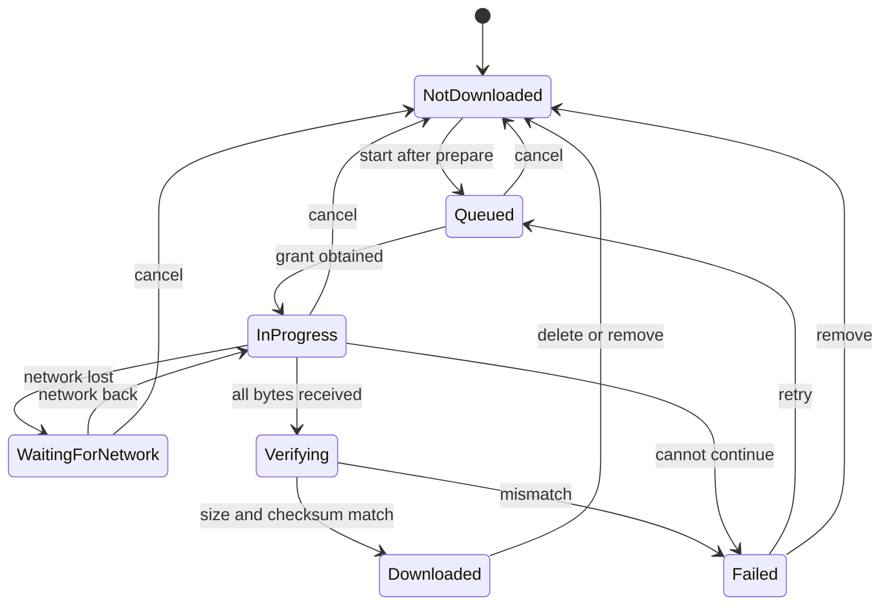

# PDF Reader and Offline Design: Metal Forming World (MFW) Mobile Application

## 1. Document Control

| Field | Detail |
|---|---|
| Document | PDF Reader and Offline Design |
| File | `Documentation/PDF_READER_AND_OFFLINE_DESIGN.md` |
| Version | 0.1 |
| Status | Draft for review. Not approved. Every rule below is PROPOSED unless it quotes a CONFIRMED requirement. Nothing is built, and nothing has been tested or measured. |
| Date | 24 October 2026 |
| Audience | The two developers. MFW's authorised approver only for the reader approach and library at M2. |
| Proposed owner | Yuvraj (WS-B), PROPOSED and not agreed. Reviewer: Sanika Attarde (WS-A). |
| Approval required | Both developers. MFW at M2 for the reader approach and library (DEC-005, TD-10). No other MFW approval is sought. |
| Sources | RS §5.5, §5.6, §6.9, §8.4; S2 AC-2, AC-4; `SYSTEM_ARCHITECTURE.md` §6.5, §7.5, §11; `DATABASE_AND_DATA_MODEL.md` §4.22, §6.2, §7, §8; `API_AND_BACKEND_CONTRACT.md` OP-11, §8; `API_AND_MODULE_CONTRACTS.md` §6.6, §6.7; `TECHNOLOGY_DECISIONS.md` TD-09, TD-10, TD-11, TD-20; `SECURITY_AND_ACCESS_CONTROL.md` §10; `CODING_STANDARDS.md` §8.2; `TESTING_STRATEGY.md` §7.4, §7.5, §9 (SEC-CHK-04), §16; `TEST_DATA_AND_FIXTURES.md` §7, §8 |

**Change history**

| Version | Date | Change |
|---|---|---|
| 0.1 | 24 October 2026 | Initial draft. This is the document planned as T-00.7 in `DEVELOPMENT_ROADMAP.md`. It is written on top of commit 5a436a3 (pull request 3, not merged, not reviewed), so the identifiers it cites are those of that commit. |

### 1.1 Related documents

| Document | Status on 24 October 2026 |
|---|---|
| `MFW_Statement_of_Work.pdf` (S2) "Scope included: Reader", AC-2, AC-4, Flow 3 | Exists, issued, unsigned. **The S2 text is authoritative.** |
| `REQUIREMENTS_SPECIFICATION.md` (RS) | Exists, draft. Requirements are quoted by ID and not restated. |
| `SYSTEM_ARCHITECTURE.md`, `TECHNOLOGY_DECISIONS.md` | Exist (draft). Own the download sequence and the technology options. |
| `DATABASE_AND_DATA_MODEL.md` | Exists (draft). Owns the file registry fields and the deleted-issue list. |
| `API_AND_BACKEND_CONTRACT.md`, `API_AND_MODULE_CONTRACTS.md` | Exist (draft). Own OP-11 and the interfaces of MOD-06 and MOD-07. |
| `SECURITY_AND_ACCESS_CONTROL.md` | Exists (draft). Owns the file access controls. |
| `CODING_STANDARDS.md` | Exists (draft). Owns the on-device storage rules (§8.2). |
| `TESTING_STRATEGY.md`, `TEST_DATA_AND_FIXTURES.md`, `ACCEPTANCE_CRITERIA.md` | Exist (draft). Own the test plans, fixtures and acceptance rows. |
| `REQUIREMENT_COVERAGE_MATRIX.md` | Exists (draft, derived). Shows which requirement has which test row. |

Status labels follow RS §1.2. **PROPOSED** marks a development-team proposal in this document. In RS terms it is an ASSUMPTION (DEV). **NOT TESTED** and **NOT VERIFIED** mean that no check has been run.

## 2. Purpose, Scope and Status

**Purpose.** The reader and offline download are the core of the product. Their rules are spread over the requirements, the architecture, the data model, the API contract and the module contracts. This document gathers the device-side design in one place: how a local copy of an issue is made, kept, opened and removed, and what happens when something goes wrong. It adds the rules those documents leave open, and it marks each as PROPOSED.

**Scope.** The mobile app only: MOD-06 (issue access and downloads) and MOD-07 (reader). The server side of the same flow is in the documents named below, and is not repeated.

```text
Who owns what
├── Requirement text                    RS §5.5, §5.6, §6.9. Quoted by ID here
├── The grant (signed link) and its checks   API_AND_BACKEND_CONTRACT OP-11 and §8
├── The download sequence               SYSTEM_ARCHITECTURE §7.5. Not repeated
├── Registry fields, deleted-issue list DATABASE_AND_DATA_MODEL §7.1, §4.22
├── Interfaces of MOD-06 and MOD-07     API_AND_MODULE_CONTRACTS §6.6, §6.7
└── This document adds
    ├── The lifecycle of a local copy, as a state machine with rules and invariants
    ├── What the app does at start-up to repair its own records
    ├── Revisions, removal rules and edge cases on the device
    └── A map from each rule to the test that would show it
```

**Status.** The core is written without a vendor's terms. Section 11 maps it onto the proposed technology. Only the requirements marked CONFIRMED are fixed. The reader library (DEC-005), the delivery mechanism (DEC-020) and the reading model (DEC-008, conflict C-03) are OPEN. This document decides nothing that needs MFW's approval, and it does not pre-empt those decisions.

## 3. What Is Settled and What Is Not

```text
Settled (CONFIRMED in S1 or S2)
├── A full issue is read from a complete downloaded copy. Reading before the download finishes is not provided (FR-READ-002)
├── Download to the app's private storage, with size shown first, a mobile-data warning, and progress (FR-DL-001, FR-DL-003 to FR-DL-005)
├── An interrupted download resumes and does not start again from zero (FR-DL-006)
├── A downloaded issue reads in full with no network, and the Downloads screen lists what is on the device (FR-DL-007, FR-DL-008, NFR-OFF-001)
├── A reader can delete a download, and deleting frees its space (FR-DL-009)
├── Swipe, tap, pinch to 300%, a page-turn effect, a plain swipe mode, two pages on tablets and in landscape (FR-READ-003 to FR-READ-007, FR-READ-009)
├── A damaged file shows an error with a retry option (FR-READ-010)
└── First page within 3 seconds, sharp text at 300%, twenty page turns without a crash (NFR-PERF-001, NFR-PERF-002, NFR-REL-001)

Working assumptions (ASSUMPTION or PROPOSED)
├── Issue files of up to 150 MB and about 120 pages (NFR-STOR-001)
├── No content delivery network, so a whole issue is downloaded before reading (NFR-STOR-003)
└── The partial-file and no-partial-listing rules (FR-STATE-004, FR-STATE-006)
```

The decisions that bound this design are below. For each, the design assumes one answer and says what moves if MFW or the team answers differently.

| Decision | What this design assumes | If the answer differs |
|---|---|---|
| OQ-08 and DEC-008, reading model. Conflict C-03. MFW's answer is reported by YG and not filed | Opening an issue keeps the full copy until the reader deletes it (GS-Q6). The registry field `retention_mode` defaults to "kept" | A temporary-copy mode is added by setting `retention_mode`. Sections 4 and 6.2 gain one removal rule. No other section changes |
| OQ-11, sign-out, account deletion, unpublish | The working design of `DATABASE_AND_DATA_MODEL.md` §7.3 (GS-Q24), restated in Section 6.2 | Only the table in Section 6.2 changes |
| OQ-36 and DEC-005, reader library | Not chosen. Section 7 states what any candidate must show | Section 11 changes. Sections 4 to 6 do not |
| OQ-37 and DEC-020, delivery mechanism | A function-issued signed link with byte ranges (TD-09). Resume on it is unproven (AR-01) | If resume fails, the download restarts from the beginning after a break. FR-DL-006 is then not met, so this is a requirement-level risk and not only a design one |
| OQ-54, background downloads | The minimum design needs the app in the foreground. Background continuation is an enhancement | Section 4.4 and two edge cases in Section 8 change |
| OQ-14, mode switching and default | Both modes exist. Switching and default are not fixed | Section 7 only |
| OQ-30 and OQ-26, size limit, devices | 150 MB per file. Test devices as NFR-COMP-003 | Section 9 and the fixtures |

## 4. The Local Copy Lifecycle

### 4.1 States

The app keeps two kinds of fact. The registry row and the file on disk are **persisted**. Everything else is **transient** and is rebuilt after a restart.

```text
State model
├── Persisted (survives a restart)
│   ├── A registry row with state "partial" and the partial file, whose length on disk is the number of bytes held
│   └── A registry row with state "complete" and the finished file
└── Transient (the interface of MOD-06, DownloadStatus)
    ├── NotDownloaded, Queued, InProgress, WaitingForNetwork, Verifying, Failed
    └── Downloaded (read from the "complete" row)
```



This diagram is PROPOSED. It follows the `DownloadStatus` types in `API_AND_MODULE_CONTRACTS.md` §6.6 and adds the removal paths.

### 4.2 Transition rules

| From | Event | To | Rule | Source |
|---|---|---|---|---|
| NotDownloaded | The reader taps Read or Download | Queued | `prepare` first: the free space is enough, the size is shown, and on mobile data the reader accepts the warning. If a current registry row is "complete", open it with no network call and start nothing | FR-DL-003, FR-DL-004, FR-STATE-004; `SYSTEM_ARCHITECTURE.md` §7.5 step 1 and 2 |
| Queued | A grant is obtained | InProgress | The app calls OP-11 and receives the link, expiry, revision, size and checksum. Nothing from the grant is stored in the registry. The link is never logged | OP-11; SC-16 |
| InProgress | The network is lost | WaitingForNetwork | The partial file stays. The status shows waiting | FR-DL-006; FX-NET-01 |
| WaitingForNetwork | The network returns | InProgress | Continue from the length of the partial file. Ask for a new grant if the old one has expired | FR-DL-006; FX-NET-05 |
| InProgress | The grant expires | InProgress | Ask OP-11 for a new grant and continue from the same offset. Whether an expiry cuts a request already in flight is unverified | DEC-020; AR-01 |
| InProgress | All bytes received | Verifying | Close the transfer. Do not list the issue yet | FR-STATE-004 |
| Verifying | Size and checksum match | Downloaded | Move the file to its final private location, then write the row as "complete". The row is written last | FR-READ-010; I-3 below |
| Verifying | Size or checksum differs | Failed | Delete the partial file and its row. Report `fileCorrupt` with a retry | FR-READ-010; MOD-06 rule 3 |
| InProgress | An error that cannot be retried | Failed | The reader sees an error and a retry option. See Section 8 for the refusals OP-11 can return | FR-STATE-006 |
| Failed | The reader taps retry | Queued | Start again from the partial file if one is left, otherwise from zero | FR-STATE-006 |
| Queued, InProgress, WaitingForNetwork | The reader cancels | NotDownloaded | PROPOSED: delete the partial file and its row, because a kept partial is 150 MB the reader cannot see. Open as RD-01 | MOD-06 `cancel` |
| Downloaded | The reader deletes it | NotDownloaded | Delete the file and the row. Storage drops by about the file size | FR-DL-009; AC-4.6 |
| Downloaded | Account deletion, or the issue is on the deleted-issue list | NotDownloaded | Delete the file and the row | Section 6.2 |

### 4.3 Invariants

These are PROPOSED design rules. Each should have a test (Section 10).

| ID | Rule | Why |
|---|---|---|
| I-1 | An issue is listed as downloaded only when its row is "complete", and a row becomes "complete" only after the size and checksum have matched | A partial file must never appear on the Downloads screen (FR-STATE-004, AC-4.7) |
| I-2 | The reader opens a file only through `openLocal`, which refuses a row that is not "complete" or whose `owner_user_id` is not the signed-in reader | Reading before the download ends is not provided (FR-READ-002). A second reader on the same device must not see the first reader's files |
| I-3 | The file is moved into its final place first, and the row is written second | A crash between the two leaves a file with no row, which start-up repair removes (Section 4.4). The other order would leave a row with no file |
| I-4 | At most one transfer runs for one issue and one reader. Starting a second returns the status of the first | A double tap must not write the same partial file twice |
| I-5 | The length of the partial file on disk is the truth for where to resume. No separate byte counter is trusted | A counter and a file can disagree after a kill or a restart |
| I-6 | A grant, a link and any token stay out of the registry, the logs and the crash reports | A link is a temporary credential (SC-16, `DATABASE_AND_DATA_MODEL.md` §9) |

### 4.4 Repair at app start

The app compares the registry with the files on disk each time it starts, and whenever it is about to list downloads. This is PROPOSED. Where the rows are cheap to check, it does not compute a checksum, because a checksum of a 150 MB file would delay the first page (NFR-PERF-001).

| Registry row | File on disk | Action |
|---|---|---|
| complete | Present, and its length equals `size_bytes` | Keep. The size is checked again at open. The checksum is not recomputed |
| complete | Present, but the length differs | Treat as damaged. Delete the file and the row. The issue shows as not downloaded |
| complete | Missing (the operating system cleared the storage, or the reader did) | Delete the row |
| partial | Present | Keep. It can be resumed from its length (I-5). No transfer starts without the reader's action, unless OQ-54 decides otherwise |
| partial | Missing | Delete the row |
| None | A file in the downloads folder | An orphan, for example after a crash between the move and the row (I-3). Delete it |
| Any | `owner_user_id` is not the signed-in reader | Leave alone and do not show. Sign-out hides files until the same reader signs in again (Section 6.2) |
| Any | The issue is on the deleted-issue list (checked only while online) | Delete the file and the row. Never delete because an issue is merely missing from a fetch |

How long a stale partial file is kept is not set (RD-02).

## 5. Revisions on the Device

An issue can have more than one file revision if MFW allows replacement (OQ-21). The server never overwrites a revision (`API_AND_BACKEND_CONTRACT.md` §8).

```text
Revisions
├── The grant carries the current revision. The registry stores the revision of each copy
├── A reader keeps what they downloaded. An older copy still opens, and the app shows an updated badge
├── The app never replaces a file silently
├── A reader who chooses to download the new revision gets it as a new partial row beside the old complete row. PROPOSED
│   ├── The old copy is removed only after the new one is "complete" and verified
│   ├── For a short time the device holds both. The free-space check must allow for that (RD-03)
│   └── The Downloads screen shows one entry per issue and the newer revision once it exists (RD-03)
├── A bookmark stores the revision it was made on. Opening it clamps the page to the file that opens and shows a notice if the revision differs (GS-Q16)
└── If MFW does not allow replacement, only revision 1 exists and nothing above applies (OQ-21)
```

## 6. Storage on the Device

### 6.1 Where and how

```text
Local storage
├── Files are kept in the app's private storage, never in a shared or external folder (NFR-SEC-004; CODING_STANDARDS §8.2)
│   ├── Android: app-specific internal storage. iOS: the Application Support directory
│   └── A partial download is kept apart from completed files (CODING_STANDARDS §8.2, item 2)
├── File names derive from opaque issue identifiers and not from titles. The name carries no email address or other personal data (CODING_STANDARDS §8.2, item 3)
├── The registry is a small local table in the same private storage (DATA-013; DATABASE_AND_DATA_MODEL §7.1)
│   └── Fields: owner_user_id, issue_id, file_revision, local_path, size_bytes, checksum, state (partial or complete), retention_mode (default kept)
├── Nothing in the registry is sent to the server. A server record of what a reader downloaded would amount to reading activity (NFR-PRIV-003)
├── Free space is checked before a download starts and shown to the reader if it is too low (FR-STATE-004)
│   └── The margin to keep above the file size is not set (RD-02)
└── Device backups
    ├── iOS: the files are excluded from device backups because they can be downloaded again (CODING_STANDARDS §8.2, to be verified in WP-06; SEC-CHK-04)
    └── Android: not stated in the standard. SEC-CHK-04 says "where applicable". The platform behaviour on both is NOT VERIFIED (RD-04)
```

### 6.2 When a copy is removed

This is the working design of `DATABASE_AND_DATA_MODEL.md` §7.3. It is PROPOSED (GS-Q24) and PROVISIONAL. MFW has not answered OQ-11 and PAC-14 is blocked on it.

| Event | Files and registry rows | Source |
|---|---|---|
| The reader deletes a download | Deleted | FR-DL-009 |
| The reader signs out | Kept and hidden, so the same reader does not repeat a 150 MB download. A different reader on the device does not see them | GS-Q24; I-2 |
| A different reader signs in on the same device | Their own downloads only. If they open the same issue they download a second copy. PROPOSED, so no access check is needed while offline | RD-05 |
| Account deletion | The reader's files, rows and caches are deleted | FR-PRIV-003; IC-08 |
| The issue is unpublished | Kept. New downloads stop | GS-Q24 |
| The issue is permanently deleted (if OQ-21 allows) | Removed when the app next sees it on the deleted-issue list | GS-Q24, GS-Q25 |
| `retention_mode` is "temporary" (only if OQ-08 chooses it) | Removed when the reader leaves the issue | OQ-08 |
| The operating system clears the storage | The repair in Section 4.4 removes the rows | Section 4.4 |

### 6.3 What this does not promise

```text
Limits of an offline copy
├── There is no DRM. A signed-in reader can keep a file they were entitled to download, and a rooted device can copy it (NFR-SEC-009)
├── A copy on a device cannot be recalled. The app removes it only when it is online and sees the issue on the deleted-issue list (OQ-11, T23)
├── A link issued before an unpublish or a deletion works until it expires (AR-06, T2)
└── The same issue may be public on MFW's website, so the sign-in gate controls the app's copy only (OQ-57, T21)
```

## 7. Opening and Rendering

```text
Open an issue
├── Preconditions: full access (route guard, DEC-014), and a "complete" row that belongs to the signed-in reader (I-2)
├── MOD-06 openLocal returns the local file only for MOD-07
├── MOD-07 PdfRenderer.open returns a handle with the page count, or fileCorrupt for a damaged file
├── Modes: page-turn effect and a plain swipe-and-zoom mode. The swipe mode is always built as the fallback (FR-READ-006, FR-READ-007)
│   └── Whether the reader can switch, and the default, is OQ-14
├── Two pages side by side on tablets and in landscape (FR-READ-009). Zoom to 300% (FR-READ-005)
├── A damaged file (FX-PDF-10, FX-PDF-11): an error with a retry option, no crash (FR-READ-010, AC-2.6)
│   └── Retrying a reopen cannot repair a damaged local file, so PROPOSED: retry deletes the copy and downloads it again (RD-06)
└── A bookmark action calls MOD-08 with the page and revision
```

**What any reader library must show.** Section 11 lists the candidates. Whatever is chosen has to pass the M2 reader test on MFW's largest sample PDF, on the low-cost Android phone and the older iPhone (TD-10, NFR-COMP-003). The test covers the CONFIRMED targets: first page within 3 seconds, sharp text at 300%, twenty page turns without a crash, and two pages in landscape. This document proposes three further checks for that test, none of them a requirement:

```text
Proposed additions to the M2 reader test (PROPOSED, not requirements)
├── The library opens a file of about 150 MB and about 120 pages (FX-PDF-05) without reading the whole file into memory at once
├── Memory use stays steady over a long run of page turns, and closing the reader releases the file
└── The library fails on a damaged file (FX-PDF-10, FX-PDF-11) by returning an error, not by crashing
```

## 8. Failure and Edge Cases

Rules marked PROPOSED are new in this document. The others quote the source named.

| Situation | Intended behaviour | Source or test |
|---|---|---|
| Network lost during a download | Status shows waiting. Resumes from the bytes held when the network returns | FR-DL-006; AC-4.3; FX-NET-01 |
| Grant expires during a download | Ask OP-11 for a new grant and continue from the same offset | DEC-020; FX-NET-05 |
| The reader's sign-in expires during a long download | PROPOSED: pause as WaitingForNetwork with a prompt to sign in. After sign-in, continue | `TESTING_STRATEGY.md` §16 proposed line; RD-07 |
| Storage is full before or during a download | Clear message. No partial file is listed | FR-STATE-004; FX-NET-06 |
| The app is killed, or the device restarts, mid-download | The partial file stays. After restart the reader can resume from its length. A partial is never listed as downloaded | FX-NET-03, FX-NET-04; Section 4.4. Background continuation is OQ-54 |
| Wi-Fi switches to mobile data mid-download | PROPOSED: pause and ask before continuing on mobile data | `TESTING_STRATEGY.md` §7.5; FX-NET-02 |
| Server error or connection reset mid-transfer | A retryable failure. A retry continues or restarts cleanly | FX-NET-07 |
| Size or checksum mismatch | Delete the partial. `fileCorrupt` with a retry | FR-READ-010; MOD-06 |
| OP-11 refuses with ACCOUNT_CLOSED, EMAIL_NOT_VERIFIED or PROFILE_INCOMPLETE | The reader is told what is missing. No retry loop | OP-11; MOD-06 errors |
| OP-11 answers ISSUE_NOT_AVAILABLE (unpublished during the download) | PROPOSED: stop, delete the partial file and tell the reader the issue is no longer available. A complete copy already held is kept (GS-Q24) | OP-11; RD-07 |
| OP-11 answers GONE (deleted) | PROPOSED: stop and delete the partial. Remove any complete copy and its row | OP-11; GS-Q24 |
| OP-11 answers RATE_LIMITED | PROPOSED: tell the reader to try later, and do not retry in a loop. The app has no failure code for this yet | `API_AND_MODULE_CONTRACTS.md` §4.2 ("Not mapped yet") |
| A link is still valid after the issue is unpublished | It works until it expires. It cannot be withdrawn | AR-06; `TESTING_STRATEGY.md` §16 |
| The reader taps Download twice | One transfer (I-4) | PROPOSED |
| A notification or a shared link opens a full issue | The same checks and the same flow as a tap in the app | OP-11 note; BR-005 (ASSUMPTION) |
| A new revision is published while an older copy is on the device | The older copy opens. A badge offers the new one. Nothing is replaced silently | `DATABASE_AND_DATA_MODEL.md` §6.2; Section 5 |
| A different reader signs in on the same device | They see only their own downloads | I-2; Section 6.2 |
| The file is a password-protected or zero-byte PDF | Should not reach the app, because the upload rejects it. The rule for password-protected files is OQ-30 | FX-PDF-12, FX-PDF-13 |

## 9. Performance and Measurement

```text
Performance
├── Targets (CONFIRMED in S2): first page within 3 seconds; sharp text at 300%; twenty page turns without a crash
│   └── AC-2.1, AC-2.3, AC-2.5. The first-page target is confirmed at the end of Week 2 [S2]
├── Measured so far: nothing. NOT VERIFIED
├── Where it will be measured
│   ├── The M2 reader test on MFW's largest sample (FX-PDF-04) and the near-limit file (FX-PDF-05)
│   ├── The low-cost Android phone, the mid-range Android phone and the older iPhone (NFR-COMP-003). Models are OQ-26
│   └── Method and repetitions per `TESTING_STRATEGY.md` §8.1 (T-02.3)
└── What each run should record: device and OS, file, app build, time to first page, a note of memory use (PROPOSED), the result of the 20-turn run
```

## 10. Verification

Each row is a rule that a test would show. Nothing has been tested.

| Rule | Test or row that would show it | Status |
|---|---|---|
| States, resume, no partial listed (4.2, I-1) | AC-4.1, AC-4.3, AC-4.7; FX-NET-01, FX-NET-03 | NOT TESTED |
| Grant renewal and expiry (4.2) | FX-NET-05; the TD-09 proof plan | NOT TESTED, NOT VERIFIED (AR-01) |
| Integrity check (4.2) | MOD-06 unit tests with a fake transport; FX-PDF-10, FX-PDF-11 as stored files | NOT TESTED |
| Delete frees space (6.2) | AC-4.6 | NOT TESTED |
| Removal on sign-out, deletion, unpublish (6.2) | PAC-14 (blocked on OQ-11); IC-08 | NOT TESTED. Behaviour OPEN |
| Airplane mode reading (7) | AC-4.2 | NOT TESTED |
| Reader targets (7, 9) | AC-2.1, AC-2.3, AC-2.5, AC-2.6 | NOT TESTED |
| Refusals before a grant is issued (8) | PAC-13; SEC-CHK-02, SEC-CHK-03 | NOT TESTED |

**Checks that no plan has yet.** These are PROPOSED candidates for `TESTING_STRATEGY.md` §7.5 and §16. They carry no AC or PAC number, and they are not contractual.

```text
Candidate checks (PROPOSED, unnumbered)
├── Kill the app between the file move and the row write (I-3). Expect no orphan after the next start
├── Clear the app's storage with a "complete" row present. Expect the row removed and the issue shown as not downloaded
├── Two readers on one device download the same issue. Expect each to see only their own copy
├── Download a replacement revision while the old one is on the device. Expect both to survive until the new one verifies
├── Unpublish the issue during a download. Expect the partial to be removed and a clear message
└── Tap Download twice. Expect one transfer
```

The coverage of every requirement by test rows is in `REQUIREMENT_COVERAGE_MATRIX.md`.

## 11. Provisional Technology Mapping

Nothing here is chosen. It records the proposals and their open conditions.

```text
Mapping (PROVISIONAL)
├── Grant and delivery: a function-issued signed link on the file store (TD-09, PROPOSED)
│   └── Condition: the TD-09 proof plan passes on a real Android device and a real iPhone with a 150 MB file (AR-01, OQ-37)
├── Download client: background_downloader 9.6.4, or a plain HTTP client with Range handling written by the team (TD-11, OPEN)
│   ├── Decided in the M3 spike. The package's behaviour with an expiring link must be shown
│   └── Version figures are as recorded in version 0.3 of `TECHNOLOGY_DECISIONS.md`. They were not re-checked for this document
├── Reader library: shortlist pdfrx 2.10.0 and pdfx 2.11.0, both MIT (TD-10, OPEN)
│   ├── The Syncfusion viewer is left out unless MFW approves its licence terms in writing (NFR-MAINT-006)
│   └── The reader sits behind PdfRenderer so a library can be replaced
├── Registry: a small local table in private storage. The storage technology is not chosen
└── Offline data for bookmarks and favourites: the database SDK's cache (TD-20, PROPOSED; OQ-10)
```

## 12. Open Items

These items are local to this document. They are not yet in the registers. After pull request 3 is merged they are to be registered in `OPEN_QUESTIONS.md`, with the owner and the evidence that would close each.

| Ref | Item | Owner | Depends on |
|---|---|---|---|
| RD-01 | Does cancel delete the partial file and its row, or keep it? Proposed: delete | Development team | MOD-06 `cancel` |
| RD-02 | The free-space margin above the file size, and how long a stale partial file is kept | Development team | NFR-STOR-001; FR-STATE-004 |
| RD-03 | When a replacement revision is downloaded: the space needed for two copies, and what the Downloads screen shows | Development team | OQ-21 |
| RD-04 | Whether downloaded files are excluded from Android's device backup. `CODING_STANDARDS.md` §8.2 states the iOS rule only, and the behaviour on both platforms is NOT VERIFIED until WP-06 | Development team | WP-06 |
| RD-05 | Whether a second reader on the same device downloads a second copy | Development team | I-2; OQ-11 |
| RD-06 | What "retry" does for a damaged local file. Proposed: delete and download again | Development team | AC-2.6 |
| RD-07 | Behaviour when a sign-in expires, or the issue is unpublished, during a download | Development team, then MFW if the wording is user-facing | OP-11 refusals; OQ-11 |

Questions for MFW stay in the register as they are: OQ-08, OQ-11, OQ-14, OQ-26, OQ-30, OQ-36, OQ-37 and OQ-54. No new question for MFW is raised here.

## 13. Traceability

```text
This document to its sources
├── FR-READ-001 to FR-READ-010, FR-DL-001 to FR-DL-010, NFR-OFF-001, NFR-OFF-002
├── NFR-PERF-001, NFR-PERF-002, NFR-REL-001, NFR-STOR-001, NFR-STOR-003, NFR-SEC-004, NFR-SEC-009, NFR-COMP-003
├── FR-STATE-004, FR-STATE-006
├── DEC-005, DEC-008, DEC-014, DEC-020
├── TD-09, TD-10, TD-11, TD-20
├── OQ-08, OQ-10, OQ-11, OQ-14, OQ-21, OQ-26, OQ-30, OQ-36, OQ-37, OQ-54, OQ-57
├── AR-01, AR-06, R1, R2, T2, T21, T23
└── AC-2, AC-4, PAC-13, PAC-14, SEC-CHK-02, SEC-CHK-03, FX-PDF-05, FX-NET-01 to FX-NET-07
```
