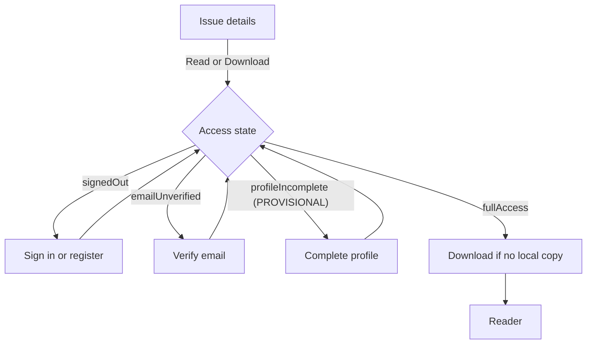

# Screen Inventory and Navigation: Metal Forming World (MFW) Mobile Application

## 1. Document Control

| Field | Detail |
|---|---|
| Document | Screen Inventory and Navigation |
| File | `Documentation/SCREEN_INVENTORY_AND_NAVIGATION.md` |
| Version | 0.1 |
| Status | Draft for review. Not approved. **Every screen below is PROPOSED. MFW approves the screens at M2 (NFR-UX-002), and has not seen this list.** This is an input to the designs and not a design. |
| Date | 24 October 2026 |
| Audience | The two developers, and whoever prepares the screen designs for M2. MFW sees the designs at M2 and not this list. |
| Proposed owner | Joint, by workstream and PROPOSED: app screens Yuvraj (WS-B), admin panel screens Sanika Attarde (WS-A). Not agreed. The other developer reviews. |
| Approval required | Both developers for the list. MFW at M2 for the screens themselves (S2 Scope: Design; S2 Milestones). |
| Sources | RS §5 (all functional requirements), §6.5, §9.2; S2 Scope: Design, Flow 3; `API_AND_MODULE_CONTRACTS.md` §4.1, §6, §7.1; `API_AND_BACKEND_CONTRACT.md` §3, §5; `SCOPE_AND_EXCLUSIONS.md` SCP-002, SCP-003, SCP-006; `ACCEPTANCE_CRITERIA.md` PAC-10; `PDF_READER_AND_OFFLINE_DESIGN.md` |

**Change history**

| Version | Date | Change |
|---|---|---|
| 0.1 | 24 October 2026 | Initial draft. Written on top of commit 5a436a3 (pull request 3, not merged, not reviewed), so the identifiers it cites are those of that commit. |

### 1.1 Related documents

| Document | Status on 24 October 2026 |
|---|---|
| `MFW_Statement_of_Work.pdf` (S2) "Scope included: Design", "Deliverables and milestones" | Exists, issued, unsigned. **The S2 text is authoritative.** |
| `REQUIREMENTS_SPECIFICATION.md` (RS) | Exists, draft. Requirements are cited by ID and not restated |
| `API_AND_MODULE_CONTRACTS.md` | Exists (draft). Owns the access states and the proposed route list (MOD-01) |
| `API_AND_BACKEND_CONTRACT.md` | Exists (draft). Owns the operations the admin screens call |
| `ACCEPTANCE_CRITERIA.md` | Exists (draft). PAC-10 requires the states to match the screens approved at M2 |
| `PDF_READER_AND_OFFLINE_DESIGN.md` | Exists (draft). Owns the download and reader behaviour that SCR-A-13 to SCR-A-15 present |
| `REQUIREMENT_COVERAGE_MATRIX.md` | Exists (draft, derived) |

Status labels follow RS §1.2. **PROPOSED** marks a development-team proposal in this document. In RS terms it is an ASSUMPTION (DEV). The baseline is one Admin role, with immediate account deletion (FR-ADMIN-004, FR-PRIV-003). Screens that exist only under a labelled change (PRC-01, PRC-02) say so, and MFW has not approved either change.

## 2. Purpose, Scope and Status

**Purpose.** S2 requires MFW to approve the screens before development (NFR-UX-002), and the loading, empty and error states are to be designed and approved with them (SCP-006, PAC-10). A complete list of what the requirements imply lets the designer cover every screen and state, and lets MFW approve against a list and not against a sample. This document derives that list from the requirements.

**Scope.** The mobile app and the web admin panel, which is the product's only web interface (FR-ADMIN-001).

```text
This document
├── Does
│   ├── Name every screen the requirements imply, with the requirements, the entry condition and the open points for each
│   ├── Show what must be reachable from where, and what the access rules do to it
│   ├── List the states every screen must handle (FR-STATE-001 to FR-STATE-007)
│   └── List the gaps it found in the proposed route list
└── Does not
    ├── Decide layout, navigation widgets (for example a tab bar or a drawer), colours, fonts, wording or icons. Those belong to the M2 designs on MFW's brand assets (NFR-UX-001)
    ├── Add a requirement, a feature or a screen that no requirement implies
    └── State that MFW approved anything
```

**Identifiers.** App screens are SCR-A-nn and admin panel screens are SCR-W-nn. Both families are new in this document and are not in the glossary. Routes are those proposed in `API_AND_MODULE_CONTRACTS.md` §6.1. A route marked "none" has no entry in that list (Section 8).

## 3. Access States and the Entry Rule

The app derives one access state for the user, checked in this order, and the first one that applies is the state (`API_AND_MODULE_CONTRACTS.md` §4.1).

```text
Access states
├── signedOut           a logged-out visitor
├── emailUnverified     an email account whose address is not verified (BR-002). Whether this applies to Google accounts is OQ-04
├── profileIncomplete   the mandatory profile is not complete (BR-003, PROVISIONAL)
└── fullAccess          may open and download full issues
```

Browsing the catalogue, issue details, search, filters and the news is open to every state (FR-MAG-001, FR-SRCH-006, FR-NEWS-007). Opening or downloading a full issue, and bookmarking, need `fullAccess`. The guard sends the user to the step that is missing, and returns to the issue when it is done (FR-AUTH-010, FR-PROF-004).



This diagram is PROPOSED. It shows the order of the checks and not a screen layout.

## 4. What Must Be Reachable From Where

The arrangement (tabs, menus, buttons) is a design decision for M2. This tree records only reachability.

```text
Reachability (PROPOSED)
├── From the start, in any state
│   ├── Home and catalogue, with search and filters
│   ├── Issue details
│   ├── News list and articles
│   ├── Settings (with fewer items when signed out, OQ-09)
│   └── Sign in and register
├── From issue details
│   ├── Read or Download, through the guard in Section 3
│   ├── Favourite (who may: OQ-12) and share (the system share sheet)
│   └── Back to the catalogue
├── From the reader
│   ├── Bookmark the current page
│   └── Back to issue details, Downloads or the bookmark list, whichever opened it
├── From Downloads and the library (needs fullAccess)
│   ├── Open an issue, delete a download
│   └── Open a bookmark at its page; remove a bookmark
├── From a notification
│   └── The linked issue or article. The same guard applies (FR-NOTIF-005, BR-005)
└── From settings
    ├── Profile, notification choices, sign out, delete account
    └── The privacy policy and terms of use (FR-PRIV-002)
```

## 5. App Screens

| ID | Screen | Route (proposed) | Requirements | Entry | Notes and open points |
|---|---|---|---|---|---|
| SCR-A-01 | Sign in | `/sign-in` | FR-AUTH-003, FR-AUTH-005, FR-AUTH-010 | signedOut | Email and password. Google Sign-In is PROVISIONAL (OQ-29). It is also the prompt shown when a visitor tries to open a full issue. Links to password reset |
| SCR-A-02 | Register | `/register` | FR-AUTH-001, FR-AUTH-005, FR-PRIV-001, FR-PRIV-002 | signedOut | Consent to the privacy policy and terms, recorded as OQ-27 decides. An address already in use is told so, by design. Rule for the other sign-in method: OQ-05 |
| SCR-A-03 | Verify email | `/verify-email` | FR-AUTH-002, FR-AUTH-010, FR-READ-001 | emailUnverified | No requirement asks for a resend control. Google accounts: OQ-04 |
| SCR-A-04 | Password reset | none | FR-AUTH-004 | signedOut | The same message for a known and an unknown address (SC-21). Missing from the route list (SN-01) |
| SCR-A-05 | Complete profile | `/complete-profile` | FR-PROF-001 to FR-PROF-005 | profileIncomplete | PROVISIONAL. Fields: OQ-01, OQ-02, GS-Q34. Timing for Google readers: OQ-03. Whether it is part of registration for email accounts: SN-02 |
| SCR-A-06 | Profile | none | FR-PROF-006, FR-PROF-007 | Signed in | Viewing is CONFIRMED. Editing is an ASSUMPTION. Own screen or part of settings: SN-01 |
| SCR-A-07 | Settings | `/settings` | FR-AUTH-008, FR-AUTH-009, FR-NOTIF-002, FR-NOTIF-003, FR-PRIV-002 | Signed in | Hosts notification choices, sign out, delete account and the policy and terms links. Visitors: OQ-09 |
| SCR-A-08 | Delete account confirmation | none | FR-AUTH-009, FR-PRIV-003, FR-PRIV-004 | Signed in | Baseline: confirm, then immediate deletion. Missing from the route list (SN-01) |
| SCR-A-09 | Deletion pending, with undo | none | PRC-02 | Signed in, pending deletion | PRC-02 only, not approved. Calls OP-12 and OP-13. Does not exist in the baseline |
| SCR-A-10 | Home | `/` | FR-MAG-006, FR-MAG-004 | All | Content is set in the M2 designs (SCP-002). One screen with the catalogue, or two: SN-03 |
| SCR-A-11 | Catalogue, search and filters | none | FR-MAG-001 to FR-MAG-004, FR-MAG-007 to FR-MAG-009, FR-SRCH-001 to FR-SRCH-007 | All | Latest issue and archive. Pull to refresh. Filters by category, segment, year, edition (meanings: OQ-13). Offline catalogue: OQ-10 |
| SCR-A-12 | Issue details | `/issues/:issueId` | FR-MAG-005, FR-DL-003, FR-BKM-003, FR-SHR-001 | All | Public metadata only for visitors (OQ-13). Read or Download starts the guard. Favourite: OQ-12. Share: OQ-09, store link OQ-15 |
| SCR-A-13 | Download prompt and progress | none | FR-DL-003 to FR-DL-006, FR-STATE-004, FR-STATE-006 | fullAccess | Size, mobile-data warning, progress, waiting for network, failure with retry. Placement: SN-04. Rules: `PDF_READER_AND_OFFLINE_DESIGN.md` §4 |
| SCR-A-14 | Reader | `/issues/:issueId/read?page=n` | FR-READ-001 to FR-READ-010, FR-BKM-001 | fullAccess | Page-turn and swipe modes, two pages in landscape, zoom to 300%, damaged-file error with retry. Switching and default: OQ-14. Bookmark action |
| SCR-A-15 | Downloads | `/downloads` | FR-DL-007 to FR-DL-009, NFR-OFF-001, FR-STATE-002 | fullAccess | Works with no network. Partial downloads are not listed. After sign-out: OQ-11 |
| SCR-A-16 | Bookmarks | `/library` | FR-BKM-002, FR-BKM-006, FR-BKM-007 | fullAccess | Opening a bookmark opens the issue at its page. Removal is an ASSUMPTION. Offline: OQ-10 |
| SCR-A-17 | Favourites | `/library` | FR-BKM-003, FR-BKM-006 | fullAccess, or wider (OQ-12) | The requirement says "screens" for bookmarks and favourites: two screens or two views of one (SN-05) |
| SCR-A-18 | News list | `/news` | FR-NEWS-001, FR-NEWS-003, FR-NEWS-004, FR-NEWS-007, FR-NEWS-009 | All | Only the categories MFW selects (INT-WP-003). Breaking presentation: OQ-17. Offline notice: FR-NEWS-005 |
| SCR-A-19 | News article | `/news/:postId` | FR-NEWS-002, FR-NEWS-005, FR-SHR-003 | All | Offline saving model: OQ-16. WordPress unreachable: FR-STATE-005 |
| SCR-A-20 | Notification explanation | none | FR-NOTIF-001 | Before the system permission prompt | Explains what the app sends. Visitors: OQ-09. Missing from the route list (SN-01) |
| SCR-A-21 | Notification categories | part of SCR-A-07 | FR-NOTIF-002, FR-NOTIF-003, FR-NOTIF-006 | See OQ-09 | Final category list: OQ-18 |
| SCR-A-22 | Not found | any unknown route | `API_AND_MODULE_CONTRACTS.md` §6.1 | All | Required by MOD-01 for an unknown route |
| SCR-A-23 | Edition-update sign-up | none | FR-EMAIL-001, FR-EMAIL-002 | See OQ-09 | CONFLICT (C-02, OQ-31). Not drawn until it is resolved. The product sends no emails (FR-EMAIL-003) |

Two things are not app screens. Sharing uses the system share sheet, and a shared link does not open the app (FR-SHR-001, FR-SHR-003, FR-SHR-005, FR-SHR-006). The notification permission prompt is the system's.

## 6. Admin Panel Screens

The panel needs sign-in and refuses accounts without the admin role (FR-ADMIN-002, FR-ADMIN-003). The baseline has one role. Under PRC-01 some screens are limited to a Super Admin. No page list for the panel exists elsewhere (SN-06), so this table is the first.

| ID | Screen | Requirements | Operations | Notes and open points |
|---|---|---|---|---|
| SCR-W-01 | Admin sign-in | FR-ADMIN-002, FR-ADMIN-003 | OP-14 | Refuses a wrong password and an account without the role. Sign-in measures: OQ-20 |
| SCR-W-02 | Issues list | FR-ADMIN-011 | OP-15 | Published and unpublished issues |
| SCR-W-03 | Issue editor | FR-ADMIN-005 to FR-ADMIN-009, FR-ADMIN-011, FR-STATE-007 | OP-16, OP-19, OP-21, OP-22, OP-40 | Details; PDF and cover upload with a clear rejection message; publish and unpublish. Replace or delete: OQ-21 (OP-30). Cover checks: OQ-22. Size limit: OQ-30 |
| SCR-W-04 | Upload status | FR-ADMIN-006, FR-ADMIN-007, FR-STATE-007 | OP-20 | Waiting, accepted, or rejected with the reason. May be part of SCR-W-03 |
| SCR-W-05 | Categories and segments | FR-ADMIN-010 | OP-17, OP-18, OP-28 | Segments only if the panel maintains them (conditional on AOQ-16 and OQ-18) |
| SCR-W-06 | News controls | FR-ADMIN-013, FR-ADMIN-014, FR-ADMIN-019 | OP-23, OP-24 | Pick a WordPress post, hide it, mark it breaking. The panel does not write or edit news |
| SCR-W-07 | Send notification | FR-ADMIN-015, FR-ADMIN-016, FR-ADMIN-017 | OP-25 | Chosen category, linked to an issue or an article, or a post sent as breaking news. Categories: OQ-18 |
| SCR-W-08 | Send log | FR-ADMIN-018, FR-STATE-007 | OP-26, OP-27 | Fields: OQ-19. An admin can retry a send |
| SCR-W-09 | Registered users | FR-USER-002, FR-USER-003 | OP-31, OP-32 | PROVISIONAL. Any admin in the baseline. Super Admin only under PRC-01 |
| SCR-W-10 | Subscriber export | FR-USER-001 | OP-33 | CONFLICT (C-02). Not drawn until it is resolved |
| SCR-W-11 | Admin management | PRC-01 | OP-35 to OP-38 | PRC-01 only, not approved. In the baseline the developers set admins up from MFW's admin list (OQ-20) |
| SCR-W-12 | Audit log | PRC-01 | OP-39 | PRC-01 only, not approved. S2 excludes an audit log (EXC-07) |

Two screens must **not** exist. The panel has no readership analytics dashboard (FR-USER-004), and it does not write or edit news (FR-ADMIN-019).

## 7. States Every Screen Must Handle

The state requirements are ASSUMPTIONS (ASM-13). PAC-10 asks that they match the screens approved at M2.

```text
States and where they apply
├── Loading (FR-STATE-001): every screen that fetches content, in the app and the panel
├── Empty (FR-STATE-002): search and filter results, Downloads, Bookmarks, Favourites, news in a chosen category
├── No network (FR-STATE-003): any screen that needs it, with a retry. Downloaded issues stay available
├── Low storage (FR-STATE-004): at the start of a download (SCR-A-13)
├── WordPress unreachable (FR-STATE-005): the news list and articles, showing what was loaded before
├── Download failed (FR-STATE-006): SCR-A-13 and SCR-A-15, with a retry
├── Panel results (FR-STATE-007): each upload, publish, unpublish and notification send, in SCR-W-03, SCR-W-04, SCR-W-07 and SCR-W-08
└── Other states set by a requirement
    ├── Damaged issue file: an error with a retry (FR-READ-010), SCR-A-14
    ├── Offline notice for articles (FR-NEWS-005), SCR-A-18 and SCR-A-19
    └── An unpublished issue: not found (OP-CAT-02), SCR-A-12
```

## 8. Open Points That Affect Screens

| Decision | Screens affected | What the design must wait for |
|---|---|---|
| OQ-01, OQ-02 (profile fields, how age is stored) | SCR-A-05, SCR-A-06 | The field list and formats |
| OQ-03, OQ-04, OQ-05 (Google profile timing, verification, linking) | SCR-A-01 to SCR-A-05 | The Google flow and its messages |
| OQ-09 (visitors and notifications, sharing) | SCR-A-07, SCR-A-12, SCR-A-20, SCR-A-21, SCR-A-23 | Which controls a visitor sees |
| OQ-10, OQ-11 (offline catalogue and library, downloads after sign-out) | SCR-A-11, SCR-A-15 to SCR-A-17 | What shows offline |
| OQ-12, OQ-13 (favourites without full access, public metadata) | SCR-A-11, SCR-A-12, SCR-A-17 | The visitor view of an issue |
| OQ-14 (reader modes) | SCR-A-14 | Whether there is a mode control |
| OQ-15 (shared store link) | SCR-A-12 | The shared text |
| OQ-16, OQ-17 (news offline model, breaking posts) | SCR-A-18, SCR-A-19 | The saved-article control, the breaking marker |
| OQ-18, OQ-19 (categories, send log fields) | SCR-A-21, SCR-W-07, SCR-W-08 | The category list, the log columns |
| OQ-21, OQ-22, OQ-30 (delete or replace, cover checks, size limit) | SCR-W-03, SCR-W-04 | The controls and messages |
| OQ-25 (accessibility baseline, NFR-UX-004) | All screens | The text-size and contrast rules |
| PRC-01, PRC-02 (not approved) | SCR-A-08, SCR-A-09, SCR-W-09, SCR-W-11, SCR-W-12 | Whether these screens exist at all |
| C-02, OQ-31 (edition-update emails) | SCR-A-23, SCR-W-10 | Whether these screens exist at all |

## 9. Gaps Found in the Proposed Route List

`API_AND_MODULE_CONTRACTS.md` §6.1 proposes twelve routes. Reading the requirements against that list shows what it leaves out. These items are local to this document. They are not yet in the registers. After pull request 3 is merged they are to be registered in `OPEN_QUESTIONS.md`.

| Ref | Item | Owner |
|---|---|---|
| SN-01 | Routes are missing for password reset (FR-AUTH-004), the profile (FR-PROF-006), account-deletion confirmation (FR-PRIV-004), the notification explanation (FR-NOTIF-001) and the policy and terms viewer (FR-PRIV-002). Some may sit inside settings. The list should say so | Development team |
| SN-02 | Whether the profile is part of registration for email accounts (FR-PROF-001 says registration is complete only when the profile is provided) or a separate step after verification, as the route list implies | Development team, with OQ-03 |
| SN-03 | Home and catalogue as one screen or two | Designer, then MFW at M2 |
| SN-04 | Download prompt and progress as part of issue details, as part of Downloads, or as its own screen | Designer, with the reader and offline design |
| SN-05 | Bookmarks and favourites as two screens (FR-BKM-006 says "screens") or two views of `/library` | Designer, then MFW at M2 |
| SN-06 | The admin panel's pages and routes are defined nowhere. Section 6 is a first proposal for task T-02.2 (admin panel screens) | Sanika Attarde (WS-A), proposed |

## 10. Verification

```text
How this list would be checked
├── MFW approves the screens at M2 (NFR-UX-002). The M2 approval record is the evidence. This list is not that evidence
├── The designer confirms that every row in Sections 5 and 6, and every state in Section 7, appears in the designs
├── PAC-10 is tested against the approved screens: loading, empty and error states match
└── Status today: NOT STARTED. No screen is designed, and nothing here is tested
```

The coverage of each requirement by test rows is in `REQUIREMENT_COVERAGE_MATRIX.md`.

## 11. Traceability

```text
This document to its sources
├── RS §5: FR-AUTH, FR-PROF, FR-MAG, FR-SRCH, FR-READ, FR-DL, FR-BKM, FR-NEWS, FR-SHR, FR-NOTIF, FR-EMAIL, FR-ADMIN, FR-USER, FR-STATE, FR-PRIV
├── NFR-UX-001, NFR-UX-002, NFR-UX-004, NFR-OFF-001
├── BR-002, BR-003, BR-005; INT-WP-003
├── Scope items: SCP-002, SCP-003, SCP-006
├── Open questions: OQ-01 to OQ-05, OQ-09 to OQ-19, OQ-20 to OQ-22, OQ-25, OQ-27, OQ-29 to OQ-31; AOQ-16
├── Labelled changes: PRC-01, PRC-02 (not approved). Conflict C-02
└── Acceptance: PAC-10; the AC rows listed in the coverage matrix
```
