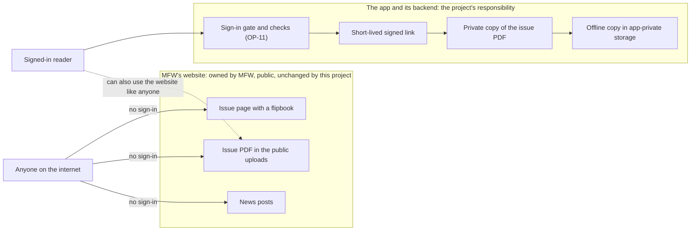
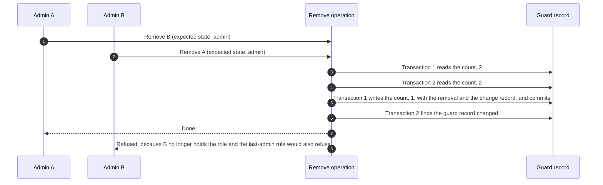

# Security and Access Control: Metal Forming World (MFW) Mobile Application

## 1. Document Control, Purpose, Scope and Status

| Field | Detail |
|---|---|
| Document title | Security and Access Control |
| File | `SECURITY_AND_ACCESS_CONTROL.md`, in the same folder as `REQUIREMENTS_SPECIFICATION.md` |
| Project | Metal Forming World (MFW) mobile application |
| Version | 0.4 |
| Status | Draft for Review |
| Last updated | 27 October 2026 |
| Prepared by | MFW development team |
| Approval status | Not approved. No MFW or internal approval of this document has been recorded. The architecture is not approved by the charter (CH §17.4). |
| Related documents | [Requirements Specification](REQUIREMENTS_SPECIFICATION.md) v0.1; [Scope and Exclusions](SCOPE_AND_EXCLUSIONS.md) v0.1; [Assumptions and Constraints Register](ASSUMPTIONS_AND_CONSTRAINTS.md) v0.2; [Glossary](GLOSSARY.md) v0.1; [System Architecture](SYSTEM_ARCHITECTURE.md) v0.4; [Technology Decisions](TECHNOLOGY_DECISIONS.md) v0.4; [Database and Data Model](DATABASE_AND_DATA_MODEL.md) v0.4; [API and Backend Contract](API_AND_BACKEND_CONTRACT.md) v0.3; `PROJECT_CHARTER.md` v0.2; [Security Incident Procedure](SECURITY_INCIDENT_PROCEDURE.md) v0.2 |

**Purpose.** This document says who may do what in the MFW product, how each rule is enforced, how it is checked, and what it does not promise. It covers the roles and permissions, the administrator lifecycle, the audit policy, the protection of personal data and of the app's issue files, the rules that the database and the file store must apply, and the tests that prove them.

**Scope.** Requirements and controls, written without code. It contains no security-rule code, no credentials, no keys and no cloud configuration, and it creates no cloud resource. It does not repeat the data model or the operation list. It refers to them.

**Status of the technology.** The core is written without a vendor's terms. Section 13 maps it onto Firebase, which is the PROPOSED baseline (TD-03, CONFLICT C-05, not approved). Only Flutter (TD-01) is an accepted decision. If another platform is chosen, only Section 13 changes.

**Change history**

| Version | Date | Change |
|---|---|---|
| 0.1 | 23 October 2026 | Initial draft. Written after the 17-question interview (GS-Q17 to GS-Q33) and a read-only review of MFW's public website (WEB). Decisions recorded here are team-accepted, with the requirement label PROVISIONAL and MFW written approval pending (GS-Q30). No requirement status in the specification changed. |
| 0.2 | 23 October 2026 | Remediation edits, see `CHANGELOG.md`. Baseline (one admin role, immediate deletion) separated from the labelled changes PRC-01 and PRC-02 (section 6.1a classifies every control and test). Threat T26, control SC-21 and test ST-21 added (account-existence messages). Section 3.2: what the gate and a signed link cannot protect; website check updated. Profile fields aligned with the requirements specification. "Team-accepted" replaced by PROPOSED with the agreement note. Error names upper-case. |
| 0.3 | 25 October 2026 | `SECURITY_INCIDENT_PROCEDURE.md` added to the related documents. No role, control, threat or test changed. |
| 0.4 | 27 October 2026 | Positions from the questioning session of 26 and 27 October 2026 applied (Technology Decisions section 10.5). One Admin role with in-panel add and remove, a last-admin guard and a narrow record of who added or removed whom (GS-Q44). Sections 6 to 8 rewritten. Section 9.4 rewritten for immediate deletion. Threat T27 added (a compromised admin account). Controls SC-09 to SC-15 and SC-17 and tests ST-02, ST-03, ST-06 to ST-11, ST-14 and ST-15 reworded. ST-11 and PRC-01 and PRC-02 are withdrawn. The audit set is narrowed, so who deleted an issue, replaced a file or exported the reader list is no longer recorded. No decision is approved. |

### 1.1 Sources and authority

| Ref | Source | Evidence status | Authority in this document |
|---|---|---|---|
| S1, S2 | MFW Mobile App Commercial Proposal and Statement of Work, 17 October 2026 | Read. Both copies are unsigned (REG-002). | S2 states the security requirements and the acceptance criteria. |
| S3 | Client emails received after S1 and S2 | Not available (REG-001). | Not used as evidence. Anything known only through the charter is PROVISIONAL. |
| CH | `PROJECT_CHARTER.md` v0.2 | Read. Draft for review, unsigned. | Working summary. It does not override S1 or S2. |
| SPEC | [Requirements Specification](REQUIREMENTS_SPECIFICATION.md) | Read. Draft for Review. | The requirement IDs and statuses, used as written. |
| TD, GS | [Technology Decisions](TECHNOLOGY_DECISIONS.md) | Draft for Review. | The decisions, the interview answers GS-Q1 to GS-Q33, and the defaults GS-D1 to GS-D20. |
| ARCH | [System Architecture](SYSTEM_ARCHITECTURE.md) | Draft for Review. | The trust boundaries (§8.1) and the threats T1 to T17 (§12.1), which are not repeated here. |
| DM | [Database and Data Model](DATABASE_AND_DATA_MODEL.md) | Draft for Review. | The entities, the invariants INV-01 to INV-18 and the access matrix (§19). |
| API | [API and Backend Contract](API_AND_BACKEND_CONTRACT.md) | Draft for Review. | The operations OP-01 to OP-42 that this document gives permissions to. |
| WEB | MFW's public website, https://metalformingworld.com/, read on 23 October 2026 | Observed. Not an approved source. | The facts behind the channel policy (Section 3). It does not change scope (INT-WP-002) and is not MFW's approval. |

S1, S2 and CH are named by file name and not linked, because they are not in this folder. All sample values are fictional.

### 1.2 Status labels and identifiers

The status legend is the specification's: CONFIRMED, PROVISIONAL, ASSUMPTION, OPEN and CONFLICT. "Proposed" is a decision status for choices the development team recommends. Version 0.1 used "team-accepted" for a choice the developer who ran the interview recorded as accepted. That word is not in the repository's status model (`DECISION_LOG.md` section 3.1), so every such choice is now PROPOSED and carries this note: "Agreement between the developers is reported by YG. No date. Sanika's written note or approving PR review is not filed." The requirement label stays PROVISIONAL, and MFW written approval is pending (GS-Q30, REG-052). CONFIRMED is never used for a proposed decision. The baseline is the confirmed text: one admin role (FR-ADMIN-004) and immediate account deletion (FR-PRIV-003). Version 0.4 keeps the baseline, adds in-panel add and remove of admins with a narrow record (GS-Q44, OQ-58), and withdraws PRC-01 (two roles and an audit log) and PRC-02 (a grace window). None of it is approved.

| Prefix | Meaning | Defined in |
|---|---|---|
| SC-nn | A security control | Section 6.3 |
| ST-nn | A security test | Section 14 |
| T1 to T17, T18 to T26 | Threats | T1 to T17 in System Architecture §12.1. T18 to T26 in Section 4.3 |
| OP-nn, CT-nn | Operations and contract tests | [API and Backend Contract](API_AND_BACKEND_CONTRACT.md) |
| INV-nn | Data invariant | [Database and Data Model](DATABASE_AND_DATA_MODEL.md) §10.8 |
| FR, NFR, INT, BR, AC, DATA | Requirement IDs and S2 acceptance criteria | Specification Sections 5 to 10 |
| OQ, C, ASM | Open questions, conflicts, assumptions | Specification Section 12 |
| TD-nn, AOQ-nn, PRC-nn | Technology decision, architecture open question, proposed requirement change | [Technology Decisions](TECHNOLOGY_DECISIONS.md) |
| AR-nn | Architecture risk | [System Architecture](SYSTEM_ARCHITECTURE.md) §14 |
| GS-Qnn, GS-Dnn | Interview answers and confirmed defaults | [Technology Decisions](TECHNOLOGY_DECISIONS.md) §10 |

## 2. Security Objectives, Principles and Assumptions

### 2.1 Objectives

```text
Security objectives
├── Protect the personal data that readers give (profile, consent, bookmarks, favourites, preferences)
├── Control access to the app's own copy of each issue file, including issues not yet released (BR-002, NFR-SEC-002, NFR-SEC-003)
├── Keep administrative power with the right people, and record who added or removed each admin (GS-Q44)
├── Keep working safely when something fails: refuse rather than guess
├── Say plainly what the controls do not do. Content protection is limited to login gating and private storage, with no DRM (NFR-SEC-009)
└── Stay within the approved scope. Nothing here adds a feature or changes the SOW
```

### 2.2 Principles

```text
Principles
├── SP-1 Enforce on the server. Hiding a control in the app or the panel is never a protection (SC-02, SC-04)
├── SP-2 Deny by default. Access is granted by a rule, never assumed (SC-05)
├── SP-3 Least privilege. A caller gets only what the role needs. There is one admin role, so every admin has the same power, and the number of admins is kept small (Section 6)
├── SP-4 Fail closed. If authorisation cannot be verified, the request is refused (SC-03)
├── SP-5 Trust nothing the client holds. Not a role, not a claim, not a user identifier sent in a request (SC-04)
├── SP-6 Collect and keep the minimum (M1, NFR-PRIV-001)
├── SP-7 Separate the channels. The website and the app have different access policies, and this project controls only the app (Section 3)
└── SP-8 Keep evidence honest. A vendor fact that was not verified is labelled NOT VERIFIED, and a guarantee is stated only as far as it is proven
```

### 2.3 Assumptions and constraints

```text
Assumptions and constraints
├── Fewer than 1,000 monthly active users is an ASSUMPTION (GS-D10)
├── The platform is the Firebase baseline, which is PROPOSED (TD-03, C-05). Section 13 holds every vendor detail
├── There is no DRM. A signed-in reader can keep a file they were entitled to download (NFR-SEC-009)
├── No legal assessment is made here. Items for MFW's legal adviser are listed in Section 9.6
├── Multi-factor sign-in for admins is NOT assumed. The working position has none (GS-Q51), and it is OPEN (AOQ-03)
├── Admin sign-in measures (password rules, session expiry) are OPEN (NFR-SEC-011, OQ-20)
├── There is one admin role with equal permissions (FR-ADMIN-004, CONFIRMED; GS-Q44). In-panel add and remove of admins and a narrow
│   change record are a proposed addition (OQ-58). S2 excludes editorial roles and an audit log (EXC-07), and that conflict is preserved
└── The effort for in-panel add and remove has not been estimated. It is smaller than the withdrawn PRC-01 estimate (7 to 11 person-days,
    a development-team estimate), which was never an approved change order
```

## 3. Channels and Content Distribution

MFW's issues are distributed on two channels with different access policies. The website is public. The app requires authentication. This section records the consequences, so that nobody reads the app's sign-in gate as something it is not.

### 3.1 The two channels



### 3.2 Channel policy

```text
Channel policy                      [PROPOSED (GS-Q32), PROVISIONAL, MFW written confirmation pending (AOQ-18, OQ-57); agreement reported by YG, not filed]
├── The decision
│   ├── The website stays public. The app requires authentication. The two channels have different access policies
│   └── The project makes no change to the website (INT-WP-002)
├── Distribution
│   ├── One issue can exist in two places: a public page and PDF on the website, and a private copy served by the app after sign-in
│   ├── The channels are not connected and nothing is copied between them. MFW uploads an issue to WordPress and, separately, in the
│   │   admin panel. An import from WordPress would be a new feature and is not proposed
│   ├── Publication time and file version can differ between the channels
│   └── Withdrawal in the app is partial: an unpublish or a deletion in the app does not touch the website's copy
├── Storage
│   ├── Two copies of each issue file: the WordPress upload, which is public, and the backend's private copy
│   ├── The app depends on its own copy only (GS-Q32). It never reads the website's PDF
│   └── The app's copy is billed to MFW's project (TD-08). The files seen on the site were 7.7 to 15.3 MB, far below the 150 MB limit
├── Authorisation
│   ├── The check in OP-11 controls the app's copy: signed in, an active account, a verified email for password accounts, the profile
│   │   gate if it is on, and a published issue
│   ├── It cannot control the website's copy
│   └── Private storage still protects an issue that is not yet released, or that was withdrawn in the app, until the website shows it
├── What the requirements already say
│   ├── NFR-SEC-009 (CONFIRMED): content protection is limited to login gating and private storage, with no DRM
│   └── NFR-SEC-003 (CONFIRMED): issue PDFs are stored privately in the backend. That describes the backend and says nothing about the website
├── Client expectations
│   ├── Registration gives the app's features: an offline copy, bookmarks, favourites, notifications and a profile. It does not give
│   │   content the website lacks
│   ├── MFW's own wording (the store listing, the privacy text, support answers) should not call the app's issues exclusive or secret.
│   │   That wording is MFW's. This document only flags it
│   ├── Readers may ask why the app needs a sign-in when the website does not. The stated purposes are MFW's visibility of who registers
│   │   (objective O6) and the app's features
│   └── MFW is asked to confirm in writing what the gate is for (AOQ-18, now OQ-57)
└── Unverified
    ├── Whether every issue PDF on the website is public. Three files were checked by header-only requests on 23 October 2026 (7.7, 9.2 and 9.6 MB), and all returned 200 without sign-in. The 15.3 MB file and the other issues were not checked
    ├── Whether the app stores question a sign-in wall for content that is public on the web (Technology Decisions §9.4, item 23)
    └── Whether MFW means the website PDFs to stay public. That is MFW's decision
```

The observations behind this section are in the [API and Backend Contract](API_AND_BACKEND_CONTRACT.md), Appendix A.

```text
What the sign-in gate and a signed link cannot protect
├── A link works until it expires and can be shared within its lifetime (T2). It cannot be withdrawn earlier (AR-06)
├── A copy already downloaded stays on the device. It cannot be recalled from a device that is offline (OQ-11)
├── A copy that exists elsewhere, such as the website's PDF, a cache or a search index, is outside the project. Unpublishing or deleting in the app does not remove it
├── There is no DRM (NFR-SEC-009). A signed-in reader can keep a file they were entitled to download
└── Tests that show the app-side limits: SEC-CHK-02 and SEC-CHK-03 (`TESTING_STRATEGY.md` section 9), PAC-13 and the table in `TESTING_STRATEGY.md` section 16. None has been run
```

## 4. Actors, Assets and Threats

### 4.1 Actors

```text
Actors
├── Logged-out visitor        can read public metadata, covers, the deleted-issue list, news and the public configuration, accept notifications and share (GS-Q46)
├── Reader                    signed in. Has full access when the account is active, the email is verified (for password accounts) and the
│                             profile gate, if on, is met. Otherwise has incomplete access (System Architecture §8.3)
├── Admin                     a reader with an active admin role record: the one admin role of FR-ADMIN-004. Every admin has the same permissions (GS-Q44)
├── The backend               server operations, triggers and the schedule, running under the backend's own credentials
├── Developers                two people who reach MFW's accounts through role-based access and never shared passwords (NFR-SEC-012)
└── MFW's authorised approver  names the first admin in writing. Not yet named (OQ-28)
```

### 4.2 Assets

```text
Assets and what protects them
├── Reader personal data: profile, consent, bookmarks, favourites, notification choices        SC-05, SC-06, SC-16, SC-17
├── The app's private issue files, including unreleased issues                                  SC-07, SC-08
├── The reader list and its exports                                                             SC-15
├── Admin role records, the guard record and the change record                                  SC-05, SC-09 to SC-14
├── The ability to send a push notification to every reader                                     SC-02, SC-18
├── Configuration, such as the profile gate and the file-link lifetime                          SC-05
└── Secrets and signing credentials: none in the app or the repository                          SC-19
```

### 4.3 Threats

Threats T1 to T17 are in [System Architecture](SYSTEM_ARCHITECTURE.md) §12.1 and are not repeated. This section adds T18 to T27. Each control and test is proposed. None is built, and no test is written.

| Ref | Threat | Control | Residual risk | Tests |
|---|---|---|---|---|
| T18 | A removed admin keeps acting with an old token or an open session | Every privileged function reads the current role record and the account status on each call. No claim is trusted. Rules deny direct reads of admin data. Sessions are ended after the commit (SC-02, SC-12) | A signed upload URL issued earlier works until it expires. Whether a read made right after the commit always sees the change is NOT VERIFIED (Technology Decisions §9.4, item 21) | ST-03, ST-04 |
| T19 | Two removals at once remove the last admin, or a change is replayed or applied from a stale screen | The guard record in one transaction, the expected state and the request identifier (SC-10, SC-11) | How transactions behave under concurrency is NOT VERIFIED (item 20) | ST-07, ST-08 |
| T20 | The bootstrap or recovery step is used to create an unauthorised admin | A written naming by MFW's authorised approver, one developer who runs the step and another who verifies it, a change record with the written reference, and a refusal to run while an active admin exists unless declared a recovery (SC-14) | The approver is not yet named (OQ-28). Two developers acting together, or a compromised developer account | ST-09 |
| T21 | Someone treats the sign-in gate as content secrecy | The channel policy states what the gate is for (Section 3.2) | The website copy is public (AOQ-18) | None. It is a statement and not a control |
| T22 | The change record is altered | The record is append-only, one module writes it, and no client can reach it (SC-13) | A person with project access can alter it. The retention value is OPEN | ST-10 |
| T23 | A deleted issue's copy stays on devices | The deleted-issue list, which the app uses to remove copies (GS-Q24) | A copy cannot be recalled from a device that is offline or never opens the app (OQ-11) | ST-17 |
| T24 | A notification is sent twice or sent with no record | The record is written first. A stale record becomes unknown. Only an admin retries (INV-17) | Whether the push service delivers a repeated send twice is NOT VERIFIED (item 22) | ST-16 |
| T25 | An account that is being deleted is used to act | Every server operation is refused once the account is marked deleting. The account leaves the active admin count (SC-17) | The direct operations on the reader's own records stay open to the owner, because rules do not look up the account status. Those records are removed with the account | ST-14 |
| T26 | Someone tests which email addresses have an account, through registration, sign-in or password reset | Sign-in gives one message for any wrong email or password. Password reset gives the same message whether or not the address has an account. All three are rate limited (SC-18, SC-21) | Registration tells the visitor that an account exists, by design (PROPOSED), so an address can be tested there, limited by the rate limit. The identity provider's behaviour is NOT VERIFIED | ST-21 |
| T27 | A compromised admin account adds an attacker as an admin, or removes the other admins | A verified email on the person added, a recent sign-in, a confirmation that names the person before a removal, the last-admin guard, the change record, and a small number of admins (SC-09 to SC-11, SC-13) | Every admin has the same power, so one compromised account can add or remove admins. The change record shows it only afterwards. There is no second factor on the working position (GS-Q51, AOQ-03) | ST-02, ST-08 |

## 5. Authentication and Account Status

```text
Authentication and account status
├── Sign-in methods
│   ├── Email and password (FR-AUTH-001 to FR-AUTH-004, CONFIRMED)
│   └── Google Sign-In (FR-AUTH-005, PROVISIONAL; the App Store risk is OQ-06; the scope conflict is C-04)
├── Email verification
│   ├── Required for a password account before a full issue (BR-002, FR-DL-002, CONFIRMED)
│   └── For a Google account, whether and how it applies is OPEN (OQ-04, AOQ-09, FR-AUTH-007)
├── Linking
│   └── One account per email address. Google is linked to a password account only when that account's email is verified (TD-06, proposed; AOQ-08)
├── Account states the backend checks
│   ├── active
│   ├── deleting            every server operation is refused with ACCOUNT_CLOSED. The reader can still read their own account (getMyAccount),
│   │                       and the direct operations on their own records stay open to them, because rules do not look up the account status
│   └── The sign-in provider may also disable an account. The backend reads both
├── Tokens and sessions
│   ├── Every call carries the provider's sign-in token, which rules and functions verify
│   ├── No role or permission is read from a token (GS-Q20)
│   ├── How soon an issued token stops working after revocation is NOT VERIFIED (Technology Decisions §9.4, item 12). T3 uses about an hour (VS-28)
│   └── Sign-out and deletion end sessions
├── Admin sign-in
│   ├── An admin is an ordinary account with a role record. The panel refuses an account without one (FR-ADMIN-003, CONFIRMED)
│   ├── The working position is a password, a verified email and a recent-sign-in check on sensitive actions. There is no second factor
│   │   (GS-Q51). Password rules and session expiry are OPEN (NFR-SEC-011, OQ-20). A second factor is not assumed (AOQ-03), and its rates
│   │   are NOT VERIFIED (item 3)
│   └── Adding or removing an admin, and other sensitive actions, need a recent sign-in. The window is configuration and its value is OPEN (AOQ-14)
└── Failure
    └── If the backend cannot verify the caller, a privileged operation fails closed (SC-03)
```

## 6. Roles, Permissions and Authorisation

### 6.1 The role

There is one admin role, and every admin has the same permissions (FR-ADMIN-004, CONFIRMED; GS-Q44). In-panel add and remove of admins and a narrow record of those changes are a proposed addition that MFW has not confirmed (OQ-58). S2 excludes editorial roles and an audit log (EXC-07), so the conflict with a full audit log is preserved. The two-role model (PRC-01) is withdrawn.

```text
Roles
└── Admin    the one admin role, the same permissions for every admin
    ├── Can: create and edit issues and categories; upload and replace PDFs and covers; publish and unpublish; delete an unpublished
    │   issue permanently, after a typed confirmation (GS-Q45); hide and mark news posts; send and retry notifications; view and export
    │   the reader list (GS-Q49); search for a registered reader by email, add or remove admins and read the change record (GS-Q44)
    └── Cannot: remove the last admin; read another reader's bookmarks or favourites; get extra access to full issue PDFs; write
        publication_state or any server-owned field from a client
```

### 6.1a What applies where

```text
Classification of controls and tests
├── Part of the S2 baseline        SC-01 to SC-08, SC-12 (a removal of an admin), SC-15 to SC-21
│                                  ST-01 to ST-06, ST-12 to ST-21
├── Proposed addition (OQ-58)      SC-09, SC-10, SC-11, SC-13, SC-14
│                                  ST-07, ST-08, ST-09, ST-10; threats T19, T20, T22, T27
├── Withdrawn                      ST-11 (denied entries), and the grace window in T25 (PRC-01 and PRC-02 are withdrawn)
└── If MFW declines in-panel add and remove
    └── Every admin is granted by the developer-run step from MFW's admin list (`DEPLOYMENT_PLAN.md` section 7.5). SC-09 to SC-11, SC-13
        and SC-14 fall away or reduce to that step
```

### 6.2 Permissions by operation

The operations are defined in the [API and Backend Contract](API_AND_BACKEND_CONTRACT.md). The table gives the working position (one Admin role, GS-Q44). OP-13 and OP-36 are withdrawn, OP-33 is dropped, and OP-28 and OP-29 are not built. In the S2 baseline the Admin role cannot use OP-34 to OP-39 and OP-42 (`API_AND_BACKEND_CONTRACT.md` section 3.2). "Own" means the caller's own records. Every "Yes" in the admin column holds only while the role record is active, the account is active, and the check succeeds on that call (SC-02).

| Operations | Logged out | Reader | Admin |
|---|---|---|---|
| OP-01 to OP-05, public reads | Yes | Yes | Yes |
| WordPress reads (API §7) | Yes | Yes | Yes |
| OP-06 to OP-09, own records | No | Own | Own |
| OP-10, OP-12, profile and account deletion | No | Own | Own |
| OP-11, a full issue file | No | After the checks | After the checks, with no extra access |
| OP-14, the caller's own role | No | Yes (the answer is not an admin) | Yes |
| OP-15 to OP-27, content administration | No | No | Yes |
| OP-30, permanent deletion of an issue | No | No | Yes, only after unpublishing and with a typed confirmation |
| OP-31, OP-32, reader list and export | No | No | Yes |
| OP-34 to OP-39, adding and removing admins, the admin list and the change record | No | No | Yes |
| OP-40, OP-41, triggers and schedule | No client | No client | No client |
| OP-42, bootstrap and recovery | No client | No client | No client |

### 6.3 Security control register

The register is proposed. Nothing in it is implemented and no test is written.

| Control | Statement | Enforced by | Requirements and decisions | Tests |
|---|---|---|---|---|
| SC-01 | Every request except a public read and a WordPress read is authenticated, and all traffic uses HTTPS | Rules and functions verify the sign-in token | NFR-SEC-001, NFR-SEC-002, FR-ADMIN-002 (CONFIRMED) | ST-01 |
| SC-02 | A privileged operation is authorised on the server on every call, from the current role record and the account status | Each function; INV-08 | FR-ADMIN-003, NFR-SEC-007 (CONFIRMED); GS-Q20 | ST-02, ST-03 |
| SC-03 | If authorisation cannot be verified, the request is refused and nothing changes | Each function | GS-Q20 | ST-05 |
| SC-04 | No role, permission or user identifier is trusted from the client, the interface or a token claim | Functions read the role record. Rules ignore claims for admin data | GS-Q20 | ST-04 |
| SC-05 | Deny by default: admin data has no direct client access, and every collection or path not listed is denied | Rules; INV-05 | NFR-SEC-005, NFR-SEC-007 (CONFIRMED) | ST-06 |
| SC-06 | Personal records are readable and writable only by their owner, and some only through functions | Rules and functions; INV-11 | NFR-SEC-005 (CONFIRMED); NFR-SEC-006 (ASSUMPTION) | ST-06 |
| SC-07 | A private issue file is released only by OP-11 after its checks, as a short-lived signed link that is never stored or logged | OP-11 and the storage rules | BR-002, NFR-SEC-002, NFR-SEC-003 (CONFIRMED) | ST-12 |
| SC-08 | Upload checks are done by the backend, and finalising an upload re-checks the uploader's role | OP-19, OP-40 | NFR-SEC-008, FR-ADMIN-006 (CONFIRMED) | ST-13 |
| SC-09 | Admins are added or removed only through the admin operations, with a recent sign-in, in one transaction with the change record and the guard record. A removal needs a confirmation that names the person | OP-35, OP-37; INV-04 | GS-Q44; OQ-58 | ST-07 |
| SC-10 | At least one active admin always exists | The guard record; INV-03 | GS-Q44 | ST-08 |
| SC-11 | An add or remove is applied once, and only against the state the caller saw | The request identifier and the expected state; INV-07 | GS-Q44 | ST-08 |
| SC-12 | After a removal is committed, privileged requests from that person are denied, and their sessions are ended | INV-08, INV-09 | GS-Q20; FR-ADMIN-003 (CONFIRMED). In the S2 baseline a removal is done by the developer-run step, and the in-panel removal is proposed (GS-Q44) | ST-03 |
| SC-13 | An add, a remove and the bootstrap step are recorded in the same transaction as the change. Nothing else is recorded | INV-04 | GS-Q44 | ST-10 |
| SC-14 | The first admin, and any recovery, are created by a controlled, auditable two-person step | OP-42; Section 7.1 | GS-Q33; NFR-SEC-012 (CONFIRMED) | ST-09 |
| SC-15 | Reader lists and exports are for admins, built in memory, neutral to spreadsheet formulas and not stored | OP-31, OP-32 | FR-USER-002, FR-USER-003 (PROVISIONAL); NFR-PRIV-004 (ASSUMPTION); GS-Q49 | ST-15 |
| SC-16 | Logs hold no personal data, token, signed link or exported data | All operations | NFR-PRIV-003 (PROVISIONAL); ARCH T12 | ST-12 |
| SC-17 | Account deletion asks for confirmation, is immediate and is safe to repeat | OP-12, OP-41 | FR-AUTH-009, FR-PRIV-003 (CONFIRMED); FR-PRIV-004 (ASSUMPTION); GS-Q50 | ST-14 |
| SC-18 | Each class of operation has a rate or size limit. The mechanism is OPEN | [API and Backend Contract](API_AND_BACKEND_CONTRACT.md) §2.7 | AOQ-10 | ST-18 |
| SC-19 | The app and the repository hold no secret, and developers use role-based access | TD-17, TD-18 | NFR-SEC-012 (CONFIRMED) | ST-19 |
| SC-20 | News HTML runs no script | The sanitising renderer | TD-12; ARCH T9 | ST-20 |
| SC-21 | Sign-in gives one message for any wrong email or password, and password reset gives the same message whether or not the address has an account. Registration may say that an account exists. All three are rate limited | The identity provider and the app's message mapping; SC-18 | FR-AUTH-001 to FR-AUTH-004 (CONFIRMED); PAC-17 (PROPOSED). The provider's behaviour is NOT VERIFIED | ST-21 |

### 6.4 Enforcement rules

```text
Enforcement rules
├── On the server: the decision is made by the backend for every privileged request. Hiding a control in the app or the panel is
│   never enough (SC-02, SC-04)
├── Current, not cached: the role record and the account status are read on this call (INV-08)
├── Closed on doubt: if either cannot be read, the request is refused and nothing changes (SC-03)
├── No claims: the role is not stored in the sign-in claims, and nothing reads a role from one (GS-Q20)
├── Privileged reads too: an admin reads sensitive data only through an operation that checks the caller. Rules give admins no direct read (SC-05)
├── Direct access: clients cannot read or write the role, change-record and guard records, the file revisions or the private configuration
│   (INV-05). They cannot write publication_state or any server-owned field
├── Server code is not covered by rules: the backend's own credentials bypass the rules, so every function checks the caller itself (TD-03)
└── The panel may call OP-14 to decide what to show. That answer is never used to authorise anything
```

### 6.5 Separation of duties

```text
Separation of duties
├── There is one admin role, so no duty is split between admin roles (GS-Q44)
├── Adding and removing admins: any admin, with a recent sign-in, a confirmation that names the person before a removal, and a record of who did it
├── The last admin cannot be removed, by anyone (INV-03)
├── Creating the first admin: MFW's authorised approver names the person, one developer runs the step and the other verifies it
└── What is split: the developers run the first-admin and recovery steps, and MFW's admins do the daily work and the admin changes after handover
```

## 7. Administrator Lifecycle

There is one admin role. The developers create the first admin securely and hand access to MFW, and after that any admin adds or removes admins in the panel (GS-Q44). Sections 7.1 to 7.4, 7.6 and 7.7 describe that position, which is PROPOSED and needs MFW's confirmation (OQ-58). If MFW declines in-panel add and remove, every admin account is a named step from MFW's admin list (OQ-20; `DEPLOYMENT_PLAN.md` section 7.5). Section 7.5 (removal) applies in both cases.

### 7.1 Bootstrap of the first admin

```text
Bootstrap of the first admin                           [PROPOSED (GS-Q33, GS-Q44), PROVISIONAL, MFW written approval pending; OP-42]
├── Why a special step: the first admin cannot be added by another admin, because none exists yet
├── Who does what
│   ├── 1. The person registers an ordinary reader account in the app
│   ├── 2. MFW's authorised approver names that person in writing. The written request is the reference. The approver is not yet named (OQ-28)
│   ├── 3. One developer runs the documented step against the target environment, under the platform's role-based access and with
│   │   no shared password (NFR-SEC-012, GS-D4)
│   ├── 4. The other developer verifies the result: the role record, the guard record with a count of 1, and the change record
│   └── 5. The reference to the written request is kept in the change record and in the project's records
├── What the step does
│   ├── Creates the admin role record, with a fixed marker as granted_by
│   ├── Creates the guard record with a count of 1
│   └── Writes the change record bootstrap_admin, holding the written reference and no personal data beyond identifiers
├── Controls
│   ├── The step refuses to run while an active admin exists, unless it is declared a recovery and carries the written reference
│   ├── It is not an operation a client can call, and it is not deployed as one
│   ├── It is rehearsed first in a throwaway project (ST-09)
│   └── It uses no key stored in the repository (SC-19)
├── Handover: the developers hand access to MFW, and the admin can then add the other admins in the panel (GS-Q44)
├── Later admin management: in the admin panel (Section 7.2). Never by this step
└── Not decided here: the script itself, because no code is written at this stage; the form of the written request; and who the approver is
```

### 7.2 Adding and removing admins in the panel

```text
Adding and removing admins in the panel                [PROPOSED (GS-Q44), PROVISIONAL, MFW written confirmation pending (OQ-58); OP-34 to OP-39]
├── Who: any admin
├── How: add and remove are operations of the backend. The panel only calls them (SC-09)
├── Adding
│   ├── The admin finds a registered reader by email (OP-34). Nobody sets another person's password
│   ├── The target's email is verified and the account is active (not being deleted)
│   └── The caller's sign-in is recent (AOQ-14, value OPEN) and the caller is an admin by the record on this call
├── Removing
│   ├── The panel asks for a confirmation that names the person
│   ├── The caller's sign-in is recent and the caller is an admin by the record on this call
│   └── No removal may leave fewer than one active admin (INV-03)
├── A user has at most one role record (INV-06). A repeated add is refused as unchanged
├── A stale screen names the state it saw. A mismatch gets a conflict message (INV-07)
├── Record: every add and remove writes a change record in the same transaction (INV-04)
└── Not allowed: any change by a non-admin, by the bootstrap step once an admin exists, or by direct database access
```

### 7.3 The last admin

```text
Last admin protection                                  [PROPOSED (GS-Q44), PROVISIONAL; INV-03; SC-10]
├── Mechanism: the guard record holds the count of active admins. Every removal, and every removal of an admin's account, reads and
│   writes it in the same transaction, and a change that would leave the count below one is refused
├── What counts as active: an admin whose account is neither disabled nor being deleted
├── Paths covered
│   ├── Removing an admin, including an admin removing themself
│   ├── An admin requesting deletion of their own account (OP-12)
│   └── The cleanup job that finishes a deletion
├── Detected, not prevented: an outside change, such as disabling or deleting an account in the sign-in provider's console. The hourly
│   repair task reports a count that differs from the role records and corrects the count (ASSUMPTION). If an outside change leaves
│   no admin, the recovery step restores one (Section 7.6)
└── Not verified: how the database engine orders two transactions that touch the same record (Technology Decisions §9.4, item 20)
```

### 7.4 Concurrent and repeated changes



```text
Concurrent and repeated changes                        [SC-10, SC-11; ST-07, ST-08]
├── Two changes at once: both read the guard record, so the second finds it changed and is retried or refused. How the platform
│   signals the conflict is NOT VERIFIED (Technology Decisions §9.4, item 20)
├── A repeated request: the same request identifier returns the first result and adds no second change record (INV-07)
├── A stale screen: the expected state no longer matches, and the answer is CONFLICT (STALE_ADMIN_STATE)
└── Not claimed: that two changes can never both succeed. The claim is tested (ST-08) before it is relied on
```

### 7.5 Removal and existing sessions

The guarantee that is intended is kept apart from the details that are not yet verified.

```text
Removal and existing sessions                          [PROPOSED (GS-Q20, GS-Q44), PROVISIONAL; INV-08, INV-09; SC-12]
├── Intended guarantee
│   ├── Once a removal is committed and visible to the authorisation check, every privileged request from that person
│   │   is denied
│   ├── The decision does not depend on the person's token, their session or any claim. It depends on the role record read on this call
│   └── If the role record cannot be read, the request is denied (SC-03)
├── How it is done
│   ├── Each privileged operation, including each privileged read, reads the current role record and the account status
│   ├── Rules give clients no direct read of admin data, so a stale token cannot read it
│   ├── After the commit the function ends the removed admin's sessions, with retry. A failure of that step does not undo the change, because
│   │   the record already decides (INV-09)
│   └── Finalising an upload re-checks the uploader's role (OP-40)
├── Known limit
│   └── A signed upload URL issued before the removal works until it expires. It can upload to the holding area only, and the
│       finalising step then rejects the file because the uploader no longer holds the role
└── Not verified, so not promised
    ├── Whether a read made right after the commit always sees the change (Technology Decisions §9.4, item 21)
    ├── How soon an issued sign-in token stops working after removal (item 12)
    └── Behaviour under caching on the platform. The guarantee is stated only as far as ST-03 proves it
```

### 7.6 Lockout recovery

```text
Recovery after a lockout                               [PROPOSED (GS-Q33, GS-Q44), PROVISIONAL]
├── When: no active admin can sign in, for example a lost password or an account removed outside the app
├── How: the same procedure as the bootstrap (Section 7.1). MFW's authorised approver names a registered reader in writing, one
│   developer runs the step declared as a recovery, the other verifies it, and the change record holds the written reference
├── Effect: an admin role record and a corrected guard record. Other admins are not changed
└── Limit: while no admin exists, nobody can sign in to the panel and no admin can be added in it
```

### 7.7 Admin account deletion

```text
Admin account deletion                                 [PROPOSED (GS-Q44, GS-Q50)]
├── An admin who asks to delete their own account goes through OP-12 like any reader
├── The account leaves the active count at the request, and the request is refused if the person is the last admin (INV-03)
├── Deletion is immediate. Once the account is marked deleting, every server operation is refused for it, which includes every privileged operation (SC-17)
└── The role record is removed with the account. What happens to change records that name the person is OPEN (AOQ-04)
```

## 8. Audit Policy

```text
Audit policy                                           [PROPOSED (GS-Q44), PROVISIONAL, MFW written confirmation pending (OQ-58); retention OPEN (AOQ-04). Narrowed on 27 October 2026]
├── Why: to show who added or removed which admin. S2 excludes an audit log (EXC-07). That conflict is preserved: the record is limited
│   to admin changes, it is not a log of admin activity, and no approved audit policy exists
├── What is recorded
│   ├── Adding an admin: admin_add
│   ├── Removing an admin: admin_remove
│   └── The bootstrap and recovery step: bootstrap_admin, with the written reference
├── What is not recorded
│   ├── Issue deletion, PDF replacement, publish and unpublish, routine edits and news controls
│   ├── Notification sends, because the send log shows who sent them
│   ├── Views of the reader list and exports of reader data
│   ├── Denied privileged attempts
│   ├── Searches for a reader by email address, reads of the admin list and reads of the change record (GS-D19)
│   └── What readers read: which issues or pages they open (M8)
├── How it is written
│   ├── In the same transaction as the add or remove. If the record cannot be written, the change does not happen (INV-04)
│   └── The event identifier comes from the request identifier, so a repeat adds no second record (INV-07)
├── What a record holds: the action, the actor, the target, the written reference, whether the recent-sign-in rule was applied and the
│   time. Never reader data, a network address or a device detail
├── Protection: append-only; one module writes it; no client can read or write it; admins read it through OP-39
├── Retention and deletion: OPEN (AOQ-04, OQ-24). Until MFW decides, a record keeps only identifiers
└── Limit: nothing records which admin deleted an issue, replaced a file or exported the reader list. Any admin can do those (GS-Q44,
    GS-Q45, GS-Q49), so MFW should know this before it relies on the record
```

## 9. Data Protection, Privacy and Deletion

### 9.1 What is collected and why

The full model is in the [Database and Data Model](DATABASE_AND_DATA_MODEL.md), Sections 4 and 11. The product collects the minimum it needs (SP-6).

```text
Personal data
├── The sign-in provider holds the email address, name, verification state and sign-in methods. The app keeps only the user identifier (GS-Q5)
├── The profile holds the required set of the requirements specification (RS FR-PROF-002, PROVISIONAL): name, exact age, gender,
│   occupation and domain of work. Mobile number, company, country, city and areas of interest are optional candidates that MFW has not
│   confirmed (OQ-01). The earlier working list (PRC-03, GS-Q23) is superseded
├── The consent record holds the accepted policy versions (DATA-012, ASSUMPTION; OQ-27)
├── Bookmarks, favourites and notification choices are the reader's own records (DATA-005 to DATA-007, CONFIRMED)
├── The push provider holds device tokens and topic subscriptions. The backend stores none
├── The reader list is built from the provider's accounts joined with profiles at request time and is not stored
└── Not collected: a copy of the email address, device tokens, network addresses, precise location, which reader opened which issue or
    page, which issues a reader has downloaded, payment details, advertising identifiers (DM §11.3)
```

### 9.2 Who can reach personal data

```text
Access to personal data
├── The owner reads their own account, profile, consent record, bookmarks, favourites and preferences (SC-06)
├── Profile writes go through OP-10 only. Bookmarks, favourites and preferences are written by the owner under rules
├── Admins reach profiles only through the reader list and the export (NFR-SEC-006, ASSUMPTION; FR-USER-002, FR-USER-003, PROVISIONAL)
├── Every admin has the same access, so the reader list is open to all of them. The number of admins is kept small (GS-Q49)
└── Nobody else, including the developers in the normal course, reads it. Developer access to MFW's accounts is role-based (NFR-SEC-012)
```

### 9.3 Exports

```text
Exports of reader data                                 [SC-15; OP-31, OP-32]
├── Any admin (GS-Q49). Nothing is recorded about a view or an export (GS-Q44)
├── Built in memory, returned to the caller and not stored
├── Cells that start with a spreadsheet formula character are neutralised (T10)
└── Whether an admin may export at all, and the export's retention, are for MFW's adviser (NFR-PRIV-004, ASSUMPTION; AOQ-05)
```

### 9.4 Deletion

```text
Account deletion                                       [immediate deletion (FR-PRIV-003, CONFIRMED; GS-Q50, PROPOSED); the grace window (PRC-02) is withdrawn; SC-17]
├── The reader confirms in the app (FR-PRIV-004, ASSUMPTION)
├── The deletion starts at once, without a window. A failed step is retried until it finishes, and there is no undo
├── Once the account is marked deleting, every server operation is refused for it (T25), and the cleanup job continues the deletion if it stopped
├── Backups keep deleted data until they expire. After a restore, deletions are re-applied using a short-lived list of purged identifiers
│   (AOQ-02, Database and Data Model §10.6)
├── The stores: Apple expects deletion to start in the app, and Google Play expects an in-app path and a web link. MFW publishes the web link on
│   its own site (GS-Q57). Both store rules were extracted from policy pages and must be re-checked (AR-02, AOQ-06, Technology Decisions §9.4, item 18)
└── FR-AUTH-009 and FR-PRIV-003 (CONFIRMED) say deleting the account removes the reader's data. Immediate deletion matches that wording. What stays in
    backups until they expire is OPEN (AOQ-02)
```

### 9.5 Retention

Retention periods for accounts, profiles, inactive accounts, send records, consent records, crash data, exports, change records and the deleted-issue list are MFW's decision and are OPEN (OQ-24, NFR-PRIV-005, DATA-017, AOQ-02, AOQ-04, AOQ-19). No period is set here.

### 9.6 For MFW's legal adviser

No legal assessment is made in this document. The items for MFW's adviser are:

```text
Items for MFW's legal adviser
├── Collecting exact age with no age gate and no parental-consent flow (FR-PROF-005, OQ-07, REG-023)
├── The mandatory profile field list (OQ-01, REG-022)
├── The data location (AOQ-01, TD-22)
├── The backup retention, the retention periods and what is kept after deletion (OQ-24, AOQ-02, AOQ-04)
├── How consent is recorded (OQ-27)
├── Whether change records and consent records may outlive a person (OQ-24, AOQ-04)
└── What the website's public PDFs mean for the wording MFW uses about the app's issues (AOQ-18, OQ-57). That is MFW's wording, not a legal finding
```

## 10. File and Content Access Controls

```text
File and content access                                [SC-07, SC-08, SC-16; OP-11, OP-19, OP-40]
├── The app's private issue files
│   ├── Stored privately. No client reads the private area (NFR-SEC-003, SC-05)
│   ├── Released only by OP-11, after its checks in order: signed in, active account, verified email (password accounts), the profile gate
│   │   if it is on, a published issue, and a current file revision (SC-07)
│   ├── The link is for one object, read-only and short-lived. Its lifetime is configuration, and 60 minutes is an ASSUMPTION (AOQ-07)
│   ├── The link is never stored in the database or logged (SC-16)
│   ├── A link issued before an unpublish or a deletion works until it expires (AR-06). It can be shared within its lifetime (T2)
│   └── A cap on link requests per reader is an ASSUMPTION (SC-18). This section describes the app's copy only
├── Unpublished, withdrawn and deleted issues
│   ├── Unpublished: the metadata is readable by admins through functions only, and OP-11 answers ISSUE_NOT_AVAILABLE
│   ├── Deleted: the identifier is on the deleted-issue list, OP-11 answers GONE, and the file revisions are removed
│   └── The website's copy is not affected (Section 3)
├── Covers: public-read by design (GS-D7). Before publication a cover is reachable by anyone who knows its opaque address (AOQ-20)
├── Uploads
│   ├── The panel uploads to a holding area through a signed, resumable, short-lived URL. Readers cannot reach the holding area
│   ├── The backend validates the file: a genuine PDF, the size limit, and the cover rules (SC-08). The uploader's role is checked again
│   │   when the upload is finalised
│   └── A rejected file is removed. A holding object that is never finalised is removed after a set time
├── Downloaded copies on the device
│   ├── Kept in the app's private storage (NFR-SEC-004). A different reader on the same device cannot open them (DM §7.1)
│   ├── There is no DRM. A signed-in reader can keep a file they were entitled to download, and a rooted device can copy it (NFR-SEC-009)
│   ├── Removed on account deletion, and when the app sees the issue on the deleted-issue list. MFW cannot recall a copy from a device
│   │   that is offline (OQ-11)
│   └── Unpublishing leaves them (GS-Q24)
└── The TD-09 proof plan
    └── It decides whether resumable signed-URL delivery works on real devices. Until it passes, resumable download is a proposed design
        and not a proven capability (AR-01). The conclusions about T1 and T2 do not depend on resume
```

## 11. Abuse and Rate Limiting

```text
Abuse and rate limiting                                [SC-18; mechanism OPEN (AOQ-10); no value is set]
├── The classes of operation that need a limit are listed in [API and Backend Contract](API_AND_BACKEND_CONTRACT.md) §2.7
├── App Check for callable functions is OPEN and is not assumed (AOQ-10). Its cost and setup were not researched (Technology Decisions §9.4, item 16)
├── A per-reader cap on link requests and a size limit on uploads are the limits the design names
├── Admin operations that expose personal data or search by email are limited because the data is sensitive and every admin can reach it
├── Password guessing and account lockout are the sign-in provider's protections. They were not researched. Sign-in, registration and password reset are limited through the provider, and whether it limits them is NOT VERIFIED (T26, SC-21)
└── A refusal for a limit is RATE_LIMITED, and it never reveals whether the thing asked for exists
```

## 12. Database and Storage Access Rules

These are the behaviours the rules must have. They are written without a vendor's rule language and contain no rule code. The mapping is in Section 13, and the entity matrix is in the [Database and Data Model](DATABASE_AND_DATA_MODEL.md) §19.

### 12.1 Database

```text
Required database behaviour                            [SC-05, SC-06; PROVISIONAL]
├── Default: every collection or path that is not listed is denied to clients
├── Public read, no client write
│   ├── Published issues (an unpublished issue is not readable), issue categories, industry segments and issue-segment links
│   ├── Notification categories, news controls, the deleted-issue list and the public configuration
│   └── Every write to these is made by a function
├── Owner only
│   ├── Read the caller's own account record, profile and consent records. Writes go through functions
│   ├── Read and write the caller's own bookmarks, favourites and notification preferences. The user identifier in the path must equal
│   │   the signed-in identifier (INV-11)
│   └── A client write may carry only the fields the entity allows. It cannot carry a role or any server-owned field (INV-05)
├── No client access at all
│   ├── Unpublished issues, upload jobs and the send log
│   ├── Admin role records, the change record and the guard record
│   ├── File revisions and their storage paths
│   ├── The edition-update list, if it exists
│   └── The private configuration
├── Admins have no special direct access. They reach admin data through operations that check them on each call (GS-Q20)
├── Not done by rules: references between records, uniqueness and rules that span records. Functions and transactions enforce them
│   (INV-13, Database and Data Model §10.8)
└── Not trusted: any role or permission carried in a token
```

### 12.2 File store

```text
Required file store behaviour                          [SC-07, SC-08; PROVISIONAL]
├── Private area: no client read and no client write
├── Cover area: public read, no client write
├── Holding area: no client read. A client writes only through the signed upload URL that the backend issued for that object
└── Everything else: denied
```

## 13. Firebase Mapping (PROVISIONAL)

Everything in this section is PROVISIONAL. Firebase is the proposed baseline (TD-03, CONFLICT C-05), and each service is proposed and not approved. Sections 1 to 12 do not change if another platform is chosen. Only services named in the project's documents are mapped.

```text
Firebase mapping                                       [PROVISIONAL; TD-03 proposed, CONFLICT C-05]
├── Firestore security rules (TD-07)
│   ├── Implement Section 12.1, deny by default, and are tested with the emulators (TD-17)
│   └── Rules do not join across collections. Nothing relies on a rule reading another document (GS-Q20)
├── Cloud Storage security rules (TD-08): implement Section 12.2
├── Cloud Functions (TD-04)
│   ├── Authorisation is in each function. The Admin SDK bypasses rules (TD-03), so each function reads the role record (SC-02)
│   └── The upload trigger re-checks the uploader (SC-08)
├── Firebase Authentication (TD-06)
│   ├── Identity only. No custom role claim (GS-Q20)
│   ├── Sessions are ended with the Admin SDK after a removal (INV-09)
│   └── The recent-sign-in check reads the time of the last sign-in. How the window is read is NOT VERIFIED (Technology Decisions §9.4, item 12)
├── App Check (AOQ-10): open and not assumed
├── Signed URLs (TD-09)
│   ├── V4 signed URLs for downloads and resumable uploads
│   └── Whether a signed URL honours the Range header (item 6), and how the Admin SDK signs it (item 7), are NOT VERIFIED
├── Cloud Messaging (TD-13): sending only from OP-25 and OP-26
├── Hosting (TD-14, TD-18): serves the admin panel. The panel's authorisation is on the server
├── Crashlytics (TD-16): crash reports carry no reader identity (DATA-014)
├── Secrets and access (TD-17, TD-18, NFR-SEC-012)
│   ├── No service account key in the repository or in CI. Developers use role-based access
│   ├── The Apple push key stays with MFW's Apple account (INT-PUSH-002). Who holds the app signing credentials is OPEN (REG-051)
│   └── Who can change rules, functions or roles in MFW's project is a console-level control held by MFW's project owner (AOQ-15 is open).
│       Billing alerts were not researched
└── Unverified Firebase facts this document depends on
    ├── Transaction behaviour under concurrency (item 20)
    ├── Rules reads and revocation visibility (item 21), which nothing relies on now
    ├── Token lifetime after revocation (item 12)
    └── Whether a repeated push send is delivered twice (item 22)
```

## 14. Security Verification

These tests are proposed. None is written and none has been run. They run first against the emulators in continuous integration (TD-17), and then once in a test project. How closely the emulators reproduce signed URLs and rules was not researched. They feed the security checklist that S2 requires before acceptance testing, whose contents the test strategy defines (NFR-SEC-010, CONFIRMED).

```text
Security tests                                         [proposed; none is written; none has been run]
├── ST-01 Authentication                        [SC-01]
│   └── Every non-public operation and path refuses a request with no token, an expired token and a token for another project
├── ST-02 Role per operation                    [SC-02]
│   └── Every operation is called as a logged-out visitor, a reader with full access, a reader with incomplete access and an admin.
│       Each gets the answer in Section 6.2
├── ST-03 Removed-admin access                  [SC-02, SC-12]
│   ├── Remove an admin, then call every privileged operation with a token and a session from before the
│   │   removal, and try every direct read. All are refused
│   ├── Finish an upload after removing the uploader. The file is rejected
│   └── Record how soon after the commit the refusal holds
├── ST-04 Stale tokens and forged claims        [SC-04]
│   └── Call privileged operations with an old token, and with a token that carries a role claim the record does not support. The record decides
├── ST-05 Fail closed                           [SC-03]
│   └── Make the role read fail, then the account-status read. Every privileged call is refused and nothing changes
├── ST-06 Direct database access attempts       [SC-05, SC-06]
│   └── For each collection and path, as a logged-out visitor, a reader and an admin, try to read and to write
│       directly. Include a collection that is not listed, another reader's records, the role, change-record and guard records, and a write
│       that carries a role or a server-owned field
├── ST-07 Add and remove atomicity              [SC-09]
│   └── Force the change-record write, then the guard write, to fail. The role record, the change record and the count are unchanged
├── ST-08 Concurrent and repeated changes       [SC-10, SC-11]
│   ├── Two admins remove each other at once. Two additions of one target at once. A removal and an addition of one target at once
│   ├── The last admin requests deletion of their own account while another change runs
│   ├── The same request twice. A change from a stale screen
│   └── Only the allowed outcomes occur and at least one admin remains. Run on a real project as well as the emulators, because
│       emulator concurrency may differ (item 20)
├── ST-09 Bootstrap and recovery                [SC-14]
│   └── Rehearse the step in a throwaway project. It refuses while an admin exists unless declared a recovery, it writes the change
│       record with the reference, and the second developer's verification checklist passes
├── ST-10 Change records                        [SC-13]
│   └── Every add, remove and bootstrap writes exactly one record with the right fields. None holds reader data. No other admin action writes one
├── ST-11 Withdrawn                             [SC-13]
│   └── The denied-entry test belonged to the withdrawn audit set (GS-Q44). The identifier stays so that earlier references resolve
├── ST-12 Files and logs                        [SC-07, SC-16]
│   ├── A direct request for a private file is refused (AC-3). Each check in OP-11 refuses in turn. An expired link is refused
│   └── No link, token or reader value appears in the app, crash and function logs. The TD-09 proof plan covers the device parts
├── ST-13 Upload validation                     [SC-08]
│   └── A renamed non-PDF, an oversized file, a file from a user whose role was revoked, and a cover that fails its checks are rejected and removed
├── ST-14 Account deletion                      [SC-17, T25]
│   └── Delete at once, send a repeated request, and stop a deletion part-way so that the cleanup job finishes it. An account marked deleting
│       is refused by every server operation. The last admin is refused. There is no undo
├── ST-15 Exports                               [SC-15]
│   └── Only an admin can run them. A cell that starts with a formula character is neutralised. Nothing is stored. Nothing is recorded about the export
├── ST-16 Notifications                         [T24]
│   └── Stop after the record and before the send, and after the send and before the mark. Only an admin retries. Two retries at once proceed once
├── ST-17 Deleted-issue copies                  [T23]
│   └── The app removes a copy only when the identifier is on the list, never because an issue is missing from a fetch. Unpublishing leaves the copy
├── ST-18 Limits                                [SC-18]
│   └── Each class of operation answers RATE_LIMITED past its limit, once the mechanism and the values are chosen
├── ST-19 Secrets and access review             [SC-19]
│   └── No key, token or credential is in the repository, the app or CI. Developers use role-based access
├── ST-20 News rendering                        [SC-20]
│   └── A post with a script, a form and an embedded frame is shown without running them
└── ST-21 Account-existence messages            [SC-21, T26]
    └── Compare sign-in and password reset for a known and an unknown address: the same message and the same error category. Registration for an address that has an account shows the account-exists prompt. Repeated attempts are limited. Timing is not tested
```

## 15. Risks, Open Questions and Verification Gaps

```text
Risks and open items
├── Risks (System Architecture §14.1)
│   ├── AR-01 Resume on a signed URL is unproven
│   ├── AR-02 Immediate deletion, a restore that brings deleted data back, and the store rules
│   ├── AR-05 In-panel add and remove of admins is not in S2 and has no estimate
│   ├── AR-06 Revocation, and an upload URL issued earlier. Reworded in version 0.2 of the architecture for function-only admin reads
│   ├── AR-15 Exports carry personal data
│   ├── AR-19 The website's public copy of an issue means the app's gate is not content secrecy (new, AOQ-18)
│   └── AR-20 A sign-in wall for content that is public on the web may draw store review questions. Not verified (new)
├── Open for MFW
│   ├── OQ-58 (in-panel add and remove), and PRC-03 and PRC-04, which need MFW's written approval. PRC-01 and PRC-02 are withdrawn
│   ├── NFR-SEC-011 and FR-USER-005 (OQ-20): admin sign-in measures and how admin accounts are managed
│   ├── AOQ-04 audit retention, AOQ-05 exports (OQ-51), AOQ-18 the website's public PDFs (OQ-57), AOQ-19 the deleted-issue list
│   ├── OQ-11 downloaded copies, OQ-21 replacement and deletion, OQ-24 retention, OQ-27 consent, OQ-28 the authorised approver
│   └── The legal items in Section 9.6
├── Open for the development team
│   ├── AOQ-03 second factor for admins, AOQ-10 App Check, AOQ-14 the recent-sign-in window, AOQ-20 covers before publication
│   ├── The rate-limit values, how long a request identifier is remembered
│   └── The rule for the typed confirmation in OP-30
└── Not verified
    └── Technology Decisions §9.4 items 3, 6, 7, 12, 16, 20 and 21, and the new items 22 and 23
```

## 16. Traceability

```text
Requirements to controls
├── NFR-SEC-001 (CONFIRMED)       all traffic uses HTTPS                         SC-01
├── NFR-SEC-002, NFR-SEC-003 (CONFIRMED)   backend-enforced, private issue files  SC-07
├── NFR-SEC-004 (CONFIRMED)       downloads in app-private storage                Section 10
├── NFR-SEC-005 (CONFIRMED)       own bookmarks and favourites                    SC-05, SC-06
├── NFR-SEC-006 (ASSUMPTION)      own profile and preferences; profiles only through the lists   SC-06, SC-15
├── NFR-SEC-007 (CONFIRMED)       only admins change content                      SC-02, SC-05
├── NFR-SEC-008 (CONFIRMED)       upload checks on the backend                    SC-08
├── NFR-SEC-009 (CONFIRMED)       login gating and private storage, no DRM        Sections 2.3, 3 and 10
├── NFR-SEC-010 (CONFIRMED)       security checklist before acceptance testing    Section 14
├── NFR-SEC-011 (OPEN)            admin sign-in measures                          Sections 5 and 7
├── NFR-SEC-012 (CONFIRMED)       role-based developer access                     SC-14, SC-19
├── FR-ADMIN-002, FR-ADMIN-003 (CONFIRMED)   admin sign-in and the admin role     SC-01, SC-02
├── FR-ADMIN-004 (CONFIRMED)      one admin role                                  Section 6.1
├── BR-002 (CONFIRMED), BR-003 (PROVISIONAL)   sign-in and profile gate for a full issue   SC-07
├── FR-AUTH-009, FR-PRIV-003 (CONFIRMED), FR-PRIV-004 (ASSUMPTION)   account deletion      SC-17
├── FR-USER-002, FR-USER-003 (PROVISIONAL)   reader list and export                SC-15
└── NFR-PRIV-001, NFR-PRIV-003 (PROVISIONAL), NFR-PRIV-004 (ASSUMPTION), NFR-PRIV-005 (OPEN)   privacy    Section 9
```

```text
Decisions to sections
├── GS-Q18 Neutral core with a Firebase mapping        Sections 1 to 12 are neutral. Section 13 is the mapping
├── GS-Q19 Two admin roles (replaced by GS-Q44)        Sections 6 and 7
├── GS-Q20 Admin reads through functions               Sections 6.4, 7.5 and 12.1
├── GS-Q21, GS-Q22 Replacement and deletion (replaced by GS-Q45)   Sections 6.1, 6.2 and 10
├── GS-Q24, GS-Q25 Deleted issues and their copies     Section 10
├── GS-Q26 Audit set (narrowed by GS-Q44)              Section 8
├── GS-Q27 Notification send                           Section 4.3 (T24) and ST-16
├── GS-Q28 Account deletion (replaced by GS-Q50)       Section 9.4
├── GS-Q29 Compatibility                               The API and Backend Contract, Section 9
├── GS-Q30 Labels                                      Section 1.2
├── GS-Q32 Channel policy                              Section 3
├── GS-Q33 Bootstrap and recovery                      Sections 7.1 and 7.6
├── GS-Q44 One Admin role, in-panel add and remove     Sections 6, 7 and 8
├── GS-Q45 Any admin: unpublish, replace, delete       Sections 6.1 and 6.2
├── GS-Q49 Registered-user export only                 Section 9.3
├── GS-Q50 Immediate account deletion                  Section 9.4
└── GS-Q51 Admin sign-in strength                      Section 5
```

```text
S2 acceptance criteria and the tests behind them
├── AC-3 Sign-in gate, direct file request refused, account deletion     ST-01, ST-12, ST-14
├── AC-8 Admin panel                                                      ST-02, ST-03, ST-06
├── AC-10 Security checklist                                              Section 14
└── AC-12 Handover                                                        This document and the other documents in the set
```
