# System Architecture: Metal Forming World (MFW) Mobile Application

## 1. Document Control, Purpose and Status

| Field | Detail |
|---|---|
| Document title | System Architecture |
| File | `SYSTEM_ARCHITECTURE.md`, in the same folder as `REQUIREMENTS_SPECIFICATION.md` |
| Project | Metal Forming World (MFW) mobile application |
| Version | 0.4 |
| Status | Draft for Review |
| Last updated | 27 October 2026 |
| Prepared by | MFW development team |
| Approval status | Not approved. No MFW or internal approval of this document has been recorded. The architecture is not approved by the charter (CH §17.4). |
| Related documents | [Requirements Specification](REQUIREMENTS_SPECIFICATION.md) v0.1; [Scope and Exclusions](SCOPE_AND_EXCLUSIONS.md) v0.1; [Assumptions and Constraints Register](ASSUMPTIONS_AND_CONSTRAINTS.md) v0.2; [Glossary](GLOSSARY.md) v0.1; [Technology Decisions](TECHNOLOGY_DECISIONS.md) v0.4; [Database and Data Model](DATABASE_AND_DATA_MODEL.md) v0.4; [API and Backend Contract](API_AND_BACKEND_CONTRACT.md) v0.3; [Security and Access Control](SECURITY_AND_ACCESS_CONTROL.md) v0.4; `PROJECT_CHARTER.md` v0.2 |

**Purpose.** This document describes how the MFW mobile app, its backend and its admin panel are put together. It shows the components, what each is responsible for, how data moves between them, where trust changes, how failures are handled and what the architecture costs to run. It is meant to let a developer plan implementation without mistaking an assumption for an approved requirement.

**Audience.** The two developers, who agree and record each architecture decision (CH §17.4). MFW's authorised approver and deputy, who approve any decision that adds third-party cost, changes scope or touches the contract. MFW's legal adviser, for the privacy points that need review.

**Scope.** The Flutter app for Android and iOS, the backend, the admin panel, and their interfaces to the WordPress site, the sign-in provider, the push services and the app stores. It does not contain application code, cloud configuration or credentials, and it does not create any cloud resource.

**Status of the technology.** The technology choices are in [Technology Decisions](TECHNOLOGY_DECISIONS.md), identified TD-01 to TD-22. Firebase is the PROPOSED baseline from S2. No Firebase service, database, cloud provider or integration is approved, apart from Flutter (TD-01), which S2 and the charter confirm. Every component below that depends on a proposed choice is labelled "proposed" in the text and in the diagrams.

**Change history**

| Version | Date | Change |
|---|---|---|
| 0.1 | 23 October 2026 | Initial draft for internal review. Revised the same day: diagrams and trees added or replacing tables in Sections 5.1, 6, 7, 8.1, 8.3, 9 and 10.1. AR-01 and the diagram lines and rows in Sections 7.4, 7.5 and 11.1 now say that resume on a signed URL is unproven. Section 7.11, AR-06 and Section 10.2 now describe the guard record, the steps outside the database transaction and AOQ-17. No decision, status or requirement changed. |
| 0.2 | 23 October 2026 | Revised after the second interview (GS-Q17 to GS-Q33). Admin reads are function-only and no role is copied into the sign-in claim (GS-Q20), so Sections 7.11, 8.3, 10.1, 10.2 and AR-06 are corrected and AOQ-17 is answered by proposal. A notification is recorded before it is sent (Section 7.9). Account deletion has an undo, an immediate option, and no disabled sign-in during the window (Section 7.10). Replacement and permanent deletion of issues, and the deleted-issue list, are described (Sections 7.5, 7.8, 10.1). New: AR-19, AR-20, the update gate (PRC-04) in Section 10.4, and rows in Sections 14.2, 15.1 and 16. The detailed contracts are in the API and Backend Contract and the permission rules in the Security and Access Control document. No requirement status in the specification changed. |
| 0.3 | 23 October 2026 | Remediation edits, see `CHANGELOG.md`. Section 1.3 added: the baseline (one admin role, immediate deletion) and the labelled changes PRC-01 and PRC-02. The deletion flow, the role flow and the function list marked accordingly. Registration and sign-in messages stated (7.1). Error categories aligned with the API and Backend Contract. "Accepted by the development team" replaced by PROPOSED with the agreement note. References to the website question extended to OQ-57. |
| 0.4 | 27 October 2026 | Positions from the questioning session of 26 and 27 October 2026 applied (Technology Decisions section 10.5). Section 1.3 rewritten for one Admin role with in-panel add and remove, immediate deletion, two reading actions and no edition-update sign-up. Sections 7.10 to 7.12, 8.3 and 10.1 and the risk, status, open-question and traceability tables updated. PRC-01 and PRC-02 are withdrawn, and their text stays only as history. No decision is approved. |

### 1.1 Sources and authority

| Ref | Source | Evidence status | Authority in this document |
|---|---|---|---|
| S1, S2 | MFW Mobile App Commercial Proposal and Statement of Work, 17 October 2026 | Read. Both copies are unsigned (REG-002). | S2 is the source of the proposed architecture and the acceptance criteria. |
| S3 | Client emails received after S1 and S2 | Not available (REG-001). | Not used as evidence. Anything known only through the charter is PROVISIONAL. |
| CH | `PROJECT_CHARTER.md` v0.2 | Read. Draft for review, unsigned. | Working summary. It does not override S1 or S2. |
| SPEC | [Requirements Specification](REQUIREMENTS_SPECIFICATION.md) | Read. Draft for Review. | Requirement IDs, statuses and acceptance criteria are used as written there. |
| TD, GS, VS | [Technology Decisions](TECHNOLOGY_DECISIONS.md) | Draft for Review. | Decision records, the questioning record and the vendor evidence behind the facts used here. |

S1, S2 and CH are named by file name and not linked, because they are not in this folder. Fees, payment amounts and personal names are left out, as in the specification.

### 1.2 Status labels and identifiers

The status legend is the specification's (spec §1.2): CONFIRMED, PROVISIONAL, ASSUMPTION, OPEN and CONFLICT. "Proposed" is used for components and decisions that the development team recommends and that are not approved. It is a decision status, and it is not a requirement status. Version 0.2 used "accepted by the development team" (team-accepted) for a choice the developer who ran the interview recorded as accepted. That wording is not in the repository's status model (`DECISION_LOG.md` section 3.1), so every such choice is now PROPOSED and carries this note: "Agreement between the developers is reported by YG. No date. Sanika's written note or approving PR review is not filed." The requirement label stays PROVISIONAL and MFW written approval is pending (GS-Q30). CONFIRMED is never used for it.

| Prefix | Meaning | Defined in |
|---|---|---|
| TD-nn | Technology decision | [Technology Decisions](TECHNOLOGY_DECISIONS.md) §5 |
| AOQ-nn | New architecture open question | [Technology Decisions](TECHNOLOGY_DECISIONS.md) §8.2 |
| AR-nn | Architecture risk | Section 14 of this document |
| INV-nn | Data invariant in the enforcement register | [Database and Data Model](DATABASE_AND_DATA_MODEL.md) §10.8 |
| OP-nn, CT-nn | Operation and contract test | [API and Backend Contract](API_AND_BACKEND_CONTRACT.md) |
| SC-nn, ST-nn | Security control and security test | [Security and Access Control](SECURITY_AND_ACCESS_CONTROL.md) |
| PRC-nn | Proposed requirement change that needs MFW's written approval | [Technology Decisions](TECHNOLOGY_DECISIONS.md) §8.3 |
| VS-nn, GS-Qn, GS-Dn | Vendor source, questioning answer, confirmed default | [Technology Decisions](TECHNOLOGY_DECISIONS.md) §9 and §10 |
| FR, NFR, DATA, INT, BR, AC | Requirement IDs and S2 acceptance criteria | Specification Sections 5 to 10 |
| OQ, C, ASM, PAC | Open questions, conflicts, assumptions, proposed criteria | Specification Sections 10 and 12 |
| SCP, EXC, CHG, REG | Scope items, exclusions, change items, register entries | The scope document and the register |

### 1.3 Baseline and the labelled changes

The working baseline is the position from the questioning session of 26 and 27 October 2026 (Technology Decisions section 10.5, GS-Q35 to GS-Q65). It is PROPOSED. Sanika's agreement is reported as verbal and is not filed. It has one Admin role with the same permissions for every admin (RS FR-ADMIN-004, CONFIRMED), with in-panel add and remove of admins by any admin, a last-admin guard and a narrow record of who added or removed whom (GS-Q44, OQ-58). Account deletion is immediate (FR-PRIV-003, CONFIRMED; GS-Q50). Two reading actions are reported as MFW's answer: Read opens a temporary copy and Download keeps one (GS-Q43, OQ-08, DEC-033). The optional edition-update sign-up is dropped. S1 and S2 list it, so MFW must agree in writing (GS-Q49, DEC-032, OQ-31). The labelled changes PRC-01 (two admin roles and an audit log) and PRC-02 (a grace window with undo) are withdrawn, and their text stays only as history. MFW has approved none of this. The document map and the reconciliation with the other documents are in `TASK_OWNERSHIP_MATRIX.md` section 13.

## 2. Architectural Goals and Non-Goals

### 2.1 Goals

| Ref | Goal | Basis |
|---|---|---|
| G1 | Meet every CONFIRMED requirement and S2 acceptance criterion AC-1 to AC-12, and carry PROVISIONAL and OPEN items without hard-coding them. | Spec §1.3 |
| G2 | Enforce access to full issue files on the backend, not only in app screens. | NFR-SEC-002 (CONFIRMED); CH R4 |
| G3 | Collect and keep the least personal data that serves the purpose, and be able to delete it. | NFR-PRIV-001 (PROVISIONAL); FR-PRIV-003 (CONFIRMED) |
| G4 | Stay proportionate. The design target is a small app. Fewer than 1,000 monthly active users is an ASSUMPTION from the development team's brief, because CH §6 says no volume target was agreed. | GS-D10 |
| G5 | Run on accounts MFW owns, and be repeatable from a clean copy into a fresh project. | AC-12; NFR-MAINT-002; NFR-SEC-012 (CONFIRMED) |
| G6 | Keep the cost of changing provider low through a thin data layer and a data model that does not depend on one vendor. | NFR-MAINT-005 (ASSUMPTION) |
| G7 | Keep working with a poor or missing network, as far as the requirements and the working assumptions allow. | NFR-OFF-001 (CONFIRMED); FR-STATE-003 (ASSUMPTION) |
| G8 | Keep running costs visible and mostly usage-based, so that MFW can see what drives them. | S1 Costs outside the fee |

### 2.2 Non-goals

| Ref | Non-goal | Basis |
|---|---|---|
| NG1 | No microservices, no Kubernetes, no distributed system and no always-on server. | S2 Rationale; principle P2 in [Technology Decisions](TECHNOLOGY_DECISIONS.md) |
| NG2 | No content delivery network at launch. Adding one is an architecture decision, and any added cost needs MFW's written approval. | NFR-STOR-003 (ASSUMPTION); CHG-05 |
| NG3 | No copy protection beyond login gating and private storage. There is no DRM. | NFR-SEC-009 (CONFIRMED); EXC-19 |
| NG4 | No reading of an issue before its download is complete. | FR-READ-002 (CONFIRMED); EXC-03 |
| NG5 | No readership analytics and no recording of which reader opened which issue or page. | FR-USER-004 (CONFIRMED); NFR-PRIV-003 (PROVISIONAL); EXC-05, EXC-06 |
| NG6 | No writing of news in the admin panel, no copy of WordPress news in the database, and no change to the WordPress site. | FR-ADMIN-019, INT-WP-002, DATA-015 (CONFIRMED); EXC-12 |
| NG7 | No payments, subscriptions, public web reader, scheduled notifications, audience segments or delivery statistics. | BR-004 (CONFIRMED); EXC-04, EXC-10, EXC-11 |
| NG8 | No editorial roles, no draft and review workflow and no full audit log. The panel keeps only the narrow record of who added or removed which admin (GS-Q44). | EXC-07; GS-Q44; OQ-58 |
| NG9 | No Sign in with Apple, unless Apple's review requires it and MFW approves a change request. | EXC-01; CHG-06; OQ-06 |

## 3. Requirements and Constraints That Shape the Architecture

### 3.1 CONFIRMED requirements and constraints

| Requirement | What it forces on the architecture |
|---|---|
| FR-MAG-001 (CONFIRMED) | Catalogue metadata is readable without signing in. |
| FR-NEWS-007 (CONFIRMED) | News is readable without signing in. The evidence is weaker than the label (Appendix A, item 3). |
| BR-002 (CONFIRMED) | A full issue needs sign-in, and for email accounts a verified email. |
| NFR-SEC-002 (CONFIRMED) | The backend refuses a direct file request from a logged-out reader or a reader with an unverified email. |
| NFR-SEC-003 (CONFIRMED) | Issue PDFs are stored privately and have no public address. |
| FR-READ-002 (CONFIRMED) | A full issue is read from a complete copy downloaded to the device. |
| FR-DL-006 (CONFIRMED) | A downloaded file resumes after a network break without starting again. |
| FR-DL-007 (CONFIRMED) | A downloaded issue opens and reads in full with no network. |
| NFR-SEC-004 (CONFIRMED) | Downloaded issues sit in the app's private storage on the device. |
| NFR-SEC-005 (CONFIRMED) | A reader reads and changes only their own bookmarks and favourites. |
| FR-BKM-004 (CONFIRMED) | Bookmarks and favourites are stored with the account and appear on a second device. |
| NFR-SEC-007, NFR-SEC-008 (CONFIRMED) | Only admin accounts change the catalogue, and upload checks run on the backend. |
| FR-ADMIN-001 (CONFIRMED) | The admin panel is a web application and the product's only web interface. |
| FR-ADMIN-004 (CONFIRMED) | One admin role with the same permissions for every admin. The working position keeps this and adds in-panel add and remove by any admin (GS-Q44, OQ-58). |
| INT-AUTH-001 (CONFIRMED) | The sign-in service supports email and password, verification, reset, deletion and an admin role. |
| FR-AUTH-009, FR-PRIV-003 (CONFIRMED) | A reader can delete the account in the app, and deletion removes the reader's data. |
| INT-WP-001, INT-WP-002, INT-WP-004 (CONFIRMED) | News comes from WordPress over its API. The site is not changed. Requests are paged and cached. |
| DATA-015 (CONFIRMED) | WordPress stays the master source of news. The product keeps only cached copies and the news controls. |
| FR-NOTIF-004, INT-PUSH-001 (CONFIRMED) | A notification reaches only devices that opted in and chose the category, through the platform push services. |
| NFR-MAINT-001 to NFR-MAINT-004 (CONFIRMED) | Code in an MFW-owned repository, repeatable deployment, signed builds from tags and technical documentation. |
| NFR-SEC-012 (CONFIRMED) | Developers use role-based access, not shared passwords. Credentials are held by MFW. |
| NFR-OBS-001 (CONFIRMED) | Crashes are reported to a crash-reporting service on MFW's accounts. |
| NFR-PERF-001, NFR-PERF-002 (CONFIRMED) | A downloaded sample issue shows its first page within 3 seconds and stays sharp at 300% zoom. |
| NFR-MAINT-006 (CONFIRMED) | No paid third-party component without MFW's written approval. |
| BR-004 (CONFIRMED) | Every edition is free to registered readers, with no payments. |

### 3.2 Reported, proposed, open and conflicting items that influence the design

| Item | Status | How the architecture treats it |
|---|---|---|
| BR-001 no guest reading | PROVISIONAL (C-01) | Logged-out visitors see metadata and news only. No public sample. They can also accept notifications and share (GS-Q46). |
| BR-003 complete profile before full access | PROVISIONAL | A configuration flag in the access check. The check works with the flag on or off. |
| FR-AUTH-005, INT-AUTH-002 Google Sign-In | PROVISIONAL (C-04) | Supported by the sign-in design, and labelled proposed. |
| FR-PROF-001 to FR-PROF-005 and DATA-004 profile | PROVISIONAL | A separate profile record, with required-ness held in configuration (OQ-01, GS-Q34). |
| FR-USER-002, FR-USER-003 registered-user list and export | PROVISIONAL | A server function for any admin (GS-Q49, AOQ-05). |
| NFR-PRIV-001, NFR-PRIV-003 | PROVISIONAL | Only approved profile fields. No per-reader reading events. |
| NFR-STOR-001 to NFR-STOR-003 file profile, no CDN | ASSUMPTION | Design sizing and the no-CDN position. |
| NFR-MAINT-005 thin data layer | ASSUMPTION | A repository layer in the app and a vendor-neutral data model. |
| FR-EMAIL-001, FR-USER-001, DATA-010 | CONFLICT (C-02) | The edition-update sign-up is dropped on the working position (GS-Q49, DEC-032). MFW must agree in writing (OQ-31). |
| C-05 architecture status | CONFLICT | Firebase stays the proposed baseline (CHG-04). |
| C-07 crash reporting and usage events | CONFLICT | Crashlytics on, Analytics collection off (TD-16). |
| OQ-08 temporary or retained copy | OPEN | Two actions on the working position, reported as MFW's answer: Read is a temporary copy and Download is kept (GS-Q43, DEC-033). Not filed. A retention-mode field on the device records the kind. |
| OQ-10 offline metadata and bookmarks | OPEN | Cache with queued writes proposed (TD-20). |
| OQ-24, DATA-017 retention | OPEN | Retention values are configuration. Nothing is hard-coded. |
| FR-ADMIN-012 replace or delete a PDF | OPEN (OQ-21) | Issue files are versioned, so replacement is possible without breaking bookmarks. |

## 4. System Context

The system under design is MFW's mobile app, admin panel and backend. Dashed text such as "proposed" marks an element that depends on an unapproved choice. WordPress, the app stores and the push services exist today or are provided by Apple and Google.

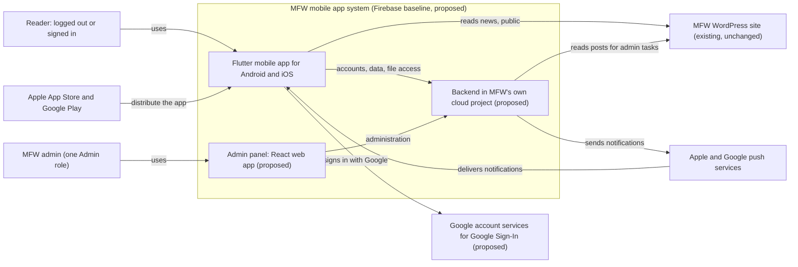

| Actor or system | Role | Status |
|---|---|---|
| Reader | A person who browses the catalogue and news, and with an account reads, downloads, bookmarks and favourites issues | CONFIRMED (spec §3.2) |
| MFW admin | A member of MFW's editorial team who manages issues, news controls and notifications. S2 has one role. This design keeps one role and adds in-panel add and remove of admins (GS-Q44). | CONFIRMED for one role, PROPOSED for in-panel add and remove |
| WordPress site | MFW's existing site, the master source of news | CONFIRMED (INT-WP-001) |
| Google account services | Provide Google Sign-In | PROVISIONAL (FR-AUTH-005, C-04) |
| Push services | Apple's push service for iPhones and Google's for Android | CONFIRMED (INT-PUSH-001) |
| App stores | Distribute the signed builds from MFW's own accounts | CONFIRMED (INT-STORE-001) |

## 5. Container Architecture

The diagram shows the runnable parts. All Firebase parts sit in one project owned by MFW. Each is PROPOSED and not approved. The region is not chosen (TD-22).

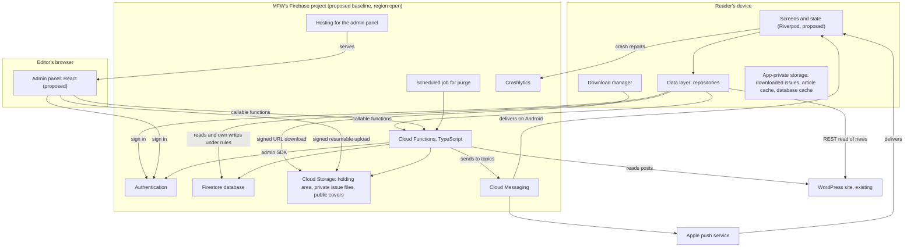

### 5.1 Component tree

The same parts, listed by where they run. Square brackets give the decision status or the evidence label. A proposed choice is not approved.

```text
MFW mobile app system                         [Firebase baseline proposed, TD-03; region open, TD-22]
├── Reader's device                           [untrusted]
│   ├── Flutter app                           [accepted, TD-01]
│   │   ├── Screens and state                 [Riverpod and go_router proposed, TD-02]
│   │   ├── Data layer (repositories)
│   │   └── Download manager                  [product open, TD-11]
│   └── App-private storage                   [NFR-SEC-004 (CONFIRMED)]
│       ├── Downloaded issue files
│       ├── File registry
│       ├── Article cache
│       └── Database cache
├── Editor's browser                          [untrusted]
│   └── Admin panel (React)                   [proposed, TD-14]
├── MFW's cloud project                       [trusted; owned and paid by MFW, REG-037 and REG-038 (CONFIRMED)]
│   ├── Security rules                        [default deny]
│   ├── Cloud Functions (TypeScript)          [proposed, TD-04]
│   │   ├── Callable functions                [Section 10.1]
│   │   ├── Storage-event trigger
│   │   └── Scheduled jobs                    [purge and holding-area cleanup]
│   ├── Authentication                        [proposed, TD-06]
│   ├── Firestore database                    [proposed, TD-07]
│   ├── Cloud Storage                         [proposed, TD-08]
│   │   ├── Private issue files
│   │   ├── Public covers
│   │   └── Holding area for uploads
│   ├── Cloud Messaging                       [proposed, TD-13]
│   ├── Hosting (serves the admin panel)      [proposed, TD-14]
│   └── Crashlytics                           [proposed, TD-16]
└── Outside MFW's control
    ├── WordPress site                        [existing and unchanged; INT-WP-001 (CONFIRMED)]
    ├── Google account services               [Google Sign-In; FR-AUTH-005 (PROVISIONAL)]
    └── Apple and Google push services        [INT-PUSH-001 (CONFIRMED)]
```

## 6. Component Responsibilities

Each component states what it does, what it must not do, and its interfaces. "Does not" lines matter as much as the responsibilities, because they mark the trust boundaries in Section 8.

### 6.1 Flutter mobile app

```text
Flutter mobile app
├── Status
│   ├── Flutter is accepted (TD-01)
│   └── State management and navigation are proposed (TD-02)
├── Responsibilities
│   ├── Show the catalogue, issue details, search and filters
│   ├── Register and sign in
│   ├── Collect and show the profile
│   ├── Request file access and download issues with progress, resume and a size warning
│   ├── Open issues in the reader
│   ├── Keep bookmarks, favourites and notification preferences
│   ├── Show news and cache it
│   ├── Subscribe the device to notification topics
│   ├── Delete downloaded issues
│   ├── Request account deletion
│   └── Report crashes
├── Does not
│   ├── Decide who may read an issue
│   ├── Hold any secret or a server credential
│   ├── Write profile data directly
│   ├── Store a signed URL after use
│   └── Trust its own copy of a role or a permission
├── Interfaces in
│   ├── Push notifications from the platform services
│   └── Deep links inside the app from a tapped notification (shared links that open the app are excluded,
│       EXC-08)
├── Interfaces out
│   ├── The sign-in provider
│   ├── The database, under rules
│   ├── Callable functions
│   ├── A signed URL for downloads
│   ├── The WordPress REST API
│   └── The crash-reporting service
├── Data it holds
│   ├── A database cache, downloaded issue files, an article cache and a small file registry, in app-private
│   │   storage (NFR-SEC-004)
│   └── Nothing else persists
└── Requirements: FR-MAG-001 to FR-MAG-008, FR-SRCH-001 to FR-SRCH-005, FR-READ-001 to FR-READ-010, FR-DL-001 to
    FR-DL-009, FR-BKM-001 to FR-BKM-006, FR-NEWS-001 to FR-NEWS-005, FR-NOTIF-001 to FR-NOTIF-005, FR-AUTH-001
    to FR-AUTH-004, FR-AUTH-009
```

### 6.2 Backend and API

The backend is a set of callable and triggered functions plus the database and file security rules. It is not a server that runs all the time.

```text
Backend and API
├── Status
│   ├── Cloud Functions in TypeScript are proposed (TD-04)
│   └── The hybrid API style is proposed (TD-05)
├── Responsibilities
│   ├── Check the caller on every call
│   ├── Decide whether a reader may have an issue file and issue a short-lived URL (TD-09)
│   ├── Validate and register uploads (FR-ADMIN-006, FR-ADMIN-007)
│   ├── Publish and unpublish issues, and delete an unpublished issue permanently on an admin's request (GS-Q45)
│   ├── Record a notification as pending, send it, and mark it accepted or failed (GS-Q27)
│   ├── Read WordPress posts for the admin post picker
│   ├── Save and validate profiles and record consent
│   ├── Run account deletion and the scheduled purge
│   ├── Add and remove admins, and write the narrow record of who added or removed whom (GS-Q44)
│   └── Produce the registered-user export on request (GS-Q49)
├── Does not
│   ├── Stream issue files through itself
│   ├── Store PDFs in the database
│   ├── Keep exports after producing them
│   ├── Log personal data
│   └── Hold news content
├── Interfaces in
│   ├── Callable requests from the app and the admin panel
│   ├── Storage events when an upload finishes
│   └── A schedule
├── Interfaces out
│   ├── The database, the file store and the sign-in provider through the server SDK, which bypasses rules and
│   │   therefore applies its own checks
│   ├── The push service
│   └── The WordPress API
├── Data it owns
│   ├── None permanently
│   └── It writes to the database and the file store
└── Requirements: NFR-SEC-002, NFR-SEC-007, NFR-SEC-008, FR-ADMIN-006, FR-ADMIN-007, FR-ADMIN-011, FR-ADMIN-015
    to FR-ADMIN-018, FR-PRIV-003, INT-FILE-001
```

### 6.3 Authentication provider

```text
Authentication provider
├── Status
│   ├── Firebase Authentication with email and password and Google Sign-In is proposed (TD-06)
│   └── Google Sign-In is PROVISIONAL
├── Responsibilities
│   ├── Create and verify accounts
│   ├── Sign readers and admins in and out
│   ├── Send verification and reset emails
│   ├── Hold the email address, name and user identifier
│   ├── Issue tokens that carry the identity to the database and the functions
│   └── Disable and delete accounts when the server asks
├── Does not
│   ├── Hold profile data, bookmarks, roles or consent
│   └── Decide access to files
├── Interfaces in
│   ├── The app and the admin panel
│   └── The server SDK
├── Interfaces out: Google account services for Google Sign-In
├── Data it owns
│   ├── The account identifier, email address, verification state, sign-in methods and display name
│   └── The app keeps only the identifier (GS-Q5)
├── Rules proposed
│   ├── One account per email address
│   ├── Google's verified-email result is trusted, subject to AOQ-09
│   └── Google links to a password account only when that account's email is verified (TD-06, OQ-04, OQ-05)
└── Requirements: FR-AUTH-001 to FR-AUTH-010, INT-AUTH-001, INT-AUTH-002, BR-002
```

### 6.4 Primary database

```text
Primary database
├── Status
│   ├── Cloud Firestore is proposed (TD-07)
│   └── The logical model is vendor-neutral (see the Database and Data Model document)
├── Responsibilities
│   ├── Hold the catalogue metadata and the lookups, per-reader app records, bookmarks, favourites, notification
│   │   preferences, news controls, send records, admin role records, the narrow admin-change record, the guard record and a small configuration record
│   ├── Enforce per-reader access through rules
│   └── Hold the device cache's source data
├── Does not: Hold PDF files, article bodies, device tokens or the email address
├── Interfaces in
│   ├── The app, directly and under rules, for public reads and a reader's own data
│   └── The functions, for everything else
├── Interfaces out: None
├── Data it owns: The entities in the data model
└── Requirements: DATA-001 to DATA-012, FR-BKM-001 to FR-BKM-004, NFR-SEC-005, NFR-SEC-006
```

### 6.5 Object storage and PDF delivery

```text
Object storage and PDF delivery
├── Status
│   ├── Cloud Storage for Firebase is proposed (TD-08)
│   ├── Signed-URL delivery is proposed (TD-09)
│   └── The location is open (TD-22)
├── Responsibilities
│   ├── Hold issue PDFs privately, cover images publicly, and uploads in a holding area before they are
│   │   validated
│   ├── Serve a file to a reader only through a short-lived signed URL
│   └── Refuse every direct client read of the private path
├── Does not
│   ├── Release a file because a client asks for it
│   └── Hold personal data
├── Interfaces in
│   ├── A signed URL for downloads
│   ├── A signed resumable upload URL for admin uploads
│   └── The server SDK
├── Interfaces out: A storage event when an upload finishes
├── Data it owns
│   ├── The PDF and cover binaries
│   └── Their metadata is in the database
└── Requirements: NFR-SEC-002, NFR-SEC-003, INT-FILE-001, FR-DL-001, FR-DL-002, FR-DL-006, FR-ADMIN-005
```

### 6.6 WordPress integration

```text
WordPress integration
├── Status
│   ├── Direct read from the app with device caching is proposed (TD-12)
│   └── The WordPress site itself exists and is unchanged (INT-WP-002)
├── Responsibilities
│   ├── The site supplies posts, categories and images over its REST API
│   ├── The app reads them in small pages, filters to the news categories MFW selects, merges the news controls
│   │   from the database and caches recent articles
│   └── The backend reads posts only for the admin post picker and for notification triggers
├── Does not: Change the site, receive credentials from the app, or have its posts copied into the database
├── Interfaces in: HTTPS requests for posts, categories and media
├── Interfaces out: None
├── Data it owns: All news content (DATA-015)
└── Requirements: INT-WP-001 to INT-WP-005, FR-NEWS-001 to FR-NEWS-005, FR-NEWS-007, FR-NEWS-008, FR-ADMIN-013
    to FR-ADMIN-015
```

### 6.7 Admin and content-management interface

```text
Admin and content-management interface
├── Status
│   ├── A React web app on Firebase Hosting is proposed (TD-14)
│   └── One Admin role with in-panel add and remove is a proposed position (GS-Q44, OQ-58)
├── Responsibilities
│   ├── Let an admin sign in, upload an issue and its cover, edit issue details and categories, publish and
│   │   unpublish, hide or mark a WordPress post, send a notification and see the send log
│   └── Add an admin by finding a registered reader by email, remove an admin after a confirmation, see the
│       record of those changes, and see and export the registered-user list
├── Does not
│   ├── Authorise anything itself
│   └── Write news
├── Authorisation: The panel hides controls by role, and the backend checks again on every call
├── Interfaces in: Editors' browsers
├── Interfaces out: The sign-in provider, callable functions and signed resumable uploads
├── Data it holds
│   ├── Nothing beyond the session
│   └── No secret is in the client bundle
└── Requirements
    ├── FR-ADMIN-001 to FR-ADMIN-019, NFR-SEC-007 and FR-USER-001 to FR-USER-005, with the statuses in the
    │   specification
    └── NFR-SEC-011 (OPEN)
```

### 6.8 Push notification provider

```text
Push notification provider
├── Status: Firebase Cloud Messaging with one topic per category is proposed (TD-13)
├── Responsibilities: Deliver a notification sent to a topic to the devices subscribed to it, on Android and
│   through Apple's push service on iPhones
├── Does not: Store reader identity or preferences, or confirm delivery per device
├── Interfaces in
│   ├── A send request from the backend
│   └── A subscription from the device
├── Interfaces out: Apple's push service and Google's
├── Data it owns: Registration tokens and topic subscriptions, held by the provider and not by the database
└── Requirements: FR-NOTIF-001 to FR-NOTIF-006, FR-ADMIN-015 to FR-ADMIN-018, INT-PUSH-001, INT-PUSH-002,
    NFR-REL-003
```

### 6.9 Monitoring and operational services

```text
Monitoring and operational services
├── Status
│   ├── Crashlytics on and Analytics collection off are proposed (TD-16)
│   └── Backups and the purge job are proposed (TD-19)
├── Responsibilities
│   ├── Collect crash reports with no reader identity
│   ├── Record function errors and security-relevant events without personal data
│   ├── Run the scheduled purge
│   ├── Keep scheduled database backups
│   └── Report cost through MFW's billing console
├── Does not
│   ├── Record which reader opened which issue or page (NFR-PRIV-003)
│   └── Collect usage events before OQ-23 is decided
├── Interfaces in: The app, the functions and the schedule
├── Interfaces out: MFW's console and billing view
└── Requirements: NFR-OBS-001, NFR-OBS-002, NFR-PRIV-003, NFR-REL-001, NFR-REL-002
```

### 6.10 External platforms MFW owns

```text
External platforms MFW owns
├── Apple Developer Program account
│   ├── Role: Store listing, signing and the push key
│   └── Status: CONFIRMED (INT-STORE-001, INT-PUSH-002)
├── Google Play account
│   ├── Role: Store listing and signing
│   └── Status: CONFIRMED (INT-STORE-001)
├── MFW's cloud project and billing
│   ├── Role: Owns all backend resources and pays usage
│   └── Status: CONFIRMED (REG-037, REG-038)
└── MFW's WordPress host
    ├── Role: Serves the news API
    └── Status: CONFIRMED (INT-WP-001)
```

## 7. Data Flows

Each flow states who starts it, what is checked and where, which data is touched, how it fails and which requirements it serves. Function names are working names for the interface table in Section 10. The data entities are defined in [Database and Data Model](DATABASE_AND_DATA_MODEL.md).

### 7.1 Registration and sign-in

```text
Registration and sign-in
├── Starts with: A visitor chooses to register or sign in, with email and password or with Google
├── Access check
│   ├── The sign-in provider verifies credentials
│   └── A function validates the profile and records consent
├── Data touched
│   ├── Provider account (email, name, identifier)
│   └── User record, profile and consent record in the database
├── Failure handling
│   ├── A verification email that does not arrive can be sent again
│   ├── A failed network call is retried by the reader
│   ├── An email already used with another method follows the linking rule
│   └── A registration without the required fields stays incomplete
└── Requirements
    ├── FR-AUTH-001 to FR-AUTH-004 (CONFIRMED)
    ├── FR-AUTH-005 (PROVISIONAL)
    ├── FR-AUTH-006, FR-AUTH-007 (OPEN)
    ├── FR-PRIV-001 (CONFIRMED)
    ├── FR-PROF-001, FR-PROF-003 (PROVISIONAL)
    ├── DATA-003 (CONFIRMED)
    └── DATA-012 (ASSUMPTION)
```

1. The reader sees links to MFW's privacy policy and terms of use (FR-PRIV-002, ASSUMPTION) and a consent action. How consent is recorded is OQ-27. The requirement that consent is mandatory at registration, and the reference to terms of use, are inferences from S2 (Appendix A, item 2).
2. For email accounts, the app creates the account with the provider, which sends a verification email (FR-AUTH-002).
3. The app calls `saveProfile` with the profile fields and the consent versions. The function checks them against the configured required-field rule, writes the profile and consent records, and creates the user record. The profile is not written by the app directly.
4. For Google Sign-In, the app obtains the Google credential and the provider signs the reader in or creates the account. The name and email are taken from the account to prefill the form (GS-Q4). When the reader completes the profile is OQ-03: straight after the first sign-in, or when the reader first opens a full issue (FR-PROF-004). The same access check supports both.
5. For a Google address that already has a password account, the linking rule applies: link only when the password account's email is verified, otherwise verify first (TD-06, OQ-05).
6. Registration tells the visitor that an account exists for an address that already has one. The duplicate-address error arises at the provider and is mapped in the app to the conflict case. Sign-in gives one message for any wrong email or password, and password reset gives the same message whether or not the address has an account. All three are rate limited. This is PROPOSED, and the provider's behaviour is NOT VERIFIED (TD-06, SECURITY_AND_ACCESS_CONTROL SC-21).

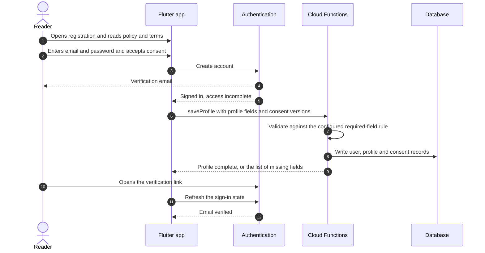

### 7.2 Profile creation and updates

```text
Profile creation and updates
├── Starts with: The reader completes the profile at registration, or opens the profile screen later
├── Access check
│   ├── The reader reads only their own profile under rules
│   └── All writes go through saveProfile, which checks the caller
├── Data touched
│   ├── Profile record (DATA-004)
│   └── The email is not copied into it
├── Failure handling
│   ├── Invalid or missing fields are returned with the field names
│   └── An offline save is refused with a retry message, because profile saves are not queued
└── Requirements
    ├── FR-PROF-001 to FR-PROF-005, DATA-004 (PROVISIONAL)
    ├── FR-PROF-006 (CONFIRMED)
    ├── FR-PROF-007 (ASSUMPTION)
    ├── NFR-PRIV-001 (PROVISIONAL)
    ├── NFR-SEC-006 (ASSUMPTION)
    └── OQ-01, OQ-02, OQ-07
```

The default required set is the list in the requirements specification: name, exact age, gender, occupation and domain of work (FR-PROF-002, PROVISIONAL). The earlier working list (PRC-03) added mobile number, company and country. They are now optional candidates, and so are city and areas of interest, until MFW confirms a list (OQ-01, GS-Q34). Email comes from the sign-in provider and is not stored again. The required set is a configuration value, so MFW's answer to OQ-01 does not need a schema change. The age format is unresolved (OQ-02) and so is the legal review (OQ-07).

### 7.3 Magazine catalogue browsing

```text
Magazine catalogue browsing
├── Starts with: Any user opens the catalogue, with or without an account
├── Access check
│   ├── Database rules allow anyone to read published issue metadata, categories and segments
│   └── They deny reads of unpublished issues
├── Data touched
│   ├── Issue, category, industry segment and issue-segment records
│   └── Covers from the public path
├── Failure handling
│   ├── With no network the app shows the cached catalogue, if OQ-10 is approved as proposed, with an offline
│   │   notice
│   └── A refresh failure keeps the cached data
└── Requirements
    ├── FR-MAG-001 to FR-MAG-008, FR-SRCH-001 to FR-SRCH-005 (CONFIRMED)
    ├── FR-SRCH-006, FR-SRCH-007 (ASSUMPTION)
    ├── FR-MAG-009 (OPEN)
    └── AC-1
```

1. The app reads the catalogue on open and on pull-to-refresh. A newly published issue appears after a refresh, and an unpublished one disappears (FR-MAG-007, FR-MAG-008).
2. Search and filters run on the device over the cached catalogue of the latest issue and four to six archive issues (TD-21). They cover metadata only.
3. Whether file size and page count are shown before sign-in is OQ-13. If they are not, those fields move to a document that only signed-in readers can read.

### 7.4 Authenticated magazine access

```text
Authenticated magazine access
├── Starts with: A reader opens or downloads a full issue
├── Access check
│   ├── The function getIssueFile runs the six checks in the diagram below, in this order
│   └── Storage rules deny every direct client read of the private path
├── Data touched: User record, profile completeness, issue and file revision records
├── Failure handling: Each failed check returns a distinct reason, and the app shows the matching prompt
└── Requirements
    ├── BR-002, FR-READ-001, FR-DL-002, FR-AUTH-010, NFR-SEC-002 (CONFIRMED)
    ├── BR-003, FR-PROF-004 (PROVISIONAL)
    ├── BR-005 (ASSUMPTION)
    └── AC-3
```

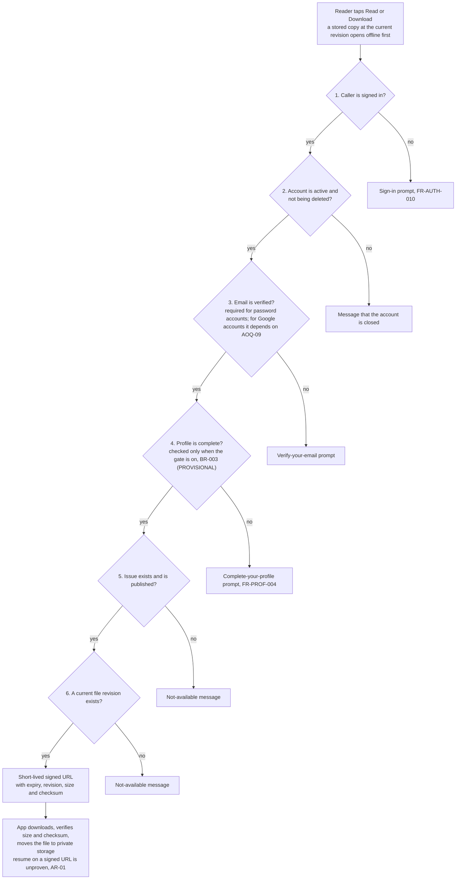

A notification or a link that leads to a full issue goes through the same function (BR-005).

### 7.5 PDF download and reading

```text
PDF download and reading
├── Starts with: A reader taps Read or Download on an issue
├── Access check
│   ├── getIssueFile, then the signed URL
│   └── A signed URL is valid for a short time, so possession of it is a temporary credential
├── Data touched: The file in Cloud Storage, a partial file and the downloaded file in app-private storage, and
│   a row in the device's file registry
├── Failure handling: See the list below and Section 11
└── Requirements
    ├── FR-READ-002, FR-DL-001, FR-DL-003 to FR-DL-009, FR-READ-010, NFR-SEC-004, NFR-OFF-001 (CONFIRMED)
    ├── FR-DL-010, OQ-08 (OPEN)
    ├── FR-STATE-004, FR-STATE-006 (ASSUMPTION)
    └── AC-2, AC-4
```

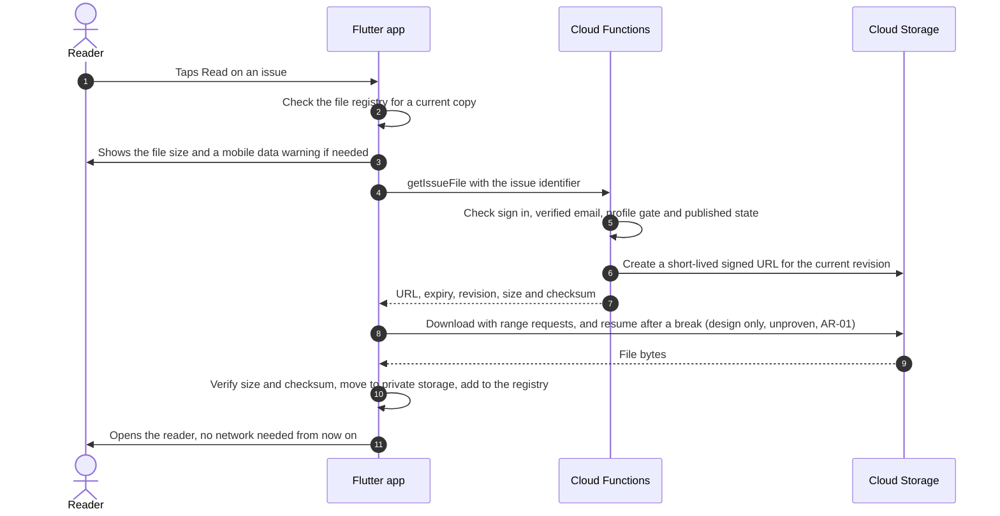

1. The app first looks in its file registry. If a copy at the current revision is stored, it opens it with no network call.
2. Otherwise it checks free space (FR-STATE-004), shows the size (FR-DL-003) and warns on mobile data (FR-DL-004), then calls `getIssueFile`.
3. The download runs to a partial file, with progress (FR-DL-005). After a network break it resumes from the bytes already held (FR-DL-006). If the signed URL has expired, the app asks the function for a new one and continues. Whether a signed URL supports resume is unproven (AR-01, AOQ-07). Downloads run only while the app is in the foreground, and a stopped download resumes later (GS-Q60).
4. When the file is complete the app checks its size and checksum. A mismatch deletes the file and offers a retry (FR-READ-010). A good file moves to private storage and is added to the registry. Only complete files are listed as downloaded.
5. On the working position there are two actions (GS-Q43). Read downloads a complete temporary copy and opens it, and the app removes the copy when the reader leaves the issue. Download keeps the copy until the reader deletes it from the Downloads screen (FR-DL-009). The registry records the kind of each copy in a retention-mode field, "kept" or "temporary". The working design also removes a temporary copy left behind by a crash at the next start of the app (proposed). The two-action answer is reported as MFW's, with no date or channel, and OQ-08 stays OPEN until MFW confirms it in writing (DEC-033).
6. What happens to downloaded files on sign-out, account deletion, unpublishing and permanent deletion is OQ-11, which stays OPEN for MFW. The working design (GS-Q24) deletes the files on account deletion, hides them on sign-out until the same reader signs in again, leaves them when an issue is only unpublished, and removes them once the app sees a permanently deleted issue on the deleted-issue list.
7. When the catalogue shows a newer revision than the stored one, the app shows an updated badge and lets the reader choose to download again. It never replaces a file silently.

### 7.6 Bookmarks and favourites

```text
Bookmarks and favourites
├── Starts with: A signed-in reader bookmarks a page or marks an issue as a favourite
├── Access check: Database rules allow a reader to read and write only the documents under their own identifier
│   (NFR-SEC-005)
├── Data touched: Bookmark and favourite records under the reader's own path
├── Failure handling: A write made offline is held on the device and sent when the network returns, and the last
│   write wins (TD-20, OQ-10)
└── Requirements
    ├── FR-BKM-001 to FR-BKM-006, NFR-SEC-005 (CONFIRMED)
    ├── FR-BKM-007 (ASSUMPTION)
    ├── FR-BKM-008, NFR-OFF-002 (OPEN)
    └── AC-5
```

1. A bookmark stores the issue, the page number and the file revision it was made on. Opening a bookmark opens the issue at that page (FR-BKM-002). If the stored file is at a different revision, the app opens the page clamped to the new page count and shows a notice (GS-Q16).
2. A favourite stores the reader and the issue. The change shows at once (FR-BKM-003).
3. Both appear on a second device after sign-in (FR-BKM-004).
4. Whether a signed-in reader without full access can favourite is OQ-12.

### 7.7 News retrieval

```text
News retrieval
├── Starts with: Any user opens the news list or an article
├── Access check
│   ├── None
│   ├── News is public data (FR-NEWS-007)
│   └── The app sends no credentials
├── Data touched
│   ├── Posts from WordPress
│   ├── The news control records in the database
│   └── The device's article cache
├── Failure handling
│   ├── If the site cannot be reached the app shows previously loaded articles with a message (FR-STATE-005)
│   └── A reader offline still reads articles already loaded, with a notice (FR-NEWS-005)
└── Requirements
    ├── INT-WP-001 to INT-WP-005, FR-NEWS-001 to FR-NEWS-005, FR-NEWS-007, FR-NEWS-008, DATA-009, DATA-015 (CONFIRMED)
    ├── FR-NEWS-006, FR-NEWS-009 (OPEN)
    └── AC-7
```

1. The app requests posts in small pages from the selected news categories, with the fields it needs, and caches recent articles (INT-WP-004, TD-12).
2. It reads the news control records and removes hidden posts and flags breaking posts. A hidden post stays public on the website.
3. Post HTML is rendered with a sanitising renderer. How a breaking post is shown (OQ-17), how articles are kept offline (OQ-16) and how embedded media is shown are open.

### 7.8 Admin magazine publishing

```text
Admin magazine publishing
├── Starts with: An admin uploads an issue's PDF and cover in the admin panel
├── Access check
│   ├── requestUpload checks the caller against the server-side role record
│   ├── The upload goes only to a holding area
│   └── A storage event runs the validation
├── Data touched: An upload job record, the holding area, the private path, an issue file revision and the issue
│   record
├── Failure handling
│   ├── A file that is not a genuine PDF, or is over the limit, is rejected and removed from the holding area,
│   │   and the upload job records the reason for the panel to show (FR-STATE-007)
│   └── A holding-area object that is never finalised is removed after a set time
└── Requirements
    ├── FR-ADMIN-005, FR-ADMIN-006, FR-ADMIN-007, FR-ADMIN-009, FR-ADMIN-011, FR-MAG-007, NFR-SEC-007, NFR-SEC-008 (CONFIRMED)
    ├── FR-ADMIN-008, FR-ADMIN-012 (OPEN)
    ├── FR-STATE-007 (ASSUMPTION)
    └── AC-8
```

End to end, from an upload to a notification. Steps 1 to 4 are this section, and steps 5 and 6 are Section 7.9.

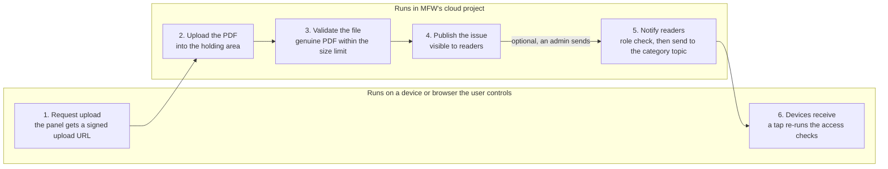

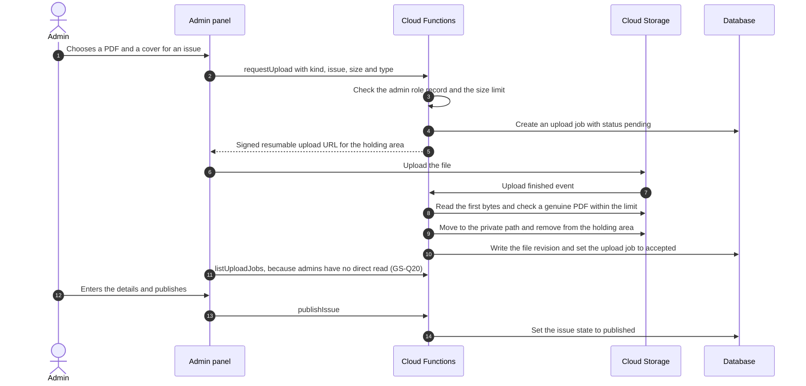

1. The size limit is 150 MB by default (FR-ADMIN-007). Whether exactly 150 MB is accepted and whether admins can change the limit is OQ-30, so the limit is a configuration value.
2. A replacement PDF for an existing issue creates a new file revision. The working design lets any admin replace a PDF, and lets any admin delete an issue permanently, after it is unpublished and after a typed confirmation (GS-Q45). No audit event is written for either, because the record is limited to admin changes (GS-Q44). OQ-21 and FR-ADMIN-012 (OPEN) stay OPEN for MFW. The architecture supports both without breaking bookmarks. A deleted issue leaves a deleted-issue record so that apps can remove their copies (GS-Q25).
3. Cover image checks are open (OQ-22, FR-ADMIN-008).
4. Publishing and unpublishing change the issue state (FR-ADMIN-011). A newly published issue can trigger a notification (7.9).

### 7.9 Push notification delivery

```text
Push notification delivery
├── Starts with: An admin sends a notification, or a reader sets notification preferences
├── Access check
│   ├── sendNotification checks the server-side role record
│   └── Only admins can send (FR-ADMIN-017)
├── Data touched
│   ├── A send record
│   ├── The category topics
│   └── A signed-in reader's saved preferences
├── Failure handling
│   ├── The send is recorded as pending first, then marked accepted or failed. A crash in between leaves it unknown, and only an admin retries (GS-Q27)
│   └── Delivery time depends on Apple and Google and is not guaranteed (NFR-REL-003)
└── Requirements
    ├── FR-NOTIF-001 to FR-NOTIF-006, FR-ADMIN-015 to FR-ADMIN-018, INT-PUSH-001, INT-PUSH-002, DATA-007, DATA-008, NFR-REL-003 (CONFIRMED)
    ├── FR-NOTIF-007, OQ-09, OQ-18, OQ-19 (OPEN)
    └── AC-9
```

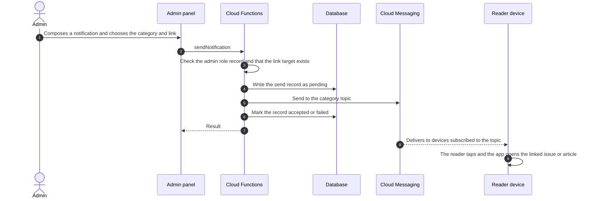

1. Before the operating system prompt, the app explains what notifications it sends (FR-NOTIF-001). If the reader agrees, the app subscribes the device to the topics for the categories chosen and unsubscribes it from the others (FR-NOTIF-002, FR-NOTIF-003).
2. A signed-in reader's choices are also saved with the user record so that they follow a new device. No device token is stored by the backend (TD-13). On the working position logged-out visitors may accept notifications and choose categories (GS-Q46), and the categories are three fixed ones set by the developers: new issues, expo specials and major news (GS-Q47). Both stay OPEN for MFW (OQ-09, OQ-18).
3. Tapping a notification opens the linked issue or article inside the app. Access rules still apply (FR-NOTIF-005, BR-005).
4. A breaking-news alert starts from a WordPress post chosen in the panel (FR-ADMIN-015). The panel reads posts through a function (TD-12).
5. On sign-out and on account deletion the app removes its subscriptions. Whether removing the token also ends the subscriptions is unproven (AOQ-13).
6. A failed or unknown send can be retried only by an admin, and the retry reuses the same record. Nothing retries automatically (GS-Q27, INV-17). Whether the push service delivers a repeated send twice is NOT VERIFIED (Technology Decisions §9.4, item 22).

### 7.10 Account deletion and data removal

```text
Account deletion and data removal
├── Starts with: A signed-in reader chooses to delete the account and confirms
├── Access check
│   ├── requestAccountDeletion checks that the caller is the account owner
│   └── The cleanup job runs under the backend's own credentials
├── Data touched
│   ├── The sign-in account, the user record, profile, bookmarks, favourites, notification preferences and the
│   │   consent record
│   └── Downloaded files on the device
├── Failure handling: The deletion is repeatable: a failure part-way leaves the account marked as being deleted
│   and a retry or the cleanup job continues it
└── Requirements
    ├── FR-AUTH-009, FR-PRIV-003 (CONFIRMED)
    ├── FR-PRIV-004 (ASSUMPTION)
    ├── NFR-PRIV-005, DATA-017, OQ-24 (OPEN)
    ├── GS-Q50
    └── AC-3
```

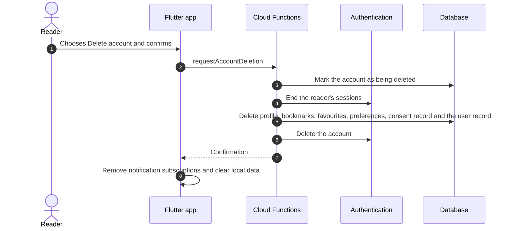

1. This is the baseline flow (GS-Q50, DEC-029). The deletion is immediate: the reader confirms, the sessions end and the deletion steps run at once. There is no undo and no pending state, which matches the wording of FR-PRIV-003 and AC-3. The earlier soft-delete proposal with a grace window (PRC-02) is withdrawn. The backup retention is open (AOQ-02).
2. On the working position the edition-update sign-up is dropped (GS-Q49, DEC-032), so no step removes such an entry. If MFW keeps the feature, the step returns (OQ-31, Appendix A, item 4).
3. Whether consent records outlive the person is OQ-24 and AOQ-04. Until MFW decides, the design keeps the consent record with the user and deletes it with the account.
4. Deleted data can remain in database backups until they expire. A restore must re-apply deletions (Section 11.4).
5. Apple expects deletion to start in the app. Google Play expects an in-app path and a web link for deletion requests (AOQ-06). MFW publishes the web link on its own site (GS-Q57). Both store rules were extracted from policy pages and must be re-checked (AR-02).
6. If a step fails after the sessions end, the account stays marked as being deleted. The app's own status closes every server operation for it, and the scheduled cleanup job continues the deletion until it finishes. The request is refused for the last admin (INV-03).

### 7.11 Adding and removing admins

```text
Adding and removing admins (one Admin role, proposed position)
├── Starts with: An admin adds a registered reader as an admin, or removes an admin
├── Access check
│   ├── The caller must be an admin by the server-side role record
│   └── The token must not be revoked and the sign-in must be recent
├── Data touched
│   ├── In one transaction: the admin role record, the record of the change and the admin guard record
│   └── Afterwards, outside that transaction: ending the removed admin's sessions
├── Failure handling
│   ├── The last-admin rule, checked against the guard record, refuses a removal that would leave no admin
│   ├── A failure inside the transaction leaves the previous role record, the change record and the guard
│   │   record unchanged
│   └── A failure after the commit does not undo the change. The role record decides, every privileged function
│       refuses the person, and the step is retried (INV-09)
└── Requirements
    ├── FR-ADMIN-003, FR-ADMIN-004 (CONFIRMED), FR-USER-005, NFR-SEC-011 (OPEN)
    ├── EXC-07
    ├── OQ-20, OQ-58
    ├── AOQ-03, AOQ-04, AOQ-14, AOQ-17 (answered by proposal, GS-Q20)
    └── How each rule is enforced and tested: INV-03 to INV-09 (Database and Data Model §10.8)
```

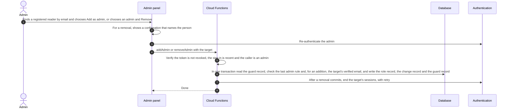

1. The first admin cannot be added by another admin, so a controlled two-person step creates it. MFW's authorised approver names the person in writing, one developer runs the step, the other verifies it, and the change record holds the written reference. The developers then hand access to MFW. The same step is the recovery route after a lockout (GS-Q33, GS-Q44).
2. An admin is added by granting the role to a registered reader whose email is verified, so nobody sets another person's password (GS-Q44). A person who has not registered in the app cannot be added.
3. No role is carried in the sign-in claims (GS-Q20). Each privileged function, including each privileged read, reads the role record and the account status on every call, and rules give admins no direct read, so an older token gains nothing. This answers AOQ-17 by proposal. An upload URL issued earlier works until it expires, and the finalising step then rejects the file (INV-08).
4. Admin sign-in is a password, a verified email and a recent-sign-in check on sensitive actions. There is no second factor on the working position (GS-Q51). AOQ-03 stays open for MFW.
5. Every admin has the same permissions, so any admin can remove any other admin. The safeguards are a confirmation that names the person, the last-admin rule and the narrow record. A removal of oneself follows the same rule and is refused only for the last admin (proposed).
6. The session step is outside the database transaction, so it can fail after the commit. The role record still decides, and the step is retried (INV-09). The change is never reported as undone when only this step failed.

### 7.12 Registered-user export

```text
Registered-user export
├── Starts with: An admin exports the registered-user list
├── Access check: The function checks the admin role record
├── Data touched: Provider account records joined with profiles at request time
├── Failure handling: An export that fails returns an error and writes nothing
└── Requirements
    ├── FR-USER-002, FR-USER-003 (PROVISIONAL)
    ├── FR-USER-001, FR-EMAIL-001 (CONFLICT; the sign-up is dropped on the working position, GS-Q49)
    ├── NFR-PRIV-004 (ASSUMPTION)
    ├── AC-8
    └── OQ-31
```

The file is built in memory, returned to the caller and not stored. Cells that start with a spreadsheet formula character are neutralised before export. Pages of up to 1,000 provider accounts are read at a time (VS-29). On the working position there is only the registered-user list, and any admin may export it (GS-Q49). The optional edition-update sign-up is dropped. S1 and S2 list it, so MFW must agree in writing (OQ-31).

## 8. Trust Boundaries, Authentication and Authorisation

### 8.1 Trust boundaries

Anything running on a reader's device or in an editor's browser is untrusted, because its owner controls it. Access is decided only by security rules and by functions in MFW's cloud project. Third-party services are outside MFW's control and are used for what they publish or deliver.

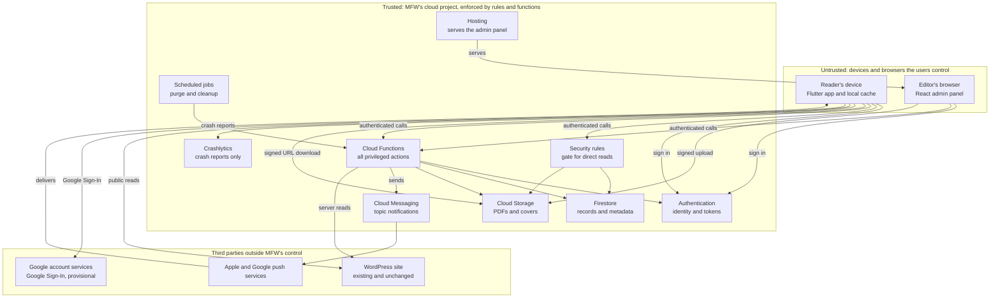

| Boundary | Crossed by | Control |
|---|---|---|
| Device or browser to the cloud project | Sign-in tokens on every database, storage and function call | The sign-in provider's token is verified by rules and by each function. No function trusts a role, a permission or a user identifier supplied by the client. |
| Cloud project to the file store | Signed URLs and server calls | The private path denies all client reads. A signed URL is issued only by `getIssueFile` after its checks. |
| Cloud project to WordPress | HTTPS reads of public data | No credentials cross this boundary. The site is not changed. |
| Cloud project to push services | A server send request | Only the function `sendNotification` sends, after a role check. |
| Device to the app's own storage | Local files | Downloaded issues are in app-private storage (NFR-SEC-004). There is no DRM (NFR-SEC-009), so a determined user on a rooted device can copy a file they were entitled to download. |

### 8.2 Authentication boundary

1. Readers and admins sign in to the same provider. The provider is the only source of identity. The app holds only the user identifier.
2. For every call, rules or functions check the signed-in identity. A function additionally checks the account status, so a disabled account, or one that is being deleted, is refused even with an unexpired token.
3. An admin is an ordinary account that holds a role record. The role record, not the token claim, is the authority for privileged operations (TD-15).
4. Adding or removing an admin, and other sensitive actions, require a recent sign-in. The time window is a configuration value (AOQ-14). There is no second factor on the working position (GS-Q51), and AOQ-03 stays open for MFW.

### 8.3 Access control by actor

The tree covers the four areas the brief names, magazine metadata, full PDF access, bookmarks and account deletion, and the other resources that need a rule. It is grouped by who is asking. "Rules" means database or storage security rules. "Function" means a callable function with its own checks. Where a spec status is OPEN or PROVISIONAL the leaf says so.

```text
Access by actor                              [bracket: enforced by; requirement (status)]
├── Logged out
│   ├── Can read
│   │   ├── Published issue metadata and covers      [Rules; FR-MAG-001 (CONFIRMED)]
│   │   └── News list and articles                   [none, public data; FR-NEWS-007 (CONFIRMED)]
│   ├── Open
│   │   └── Own notification preferences             [OPEN, OQ-09; FR-NOTIF-002 (CONFIRMED)]
│   └── Cannot
│       └── Unpublished issues, full PDFs, bookmarks, favourites, a profile, account deletion,
│           another reader's bookmarks or favourites, any admin operation
├── Signed in, access incomplete (email not verified, or the profile gate not met)
│   ├── Can read
│   │   ├── Published issue metadata and covers      [Rules; FR-MAG-001 (CONFIRMED)]
│   │   ├── News list and articles                   [none, public data; FR-NEWS-007 (CONFIRMED)]
│   │   └── Own profile                              [Rules for read, Function for write;
│   │                                                 FR-PROF-006 (CONFIRMED); NFR-SEC-006 (ASSUMPTION)]
│   ├── Can read and write
│   │   └── Own notification preferences             [Rules, by user identifier; FR-NOTIF-002 (CONFIRMED)]
│   ├── Can do
│   │   └── Delete own account                       [Function, owner check; FR-AUTH-009 (CONFIRMED)]
│   ├── Open
│   │   └── Own favourites                           [OPEN, OQ-12; FR-BKM-003 (CONFIRMED)]
│   └── Cannot
│       └── Full PDF, bookmarks (a bookmark needs an open issue), unpublished issues,
│           another reader's bookmarks or favourites, any admin operation
├── Signed in, full access
│   ├── Can read
│   │   ├── Published issue metadata and covers      [Rules; FR-MAG-001 (CONFIRMED)]
│   │   ├── News list and articles                   [none, public data; FR-NEWS-007 (CONFIRMED)]
│   │   └── Own profile                              [Rules for read, Function for write;
│   │                                                 FR-PROF-006 (CONFIRMED); NFR-SEC-006 (ASSUMPTION)]
│   ├── Can read and write
│   │   ├── Own bookmarks                            [Rules, by user identifier; FR-BKM-001 (CONFIRMED);
│   │   │                                             NFR-SEC-005 (CONFIRMED)]
│   │   ├── Own favourites                           [Rules, by user identifier; FR-BKM-003 (CONFIRMED); OQ-12]
│   │   └── Own notification preferences             [Rules, by user identifier; FR-NOTIF-002 (CONFIRMED)]
│   ├── Can do
│   │   ├── Obtain a full issue PDF, only through the function   [Function, and storage rules that deny
│   │   │                                                         direct reads; BR-002 (CONFIRMED);
│   │   │                                                         BR-003 (PROVISIONAL); NFR-SEC-002 (CONFIRMED)]
│   │   └── Delete own account                       [Function, owner check; FR-AUTH-009 (CONFIRMED)]
│   └── Cannot
│       └── Unpublished issues, another reader's bookmarks or favourites, any admin operation
└── Admin (one role; in-panel add and remove is a proposed position, GS-Q44)
    ├── Own data only, as for a signed-in reader with full access
    │   └── Profile, bookmarks, favourites, notification preferences, account deletion
    │       (no extra access to full PDFs)
    ├── Can read
    │   ├── Unpublished issue metadata               [Function (listIssuesForAdmin); FR-MAG-008 (CONFIRMED); GS-Q20]
    │   ├── The send log                             [Function (listNotificationSends); FR-ADMIN-018 (CONFIRMED); GS-Q20]
    │   ├── The registered-user list                 [Function; FR-USER-002 (PROVISIONAL); AOQ-05]
    │   └── The admin list and the change record     [Function; GS-Q44]
    ├── Can do
    │   ├── Upload an issue or cover                 [Function, then storage validation; FR-ADMIN-005 (CONFIRMED)]
    │   ├── Publish or unpublish an issue, or replace its PDF
    │   │                                            [Function; FR-ADMIN-011 (CONFIRMED); GS-Q45]
    │   ├── Delete an unpublished issue permanently  [Function, with a typed confirmation; FR-ADMIN-012 (OPEN); GS-Q45]
    │   ├── Write news controls                      [Function; FR-ADMIN-013 (CONFIRMED);
    │   │                                             FR-ADMIN-014 (CONFIRMED)]
    │   ├── Send a notification                      [Function; FR-ADMIN-017 (CONFIRMED)]
    │   ├── Export the registered-user list          [Function; FR-USER-003 (PROVISIONAL); GS-Q49]
    │   └── Add or remove an admin                   [Function, recent sign-in, last-admin guard; GS-Q44]
    └── Cannot
        └── Another reader's bookmarks or favourites [Rules; FR-BKM-005 (CONFIRMED)], extra access to
            full PDFs, or removing the last admin    [Function; INV-03]
```

There is one admin role, as in S2 (FR-ADMIN-004). The in-panel add and remove is a proposed addition that MFW has not confirmed (OQ-58). The admin panel itself refuses accounts that have no admin role (FR-ADMIN-003).

### 8.4 Protection of private content

| Control | What it stops | Residual risk |
|---|---|---|
| The private storage path denies every client read | Guessing or listing file addresses | None for this path |
| `getIssueFile` checks identity, account status, verified email, the profile gate and publication state before it signs | Logged-out readers, unverified readers, closed accounts and unpublished issues | A signed-in reader who passes the checks can download and keep the file |
| Short-lived signed URLs | A leaked link working for long | A link can be shared during its lifetime |
| No non-expiring download links for private files | A permanent leak (VS-10) | None |
| App-private storage on the device (NFR-SEC-004) | Other apps reading the file | Rooted devices. S2 states there is no DRM. |
| App Check for callable functions, if adopted (AOQ-10) | Calls from clients that are not the real app | Cost and setup not researched |
| Logs without personal data or URLs | A leak through logs | None expected |

### 8.5 Secrets and credentials

The app contains no secret and no server credential. Its cloud configuration identifiers identify a project and are not secrets. Developers reach MFW's accounts through role-based access and never through shared passwords (NFR-SEC-012). No service account key is stored in the repository or in CI (TD-17, TD-18). The Apple push key stays with MFW's Apple account (INT-PUSH-002). Who holds the app signing credentials is OPEN (REG-051).

## 9. Deployment Topology and Environments

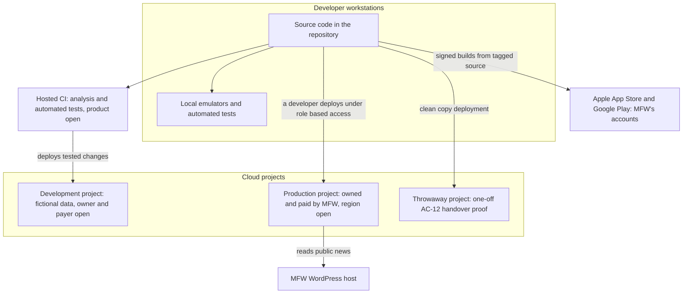

```text
Environments
├── Local emulators                          [proposed, TD-17]
│   ├── Purpose: daily development and automated rules and function tests
│   ├── Data: fictional
│   ├── Owner and payer: the developer's machine
│   └── Deployed by: the developer
├── Development project                      [proposed, TD-18]
│   ├── Purpose: shared testing of builds and functions
│   ├── Data: fictional only, never real reader data
│   ├── Owner and payer: open (AOQ-15)
│   └── Deployed by: CI, after tests
├── Production project                       [MFW ownership CONFIRMED; region open, TD-22]
│   ├── Purpose: the live app, admin panel and backend
│   ├── Data: real data
│   ├── Owner and payer: MFW (REG-037, REG-038)
│   └── Deployed by: a developer under role-based access
└── Throwaway project                        [proposed; needed for AC-12]
    ├── Purpose: prove that a clean copy deploys from the written documentation into a fresh project
    ├── Data: fictional
    ├── Owner and payer: open (AOQ-15)
    └── Deployed by: a developer, once
```

| Topic | Position |
|---|---|
| Region | Open (TD-22, AOQ-01). All regional choices are made once, before any resource is created. |
| Configuration per environment | Held outside the code and set per project. No value is set in this document. |
| Releases | Android and iOS builds are signed and made from tagged source code (NFR-MAINT-003). They go to the stores through MFW's accounts. |
| Production deployment | Made by a developer, not by CI, so that no production credential sits in CI (GS-D4). |
| Handover | The repository, documentation, security rules and a record of who holds each credential go to MFW (NFR-MAINT-001, NFR-MAINT-004; S2 Handover). |

## 10. API and Integration Boundaries

The backend exposes callable functions and receives events. There is no public REST API and no OpenAPI document (TD-05, GS-D2). The tree and tables below are the contract, and the TypeScript functions and the React admin panel can share the types. All function names are working names.

### 10.1 Callable functions and triggers

Every function authenticates the caller first. "Admin" means an account that has the Admin role by the server-side role record.

```text
Backend functions (working names)
├── Signed-in reader
│   ├── saveProfile
│   │   ├── In: profile fields; on the first call, the policy and terms versions accepted
│   │   ├── Out: profile status, complete or the missing fields
│   │   ├── Refuses: invalid or missing fields; account being deleted
│   │   └── Requirements: FR-PROF-001 to FR-PROF-005 (PROVISIONAL); FR-PRIV-001 (CONFIRMED);
│   │       DATA-012 (ASSUMPTION)
│   ├── getIssueFile
│   │   ├── In: issue identifier
│   │   ├── Out: signed URL, expiry, file revision, size, checksum
│   │   ├── Refuses: the six checks in 7.4
│   │   └── Requirements: NFR-SEC-002, BR-002, INT-FILE-001 (CONFIRMED); BR-003 (PROVISIONAL)
│   └── requestAccountDeletion                   [caller: the account owner]
│       ├── In: a confirmation flag
│       ├── Out: confirmation that the deletion is done, or has started and will finish
│       ├── Refuses: not the owner; already deleting; the last admin (INV-03)
│       └── Requirements: FR-AUTH-009, FR-PRIV-003 (CONFIRMED); GS-Q50
├── Admin (by the server-side role record)
│   ├── getMyAdminRole, listIssuesForAdmin, listUploadJobs, listNotificationSends
│   │   ├── In: filters and a page cursor, or none
│   │   ├── Out: the caller's role, or a page of records. Admins have no direct read, so every admin read is one of these (GS-Q20)
│   │   ├── Refuses: not an admin (getMyAdminRole answers none instead)
│   │   └── Requirements: FR-ADMIN-003, NFR-SEC-007, FR-ADMIN-018 (CONFIRMED); FR-STATE-007 (ASSUMPTION)
│   ├── requestUpload
│   │   ├── In: kind (PDF or cover), issue, size, content type
│   │   ├── Out: signed resumable upload URL for the holding area
│   │   ├── Refuses: not an admin; over the size limit
│   │   └── Requirements: FR-ADMIN-005 to FR-ADMIN-007 (CONFIRMED)
│   ├── saveIssue, saveCategory, publishIssue, unpublishIssue
│   │   ├── In: issue details, category name, issue identifier
│   │   ├── Out: saved record or new state
│   │   ├── Refuses: not an admin; invalid values; publishing an issue with no accepted file
│   │   └── Requirements: FR-ADMIN-009 to FR-ADMIN-011 (CONFIRMED)
│   ├── setNewsControl
│   │   ├── In: WordPress post identifier, hidden or breaking flag
│   │   ├── Out: saved control record
│   │   ├── Refuses: not an admin
│   │   └── Requirements: FR-ADMIN-013, FR-ADMIN-014 (CONFIRMED); DATA-009 (CONFIRMED)
│   ├── listWordPressPosts
│   │   ├── In: page and category filters
│   │   ├── Out: a page of posts
│   │   ├── Refuses: not an admin; the site is unreachable
│   │   └── Requirements: FR-ADMIN-013 to FR-ADMIN-015 (CONFIRMED); INT-WP-001 (CONFIRMED)
│   ├── sendNotification, retryNotification
│   │   ├── In: category, title, body, link target; or the identifier of a failed or unknown send
│   │   ├── Out: result
│   │   ├── Refuses: not an admin; unknown or unpublished link target; a send that cannot be retried
│   │   └── Requirements: FR-ADMIN-016, FR-ADMIN-017 (CONFIRMED)
│   ├── deleteIssue
│   │   ├── In: issue identifier and a typed confirmation
│   │   ├── Out: confirmation
│   │   ├── Refuses: not an admin; the issue is not unpublished; the confirmation does not match
│   │   └── Requirements: FR-ADMIN-012 (OPEN); GS-Q45
│   ├── listRegisteredUsers, exportRegisteredUsers
│   │   ├── In: a page, or none
│   │   ├── Out: a page, or a CSV in memory
│   │   ├── Refuses: not an admin
│   │   └── Requirements: FR-USER-002, FR-USER-003 (PROVISIONAL); GS-Q49
│   └── searchUsersByEmail, addAdmin, removeAdmin, listAdmins, listAdminChanges
│       ├── In: a target, or a page cursor
│       ├── Out: the target's status, the admin list, a page of change records, or a confirmation
│       ├── Refuses: not an admin; stale sign-in; an addition for a person whose email is not verified; a removal
│       │   with no confirmation; removing the last admin
│       └── Requirements: FR-USER-005, NFR-SEC-011 (OPEN); GS-Q44; OQ-58
└── Triggered, with no human caller
    ├── onUploadFinalized                        [caller: a storage event]
    │   ├── In: the uploaded object
    │   ├── Out: an accepted revision, or a rejected job
    │   ├── Refuses: not a genuine PDF; over the limit
    │   └── Requirements: FR-ADMIN-006, FR-ADMIN-007, NFR-SEC-008 (CONFIRMED)
    └── purgeDeletedAccounts, cleanupHoldingArea [caller: a schedule]
        ├── In: none
        ├── Out: a deletion that failed part-way is finished, and the holding area is cleaned
        ├── Refuses: none
        └── Requirements: FR-PRIV-003 (CONFIRMED); GS-Q50
```

Error categories are the upper-case names of `API_AND_BACKEND_CONTRACT.md` section 2.5: UNAUTHENTICATED, FORBIDDEN, FAILED_PRECONDITION (for example an unverified email or an incomplete profile), INVALID_ARGUMENT, NOT_FOUND, GONE, CONFLICT, RATE_LIMITED, UNAVAILABLE and INTERNAL. Each refusal carries a reason code. The exact names are confirmed at implementation. This tree is a summary, and the API and Backend Contract governs the detail of each operation.

### 10.2 Direct database access under rules

| Path or collection | Read | Write |
|---|---|---|
| Published issues, categories, industry segments, notification categories, the deleted-issue list | Anyone | Nobody from clients |
| Unpublished issues, upload jobs, send log | Nobody from clients. Admins read them through functions (GS-Q20). | Nobody from clients |
| The reader's own user record, profile and consent records | The owner | Nobody from clients. Functions write. |
| The reader's own bookmarks, favourites and notification preferences | The owner | The owner |
| News controls | Anyone, because the app needs them | Nobody from clients |
| Admin role records, the narrow change record, the admin guard record, file revisions with storage paths | Nobody from clients | Nobody from clients |
| The configuration record, public part | Anyone | Nobody from clients |

Every collection not listed is denied by default. Rules are tested with automated tests (TD-17).

### 10.3 External interfaces

| Interface | Direction | Content | Failure behaviour |
|---|---|---|---|
| WordPress REST API | App to site. Backend to site for admin tasks. | Posts, categories, media and the post's public address, by HTTPS GET. Default 10 and maximum 100 posts a request. Parameters embed related items, limit fields and filter by modified date (VS-41). | The app shows cached articles and a message (FR-STATE-005). Cross-origin access from a browser was not researched, so the admin panel reads through a function. |
| Sign-in provider | App and panel to provider. Backend to provider by the server SDK. | Credentials, tokens, verification and reset emails, user records | A provider outage is not a product defect [S2 Warranty]. Existing downloaded issues still open. |
| Google account services | App to Google | Google Sign-In credential | The reader can use email and password. |
| Cloud Messaging and platform push | Backend to provider to devices | A message to a topic. Subscriptions from devices. | A failed send is shown to the admin and its record is marked failed. A send that stops part-way stays pending and is then marked unknown (GS-Q27). Delivery time is not guaranteed (NFR-REL-003). |
| Signed URLs | Backend issues. Device and browser use. | Download of a private file. Resumable upload to the holding area. | Expired URLs are replaced by a new call. |
| App stores | Developer to store | Signed builds, listings, privacy details that match MFW's policy (NFR-PRIV-002) | Review outcome and timing are outside the team's control. |

### 10.4 Compatibility

Installed apps stay on old versions for months, so contracts change only in a backward-compatible way, and a breaking change needs a record and an approval. The policy is in the API and Backend Contract, Section 9 (GS-Q29). A minimum supported app version with an update-required screen is the update gate (PRC-04). It adds to S2 scope and needs MFW's agreement. The policy and the gate are not built.

## 11. Failure Handling, Offline Behaviour and Recovery

### 11.1 Failure handling

| Situation | Behaviour | Requirement |
|---|---|---|
| Network lost during a download | The partial file is kept and the download is meant to resume from the bytes already held when the network returns. Resume on a signed URL is unproven (AR-01). | FR-DL-006 (CONFIRMED) |
| Signed URL expires during a download | The app is meant to call `getIssueFile` again and continue. This is the proposed behaviour. Whether an expiry cuts a request already in flight is unverified (AR-01). | TD-09; AR-01 |
| Downloaded file is damaged | A size or checksum mismatch deletes the file and shows an error with a retry. | FR-READ-010 (CONFIRMED) |
| Not enough free space | The app tells the reader before starting, and a partial file is not listed as downloaded. | FR-STATE-004 (ASSUMPTION) |
| Download fails and cannot resume | An error with a retry option. | FR-STATE-006 (ASSUMPTION) |
| App is closed during a download | The partial file persists. Whether the download continues in the background is open. | AOQ-12 |
| WordPress unreachable | Previously loaded articles are shown with a message. | FR-STATE-005 (ASSUMPTION); INT-WP-004 (CONFIRMED) |
| Provider sign-in outage | New sign-ins fail with a clear message. Signed-in sessions and downloaded issues continue. | FR-STATE-003 (ASSUMPTION); S2 Warranty |
| Upload is not a genuine PDF or is too large | Rejected with a clear message and removed from the holding area. | FR-ADMIN-006, FR-ADMIN-007 (CONFIRMED) |
| A function fails during publishing | The issue stays unpublished and the panel shows the error. | FR-STATE-007 (ASSUMPTION) |
| Notification send fails | The panel shows the error and no send record is written. | FR-ADMIN-018 (CONFIRMED) |
| Purge fails part-way | The account stays marked and the next scheduled run continues. | TD-19 |
| Writes made offline conflict | The last write wins. | TD-20; OQ-10 |
| Callable function abused | Rate limits and App Check, if adopted, reduce the effect. | AOQ-10 |

### 11.2 Offline behaviour

| Capability | Offline behaviour | Status |
|---|---|---|
| Read a downloaded issue, and use the Downloads screen | Works in full | CONFIRMED (FR-DL-007, NFR-OFF-001) |
| Read articles already loaded | Works, with a notice | CONFIRMED (FR-NEWS-005) |
| Browse the cached catalogue | Works, if the TD-20 proposal is adopted | OPEN (OQ-10, NFR-OFF-002) |
| View bookmarks and favourites | Works, if the TD-20 proposal is adopted | OPEN (OQ-10) |
| Add or remove a bookmark or favourite | Queued and synced when online, last write wins | OPEN (OQ-10, FR-BKM-008) |
| Start a new download | Needs the network | CONFIRMED (FR-READ-002) |
| Save a profile, send a notification, publish | Needs the network | Design |

Reading progress such as a last-read page is not a requirement. It is not stored on the server. A convenience copy on the device only is a development-team option and is not proposed (see [Database and Data Model](DATABASE_AND_DATA_MODEL.md) §7.2).

### 11.3 Reader-facing guarantees and non-guarantees

No availability, recovery-time or recovery-point target has been agreed (spec §6.2). This document does not invent one. An outage at the cloud provider, Apple, Google or the WordPress host is not a product defect [S2 Warranty].

The intended and the tested behaviour of downloads, links and offline copies are listed in `TESTING_STRATEGY.md` section 16. Nothing in that table has been tested.

### 11.4 Backup and recovery

| Asset | Protection | Notes |
|---|---|---|
| Issue PDFs and covers | MFW holds the original files, because MFW creates the content [S2 Not included]. Cloud storage keeps deleted objects for a retention period by default (VS-05). | A restored issue is a re-upload from MFW's originals. |
| Database | Scheduled managed backups, one daily and one weekly at most, kept up to 14 weeks. Point-in-time recovery keeps seven days (VS-19, VS-20). Both are billed. | Rates NOT VERIFIED. The retention to use is open (AOQ-02). |
| Code and configuration | The repository, owned by MFW at handover (NFR-MAINT-001). A clean-copy deployment is proved once (AC-12). | |
| Sign-in accounts | Held by the provider. | A migration route was not researched. |
| Security rules | Not included in database backups (VS-19). Kept in the repository. | |

A database restore can bring back personal data that was purged. After any restore, the purge is re-run for every account deleted since the backup. That needs a short-lived list of purged identifiers that outlives the backup retention. Whether such a list is acceptable is AOQ-02.

## 12. Security and Privacy Considerations

### 12.1 Threats and controls

| Ref | Threat | Control | Residual risk |
|---|---|---|---|
| T1 | A logged-out or unverified person requests a PDF directly | The private path denies client reads. Files are released only by `getIssueFile`. AC-3 tests a direct request. | None expected |
| T2 | A signed URL is shared | Short lifetime and a per-reader limit on URL requests (a development-team safeguard, ASSUMPTION) | Sharing inside the lifetime |
| T3 | A reader's token is stolen | Tokens last about an hour (VS-28). Sign-out and deletion revoke sessions. | Use inside the token lifetime |
| T4 | An admin account is compromised | Strong sign-in rules (NFR-SEC-011, OPEN), a verified email, recent sign-in for adding or removing admins and other sensitive actions, few admins, the narrow record of who added or removed whom (GS-Q44), a second factor only if MFW decides (AOQ-03) | Phishing of an admin. Account takeover without a second factor. A compromised admin can add or remove admins. |
| T5 | Privilege escalation through the role functions | The server-side role record is the authority. A transaction guards the last admin. The functions are tested. | A defect in the guard |
| T6 | A client changes data it should not | Deny-by-default rules, tested with automated tests | A rule defect |
| T7 | Callable functions are called in volume | App Check, if adopted (AOQ-10). Limits per caller. Billing alerts in MFW's console, if the provider offers them (not researched). | Cost until limits act |
| T8 | A malicious or malformed upload | A holding area. A genuine-PDF check on the first bytes and a size check before the file moves to the private path. | A parser flaw if PDF content is parsed on the server. Page count extraction must use a maintained library. |
| T9 | HTML from news posts runs script in the app | A sanitising renderer. No script execution. | A renderer defect |
| T10 | A spreadsheet formula in an exported cell | Cells that start with a formula character are neutralised on export | None expected |
| T11 | Too much personal data is collected | Only the approved profile fields. Required-ness is configuration. No email copy. No device tokens. Analytics off until OQ-23. | The earlier working list (PRC-03, superseded as the default) was wider than the S3 list. Its extra fields are optional candidates (GS-Q34) |
| T12 | Personal data in logs | Logs carry identifiers and event names, not personal data or URLs | Developer error |
| T13 | Backups keep deleted data | Documented in the privacy inputs. Deletions are re-applied after a restore. | Retention until backups expire |
| T14 | A dependency is compromised or breaks | Versions are pinned and audited. The Firebase plugins published new major versions about a week before this document (VS-42). | A late-found defect |
| T15 | Data at rest on a lost device | App-private storage. The cache is cleared on sign-out and deletion. | Rooted or unlocked devices |
| T16 | Account takeover through sign-in linking | One account per email. Link only after the password account's email is verified (TD-06). | The linking behaviour is unproven (AOQ-08) |
| T17 | A minor's data is collected | No age gate and no parental-consent flow is the PROVISIONAL position (FR-PROF-005). The age value and the consent record make a later age gate possible (CHG-07). | A legal risk that is MFW's (CH R10, OQ-07) |

### 12.2 Personal data in the architecture

The full model is in [Database and Data Model](DATABASE_AND_DATA_MODEL.md). This is the summary by location.

| Data | Where it lives | Purpose | Status |
|---|---|---|---|
| Email address, name, user identifier, verification state | The sign-in provider | Sign-in and verification. Name and email prefill the profile. | CONFIRMED for email (DATA-003). The app keeps only the identifier (GS-Q5). |
| Profile fields: name, exact age, gender, occupation and domain of work (the default required set). Optional candidates, not required until MFW confirms them: mobile number, company, country, city, areas of interest | The database, in a profile record | MFW's visibility of who registers (O6) | PROVISIONAL (FR-PROF-002, DATA-004); optional candidates ASSUMPTION (GS-Q34) |
| Consent record | The database | Evidence of consent | ASSUMPTION (DATA-012, OQ-27) |
| Bookmarks, favourites | The database, under the reader's identifier | Features | CONFIRMED (DATA-005, DATA-006) |
| Notification choices | The database for signed-in readers | Features | CONFIRMED (DATA-007) |
| Device registration tokens and topic subscriptions | The push provider | Delivery | Held by the provider and not by the database |
| Edition-update email | The database, only if the feature is kept | Edition emails MFW sends itself | CONFLICT (DATA-010, OQ-31) |
| Admin role records and the narrow change record | The database | Authorisation and accountability | Proposed (GS-Q44, OQ-58) |
| Crash reports | The crash-reporting service | Fixing defects | CONFIRMED (DATA-014). No reader identity. |
| Downloaded issues and article cache | The reader's device | Offline reading | CONFIRMED (DATA-013) |

### 12.3 Privacy design commitments

1. Collect only the fields on the approved list, for the purpose in MFW's privacy policy (NFR-PRIV-001, PROVISIONAL). The policy must name the fields and their purpose [CH §9 rule 8], and MFW supplies it (EXC-18).
2. Do not copy the email address. Do not store device tokens. Do not record which reader opened which issue or page (NFR-PRIV-003).
3. Keep the profile apart from account data, readable only by its owner and, through the export, by admins (NFR-SEC-006, NFR-PRIV-004).
4. Build exports in memory and do not keep them.
5. Delete on request through one workflow, and say in the privacy inputs what remains in backups until they expire (FR-PRIV-003, TD-19).
6. Make the store privacy details match MFW's policy (NFR-PRIV-002, AC-11).
7. Make no legal assessment. The items for MFW's legal adviser are the exact-age position (OQ-07, REG-023), the mandatory field list (OQ-01, REG-022), the data location (AOQ-01), the backup retention and the records kept after deletion (OQ-24, AOQ-02), and how consent is recorded (OQ-27).

## 13. Operating Costs and Cost Drivers

MFW pays third-party costs directly to each provider [S1 Costs outside the fee]. S1 does not quote cloud usage in rupees. This section states what drives cost and gives figures only where a vendor page was read. Any amount below is illustrative arithmetic on stated assumptions. It is not a quote, a forecast or a commitment.

### 13.1 What MFW pays

| Item | Cost to MFW | Source |
|---|---|---|
| Cloud usage on the Firebase and Google Cloud project | Billed by Google on actual use. The pay-as-you-go plan is required for Cloud Storage and Cloud Functions. | S1; VS-02; VS-03 |
| Apple Developer Program | USD 99 a year | S1 (unsigned) |
| Google Play Console | USD 25, once | S1 (unsigned) |
| A custom domain for the admin panel | Optional, at the registrar's price | S1; CHG-14 |
| A commercial reader or flipbook licence | None assumed. Bought only after MFW approves a quotation in writing. | S1; NFR-MAINT-006; CHG-03 |

### 13.2 Cost drivers

| Rank | Driver | Why it matters | Verified figure | Estimate |
|---|---|---|---|---|
| 1 | Issue downloads, as internet egress from storage | Each download is a whole file of up to 150 MB, and there is no content delivery network (NFR-STOR-003). | USD 0.12 per GiB for the first 10 TiB a month (VS-04) | Scenarios in 13.3 |
| 2 | Storage at rest | About 2 GB of live issues and covers | Mumbai Standard storage about USD 0.02 per GiB-month (VS-04) | Roughly USD 0.03 to 0.10 a month, including replaced revisions and soft-deleted objects |
| 3 | Soft-deleted and replaced files | Kept for seven days by default and still billed (VS-05) | As above | Included in rank 2 |
| 4 | Storage operations | One or a few reads per download | USD 0.0004 per 1,000 Class B operations (VS-04) | Negligible |
| 5 | Function invocations | Privileged actions only, about one per download | 2 million free a month, then USD 0.40 per million (VS-01) | Within the allowance |
| 6 | Database reads and writes | Catalogue refreshes and each reader's own records | Standard edition daily allowance of 50,000 reads and 20,000 writes (VS-01). The Mumbai price beyond it was NOT VERIFIED. | Not estimated. The design aims to stay inside the allowance and checks this by measuring reads. |
| 7 | Database backups and point-in-time recovery | Billed by storage with no allowance | Rates NOT VERIFIED (VS-19, VS-20) | Not estimated |
| 8 | Scheduled job | One or two jobs | Three free per Google account, then USD 0.10 per job a month (VS-14) | Within the allowance, if the account has no other jobs |
| 9 | Admin panel hosting | Editor-only traffic | 10 GB stored and 360 MB a day free (VS-01) | Within the allowance |
| 10 | Authentication | Under 1,000 monthly active users | 50,000 free (VS-01). Multi-factor rates NOT VERIFIED (VS-32, VS-33). | None for email and Google. Multi-factor not estimated. |
| 11 | Messaging, crash reporting, analytics | | Listed as no-cost (VS-01) | None |

### 13.3 Illustrative download-volume scenarios

The inputs are assumptions. One issue is taken as 150 MB, the upper bound in ASM-01, which is about 0.14 GiB. The number of readers and downloads per reader are not in any source. Units of GB and GiB are treated as equal, which understates the vendor's GiB-based price by about 7%. Amounts are rounded to the nearest ten cents.

| Scenario | Readers who download | Issues each, in a month | Volume | Egress at USD 0.12 per GiB, with no allowance (a Mumbai bucket) | If the bucket were in a US region with the 100 GB a month no-cost allowance |
|---|---|---|---|---|---|
| A | 300 | 1 | About 42 GiB | About USD 5.00 | USD 0 |
| B | 1,000 | 1 | About 140 GiB | About USD 16.80 | About USD 4.80 |
| C | 1,000 | 3 | About 420 GiB | About USD 50.40 | About USD 38.40 |
| D, an upper bound for a launch month | 1,000 | 7, the latest and six archive issues | About 980 GiB | About USD 117.60 | About USD 105.60 |

The US-region column is not a recommendation. A US bucket is farther from Indian readers and the location cannot be changed later (TD-22). It shows that the allowance is worth at most about USD 12 a month (100 GB at USD 0.12), so at these volumes the location decision moves the cost by a small amount. Latency, data location and the fact that the choice cannot be undone matter more.

### 13.4 What is not estimated

Database operations beyond the allowance, backups, point-in-time recovery, multi-factor sign-in, any function compute beyond the allowance, CI minutes, and any alternative platform. The prices for these were not verified, and none is guessed here.

### 13.5 Levers and review triggers

| Lever | Effect | Note |
|---|---|---|
| Choose the bucket location after MFW has seen 13.3 | Largest single choice | TD-22, AOQ-01 |
| Ask MFW for web-optimised PDFs below 150 MB | Cuts egress in proportion | A development-team suggestion. The size is MFW's choice (ASM-01 is checked at M1 on its sample PDFs). |
| A limit on signed-URL requests per reader | Caps abuse and accidental repeat downloads | ASSUMPTION |
| A content delivery network | Changes the cost model | Not researched. Needs MFW's written approval (CHG-05). |
| Re-check the vendor pages before MFW approves | Prices and plan rules change. The Storage plan requirement changed in 2026 (VS-03). | Re-verify before approval |

Review triggers: a measured monthly download volume near scenario C, MFW stating a cost ceiling (AOQ-11), or any vendor price or plan change.

## 14. Architectural Risks and Unresolved Decisions

### 14.1 Architecture risks

These are risks to the architecture. The charter's own risks R1 to R11 stay as they are in the charter and the register. Owners are proposals. Each AR maps to a risk in `RISK_REGISTER.md` section 7 (AR-18 became R23).

| ID | Risk | Effect | Mitigation | Owner | Linked |
|---|---|---|---|---|---|
| AR-01 | Resumed downloads have not been shown to work with a signed URL. The Range header is documented for object downloads, and its use with a signed URL was NOT VERIFIED (VS-09). | A 150 MB download restarts from zero after a break and fails FR-DL-006 and AC-4. | Run the TD-09 proof plan (Technology Decisions, TD-09) on a real Android device and a real iPhone before M3, in a throwaway project. Until it passes, resumable signed-URL download is a proposed design with an open validation item, not a proven capability. Fallback: the Storage SDK under rules (TD-09, option B), accepting its limits. | Development team | TD-09; TD-11; AOQ-07 |
| AR-02 | Immediate deletion is the S2 wording, and a restore can bring deleted personal data back. Apple's extracted text expects deletion to start in the app, and Google Play expects an in-app path and a web link (AOQ-06). | A store rejection, or a finding that AC-3 is not met after a restore. | Delete at once (GS-Q50). Re-apply deletions after a restore (Section 11.4). MFW publishes the web link on its own site (GS-Q57). Re-check the store pages. | MFW authorised approver; development team | TD-19; AOQ-02; AOQ-06 |
| AR-03 | The bucket location cannot be changed, and a Mumbai bucket has no no-cost Storage allowance. | A permanent cost or latency choice made too early. | Decide the location only after MFW has seen the cost scenarios. | MFW authorised approver | TD-22; AOQ-01 |
| AR-04 | Account-linking outcomes were not verified, and Google counts as trusted only for Gmail addresses. | Duplicate accounts, linking errors, or a takeover path. | A spike over every combination before M3. | Development team | TD-06; AOQ-08; AOQ-09 |
| AR-05 | In-panel add and remove of admins is not in S2, and its effort has not been estimated. It is smaller than the two-role model that was withdrawn (PRC-01, about 7 to 11 person-days, estimate). The guard record, the deleted-issue record, the bootstrap procedure and the tests are part of the work (GS-Q44). | Schedule pressure on M2 to M4 (CH R7), or a scope question if MFW does not accept it as part of the S2 admin panel. | Ask MFW to confirm in writing that it is a clarification, or to approve it as a change (OQ-58). Keep the S2-compatible fallback: one role, with admin access granted by a developer-run step. | MFW authorised approver; development team | OQ-58; TD-15 |
| AR-06 | A revoked admin could keep access if any privileged path trusted a token, a session or a claim. An upload URL issued earlier works until it expires. | An earlier upload URL can upload to the holding area after the revocation, and the finalising step then rejects the file. Whether a read made right after the commit always sees the change is NOT VERIFIED. | Admin reads and writes go only through functions that read the role record and the account status on each call (GS-Q20), with no role claim and no direct admin read under rules. The finalising step re-checks the uploader. Sessions are ended after the commit. AOQ-17 is answered by this proposal. | Development team | TD-15; AOQ-17; INV-08; INV-09; ST-03 |
| AR-07 | Vendor prices and plan rules change. The Storage plan requirement changed in 2026. | Cost and contract effects. | Re-verify the vendor pages before MFW approves. Review on any price change. | Development team | Technology Decisions §9 |
| AR-08 | Lock-in to Firebase sign-in identifiers and the database model. | A costly migration. | A thin data layer, a vendor-neutral data model and standard object storage. A migration route for accounts was not researched. | Development team | TD-03; NFR-MAINT-005 |
| AR-09 | Whole-file downloads of up to 150 MB on mobile networks and small devices, with no CDN. | Failed downloads, storage pressure and cost (CH R2). | Size warning, resume, free-space check, a limit on URL requests, and a request to MFW for smaller PDFs. | Development team | FR-DL-003 to FR-DL-006; NFR-STOR-003 |
| AR-10 | The Firebase plugins published new major versions about a week before this document, and the Flutter stable release is recent (VS-42, VS-43). | Breakage on upgrade or hidden defects. | Pin versions and test before use. | Development team | TD-01; TD-06 |
| AR-11 | The earlier working profile list (PRC-03, superseded as the default) was wider than the S3-reported list and included mobile number and company. They are now optional candidates (GS-Q34), and the risk stays until MFW confirms a list. | Privacy and legal exposure that MFW owns (CH R10, R11). | MFW confirms the list (OQ-01) and its adviser reviews it (OQ-07). The required set is configuration. | MFW authorised approver; legal adviser | PRC-03; REG-022; REG-023 |
| AR-12 | Charter §17.4 needs both developers to agree each architecture decision. One developer confirmed them in the questioning session. | Decisions are later reversed. | Record all as proposed. Get the other developer's agreement. | Development team | REG-052; GS |
| AR-13 | The two-action answer (Read is temporary, Download is kept) is reported by YG with no date or channel, and an earlier report said otherwise (GS-Q43). | Rework of the reader and the device registry if MFW's written answer differs. | The registry records the kind of copy in a retention-mode field, so either model is a small change. MFW confirms in writing (OQ-08). | Development team | TD-11; OQ-08; DEC-033 |
| AR-14 | Google Play may require a web link for deletion requests, and no such page is in scope. | A store rejection. | MFW decides where it lives. | MFW authorised approver | AOQ-06; VS-39 |
| AR-15 | Admin exports carry personal data. | Over-exposure or a formula-injection attack on a spreadsheet user. | Admins only, built in memory, formula characters neutralised. Every admin can export (GS-Q49), so the number of admins is kept small. | Development team | FR-USER-003; AOQ-05 |
| AR-16 | MFW's WordPress host throttles or blocks the app. | News does not load. | Paging, caching, and a move to a backend cache (TD-12, option B). | Development team | CH R5; TD-12 |
| AR-17 | The glossary defines one admin role and says "Content administrator" is not a project term. | None on the working position, which keeps one role. The glossary does not mention in-panel add and remove. | Super Admin and Content Admin are withdrawn terms (PRC-01 is withdrawn). Update the glossary only if MFW files the position. | Development team | TD-15; Appendix B |
| AR-18 | Many vendor facts came from summaries of long pages. | A wrong fact in a decision. | The reading mode is recorded for each source. Re-check summaries before approval. | Development team | Technology Decisions §9.1 |
| AR-19 | The same issue PDFs may be public on MFW's website, while the app requires sign-in. | The app's gate controls the app's copy only, and a reader or MFW may take it for content secrecy. Withdrawal in the app does not withdraw the website's copy. | State the channel policy plainly (Security and Access Control §3). MFW confirms in writing what the gate is for (AOQ-18, now OQ-57). Do not call the app's issues secret or exclusive in project documents. | MFW authorised approver; development team | AOQ-18, now OQ-57; GS-Q32; NFR-SEC-009 |
| AR-20 | A sign-in wall for content that is public on the web, and a forced-update screen, may draw questions in app store review. Not verified. | A store rejection or a late change. | Check the live store guidelines before submission (Technology Decisions §9.4, item 23). The update gate is a proposal that MFW can decline (PRC-04). | Development team | PRC-04; AOQ-18, now OQ-57; AR-02 |

### 14.2 Unresolved decisions that affect the architecture

| Area | Open items | Blocks |
|---|---|---|
| Approval | TD-03 and C-05 (CHG-04). REG-001, REG-002 and REG-007. | Any cloud project |
| Location | TD-22 (AOQ-01). AOQ-11 and AOQ-15. | Any cloud project |
| Sign-in | OQ-04, OQ-05, OQ-06. AOQ-08, AOQ-09. C-04. | The sign-in design and the access check |
| Profile | OQ-01, OQ-02, OQ-03, OQ-07. | The profile function, consent text, store privacy forms |
| Reading and offline | OQ-08, OQ-10, OQ-11, OQ-21. AOQ-07, AOQ-12. | Device registry, download flow |
| Reader library | TD-10 (CH D3) | The reader module, at the M2 test |
| Admin | OQ-20, OQ-58. AOQ-03, AOQ-04, AOQ-05, AOQ-14. AOQ-17 is answered by proposal (GS-Q20). | The admin panel's add and remove design |
| Notifications | OQ-09, OQ-18, OQ-19. AOQ-13. | Topic design and the send log |
| Edition-update list | OQ-31, C-02 | Whether the list, its export and the deletion step exist. Dropped on the working position (GS-Q49). |
| Privacy and deletion | OQ-24, OQ-27. AOQ-02, AOQ-06. | Deletion workflow, backups, consent record |
| Usage events | OQ-23, C-07 | Analytics |
| Channels and content | AOQ-18, now OQ-57, AOQ-19, AOQ-20. OQ-11, OQ-21. | The wording of the app's gate, the deleted-issue list and cover handling |
| Contract changes | PRC-04 | The update gate |

### 14.3 What blocks implementation

1. Both developers' agreement on the architecture, and MFW's written approval if terms, cost or scope change (CH §17.4).
2. A cloud project in MFW's name with billing on (REG-037), and an agreed region (TD-22).
3. The TD-09 proof plan for signed URLs (AR-01) and the sign-in linking spike (AR-04).
4. MFW's written confirmation of in-panel add and remove (OQ-58) before the admin panel's add and remove screens are built.
5. The M2 reader test (TD-10).

Work that does not depend on these, such as the screen designs and the static parts of the app, is not blocked.

## 15. Traceability

### 15.1 Architecture decisions to requirements

| Decision or element | Decision record | Requirements and status | Open items |
|---|---|---|---|
| Private PDFs released by a signed URL from a function | TD-09 | NFR-SEC-002 (CONFIRMED); NFR-SEC-003 (CONFIRMED); BR-002 (CONFIRMED); BR-003 (PROVISIONAL); FR-DL-006 (CONFIRMED) | AR-01 |
| Public catalogue by security rules | TD-05, TD-07 | FR-MAG-001 (CONFIRMED); FR-MAG-007 (CONFIRMED); FR-MAG-008 (CONFIRMED); FR-MAG-009 (OPEN) | OQ-13 |
| One-action download and the device file registry | TD-11, TD-20 | FR-READ-002 (CONFIRMED); FR-DL-007 (CONFIRMED); FR-DL-009 (CONFIRMED); FR-DL-010 (OPEN) | OQ-08, OQ-11 |
| Per-reader records under rules | TD-05, TD-07 | FR-BKM-001 (CONFIRMED); FR-BKM-003 (CONFIRMED); FR-BKM-004 (CONFIRMED); NFR-SEC-005 (CONFIRMED) | OQ-12 |
| Sign-in provider | TD-06 | FR-AUTH-001 (CONFIRMED); FR-AUTH-009 (CONFIRMED); INT-AUTH-001 (CONFIRMED); FR-AUTH-005 (PROVISIONAL); INT-AUTH-002 (PROVISIONAL) | OQ-06; C-04 |
| One account per email, verified-email linking rule | TD-06 | FR-AUTH-006 (OPEN); FR-AUTH-007 (OPEN) | OQ-04, OQ-05; AOQ-08; AOQ-09 |
| Profile record written through a function | TD-05, TD-07 | FR-PROF-001 (PROVISIONAL); FR-PROF-006 (CONFIRMED); FR-PROF-007 (ASSUMPTION); DATA-004 (PROVISIONAL) | OQ-01, OQ-02, OQ-03; GS-Q34 |
| Consent record | TD-07 | FR-PRIV-001 (CONFIRMED); FR-PRIV-002 (ASSUMPTION); DATA-012 (ASSUMPTION) | OQ-27 |
| Direct WordPress read with device cache | TD-12 | INT-WP-001 (CONFIRMED); INT-WP-004 (CONFIRMED); DATA-015 (CONFIRMED); FR-NEWS-007 (CONFIRMED); FR-NEWS-005 (CONFIRMED) | OQ-16, OQ-17 |
| News controls kept in the database | TD-12 | DATA-009 (CONFIRMED); FR-ADMIN-013 (CONFIRMED); FR-ADMIN-014 (CONFIRMED) | |
| Notification topics per category | TD-13 | FR-NOTIF-004 (CONFIRMED); INT-PUSH-001 (CONFIRMED); DATA-007 (CONFIRMED); DATA-008 (CONFIRMED) | OQ-09, OQ-18, OQ-19; AOQ-13 |
| Holding area and server-side upload checks | TD-04, TD-08 | FR-ADMIN-006 (CONFIRMED); FR-ADMIN-007 (CONFIRMED); NFR-SEC-008 (CONFIRMED) | OQ-22, OQ-30 |
| Versioned issue files | TD-07, TD-08 | DATA-001 (CONFIRMED); FR-ADMIN-012 (OPEN); FR-BKM-002 (CONFIRMED) | OQ-21 |
| React admin panel on Hosting | TD-14 | FR-ADMIN-001 (CONFIRMED); NFR-SEC-007 (CONFIRMED) | OQ-26 |
| One Admin role, in-panel add and remove, narrow change record | TD-15 | FR-ADMIN-004 (CONFIRMED); FR-USER-005 (OPEN); NFR-SEC-011 (OPEN); DATA-011 (CONFIRMED) | OQ-20; OQ-58; AOQ-03 to AOQ-05; AOQ-14; AOQ-17 |
| Exports built in memory, any admin | TD-15 | FR-USER-002 (PROVISIONAL); FR-USER-003 (PROVISIONAL); FR-USER-001 (CONFLICT); NFR-PRIV-004 (ASSUMPTION) | AOQ-05; OQ-31 |
| Immediate deletion workflow and cleanup job | TD-19 | FR-AUTH-009 (CONFIRMED); FR-PRIV-003 (CONFIRMED); FR-PRIV-004 (ASSUMPTION) | AOQ-02; OQ-24 |
| Database backups and restore rule | TD-19 | NFR-PRIV-005 (OPEN); DATA-017 (OPEN) | AOQ-02 |
| Crashlytics on, Analytics collection off | TD-16 | NFR-OBS-001 (CONFIRMED); NFR-OBS-002 (CONFIRMED); NFR-PRIV-003 (PROVISIONAL) | C-07; OQ-23 |
| Development, production and throwaway projects | TD-18 | NFR-MAINT-002 (CONFIRMED); NFR-SEC-012 (CONFIRMED); NFR-MAINT-001 (CONFIRMED) | AOQ-15 |
| Database cache with queued writes | TD-20 | NFR-OFF-001 (CONFIRMED); NFR-OFF-002 (OPEN); FR-BKM-008 (OPEN) | OQ-10 |
| On-device search and filters | TD-21 | FR-SRCH-001 (CONFIRMED); FR-SRCH-007 (ASSUMPTION); FR-SRCH-006 (ASSUMPTION) | OQ-13 |
| Thin data layer in the app | TD-02 | NFR-MAINT-005 (ASSUMPTION) | |
| No content delivery network | TD-08 | NFR-STOR-003 (ASSUMPTION) | CHG-05 |
| Region of the database, bucket and functions | TD-22 | NFR-STOR-001 (ASSUMPTION) | AOQ-01; AOQ-11 |
| Deleted-issue list and opaque identifiers | TD-07 | DATA-013 (CONFIRMED); FR-ADMIN-012 (OPEN) | OQ-11; OQ-21; AOQ-19 |
| Update gate and compatibility policy | TD-05 | NFR-MAINT-005 (ASSUMPTION) | PRC-04 |
| Website and app channels | TD-09, TD-12 | NFR-SEC-009 (CONFIRMED); NFR-SEC-003 (CONFIRMED); INT-WP-002 (CONFIRMED) | AOQ-18, now OQ-57; AR-19 |

### 15.2 S2 acceptance criteria and the architecture that serves them

| Criterion | Served by | Section |
|---|---|---|
| AC-1 Browsing and search | Public catalogue by rules, device search | 7.3 |
| AC-2 Reader | Reader library on a downloaded file | 7.5, TD-10 |
| AC-3 Accounts | Sign-in provider, access check, deletion workflow | 7.1, 7.4, 7.10 |
| AC-4 Offline downloads | Signed URL, download manager, file registry | 7.5 |
| AC-5 Bookmarks and favourites | Per-reader records under rules | 7.6 |
| AC-6 Sharing | Device share sheet with store and article links | Not an architecture driver |
| AC-7 News | Direct WordPress read, cache | 7.7 |
| AC-8 Admin panel | Admin panel, functions, upload validation | 7.8, 7.12 |
| AC-9 Notifications | Topics per category, send function | 7.9 |
| AC-10 Testing | Automated tests, emulators, security checklist | TD-17 |
| AC-11 Release | Signed builds from tags, store privacy details | Section 9 |
| AC-12 Handover | Clean-copy deployment into a fresh project | Section 9, TD-18 |

## 16. What Remains Provisional

Nothing in this document is approved. The items below are the ones most likely to be mistaken for settled. Agreement between the developers is reported by YG. No date. Sanika's written note or approving PR review is not filed.

| Item | Label | What resolves it |
|---|---|---|
| Firebase and every Firebase service | proposed, CONFLICT (C-05) | Both developers agree. MFW approves in writing if terms or cost change (CHG-04). |
| TypeScript, React, Riverpod and go_router | proposed | Both developers agree. |
| Google Sign-In | PROVISIONAL (C-04) | The S3 record or MFW's written confirmation (OQ-29), and OQ-06 |
| The account-linking and verified-email rule | proposed | MFW's approval of OQ-04 and OQ-05, and the spikes |
| The default required profile set (the requirements-specification list) and the optional extra fields | PROVISIONAL (FR-PROF-002); extra fields ASSUMPTION (GS-Q34) | MFW's answer to OQ-01, OQ-02 and OQ-07 |
| Profile completeness before full access | PROVISIONAL (BR-003) | The S3 record or MFW's written confirmation |
| Two-action reading: Read is temporary, Download is kept | REPORTED (GS-Q43), OPEN (OQ-08) | MFW's written answer to OQ-08 |
| Offline cache and queued writes | proposed, OPEN (OQ-10) | MFW's approval |
| Signed-URL delivery and its resume behaviour | proposed | The TD-09 proof plan (AR-01) |
| One Admin role with in-panel add and remove, and the narrow change record | PROPOSED (GS-Q44) | MFW's written confirmation or approval (OQ-58), and Sanika's written agreement |
| Admin reads through functions only, and a revoked admin's older token | PROPOSED (GS-Q20), AOQ-17 answered by proposal | MFW's confirmation of the admin position (OQ-58), and the TD-15 and security tests |
| Immediate account deletion | PROPOSED (GS-Q50) | MFW's and its adviser's agreement on backups and disclosure |
| The update gate and the compatibility policy | proposed addition (PRC-04) | MFW's written agreement for the gate |
| The channel policy for the website and the app | PROPOSED (GS-Q32) | MFW's written confirmation (AOQ-18, now OQ-57) |
| Crashlytics on and Analytics off | proposed, CONFLICT (C-07) | MFW's decision on C-07 and OQ-23 |
| Data location | open (TD-22) | MFW's decision |
| The reader library | open (TD-10) | The M2 reader test |
| The registered-user list and export | PROVISIONAL | The S3 record or MFW's written confirmation |
| The edition-update list and its export | CONFLICT (C-02), dropped on the working position (GS-Q49) | MFW's written decision (OQ-31) |
| Milestone dates | PROVISIONAL (C-08) | The S3 record or MFW's written confirmation |
| Vendor facts from page summaries and unverified items | Technology Decisions §9 | Re-check on the live pages and run the spikes |

## Appendix A. Review-Gate Items Carried Into the Architecture

Five issues in the earlier documents were checked before drafting. None was resolved there, so their status is preserved. The earlier documents were not edited.

| # | Issue | Finding | Architecture impact |
|---|---|---|---|
| 1 | Reading model | S2 supports reading from a complete downloaded copy (S2 Assumptions, Flow 3, and the exclusion of reading before the download finishes). Temporary versus retained copies is OPEN (OQ-08, REG-029, FR-DL-010). The specification holds the same fact as CONFIRMED (FR-READ-002) and as an S2 assumption (ASM-09). | Two actions are the working position, reported as MFW's answer (GS-Q43). The device registry has a retention-mode field. |
| 2 | Registration consent | S2 says only that MFW supplies the policy and terms and the developers implement consent and deletion. FR-PRIV-001 is CONFIRMED on that basis. That consent is mandatory at registration, and that terms of use are covered, are inferences (OQ-27). | A consent record with the policy versions is kept (DATA-012, ASSUMPTION). The registration flow includes a consent action. |
| 3 | Public news | S2 is silent on news for logged-out visitors. The charter says news is public, citing S3. FR-NEWS-007 is CONFIRMED, and its evidence is weaker than that label. | News is read without sign-in. If MFW decides otherwise, the news path would need a sign-in check and the control records stay as they are. |
| 4 | Deletion and edition-update sign-up | FR-PRIV-003 (CONFIRMED) mentions any edition-update sign-up while FR-EMAIL-001 is CONFLICT (OQ-31). | The sign-up is dropped on the working position (GS-Q49), so there is no deletion step for it. The step returns if MFW keeps the feature. |
| 5 | Privacy-risk mapping | Charter risk R11 covers the policy, consent and deletion only. The profile-field decisions (OQ-01, OQ-02) and the legal review (OQ-07, NFR-PRIV-006) are tied to R10 and to REG-022, REG-023 and REG-024. | Section 12 maps R10 and R11 to all three, and the required set of fields is configuration. |

## Appendix B. Terms

### B.1 Terms reused from the glossary

Reader, signed-in reader, logged-out visitor, access incomplete, full access, catalogue, issue, full issue, downloaded issue, Downloads screen, bookmark, favourite, public metadata, private storage, news post, app-level news control, notification category, send log, edition-update email sign-up, industry segment, edition, CDN, DRM, Firestore, Firebase Authentication, Cloud Functions, Cloud Storage, FCM, APNs, Crashlytics, consent, account deletion, mandatory profile, security rules, role-based access, registered user. They have the meanings in [GLOSSARY.md](GLOSSARY.md).

### B.2 Terms used here that are not in the glossary

| Term | Meaning in this document | Status |
|---|---|---|
| Super Admin, Content Admin | Withdrawn terms. The proposal of 23 October 2026 for two admin roles (PRC-01) was replaced by one Admin role (GS-Q44). The glossary defines one admin role and says "Content administrator" is not a project term. | Withdrawn |
| Guard record | A single record that every admin add and remove reads and writes, so that two concurrent changes cannot both succeed when only one should | Proposed (GS-Q44) |
| Deleted-issue record | An identifier and a time kept after an issue is permanently deleted, so apps can remove their copies | Proposed (GS-Q25) |
| Update gate | A minimum supported app version and an update-required screen | Proposed addition to S2 scope (PRC-04) |
| Team-accepted (retired word) | Used in version 0.2 for a choice the interviewed developer recorded as accepted. Replaced by PROPOSED plus the agreement note (section 1.2) | Label (GS-Q30) |
| Signed URL | A web address that grants access to one file for a short time | Technical term |
| Holding area | A private place where uploads wait for validation before they move to the private path | Design term |
| File revision | A numbered version of an issue's PDF. A replacement creates a new revision. | Design term |
| Callable function | A server function the app or the admin panel calls directly, after the caller is identified | Technical term |
| Topic | A named group of devices that receive the same notifications, one per category | Technical term |
| Purge window | Withdrawn term. Deletion is immediate (GS-Q50) | Withdrawn (PRC-02) |
| App Check | A provider feature that helps tell requests from the real app from other callers | Technical term. Adoption is open (AOQ-10). |
